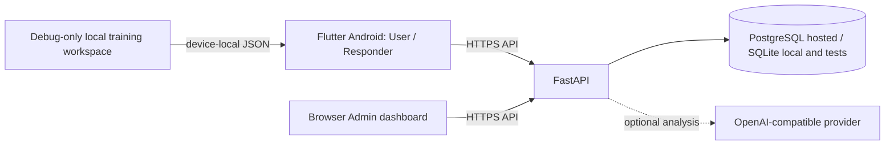

# Emergency Coordination System

Flutter Android client, browser administration dashboard, and FastAPI service for an academic emergency coordination demonstration. The clients share the API and its SQL database for accounts, incidents, assignments, resources, status history, notifications, and audit records. SQLite supports local development and tests; PostgreSQL is required by the production configuration.

> **Demonstration software only. Do not use this system to report or coordinate a real emergency.** It does not contact emergency services or dispatch responders. Priority and assignment recommendations are prototype rules, not validated triage or dispatch policy. For a real emergency, use the emergency number and procedures for your location.

## Current status

- The repository contains source code and a demo APK, but no deployed API, dashboard, production database, or configured AI provider.
- Shared mobile portals require a running API and a configured API origin. The dashboard requires the same API.
- `release/emergency-coordination-system-demo.apk` is an older, debug-key-signed demo build. It does not include all current source changes and is not suitable for store or production distribution.
- Deployment preparation and remaining release gates are documented in [hosting](docs/operations/hosting.md). There is no verified live URL.

## Architecture



AI analysis is disabled by default. Admin Copilot and default incident analysis use fixed, local rules; neither has dispatch authority. The debug training workspace is a separate device-local simulator and does not sync with the API.

## Repository map

| Path | Purpose |
|---|---|
| `lib/`, `android/`, `assets/` | Flutter app, Android integration, and app assets |
| `web/` | Static administration and activation pages |
| `backend/app/`, `backend/migrations/`, `backend/tests/` | FastAPI service, database models/migrations, and tests |
| `backend/compose.yaml`, `backend/Dockerfile` | Local PostgreSQL Compose and API container setup |
| `scripts/`, `vercel.json` | Static web configuration build, Android release wrapper, hosting config |
| `docs/` | Demo, operations, audit, and requirements documentation |
| `.github/workflows/quality.yml` | Backend, Flutter, and JavaScript quality checks |

Flutter and static-web copies of the official logo are both required for their respective asset pipelines. Backend assignment rules and the isolated training simulator also serve distinct API-backed and offline-demo workflows.

## Requirements and versions

- Flutter stable **3.47.7** is pinned by CI. `pubspec.yaml` requires Dart `^3.13.5`.
- Backend development requires Python 3.12 or newer. The Docker image uses Python 3.12; CI currently uses Python 3.13.
- Node.js is needed only for the static web configuration script and its syntax check.
- Android builds require Android SDK/Platform Tools. PostgreSQL Compose additionally requires Docker Compose.

Install Flutter and Android tooling using their official installation guides. The Flutter dependency manifest is `pubspec.yaml`; backend dependencies are in `backend/requirements*.txt`.

## Local backend

From the repository root:

```sh
cd backend
python3 -m venv .venv
source .venv/bin/activate        # Windows: .venv\Scripts\activate
python -m pip install -r requirements-dev.txt
cp .env.example .env
```

Set a private random `JWT_SECRET` of at least 32 characters in `backend/.env`; keep `ENVIRONMENT=development` and the example SQLite `DATABASE_URL`. Never commit `.env`. Initialize the schema and provision the first administrator:

```sh
alembic upgrade head
python -m app.provision_admin --email admin@example.test --display-name 'Operations Admin'
uvicorn app.main:app --reload --host 127.0.0.1 --port 8000
```

The provisioning command prompts for the password; there is no default admin credential. API documentation is at `http://127.0.0.1:8000/docs`. Public registration creates user accounts only. See [backend setup and API notes](backend/README.md).

For local PostgreSQL instead, use the Compose instructions in [backend/README.md](backend/README.md). Production mode requires PostgreSQL, explicit Alembic migrations, HTTPS dashboard origins, and an HTTPS public app origin. Do not use the development seed or SQLite file for production.

To create the documented synthetic SQLite dataset, follow [demo account setup](docs/DEMO_ACCOUNTS.md). Seeding is development-only, opt-in, and refuses non-SQLite databases.

## Run the clients

### Android

With the backend running on the same computer and a USB-connected Android device:

```sh
adb reverse tcp:8000 tcp:8000
flutter pub get
flutter run -d <device-id> --dart-define=API_BASE_URL=http://127.0.0.1:8000
```

The client routes users and responders to the role stored by the server; administrator work is in the browser dashboard. A release build requires a real HTTPS API origin:

```sh
API_BASE_URL=https://<your-api-host> sh scripts/build_android_release.sh
```

The checked-in release APK can be installed with `adb install -r release/emergency-coordination-system-demo.apk`, but it predates current source and is debug-key-signed. Release signing is not configured for production.

The separate local simulator is available only in debug mode when explicitly enabled:

```sh
flutter run -d <device-id> --dart-define=ENABLE_TRAINING_WORKSPACE=true
```

It stores synthetic records in the app's private local JSON file. Its role selector is not authentication and the records never sync to the server.

### Browser dashboard

For a local preview, serve `web/` as static files (for example, `python3 -m http.server 8080 --directory web`) and open `/admin/`. Configure the service URL in the dashboard's development login flow and add the page origin to backend `CORS_ORIGINS`.

For hosted static deployment, set `ECS_API_BASE_URL` to the real API HTTPS origin and build with `node scripts/build_web_config.mjs --required`; output is `web/`. The generated configuration contains only the public API origin, not credentials. Full deployment steps and limits are in [hosting preparation](docs/operations/hosting.md).

## Configuration

Backend settings are loaded from environment variables (locally, `backend/.env`; in deployment, a secret/configuration store). `.env.example` lists the names and development defaults. Core settings are `DATABASE_URL`, `JWT_SECRET`, `ENVIRONMENT`, `CORS_ORIGINS`, `PUBLIC_APP_URL`, `ACCESS_TOKEN_MINUTES`, and `REMEMBER_ME_DAYS`. Compose also uses `POSTGRES_PASSWORD`.

Responder invitation email uses `SMTP_HOST`, `SMTP_PORT`, `SMTP_USERNAME`, `SMTP_PASSWORD`, and `SMTP_FROM`. Optional model-backed incident analysis uses `AI_PROVIDER`, `AI_BASE_URL`, `AI_API_KEY`, `AI_MODEL`, `AI_TIMEOUT_SECONDS`, `AI_MAX_ATTEMPTS`, `AI_RATE_LIMIT_PER_MINUTE`, and `AI_SHARE_INCIDENT_LOCATION`. Recommendation scoring weights are `RECOMMENDATION_DISTANCE_WEIGHT`, `RECOMMENDATION_CAPABILITY_WEIGHT`, and `RECOMMENDATION_WORKLOAD_WEIGHT`. `PORT` is provided to the Docker container by its host.

The mobile app reads compile-time `API_BASE_URL` and `ENABLE_TRAINING_WORKSPACE`; the static web build reads `ECS_API_BASE_URL`. Do not put backend secrets in Flutter build arguments, browser configuration, or committed files.

## Behavior and boundaries

- Incident types are Ambulance / Medical, Fire and Rescue, Police / Security, and Other Emergency. Users may provide foreground GPS or a manual text location; missing GPS is not replaced with simulated coordinates.
- Responder status follows **Assigned → Accepted → En Route → On Scene → Resolved**. Server-side ownership and role checks govern access.
- Authenticated clients refresh data by polling every 12 seconds. Notifications are persisted in-app events; there is no configured push delivery, notification email, WebSocket, or device token service.
- Automatic assignment is disabled by default. When enabled by a Super Admin, the backend checks eligibility, capability, availability, workload, severity ceiling, and fresh accurate GPS; a coordinator still reviews cases that lack an eligible match. Distance is straight-line, not route time.
- AI provider use is opt-in. With the default `AI_PROVIDER=none`, deterministic local analysis is used. The optional compatible provider receives report text; location text is excluded unless explicitly enabled, and GPS coordinates are not sent. Model output is validated and failures fall back to the local baseline. Provider use may incur cost and disclose report text; review privacy and retention before enabling it.
- The prototype's priority scores and recommendations are not clinical or operational guidance. The backend is not yet deployed or approved for real emergency use.

## Checks

Run the same project checks used by CI:

```sh
(cd backend && python -m pytest -q)
dart format --output=none --set-exit-if-changed lib test
flutter analyze
flutter test test/api_client_test.dart test/api_configuration_test.dart test/dispatch_rules_test.dart test/operations_store_test.dart test/widget_test.dart
node --check web/admin/app.js
node --check scripts/build_web_config.mjs
```

Backend tests use SQLite; PostgreSQL integration/concurrency testing is still needed for deployment. See [test results and limitations](docs/audit/test-results.md) and the [requirements traceability matrix](docs/requirements/traceability-matrix.md).

## Further documentation

- [Backend setup, administration, and API behavior](backend/README.md)
- [Synthetic demo accounts](docs/DEMO_ACCOUNTS.md)
- [Hosting and production readiness](docs/operations/hosting.md)
- [Backup and recovery runbook](docs/operations/backup-and-recovery.md)
- [Architecture audit](docs/audit/architecture.md)
- [Known verification limits](docs/audit/test-results.md)
- [Build from this Seagate/exFAT checkout](SETUP.md)
