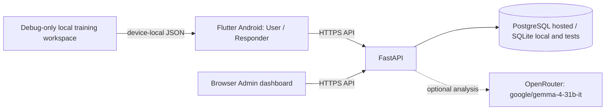

# Emergency Coordination System

Flutter Android client, browser administration dashboard, and FastAPI service for an academic emergency coordination demonstration. The clients share the API and its SQL database for accounts, incidents, assignments, resources, status history, notifications, and audit records. SQLite supports local development and tests; PostgreSQL is required by the production configuration.

> **Demonstration software only. Do not use this system to report or coordinate a real emergency.** It does not contact emergency services or dispatch responders. Priority and assignment recommendations are prototype rules, not validated triage or dispatch policy. For a real emergency, use the emergency number and procedures for your location.

## Current status

- The repository contains source code and a demo APK, but no deployed API, dashboard, production database, or configured AI provider.
- Shared mobile portals require a running API and a configured API origin. The dashboard requires the same API.
- `release/emergency-coordination-system-demo.apk` is an older, debug-key-signed demo build. It does not include all current source changes and is not suitable for store or production distribution.
- Deployment preparation and remaining release gates are documented in [hosting](docs/operations/hosting.md). There is no verified live URL.

The documented target is Vercel for the static site, Render for the FastAPI container, and Supabase PostgreSQL. Provider projects have not been created or connected, so no public URL, remote persistence, or cloud login is verified. The free tiers have inactivity, usage, and backup limitations; see the [deployment guide](docs/operations/hosting.md) before using them.

## Architecture



AI analysis is disabled by default. Admin Copilot and default incident analysis use fixed, local rules; neither has dispatch authority. The debug training workspace is a separate device-local simulator and does not sync with the API.

## Repository map

| Path | Purpose |
|---|---|
| `lib/`, `android/`, `assets/` | Flutter app, Android integration, and app assets |
| `web/` | Static administration and activation pages |
| `backend/app/`, `backend/migrations/`, `backend/tests/` | FastAPI service, database models/migrations, and tests |
| `backend/compose.yaml`, `backend/Dockerfile` | Local PostgreSQL Compose and API container setup |
| `scripts/`, `vercel.json`, `render.yaml` | Web/API hosting configuration and Android release wrapper |
| `docs/` | Demo, operations, audit, and requirements documentation |
| `.github/workflows/quality.yml` | Backend, Flutter, and JavaScript quality checks |

Flutter and static-web copies of the official logo are both required for their respective asset pipelines. Backend assignment rules and the isolated training simulator also serve distinct API-backed and offline-demo workflows.

## Requirements and versions

- Flutter stable **3.47.7** is pinned by CI. `pubspec.yaml` requires Dart `^3.13.5`.
- Backend development requires Python 3.12 or newer. The Docker image uses Python 3.12; CI currently uses Python 3.13.
- Node.js is needed only for the static web configuration script and its syntax check.
- Android builds require Android SDK/Platform Tools. PostgreSQL Compose additionally requires Docker Compose.

Install Flutter and Android tooling using their official installation guides. The Flutter dependency manifest is `pubspec.yaml`; backend dependencies are in `backend/requirements*.txt`.

## Local backend

From the repository root:

```sh
cd backend
python3 -m venv .venv
source .venv/bin/activate        # Windows: .venv\Scripts\activate
python -m pip install -r requirements-dev.txt
cp .env.example .env
```

Set a private random `JWT_SECRET` of at least 32 characters in `backend/.env`; keep `ENVIRONMENT=development` and the example SQLite `DATABASE_URL`. Never commit `.env`. Initialize the schema and provision the first administrator:

```sh
alembic upgrade head
python -m app.provision_admin --email admin@example.org --display-name 'Operations Admin'
uvicorn app.main:app --reload --host 127.0.0.1 --port 8000
```

The provisioning command prompts for the password; there is no default admin credential. API documentation is at `http://127.0.0.1:8000/docs`. Public registration creates user accounts only. See [backend setup and API notes](backend/README.md).

For local PostgreSQL instead, use the Compose instructions in [backend/README.md](backend/README.md). Production mode requires PostgreSQL, explicit Alembic migrations, HTTPS dashboard origins, and an HTTPS public app origin. Do not use the development seed or SQLite file for production.

To create the documented synthetic SQLite dataset, follow [demo account setup](docs/DEMO_ACCOUNTS.md). Seeding is development-only, opt-in, and refuses non-SQLite databases.

## Run the clients

### Android

With the backend running on the same computer and a USB-connected Android device:

```sh
adb reverse tcp:8000 tcp:8000
flutter pub get
flutter run -d <device-id> --dart-define=API_BASE_URL=http://127.0.0.1:8000
```

The client routes users and responders to the role stored by the server; administrator work is in the browser dashboard. A release build requires a real HTTPS API origin:

```sh
# Set API_BASE_URL to the verified HTTPS API origin, and configure
# ANDROID_KEYSTORE_PATH, ANDROID_KEYSTORE_PASSWORD, ANDROID_KEY_ALIAS, and
# ANDROID_KEY_PASSWORD from a protected local secret store before running:
sh scripts/build_android_release.sh
```

The checked-in release APK can be installed with `adb install -r release/emergency-coordination-system-demo.apk`, but it predates current source and is debug-key-signed. The production release wrapper requires a protected release keystore and real HTTPS API URL; signing setup and GitHub artifact distribution are documented in [cloud deployment readiness](docs/operations/hosting.md).

The separate local simulator is available only in debug mode when explicitly enabled:

```sh
flutter run -d <device-id> --dart-define=ENABLE_TRAINING_WORKSPACE=true
```

It stores synthetic records in the app's private local JSON file. Its role selector is not authentication and the records never sync to the server.

### Browser dashboard

For a local preview, serve `web/` as static files (for example, `python3 -m http.server 8080 --directory web`) and open `/admin/`. Configure the service URL in the dashboard's development login flow and add the page origin to backend `CORS_ORIGINS`.

For hosted static deployment, set `ECS_API_BASE_URL` to the real API HTTPS origin and build with `node scripts/build_web_config.mjs --required`; output is `web/`. The generated configuration contains only the public API origin, not credentials. Full deployment steps and limits are in [hosting preparation](docs/operations/hosting.md).

## Configuration

Backend settings are loaded from environment variables (locally, `backend/.env`; in deployment, a secret/configuration store). `.env.example` lists the names and development defaults. Core settings are `DATABASE_URL`, `JWT_SECRET`, `ENVIRONMENT`, `CORS_ORIGINS`, `PUBLIC_APP_URL`, `ACCESS_TOKEN_MINUTES`, and `REMEMBER_ME_DAYS`. Compose also uses `POSTGRES_PASSWORD`.

Responder invitation email uses `SMTP_HOST`, `SMTP_PORT`, `SMTP_USERNAME`, `SMTP_PASSWORD`, and `SMTP_FROM`. Optional Gemma analysis uses `AI_PROVIDER=openrouter` and the server-side `OPENROUTER_API_KEY`. `OPENROUTER_BASE_URL` defaults to `https://openrouter.ai/api/v1`; `OPENROUTER_MODEL` defaults to `google/gemma-4-31b-it`. `AI_TIMEOUT_SECONDS`, `AI_MAX_ATTEMPTS`, `AI_RATE_LIMIT_PER_MINUTE`, and `AI_SHARE_INCIDENT_LOCATION` configure requests and data sharing. Legacy `AI_BASE_URL`, `AI_API_KEY`, and `AI_MODEL` are retained only for the generic-compatible adapter. Recommendation scoring weights are `RECOMMENDATION_DISTANCE_WEIGHT`, `RECOMMENDATION_CAPABILITY_WEIGHT`, and `RECOMMENDATION_WORKLOAD_WEIGHT`. `PORT` is provided to the Docker container by its host.

The mobile app reads compile-time `API_BASE_URL` and `ENABLE_TRAINING_WORKSPACE`; the static web build reads `ECS_API_BASE_URL`. Do not put backend secrets in Flutter build arguments, browser configuration, or committed files.

## Behavior and boundaries

- Incident types are Ambulance / Medical, Fire and Rescue, Police / Security, and Other Emergency. Users may provide foreground GPS or a manual text location; missing GPS is not replaced with simulated coordinates.
- The incident and its `incident_analyses` pending-work record are committed together. A database-backed worker processes analysis and recovers stale processing rows after five minutes, with at most three process attempts before marking the analysis unavailable. The worker runs in the API process (not a separate durable queue service); automatic assignment itself is evaluated and persisted transactionally during incident submission.
- Responder status follows **Assigned → Accepted → En Route → On Scene → Resolved**. Server-side ownership and role checks govern access.
- Authenticated clients refresh data by polling every 12 seconds. Notifications are persisted in-app events; there is no configured push delivery, notification email, WebSocket, or device token service.
- Automatic assignment is disabled by default. When enabled by a Super Admin, the backend checks eligibility, capability, availability, workload, severity ceiling, and fresh accurate GPS; a coordinator still reviews cases that lack an eligible match. Distance is straight-line, not route time.
- OpenRouter use is opt-in and disabled by default. When enabled, the server sends report category, description, severity, and urgency to Gemma; coordinates are not sent, and location text is excluded unless `AI_SHARE_INCIDENT_LOCATION=true`. The API requests strict JSON schema output; the backend independently validates content and falls back to deterministic analysis on provider failure. Model output does not control dispatch. The exact model ID is listed in OpenRouter's public catalog, but this repository has no API key, so account-specific access and live inference remain unverified. Current standard model pricing is listed around $0.09/M input and $0.34/M output tokens; the `:free` variant is a different ID and is not silently selected. Prices can change. See [model details and pricing](https://openrouter.ai/google/gemma-4-31b-it) and [structured output documentation](https://openrouter.ai/docs/features/structured-outputs).
- The prototype's priority scores and recommendations are not clinical or operational guidance. The backend is not yet deployed or approved for real emergency use.

## Roles, incident lifecycle, and API

- **User:** register a normal account, submit an incident with a required `Idempotency-Key`, follow only their own incident state, and read in-app updates.
- **Responder:** account is created by administrator invitation and activated by the responder. Responders see only their assignments, may share foreground location, and advance allowed statuses.
- **Super Admin:** provision the first account with the password-prompting CLI, invite responders, create scoped Co-Admins, manage resources, assign/reassign, review audit history, and optionally enable automatic assignment.
- **Co-Admin:** permissions are stored and checked by the backend per request; a client-supplied role is never authorization.

Incident lifecycle: **Unassigned → Assigned → Accepted → En Route → On Scene → Resolved**. Coordinators can cancel eligible incidents; status transitions are persisted with history and in-app events. Automatic assignment runs transactionally during incident submission only when policy, severity, and authoritative responder constraints pass. Model analysis runs separately and cannot select or reserve a responder.

The main API groups are `/auth/*`, `/user/incidents`, `/incidents/*`, `/notifications`, `/responder/*`, and `/admin/*`. The running backend's OpenAPI reference is `/docs`; route authorization and request schemas are in `backend/app/api.py` and `backend/app/schemas.py`. Notification records track creation and read state; they do not imply external push/email delivery.

## Secrets and environment reference

| Variable | Consumer | Secret? / use |
|---|---|---|
| `DATABASE_URL`, `JWT_SECRET` | Backend | Yes; database credential and token signing secret |
| `ENVIRONMENT`, `CORS_ORIGINS`, `PUBLIC_APP_URL`, `ACCESS_TOKEN_MINUTES`, `REMEMBER_ME_DAYS` | Backend | Configuration; exact HTTPS origins in production |
| `SMTP_HOST`, `SMTP_PORT`, `SMTP_USERNAME`, `SMTP_PASSWORD`, `SMTP_FROM` | Invitation email | Credentials are secret; unset means no production email delivery |
| `AI_PROVIDER`, `OPENROUTER_API_KEY`, `OPENROUTER_MODEL`, `OPENROUTER_BASE_URL`, `AI_TIMEOUT_SECONDS`, `AI_MAX_ATTEMPTS`, `AI_RATE_LIMIT_PER_MINUTE`, `AI_SHARE_INCIDENT_LOCATION` | Backend analysis | API key is secret; AI stays off unless `AI_PROVIDER=openrouter` |
| `AI_BASE_URL`, `AI_API_KEY`, `AI_MODEL` | Legacy compatible model adapter | Keep the key server-side; use OpenRouter settings for Gemma |
| `RECOMMENDATION_DISTANCE_WEIGHT`, `RECOMMENDATION_CAPABILITY_WEIGHT`, `RECOMMENDATION_WORKLOAD_WEIGHT` | Backend recommendations | Prototype scoring settings |
| `POSTGRES_PASSWORD` | Local Compose | Secret; choose a unique local value |
| `ECS_API_BASE_URL` | Static web build | Public API origin, not a secret |
| `API_BASE_URL` | Flutter build / GitHub Actions variable | Public HTTPS API origin, not a secret |
| `ANDROID_KEYSTORE_BASE64`, `ANDROID_KEYSTORE_PASSWORD`, `ANDROID_KEY_ALIAS`, `ANDROID_KEY_PASSWORD` | GitHub Actions | Private signing material; configure as repository secrets |
| `PORT` | Container host | Runtime-provided port |

Rotate credentials in the issuing service and its secret store, then restart/redeploy the backend. Never put secrets in `.env.example`, browser configuration, APKs, command history, or Git. Production DB recovery instructions are in [backup and recovery](docs/operations/backup-and-recovery.md).

## Troubleshooting

- **Sign-in says the API is unavailable:** check the actual API origin, `/health/ready`, and whether the dashboard's exact origin is allowed by `CORS_ORIGINS`.
- **Release build rejects the API origin:** release builds require HTTPS; loopback HTTP is only allowed for debug. Release builds also require all four Android signing settings above.
- **Gemma analysis falls back to rules:** check `AI_PROVIDER=openrouter`, the private backend key, model access on the account, and provider usage limits. Incident intake still persists; admins can inspect analysis state and safe failure category.
- **Responder invitation is not emailed:** configure an approved email provider. Render Free blocks common SMTP ports 25, 465, and 587.
- **Analysis is unavailable after interrupted work:** the API worker recovers stale processing after five minutes and stops after three interrupted attempts. An authorized administrator can request a retry; the worker runs in the API process and does not provide independent queue scaling.

## Deployment and release status

Deployment templates and CI workflow are in the repository, but no hosting projects, live URLs, production database, OpenRouter key, or production Android signer are configured here. GitHub Actions and hosted deployment were not verified for this change. CI builds a signed APK only after the API variable and signing secrets are configured; artifact download and installation are manual. See [hosting and operational setup](docs/operations/hosting.md) for provider limits, startup migrations, costs, and remaining owner actions.

## Checks

Run the same project checks used by CI:

```sh
(cd backend && python -m pytest -q)
dart format --output=none --set-exit-if-changed lib test
flutter analyze
flutter test test/api_client_test.dart test/api_configuration_test.dart test/dispatch_rules_test.dart test/operations_store_test.dart test/widget_test.dart
node --check web/admin/app.js
node --check scripts/build_web_config.mjs
```

Backend tests use SQLite; PostgreSQL integration/concurrency testing is still needed for deployment. See [test results and limitations](docs/audit/test-results.md) and the [requirements traceability matrix](docs/requirements/traceability-matrix.md).

The `Quality checks` workflow also validates the static configuration build. After `API_BASE_URL` and the Android signing secrets are configured in GitHub, it builds a signed APK after CI passes on `main`; qualifying builds are retained as 30-day Actions artifacts. A `v*` tag publishes a deliberate GitHub Release. Vercel Git integration and Render's Git-connected Blueprint still require owner account setup.

## Further documentation

- [Backend setup, administration, and API behavior](backend/README.md)
- [Synthetic demo accounts](docs/DEMO_ACCOUNTS.md)
- [Hosting and production readiness](docs/operations/hosting.md)
- [Backup and recovery runbook](docs/operations/backup-and-recovery.md)
- [Architecture audit](docs/audit/architecture.md)
- [Known verification limits](docs/audit/test-results.md)
- [CI/CD status](docs/CI_CD_AUDIT.md)
- [Build from this Seagate/exFAT checkout](SETUP.md)
