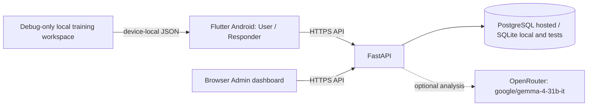
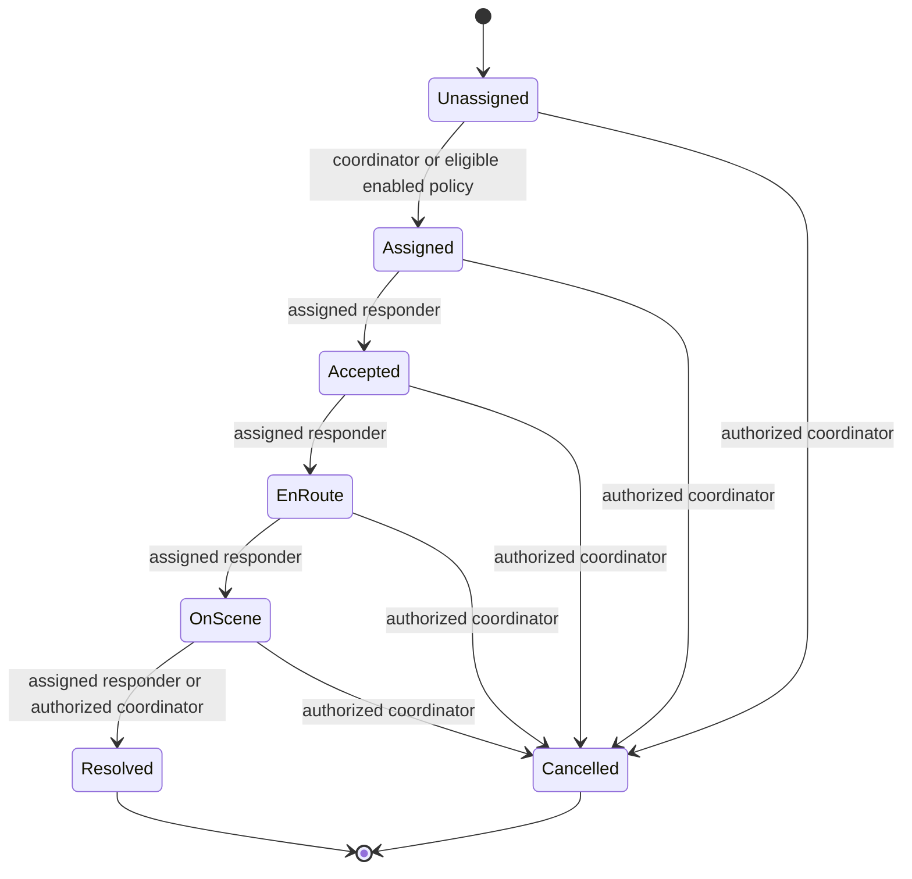
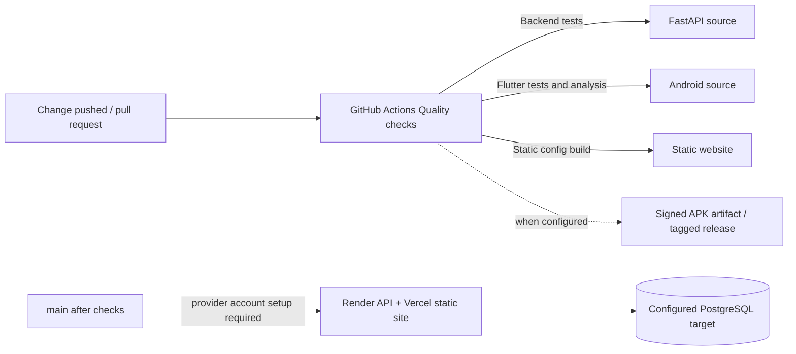
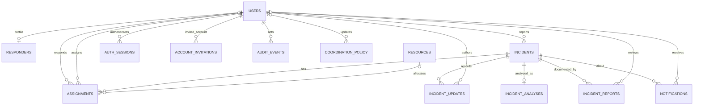

# Emergency Coordination System

Flutter Android client, browser administration dashboard, and FastAPI service for an academic emergency coordination demonstration. The clients share the API and its SQL database for accounts, incidents, assignments, resources, status history, notifications, and audit records. SQLite supports local development and tests; PostgreSQL is required by the production configuration.

> **Demonstration software only. Do not use this system to report or coordinate a real emergency.** It does not contact emergency services or dispatch responders. Priority and assignment recommendations are prototype rules, not validated triage or dispatch policy. For a real emergency, use the emergency number and procedures for your location.

## Current status

- The repository contains source code and a demo APK, but no deployed API, dashboard, or production database. AI defaults to `AI_PROVIDER=none`; no hosted provider configuration or live inference has been verified.
- Shared mobile portals require a running API and a configured API origin. The dashboard requires the same API.
- `release/emergency-coordination-system-demo.apk` is an older, debug-key-signed demo build. It does not include all current source changes and is not suitable for store or production distribution.
- Deployment preparation and remaining release gates are documented in [hosting](docs/operations/hosting.md). There is no verified live URL.

The documented target is Vercel for the static site, Render for the FastAPI container, and Supabase PostgreSQL. Provider projects have not been created or connected, so no public URL, remote persistence, or cloud login is verified. The free tiers have inactivity, usage, and backup limitations; see the [deployment guide](docs/operations/hosting.md) before using them.

## Architecture



AI analysis is disabled by default. Admin Copilot and default incident analysis use fixed, local rules; neither has dispatch authority. The debug training workspace is a separate device-local simulator and does not sync with the API.

## Repository map

| Path | Purpose |
|---|---|
| `lib/`, `android/`, `assets/` | Flutter app, Android integration, and app assets |
| `web/` | Static administration and activation pages |
| `backend/app/`, `backend/migrations/`, `backend/tests/` | FastAPI service, database models/migrations, and tests |
| `backend/compose.yaml`, `backend/Dockerfile` | Local PostgreSQL Compose and API container setup |
| `scripts/`, `vercel.json`, `render.yaml` | Web/API hosting configuration and Android release wrapper |
| `docs/` | Demo, operations, audit, and requirements documentation |
| `.github/workflows/quality.yml` | Backend, Flutter, and JavaScript quality checks |

Flutter and static-web copies of the official logo are both required for their respective asset pipelines. Backend assignment rules and the isolated training simulator also serve distinct API-backed and offline-demo workflows.

## Technology stack

| Component | Verified implementation |
|---|---|
| Android client | Flutter/Dart; `http`, `geolocator`, `flutter_secure_storage`, and `flutter_svg` dependencies (`pubspec.yaml`). |
| Web dashboard and activation | Static HTML, CSS, and browser JavaScript in `web/`; no npm frontend package or bundler. |
| Backend API | Python 3.12 container; FastAPI, Pydantic settings/schemas, SQLAlchemy, Alembic, Uvicorn, and PyJWT. Password hashing uses `pwdlib[argon2]`. |
| Persistence | SQLAlchemy-supported SQLite for development/test; PostgreSQL via `psycopg` for production configuration. |
| Optional model gateway | OpenRouter chat completions from backend-only Python `httpx`; model default is `google/gemma-4-31b-it`. Disabled unless configured. |
| Tests and automation | Pytest, Flutter test/analyze, Node built-in syntax/helper tests, and GitHub Actions. |
| Hosting templates | Vercel static output and Render Docker service configuration are present; no provider project is connected. |

The repository does not bundle a map/routing SDK, push notification SDK/service, frontend chart library, or external emergency-dispatch integration.

## Requirements and versions

- Flutter stable **3.47.7** is pinned by CI. `pubspec.yaml` requires Dart `^3.13.5`.
- Backend development requires Python 3.12 or newer. The Docker image uses Python 3.12; CI currently uses Python 3.13.
- Node.js is needed only for the static web configuration script and its syntax check.
- Android builds require Android SDK/Platform Tools. PostgreSQL Compose additionally requires Docker Compose.

Install Flutter and Android tooling using their official installation guides. The Flutter dependency manifest is `pubspec.yaml`; backend dependencies are in `backend/requirements*.txt`.

## Local backend

From the repository root:

```sh
cd backend
python3 -m venv .venv
source .venv/bin/activate        # Windows: .venv\Scripts\activate
python -m pip install -r requirements-dev.txt
cp .env.example .env
```

Set a private random `JWT_SECRET` of at least 32 characters in `backend/.env`; keep `ENVIRONMENT=development` and the example SQLite `DATABASE_URL`. Never commit `.env`. Initialize the schema and provision the first administrator:

```sh
alembic upgrade head
python -m app.provision_admin --email admin@example.org --display-name 'Operations Admin'
uvicorn app.main:app --reload --host 127.0.0.1 --port 8000
```

The provisioning command prompts for the password; there is no default admin credential. API documentation is at `http://127.0.0.1:8000/docs`. Public registration creates user accounts only. See [backend setup and API notes](backend/README.md).

For local PostgreSQL instead, use the Compose instructions in [backend/README.md](backend/README.md). Production mode requires PostgreSQL, explicit Alembic migrations, HTTPS dashboard origins, and an HTTPS public app origin. Do not use the development seed or SQLite file for production.

To create the documented synthetic SQLite dataset, follow [demo account setup](docs/DEMO_ACCOUNTS.md). Seeding is development-only, opt-in, and refuses non-SQLite databases.

## Run the clients

### Android

The mobile app uses the same warm neutral surfaces, near-black primary actions,
yellow highlight, sage availability/status accents, and rounded white cards as
the finalized website. The shared tokens and Material components live in
`lib/presentation/design_system.dart`; the phone keeps role-based user and
responder flows with bottom navigation and vertically scrolling content rather
than reproducing the website sidebar. The login, onboarding, remembered-session,
and backend role-routing behavior are unchanged.

With the backend running on the same computer and a USB-connected Android device:

```sh
adb reverse tcp:8000 tcp:8000
flutter pub get
flutter run -d <device-id> --dart-define=API_BASE_URL=http://127.0.0.1:8000
```

The client routes users and responders to the role stored by the server; administrator work is in the browser dashboard. A release build requires a real HTTPS API origin:

```sh
# Set API_BASE_URL to the verified HTTPS API origin, and configure
# ANDROID_KEYSTORE_PATH, ANDROID_KEYSTORE_PASSWORD, ANDROID_KEY_ALIAS, and
# ANDROID_KEY_PASSWORD from a protected local secret store before running:
sh scripts/build_android_release.sh
```

The checked-in release APK can be installed with `adb install -r release/emergency-coordination-system-demo.apk`, but it predates current source and is debug-key-signed. The production release wrapper requires a protected release keystore and real HTTPS API URL; signing setup and GitHub artifact distribution are documented in [cloud deployment readiness](docs/operations/hosting.md).

The separate local simulator is available only in debug mode when explicitly enabled:

```sh
flutter run -d <device-id> --dart-define=ENABLE_TRAINING_WORKSPACE=true
```

It stores synthetic records in the app's private local JSON file. Its role selector is not authentication and the records never sync to the server.

### Browser dashboard

For a local preview, serve `web/` as static files (for example, `python3 -m http.server 8080 --directory web`) and open `/admin/`. Configure the service URL in the dashboard's development login flow and add the page origin to backend `CORS_ORIGINS`.

The dashboard is plain HTML, CSS, and JavaScript; there is no frontend bundler or chart dependency. Its website-only operations overview uses a full-width warm-neutral workspace, a persistent rounded desktop sidebar, dark selected navigation and actions, a chartreuse highlight, four compact KPI cards, and a seven-stage incident lifecycle. Three lower panels show priority incidents, persisted AI analysis state and responder workload, and items requiring coordinator attention. At tablet widths the panels reflow to two columns; at phone widths they stack and the sidebar becomes a menu. A notification shortcut shows the authenticated administrator's unread in-app records. A local account whose email begins with `demo.` receives a visible synthetic-data banner. No sample incidents are inserted into production views.

Dashboard data comes from the authenticated `/admin/dashboard`, `/admin/analytics?days=7`, `/incidents`, `/admin/responders`, `/notifications`, and (for accounts with audit permission) `/admin/audit` endpoints. Pipeline values are counts of incidents created in the selected seven-day window, grouped by their persisted incident status; selecting a stage opens the incident queue with that status filter. Priority and assignment actions use the existing authorized detail and assignment flows. Responder workload uses persisted assignments in the selected seven-day window, while availability is a current account-state snapshot. AI counts are based only on persisted incident-analysis metadata; they do not imply the provider is currently available or that AI dispatched a responder. Detailed reports retain the interactive SVG incident trend and category donut, status drill-downs, period selection, and authorized export. Empty or missing data is displayed as zero or an explicit empty state, never as invented operational data.

The shared shell and visual system apply to the existing login, overview, incident queue/detail dialog, responder directory, users, resources, reports, audit history, notifications, automation policy, and Super Admin co-admin views. Existing forms, permission checks, dialogs, and server actions remain in `web/admin/app.js`; dashboard presentation and analytics helpers load from `web/admin/redesign.css` and `web/admin/redesign.js`. Layouts reflow for narrow website viewports and retain horizontal scrolling for dense data tables. Keyboard focus rings, labelled filters, text status labels, chart summaries, keyboard-operable donut segments, and reduced-motion styles are included. Browser-based 1200 × 900 screenshot comparison, contrast, and screen-reader audits have not been run in this environment; do not treat this as a pixel-verified recreation.

Analytics definitions: assignment delay measures time from incident creation to each persisted assignment record (reassignments may add samples); assignment-to-completion measures time from assignment to a closed assignment record and is not travel or arrival time. Resource allocation on the analytics endpoint is a current snapshot, not a historical series. Responder availability is a current account-state snapshot and does not by itself indicate eligibility for a particular incident. Browser-only helper tests run with `node --test web/admin/analytics.test.cjs`.

For hosted static deployment, set `ECS_API_BASE_URL` to the real API HTTPS origin and build with `node scripts/build_web_config.mjs --required`; output is `web/`. The generated configuration contains only the public API origin, not credentials. Full deployment steps and limits are in [hosting preparation](docs/operations/hosting.md).

## Configuration

Backend settings are loaded from environment variables (locally, `backend/.env`; in deployment, a secret/configuration store). `.env.example` lists the names and development defaults. Core settings are `DATABASE_URL`, `JWT_SECRET`, `ENVIRONMENT`, `CORS_ORIGINS`, `PUBLIC_APP_URL`, `ACCESS_TOKEN_MINUTES`, and `REMEMBER_ME_DAYS`. Compose also uses `POSTGRES_PASSWORD`.

Responder invitation email uses `SMTP_HOST`, `SMTP_PORT`, `SMTP_USERNAME`, `SMTP_PASSWORD`, and `SMTP_FROM`. Optional Gemma analysis uses `AI_PROVIDER=openrouter` and the server-side `OPENROUTER_API_KEY`. `OPENROUTER_BASE_URL` defaults to `https://openrouter.ai/api/v1`; `OPENROUTER_MODEL` defaults to `google/gemma-4-31b-it`. `AI_TIMEOUT_SECONDS`, `AI_MAX_ATTEMPTS`, `AI_RATE_LIMIT_PER_MINUTE`, and `AI_SHARE_INCIDENT_LOCATION` configure requests and data sharing. Legacy `AI_BASE_URL`, `AI_API_KEY`, and `AI_MODEL` are retained only for the generic-compatible adapter. Recommendation scoring weights are `RECOMMENDATION_DISTANCE_WEIGHT`, `RECOMMENDATION_CAPABILITY_WEIGHT`, and `RECOMMENDATION_WORKLOAD_WEIGHT`. `PORT` is provided to the Docker container by its host.

The mobile app reads compile-time `API_BASE_URL` and `ENABLE_TRAINING_WORKSPACE`; the static web build reads `ECS_API_BASE_URL`. Do not put backend secrets in Flutter build arguments, browser configuration, or committed files.

## Behavior and boundaries

- Incident types are Ambulance / Medical, Fire and Rescue, Police / Security, and Other Emergency. Users may provide foreground GPS or a manual text location; missing GPS is not replaced with simulated coordinates.
- The incident and its `incident_analyses` pending-work record are committed together. A database-backed worker processes analysis and recovers stale processing rows after five minutes, with at most three process attempts before marking the analysis unavailable. The worker runs in the API process (not a separate durable queue service); automatic assignment itself is evaluated and persisted transactionally during incident submission.
- Responder status follows **Assigned → Accepted → En Route → On Scene → Resolved**. Server-side ownership and role checks govern access.
- Authenticated clients refresh data by polling every 12 seconds. Notifications are persisted in-app events; there is no configured push delivery, notification email, WebSocket, or device token service.
- Automatic assignment is disabled by default. When enabled by a Super Admin, the backend checks eligibility, capability, availability, workload, severity ceiling, and fresh accurate GPS; a coordinator still reviews cases that lack an eligible match. Distance is straight-line, not route time.
- OpenRouter use is opt-in and disabled by default. When enabled, the server sends report category, description, severity, and urgency to Gemma; coordinates are not sent, and location text is excluded unless `AI_SHARE_INCIDENT_LOCATION=true`. The API requests strict JSON schema output; the backend independently validates content and falls back to deterministic analysis on provider failure. Model output does not control dispatch. No account-specific access or live inference was verified. At the 2026-10-24 documentation check, OpenRouter listed standard pricing around $0.09/M input and $0.34/M output tokens; the `:free` variant is a different ID and is not silently selected. Prices can change. See [model details and pricing](https://openrouter.ai/google/gemma-4-31b-it) and [structured output documentation](https://openrouter.ai/docs/features/structured-outputs).
- The prototype's priority scores and recommendations are not clinical or operational guidance. The backend is not yet deployed or approved for real emergency use.

## Roles, incident lifecycle, and API

- **User:** register a normal account, submit an incident with a required `Idempotency-Key`, follow only their own incident state, and read in-app updates.
- **Responder:** account is created by administrator invitation and activated by the responder. Responders see only their assignments, may share foreground location, and advance allowed statuses.
- **Super Admin:** provision the first account with the password-prompting CLI, invite responders, create scoped Co-Admins, manage resources, assign/reassign, review audit history, and optionally enable automatic assignment.
- **Co-Admin:** permissions are stored and checked by the backend per request; a client-supplied role is never authorization.

Incident lifecycle: **Unassigned → Assigned → Accepted → En Route → On Scene → Resolved**. Coordinators can cancel eligible incidents; status transitions are persisted with history and in-app events. Automatic assignment runs transactionally during incident submission only when policy, severity, and authoritative responder constraints pass. Model analysis runs separately and cannot select or reserve a responder.

The main API groups are `/auth/*`, `/user/incidents`, `/incidents/*`, `/notifications`, `/responder/*`, and `/admin/*`. The running backend's OpenAPI reference is `/docs`; route authorization and request schemas are in `backend/app/api.py` and `backend/app/schemas.py`. Notification records track creation and read state; they do not imply external push/email delivery.

## Conversational intake, responder notes, and resolution reports

- Incident submission still persists the original report and evaluates configured deterministic dispatch immediately. The mobile client then offers up to three short, category-specific follow-up questions. They are optional, can be skipped, and accept `unknown`; answers are saved in `incidents.intake_data` and as timestamped `incident_updates`. They do not delay assignment. Location is collected in the existing SOS form; permission denial falls back to manually entered location.
- The follow-up prompts currently use backend category rules. Optional Gemma analysis separately returns validated missing-information suggestions, visible to authorized reviewers; those suggestions do not dynamically author questions yet. Submitted answers are explicitly marked user-reported.
- Responders can ask the backend for a rewrite draft from their assigned incident. The app displays an editable review step before submission. When a validated model draft is accepted, the update stores both `original_message` and final `message`, with `ai_assisted=true`; status changes remain a separate authenticated API operation. Provider errors, invalid drafts, or unconfigured AI return the original wording. No live model response is assumed.
- On a transition to `Resolved`, the backend persists one versioned, deterministic evidence-template report in `incident_reports` within the resolution transaction. The report contains the original description, recorded update timeline, assignment records, source record IDs, and limitations. This implementation always states that cause was not established; it does not extract a cause from notes. It is not an independent investigation. A report-available in-app notification is queued idempotently for the reporter and authorized coordinators.
- Users and assigned responders may read their incident report through `GET /incidents/{id}/report`. Admins with `update_incidents` may add a review note through `POST /admin/incidents/{id}/report/review`; this marks the report reviewed while preserving its generated version. The admin dashboard displays intake answers, original/accepted responder notes, and generated reports in incident details.
- Intake endpoints are `GET /incidents/{id}/intake` and `POST /incidents/{id}/intake/answers`. Responder writing uses `POST /responder/incidents/{id}/rewrite`, and accepted notes use the existing `POST /incidents/{id}/updates` endpoint with optional original/AI metadata. Resolution reports are generated from persisted data, not by Gemma.
- Notification wording remains deterministic and notifications remain in-app only. AI-generated message variants, push/email delivery, report content editing/annotations, PDF export, and a separately recoverable report-generation queue are not implemented. Report generation is synchronous and deterministic so it does not rely on the model.
- Migration `c2a71d0e48bf` adds structured intake storage, responder-note provenance, and versioned report records. Apply it with the documented Alembic upgrade command before starting an existing deployment.

The provider key must be a newly rotated secret stored only in the backend environment. A credential-shaped value was found in the local `.env.example` edit and replaced with a placeholder; rotate that credential at OpenRouter before enabling inference. The repository does not verify account-specific access or live inference.

## Secrets and environment reference

| Variable | Consumer | Secret? / use |
|---|---|---|
| `DATABASE_URL`, `JWT_SECRET` | Backend | Yes; database credential and token signing secret |
| `ENVIRONMENT`, `CORS_ORIGINS`, `PUBLIC_APP_URL`, `ACCESS_TOKEN_MINUTES`, `REMEMBER_ME_DAYS` | Backend | Configuration; exact HTTPS origins in production |
| `SMTP_HOST`, `SMTP_PORT`, `SMTP_USERNAME`, `SMTP_PASSWORD`, `SMTP_FROM` | Invitation email | Credentials are secret; unset means no production email delivery |
| `AI_PROVIDER`, `OPENROUTER_API_KEY`, `OPENROUTER_MODEL`, `OPENROUTER_BASE_URL`, `AI_TIMEOUT_SECONDS`, `AI_MAX_ATTEMPTS`, `AI_RATE_LIMIT_PER_MINUTE`, `AI_SHARE_INCIDENT_LOCATION` | Backend analysis | API key is secret; AI stays off unless `AI_PROVIDER=openrouter` |
| `AI_BASE_URL`, `AI_API_KEY`, `AI_MODEL` | Legacy compatible model adapter | Keep the key server-side; use OpenRouter settings for Gemma |
| `RECOMMENDATION_DISTANCE_WEIGHT`, `RECOMMENDATION_CAPABILITY_WEIGHT`, `RECOMMENDATION_WORKLOAD_WEIGHT` | Backend recommendations | Prototype scoring settings |
| `POSTGRES_PASSWORD` | Local Compose | Secret; choose a unique local value |
| `ECS_API_BASE_URL` | Static web build | Public API origin, not a secret |
| `API_BASE_URL` | Flutter build / GitHub Actions variable | Public HTTPS API origin, not a secret |
| `ANDROID_KEYSTORE_BASE64`, `ANDROID_KEYSTORE_PASSWORD`, `ANDROID_KEY_ALIAS`, `ANDROID_KEY_PASSWORD` | GitHub Actions | Private signing material; configure as repository secrets |
| `PORT` | Container host | Runtime-provided port |

Rotate credentials in the issuing service and its secret store, then restart/redeploy the backend. Never put secrets in `.env.example`, browser configuration, APKs, command history, or Git. Production DB recovery instructions are in [backup and recovery](docs/operations/backup-and-recovery.md).

## Troubleshooting

- **Sign-in says the API is unavailable:** check the actual API origin, `/health/ready`, and whether the dashboard's exact origin is allowed by `CORS_ORIGINS`.
- **Release build rejects the API origin:** release builds require HTTPS; loopback HTTP is only allowed for debug. Release builds also require all four Android signing settings above.
- **Gemma analysis falls back to rules:** check `AI_PROVIDER=openrouter`, the private backend key, model access on the account, and provider usage limits. Incident intake still persists; admins can inspect analysis state and safe failure category.
- **Responder invitation is not emailed:** configure an approved email provider. Render Free blocks common SMTP ports 25, 465, and 587.
- **Analysis is unavailable after interrupted work:** the API worker recovers stale processing after five minutes and stops after three interrupted attempts. An authorized administrator can request a retry; the worker runs in the API process and does not provide independent queue scaling.

## Deployment and release status

Deployment templates and CI workflow are in the repository, but no hosting projects, live URLs, production database, OpenRouter key, or production Android signer are configured here. GitHub Actions and hosted deployment were not verified for this change. CI builds a signed APK only after the API variable and signing secrets are configured; artifact download and installation are manual. See [hosting and operational setup](docs/operations/hosting.md) for provider limits, startup migrations, costs, and remaining owner actions.

## Checks

Run the same project checks used by CI:

```sh
(cd backend && python -m pytest -q)
dart format --output=none --set-exit-if-changed lib test
flutter analyze
flutter test test/api_client_test.dart test/api_configuration_test.dart test/dispatch_rules_test.dart test/operations_store_test.dart test/widget_test.dart
node --check web/admin/app.js
node --check web/admin/redesign.js
node --test web/admin/analytics.test.cjs
node --check scripts/build_web_config.mjs
```

Backend tests use SQLite; PostgreSQL integration/concurrency testing is still needed for deployment. See [test results and limitations](docs/audit/test-results.md) and the [requirements traceability matrix](docs/requirements/traceability-matrix.md).

For the mobile visual update on 2026-10-24, `dart format --output=none --set-exit-if-changed lib test`, `flutter analyze`, and the explicit Flutter test command above passed (31 tests). A debug APK built from a clean temporary source copy, installed, and launched on a connected Android 16 phone. The inspected screenshot showed the direct login screen with the new theme. Authenticated dashboard flows were not checked on-device because that build had no configured API origin/session. An unrestricted `flutter test` attempt is not recommended on this mounted checkout: macOS AppleDouble `._*.dart` sidecars caused Flutter's discovery process to crash; the explicit test list is the same one configured in CI.

The `Quality checks` workflow also validates the static configuration build. After `API_BASE_URL` and the Android signing secrets are configured in GitHub, it builds a signed APK after CI passes on `main`; qualifying builds are retained as 30-day Actions artifacts. A `v*` tag publishes a deliberate GitHub Release. Vercel Git integration and Render's Git-connected Blueprint still require owner account setup.

## Further documentation

- [Backend setup, administration, and API behavior](backend/README.md)
- [Synthetic demo accounts](docs/DEMO_ACCOUNTS.md)
- [Hosting and production readiness](docs/operations/hosting.md)
- [Backup and recovery runbook](docs/operations/backup-and-recovery.md)
- [Architecture audit](docs/audit/architecture.md)
- [Known verification limits](docs/audit/test-results.md)
- [CI/CD status](docs/CI_CD_AUDIT.md)
- [Build from this Seagate/exFAT checkout](SETUP.md)

## Feature inventory and verification boundaries

| Subsystem | Implementation in this repository | Verification boundary |
|---|---|---|
| Authentication | FastAPI login, registration, invitation acceptance, role lookup, refresh rotation, logout revocation; Flutter secure-storage client | API and Flutter tests cover session behavior. Hosted authentication is not configured. |
| User incident reporting | Authenticated Flutter SOS form submits category, description, location source, and an idempotency key; API validates and persists the incident | Workflow/API tests cover persistence and validation. No emergency agency is contacted. |
| Assignment | Deterministic server eligibility checks and optional policy-controlled assignment; administrator can assign/reassign | SQLite tests cover core rules. PostgreSQL multi-process concurrency has not been verified. |
| AI analysis | Optional OpenRouter adapter requests structured Gemma output, validates it against report evidence, stores analysis separately, and falls back to deterministic rules | Mocked provider tests exist. Account-specific access and live inference are unverified. |
| Follow-up intake | Mobile displays optional category-based follow-up questions and stores user-provided answers | UI/API tests cover the implemented flow. Questions are not dynamically generated by Gemma. |
| Responder workflow | Authenticated assigned-case view, allowed status changes, location update, editable AI-assisted note draft | Automated tests cover existing client/API paths. Live role workflow on a deployed service is unverified. |
| Notifications | Persistent, account-scoped in-app records, read state, and idempotent event keys | Database/API tests cover records and authorization. Push, WebSocket, and notification email delivery are not implemented. |
| Administration | Static web dashboard plus permission-checked API for incidents, responders, resources, users, automation, reports, invitations, audit, and co-admins | JS helper and backend tests exist. There is no connected production host. |
| Resolution report | Synchronous evidence-template report is stored on resolution with source record IDs and review fields | Backend tests cover implementation. It is not an investigation or verified cause analysis. |
| Analytics | API-backed counts and persisted-record time series/status/resource summaries; dashboard charts and filters | Analytics helper tests pass. Metrics describe recorded data, not forecasts or response guarantees. |

The Android client uses the same warm-neutral, near-black, chartreuse, and sage visual tokens as the website in `lib/presentation/design_system.dart`. It retains phone-appropriate bottom navigation and vertical scrolling. The browser application is static HTML/CSS/JavaScript (`web/admin/`); the service is FastAPI (`backend/app/`).

## System workflows

### Incident submission and processing

```mermaid
sequenceDiagram
  actor Caller
  participant App as Flutter client
  participant API as FastAPI /api/v1
  participant DB as SQL database
  participant AI as Optional OpenRouter
  Caller->>App: Submit emergency report
  App->>API: POST /user/incidents + bearer token + Idempotency-Key
  API->>API: Authenticate, authorize, validate fields and GPS freshness
  API->>DB: Transaction: incident + pending analysis + optional policy-based assignment + in-app events
  DB-->>API: Commit
  API-->>App: Persisted incident response
  API-)API: FastAPI background analysis task
  API->>AI: Optional minimal report fields; no coordinates
  AI-->>API: Structured decision-support result
  API->>DB: Validate evidence and persist result or safe fallback
  Note over API,DB: Database recovery worker reclaims pending/stale analysis records after restart
```

The request path persists first; AI success is not required for an incident to be recorded. Automatic assignment is a deterministic backend decision in the incident transaction and is disabled by default. If enabled, the backend checks severity policy, active account, availability, required capability, active workload, and recent accurate GPS for both parties. A model response cannot choose an assignment. If no eligible candidate exists, the incident remains available for coordinator review. GPS distance is straight-line distance only.

### Status, notification, and report flow



Status changes, assignment changes, incident updates, audit entries, and in-app notifications are written by authenticated API routes. A resolution transition creates the evidence-template report in the same database transaction. Notifications are database records; the system does not confirm delivery to a device or person.

### Deployment and CI



The repository includes deployment templates and CI configuration, but no provider projects, hosted database, or live URLs are configured. See [hosting preparation](docs/operations/hosting.md); the diagram's hosted targets are plans, not deployed services.

## API route catalog

The API is mounted at `/api/v1`. The running FastAPI service publishes its OpenAPI UI at `/docs` and schema at `/openapi.json`. Route schemas, dependencies, and detailed permission checks in `backend/app/api.py`, `backend/app/schemas.py`, and `backend/app/security.py` are authoritative; this table groups the actual routes for orientation. Protected resource routes require a bearer access token. Login and registration use credentials, invitation acceptance uses its one-time invitation token, and refresh uses the refresh token in its request body. Role and Co-Admin permission checks are enforced server-side.

| Method and path | Purpose / access boundary |
|---|---|
| `POST /auth/login`, `POST /auth/register`, `POST /auth/accept-invitation` | Sign in, create a user account, or activate an invited account; credentials/passwords are validated by the API. |
| `POST /auth/refresh`, `POST /auth/logout`, `GET /auth/me` | Rotate remembered session, revoke session, and validate current authenticated identity. |
| `POST /user/incidents` | User incident submission; bearer token plus required `Idempotency-Key` request header. |
| `GET /incidents`, `GET /incidents/{incident_id}`, `GET /incidents/{incident_id}/updates` | Role-scoped incident data. Users are limited to their own incidents; responders to authorized assignments; admin access depends on permission. |
| `GET /incidents/{incident_id}/intake`, `POST /incidents/{incident_id}/intake/answers`, `POST /incidents/{incident_id}/updates` | Read and submit follow-up answers or incident updates under incident ownership/assignment rules. |
| `POST /responder/incidents/{incident_id}/rewrite`, `POST /responder/incidents/{incident_id}/status`, `GET /responder/profile`, `PUT /responder/location` | Responder-only writing assistance, lifecycle action, profile, and location endpoints. Status is distinct from `/incidents/{incident_id}/updates`. |
| `GET /incidents/{incident_id}/report`, `POST /admin/incidents/{incident_id}/report/review` | Read report if authorized; review requires the admin report/update permission. |
| `GET /notifications`, `PATCH /notifications/{notification_id}/read`, `PATCH /notifications/read-all` | Current user's persistent in-app notification inbox and read state. |
| `GET /admin/dashboard`, `GET /admin/analytics`, `POST /admin/copilot` | Admin dashboard, report data, and read-only rules-based copilot; each requires its corresponding permission. |
| `GET /admin/responders`, `GET /admin/users`, `GET /admin/resources` | Permission-scoped administrative directories. |
| `POST /admin/invitations/responders`, `GET /admin/invitations`, `POST /admin/invitations/{invitation_id}/revoke`, `POST /admin/invitations/responders/{user_id}/resend` | Responder invitation lifecycle; administrator management permission and invitation throttling apply. |
| `GET /admin/coadmins`, `POST /admin/coadmins`, `PATCH /admin/coadmins/{user_id}/active`, `PATCH /admin/coadmins/{user_id}/permissions` | Super Admin co-admin lifecycle and scoped permissions. |
| `GET /admin/automation`, `PUT /admin/automation` | Inspect/update opt-in automatic assignment policy; policy changes are restricted to Super Admin. |
| `GET /admin/incidents/{incident_id}/recommendations`, `GET /admin/incidents/{incident_id}/duplicates`, `POST /admin/incidents/{incident_id}/analysis/retry` | Deterministic recommendation, review-only duplicate candidates, and authorized analysis retry. |
| `POST /admin/incidents/{incident_id}/assign`, `POST /admin/incidents/{incident_id}/reassign`, `POST /admin/incidents/{incident_id}/cancel`, `POST /admin/incidents/{incident_id}/resolve` | Coordinator operations with assignment/update permission and server-side validation. |
| `POST /admin/users`, `PATCH /admin/users/{user_id}/active`, `PATCH /admin/responders/{responder_id}/availability`, `PUT /admin/responders/{responder_id}/capabilities`, `POST /admin/resources`, `PATCH /admin/resources/{resource_id}` | Account, responder, and resource administration; required permission depends on target and method. |
| `GET /admin/audit`, `GET /changes` | Permission-scoped audit listing and authenticated change polling. |
| `GET /health/live`, `GET /health/ready` | Liveness and database readiness; outside the `/api/v1` prefix. |

Some coordinator actions have additional state/permission checks beyond role labels. For exact JSON fields, response schemas, query parameters, and error shapes, use the source-backed OpenAPI document rather than inferring them from the route name.

## Database model

SQLAlchemy models are in `backend/app/models.py`; ordered Alembic revisions are in `backend/migrations/versions/`. Migrations are the deployment schema mechanism. Development/test startup may create missing tables; production startup applies Alembic through `backend/start.sh` before binding the API. The SQLite database is for local work/tests; production configuration rejects non-PostgreSQL URLs.



`USERS` carries the role, password hash, active flag, and explicit Co-Admin permission list. `RESPONDERS` extends an account with capability, availability, and optional timestamped/accuracy-tagged location. `INCIDENTS` stores the user report, type, location provenance, severity/urgency, computed prototype priority, status, and caller-scoped idempotency key. `ASSIGNMENTS` references an incident, responder, optional resource, and assigning user; partial unique indexes prevent more than one active assignment per responder or incident. `INCIDENT_UPDATES` retains actor, original/final note, and AI-assistance provenance. `INCIDENT_ANALYSES` is a one-to-one database-backed analysis work/result record; it is not a general-purpose queue table. `INCIDENT_REPORTS` contains versioned report content, source-record IDs, and review metadata. `NOTIFICATIONS` is an account-scoped in-app record with a unique event key. `AUTH_SESSIONS` stores token identifiers, expiration, revocation, and only a hash for refresh tokens. `ACCOUNT_INVITATIONS`, `RESOURCES`, `COORDINATION_POLICY`, and `AUDIT_EVENTS` support their corresponding flows.

Schema-level checks cover incident severity/urgency and coordinate ranges, resource quantities, unique email/reference/idempotency values, invitation tokens, report versions, notification event keys, and active assignment indexes. This does not replace deployment backup/restore testing; see [backup and recovery](docs/operations/backup-and-recovery.md).

## Environment and secret reference

`backend/.env.example` is the local template; actual `backend/.env` and host settings are private. Defaults below come from `backend/app/config.py`, `backend/.env.example`, and deployment files. “Optional” means the code has a default or feature can remain disabled; production validation imposes additional requirements.

| Variable | Consumer | Required / default | Secret? |
|---|---|---|---|
| `DATABASE_URL` | Backend SQLAlchemy | Required; local SQLite example; production must be `postgresql+psycopg://...` | Yes when credentials are embedded |
| `JWT_SECRET` | Backend session signing | Required, at least 32 chars outside test | Yes |
| `ENVIRONMENT` | Backend lifecycle/config validation | Optional; `development`; production settings validated | No |
| `ACCESS_TOKEN_MINUTES`, `REMEMBER_ME_DAYS` | Backend auth | Optional; 30 minutes / 30 days | No |
| `CORS_ORIGINS`, `PUBLIC_APP_URL` | Backend web origins/invitation links | Optional in local defaults; real HTTPS origins required in production | No |
| `SMTP_HOST`, `SMTP_PORT`, `SMTP_USERNAME`, `SMTP_PASSWORD`, `SMTP_FROM` | Backend responder invitation email | Optional; SMTP unset disables actual email (development can return activation URL) | Credentials/password secret |
| `AI_PROVIDER`, `OPENROUTER_API_KEY`, `OPENROUTER_BASE_URL`, `OPENROUTER_MODEL` | Backend analysis/writing | Optional; `none`, empty key, official gateway default, `google/gemma-4-31b-it` | Key secret |
| `AI_BASE_URL`, `AI_API_KEY`, `AI_MODEL` | Legacy-compatible model adapter | Optional; blank | API key secret |
| `AI_TIMEOUT_SECONDS`, `AI_MAX_ATTEMPTS`, `AI_RATE_LIMIT_PER_MINUTE`, `AI_SHARE_INCIDENT_LOCATION` | Backend AI behavior | Optional; 8, 2, 60, and false | No |
| `RECOMMENDATION_DISTANCE_WEIGHT`, `RECOMMENDATION_CAPABILITY_WEIGHT`, `RECOMMENDATION_WORKLOAD_WEIGHT` | Backend ranking | Optional; 45, 35, 20 | No |
| `POSTGRES_PASSWORD` | Local Compose PostgreSQL | Required for local Compose; choose a fresh value | Yes |
| `PORT` | Container start script/host | Host-supplied; defaults to 8000 in `backend/start.sh` | No |
| `ECS_API_BASE_URL` | Static website build | Required only for configured build (`--required`); public HTTPS API origin | No |
| `API_BASE_URL` | Flutter compile-time API origin and conditional CI release build | Required for real API use/release; no source default | No |
| `ENABLE_TRAINING_WORKSPACE` | Flutter debug compile-time flag | Optional; false unless explicitly enabled | No |
| `ANDROID_KEYSTORE_PATH` | Local Android release build; CI sets a runner-temp path from the base64 key | Required for signed release build; filesystem path | Path is not a credential; the keystore file is secret |
| `ANDROID_KEYSTORE_BASE64`, `ANDROID_KEYSTORE_PASSWORD`, `ANDROID_KEY_ALIAS`, `ANDROID_KEY_PASSWORD` | GitHub signed APK job | Required only for signed release job | Yes |

Do not put backend secrets in Flutter `--dart-define`, static build configuration, the APK, or committed environment files. Rotate exposed credentials with the issuing provider; do not reuse a credential copied from an old local configuration.

## Contributing, license, and acknowledgements

No contribution convention or license file is present in the audited repository. Until a license is added, reuse and redistribution terms are not declared here; do not assume an open-source license. A project owner should add a license before external reuse.

Recommended contribution workflow (not an existing enforced policy): create a focused branch; keep each commit scoped; add or update backend, Flutter, or JavaScript tests for behavior changes; run the commands in [Checks](#checks); include database migrations and update `.env.example`/documentation when schema, configuration, endpoints, or workflows change; never include local `.env`, database files, signing material, or user data. For a report, include the exact command, sanitized error, relevant version, and steps to reproduce. No additional acknowledgements or sponsorship claims are made because the repository does not document them.
