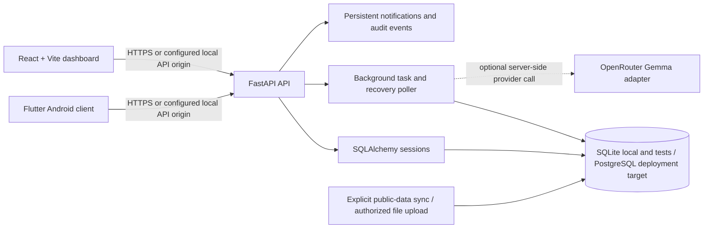
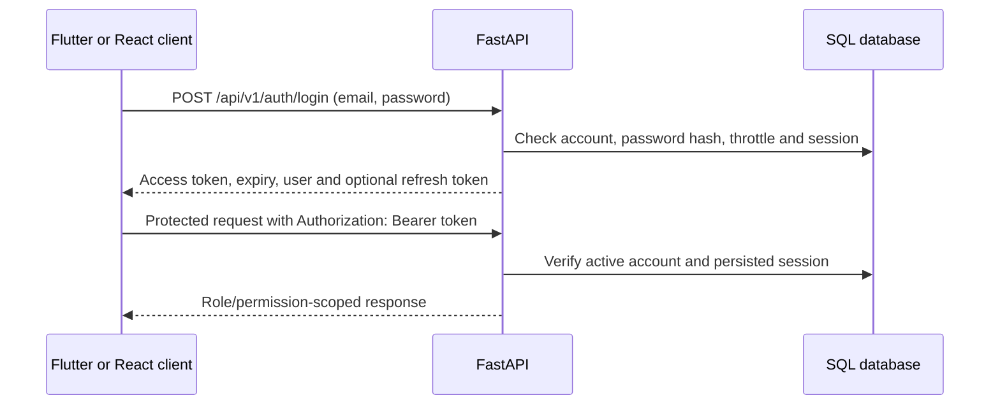
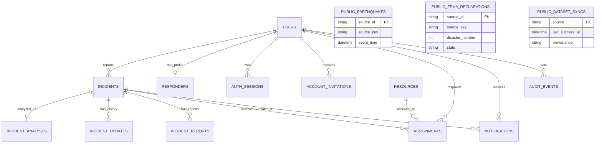

# Intelligent Emergency Responder Coordination System (IERCS)

A Flutter mobile client, React coordinator dashboard, and FastAPI service for an **academic emergency-coordination demonstration**.

> **Demo only. This software is not an emergency service. Do not use it to report, assess, or coordinate a real emergency.** It does not contact emergency agencies, place emergency calls, or dispatch responders. Its priority, assignment, and analysis features are prototypes and are not validated for real-world response.

This repository contains source code and deployment templates. No live hosted deployment, operational database, or production service is verified. Review [deployment status](docs/operations/hosting.md) before attempting to host it.

## Contents

- [Overview](#overview)
- [Implemented capabilities and limits](#implemented-capabilities-and-limits)
- [Architecture](#architecture)
- [Repository structure](#repository-structure)
- [Technology stack](#technology-stack)
- [Prerequisites](#prerequisites)
- [Local development setup](#local-development-setup)
- [Configuration reference](#configuration-reference)
- [API reference](#api-reference)
- [Data model and migrations](#data-model-and-migrations)
- [Authentication and security](#authentication-and-security)
- [Testing and quality checks](#testing-and-quality-checks)
- [Deployment](#deployment)
- [Troubleshooting](#troubleshooting)
- [Development workflow](#development-workflow)
- [Roadmap and known limitations](#roadmap-and-known-limitations)
- [License and acknowledgements](#license-and-acknowledgements)
- [Further documentation](#further-documentation)

## Overview

The system is a teaching and demonstration project for coordinating synthetic incident reports among three clients/services:

| Component / role | Responsibility in this implementation |
|---|---|
| Flutter User | Creates an account, submits an SOS/incident request with a manual or permitted location, provides follow-up answers, and views the user's incidents and notifications. |
| Flutter Responder | Uses an invited and activated account to view assigned tasks, update permitted task statuses, report progress, and submit a location for recommendation calculations. |
| Flutter Admin / React administrator | Reviews incidents and reports; manages responder invitations, assignments, resources, accounts, notifications, analytics, audit history, and selected policy controls according to permissions. |
| FastAPI | Owns identity, authorization, request validation, workflow decisions, persistence, and the versioned HTTP API. |
| SQL database | Stores accounts, incidents, assignments, workflow records, notifications, analysis, audit events, and separate historical dataset records. |

The React website is in `web/react-dashboard/`. Flutter source is at the repository root (`lib/`, `android/`, and `pubspec.yaml`). The Flutter Web build target is separate and writes to `build/web/`; it is not the React website. The two clients communicate with the same configured API origin, but local, emulator, physical-device, and hosted origins differ.

The React dashboard includes Overview, Incident Queue, Responders, User Accounts, Resources, Reports & Analytics, Historical/Public Data, Audit History, Co-Admins, Notifications, and Automatic Assignment Policy views, subject to role/permission visibility. The `/activate` and `/activate.html` routes serve responder invitation activation; `/` and `/admin` show the dashboard. The React app does not provide public User registration.

### Core workflow

1. A User registers or signs in using the mobile client. Public registration creates only a normal User account.
2. The User submits a validated incident request with an idempotency key. The API persists the incident and related initial records before returning its ID/reference.
3. An administrator with incident access retrieves the permitted incident list, reviews details, and may assign, reassign, cancel, or resolve within the backend's authorization and workflow rules.
4. An assigned Responder can advance the assignment through allowed statuses and add progress updates.
5. In-app notifications and audit records are stored in the database. They are not mobile push notifications.

The API's exact data scope depends on the authenticated role. These routes and client flows are implemented; hosted delivery, real emergency response, and live provider integrations are not implied.

## Implemented capabilities and limits

| Area | Implemented behavior | Boundary / verification note |
|---|---|---|
| Authentication | User registration and login; one-time Super Admin provisioning; invited responder activation; access and refresh sessions; logout/revocation. | Normal User registration cannot choose an administrator or responder role. No demo credentials are prefilled in the React login. |
| SOS and incident intake | Flutter User portal posts an incident, attaches authorization and an idempotency key, and requires a valid location choice. Follow-up questions and answers are supported. | The app explicitly tells users it does not contact emergency services. Never enter real emergency or sensitive personal data. |
| Location | Device GPS permission and freshness checks, manual location option, and coordinates when available. Responder location can support recommendations when sufficiently recent and accurate. | Location permission may be unavailable; the user can use manual incident location. Responder locations are sensitive and must remain synthetic in demos. |
| Incident lifecycle | Status, priority, report details, updates, cancellation, resolution, and coordinator review. | Priority is a prototype rule. Resolution reports are evidence/template summaries, not independent investigations. |
| Assignment | Admin selects an eligible responder and optionally a compatible resource. Optional automatic assignment is policy-controlled and disabled by default in the model. | The backend rechecks authorization and eligibility. A score is not a validated dispatch recommendation. |
| Responder management | Invitation, activation, capabilities, availability, account state, active task visibility, and task status updates. | Invitation email needs SMTP configuration. In-app notification records do not deliver email or push. |
| Administration | Scoped Co-Admins, user/account status, resources, analytics, audit history, notifications, and automatic-assignment policy screens exist in the React app. | Backend permission dependencies remain authoritative; hiding UI controls alone is not security. |
| Public historical data | Separate USGS earthquake and FEMA declaration tables, bounded explicit synchronization command, dashboard filters/charts, and Super Admin CSV upload with provenance. | These records are not operational incidents and do not create responders, assignments, notifications, or dispatches. Uploaded files are user-provided and not independently verified. No provider fetch occurs at app startup or page render. |
| Incident analysis | Optional server-side OpenRouter adapter, structured result validation, deterministic fallback, durable analysis rows, and recovery polling are implemented. | `AI_PROVIDER=none` is the default. A live hosted Gemma request has not been verified; enabling a provider can incur costs and discloses incident text to that provider. |
| Responder note drafting | Optional provider-assisted rewrite returns a draft for responder review; validation/fallback paths exist. | A rewrite does not itself change incident state. Provider output is not trusted as a source of facts. |
| Admin Copilot | Fixed, read-only intent handling over available records. | It is not arbitrary SQL, a general chat model, or a mutation/dispatch interface. |
| Local training workspace | A separate local JSON-backed workspace can be exposed in a Flutter debug build with `ENABLE_TRAINING_WORKSPACE=true`. | It is not server-synchronized operational data. The build flag is debug-only. |

Automated unit/component tests and mocked provider tests exist. They do not prove a hosted service, a live OpenRouter request, mail delivery, production CORS, or a complete deployed workflow.

## Architecture



FastAPI is the authority for authentication, permissions, ownership, incident transitions, and persistence. React and Flutter clients send bearer credentials for protected API routes. Public historical data is stored in dedicated tables, separate from operational incident and assignment tables.

### Registration and login



React administrator sign-in sends only email/password and uses the build-configured API origin. Its session is held in the current browser tab's `sessionStorage` and revalidated with `/auth/me` after reload. Flutter stores credentials securely only for a remembered session; otherwise a session is held for the current app run.

### SOS submission and dashboard retrieval

```mermaid
sequenceDiagram
  participant U as Flutter User portal
  participant A as FastAPI
  participant D as SQL database
  participant R as React dashboard
  U->>A: POST /api/v1/user/incidents + bearer token + Idempotency-Key
  A->>A: Validate role, request, location and idempotency key
  A->>D: Commit incident, analysis row, update, audit and notifications
  A-->>U: 201 created (or 200 for an idempotent replay), incident ID/reference
  R->>A: GET /api/v1/incidents + authorized admin token
  A->>D: Apply role/permission scope and read persisted incidents
  A-->>R: Incident list
  R->>R: Render list/details; refresh supported dashboard views periodically
```

The dashboard does not read directly from SQLite/PostgreSQL. If a record is missing, check that both clients target the same backend/database, the administrator has `view_incidents`, the API list response includes the record, and UI filters are cleared. React refreshes Overview, Incident Queue, Reports, and Notifications periodically while the page is visible and no dialog is open; this is not a push channel.

For responder invitation links, the API generates `/activate.html#token=...`. React also accepts an invitation token supplied in the query string, removes the token from browser history before rendering the form, and posts it to `/api/v1/auth/accept-invitation`. Hosted activation uses the configured HTTPS API origin. A local activation page can request a service origin when no build-time origin exists; this exception is constrained to loopback HTTP development.

### Assignment and responder status

```mermaid
sequenceDiagram
  participant Admin as Authorized coordinator
  participant API as FastAPI
  participant DB as SQL database
  participant Responder as Flutter responder
  Admin->>API: POST /api/v1/admin/incidents/{id}/assign
  API->>API: Recheck permission, candidate, resource and active-assignment rules
  API->>DB: Commit assignment, status/history and notifications
  Responder->>API: POST /api/v1/responder/incidents/{id}/status
  API->>DB: Verify ownership and allowed next status; persist update
  API-->>Responder: Updated task status
```

### External integrations

- **USGS and FEMA:** called only by the explicit bounded importer; no request is made just by opening the dashboard.
- **OpenRouter:** optional, server-side only, with `google/gemma-4-31b-it` as the configured default model. The checked-in Render blueprint selects `AI_PROVIDER=none`.
- **SMTP:** optional responder invitation delivery. It is not used for incident notifications.
- **Vercel, Render, Supabase:** configuration/templates and an operations guide exist, but no live provider project or deployed application is verified.

## Repository structure

```text
.
├── .github/workflows/quality.yml      # Backend, Flutter, React, and gated APK CI
├── android/                           # Flutter Android project
├── backend/
│   ├── app/                           # FastAPI routes, schemas, models, config and services
│   ├── migrations/versions/           # Alembic revisions
│   ├── tests/                         # Backend unit/API and opt-in PostgreSQL tests
│   ├── Dockerfile
│   ├── compose.yaml                   # Local PostgreSQL service/volume definition
│   ├── start.sh                       # Migration-first server startup when invoked
│   └── requirements*.txt
├── docs/
│   ├── architecture/                  # Frontend migration and historical data
│   ├── operations/                    # Hosting and backup/recovery
│   ├── audit/                         # Architecture, testing and release audits
│   └── requirements/                  # Requirements and traceability
├── lib/
│   ├── data/                          # Flutter API client, API config and local store
│   ├── domain/                        # Client-side models and deterministic rules
│   └── presentation/                  # Flutter portals, screens and design system
├── scripts/                           # Protected Android release build helper
├── test/                              # Flutter tests
├── web/
│   ├── assets/brand/official-logo.svg  # Shared React branding asset
│   ├── index.html                     # Flutter Web source entry point
│   ├── manifest.json, icons/          # Flutter Web metadata/assets
│   └── react-dashboard/              # React/Vite/TypeScript coordinator site
│       ├── src/app/                   # Dashboard and invitation activation screens
│       ├── src/api/, src/auth/        # API client/config and browser session
│       ├── package.json, package-lock.json
│       └── vercel.json                # Vercel config for this project root
├── render.yaml                        # Render API blueprint
├── vercel.json                        # Repository-level Vercel config
├── pubspec.yaml, pubspec.lock         # Flutter project and resolved dependencies
└── README.md
```

`web/admin/` static dashboard sources were removed from the current working tree; the maintained dashboard is `web/react-dashboard/`. Flutter Web output remains `build/web/`. Local databases, `.env` files, virtual environments, and generated build/cache folders are not source configuration and should not be committed.

## Technology stack

| Technology | Use |
|---|---|
| Flutter / Dart | Android mobile client and separate Flutter Web target. Version constraints are in `pubspec.yaml`; CI selects Flutter 3.47.7. |
| React 18, TypeScript, Vite 6 | Browser coordinator dashboard and activation screen. Exact package versions are in `web/react-dashboard/package-lock.json`. |
| Python, FastAPI, Pydantic Settings | API routing, request validation, settings and OpenAPI docs. Dependency ranges are in `backend/requirements*.txt`. |
| SQLAlchemy 2, Alembic | ORM/session handling and versioned schema migrations. |
| SQLite | Local development and isolated automated test database support. |
| PostgreSQL + psycopg | Required database URL dialect for staging/production settings. |
| PyJWT, pwdlib Argon2 | Signed access tokens and password hashing. |
| HTTPX | Optional server-side provider adapters and API tests. |
| pytest, Vitest, Testing Library, Flutter Test | Backend, React, and mobile tests. |
| Vercel, Render, Supabase | Intended separate React hosting, container API and PostgreSQL targets. These are not connected/verified. |

CI currently uses Python 3.13, Node.js 24, Flutter 3.47.7, and Java 17. Those are workflow selections, not a claim that every developer environment has those versions.

## Prerequisites

### Required for local development

- Git.
- Python 3.12+ and `venv` for the backend (CI uses 3.13).
- Node.js/npm compatible with the checked-in lockfile (CI uses Node 24).
- Flutter SDK/Dart satisfying `pubspec.yaml` (CI uses Flutter 3.47.7).
- Android SDK and Platform Tools only for Android emulator/device work.

SQLite is sufficient for a new isolated local database. Docker Compose and PostgreSQL are optional for local PostgreSQL work. A Vercel/Render/Supabase account is not required for local tests. Provider API keys are not needed for provider-off operation or mocked tests.

## Local development setup

These instructions are for a **new, isolated development database**, not an existing staging or production database. Do not overwrite an existing `.env` or database file. If either already exists, inspect and back it up before changing configuration.

### 1. Clone and prepare the API

```sh
git clone https://github.com/QaziZaid16/emergency_coordination_system.git
cd emergency_coordination_system

cd backend
python3 -m venv .venv
source .venv/bin/activate               # Windows PowerShell: .\.venv\Scripts\Activate.ps1
python -m pip install -r requirements-dev.txt
cp .env.example .env                    # Windows PowerShell: Copy-Item .env.example .env
```

Edit the new `backend/.env` locally. Set `ENVIRONMENT=development` explicitly (the checked-in example may not include it), set a new private `JWT_SECRET` with at least 32 characters, and choose a new SQLite file. For example:

```dotenv
ENVIRONMENT=development
DATABASE_URL=sqlite:///./data/coordination.db
JWT_SECRET=<new-private-random-value-at-least-32-characters>
CORS_ORIGINS=http://127.0.0.1:5173
PUBLIC_APP_URL=http://127.0.0.1:8000
AI_PROVIDER=none
```

Do not put an actual credential in the README, a Dart define, a Vite variable, or Git. Pydantic Settings loads the process environment and `.env` relative to the backend process working directory; process environment values take precedence.

### 2. Migrate and provision a local administrator

Still from `backend/` with the virtual environment active:

```sh
alembic upgrade head
python -m app.provision_admin --email admin@example.org --display-name "Local Operations Admin"
```

The provisioning command prompts for the password without echo and creates only the first Super Admin. Do not use it against a database until its target is known. For an existing database with schema drift or an unexpected Alembic revision, stop and diagnose before applying migrations. Never replace migration history with `stamp` just to make an upgrade pass.

### 3. Start the API

From `backend/`:

```sh
uvicorn app.main:app --reload --host 127.0.0.1 --port 8000
```

The backend listens on loopback. Open another terminal and check:

- Liveness: <http://127.0.0.1:8000/health/live>
- Database readiness: <http://127.0.0.1:8000/health/ready>
- Interactive OpenAPI: <http://127.0.0.1:8000/docs>

Development/test app startup can create missing tables with SQLAlchemy metadata, but this does not replace Alembic. For a fresh local database, migrate first. Hosted environments use migrations and do not run `create_all()`.

### 4. Install and start React

From the repository root:

```sh
npm ci --prefix web/react-dashboard
```

Create `web/react-dashboard/.env.local` with the **public API origin** (no credentials or path):

```dotenv
VITE_ECS_API_ORIGIN=http://127.0.0.1:8000
```

Then start Vite:

```sh
npm run dev --prefix web/react-dashboard
```

Open the URL Vite prints, normally <http://127.0.0.1:5173/>. Set backend `CORS_ORIGINS` to the exact origin used by the browser. Restart Vite after changing environment values. The login page accepts email/password only and fails closed when API configuration is missing or invalid.

### Keep mobile and dashboard on the same backend

Set both clients to the exact same API service before comparing records:

- React: `VITE_ECS_API_ORIGIN` in `web/react-dashboard/.env.local`.
- Flutter: `--dart-define=API_BASE_URL=...` when running or building the app.
- On a USB-connected phone using `127.0.0.1`, create an ADB reverse mapping for that same API port (see below).

A matching port alone does not prove two clients share a database. `DATABASE_URL=sqlite:///./data/coordination.db` is relative to the backend process working directory; when started from `backend/`, it resolves to `backend/data/coordination.db`. A process configured for `backend/data/staging-public-datasets.sqlite` uses a different database even if it serves the same API routes. Before testing, inspect each API process's non-secret `DATABASE_URL` source and resolved SQLite file (for example, use `lsof -p <api-pid>` to identify an open database file). Never point a synthetic workflow at a database containing user or operational records. Do not migrate, seed, or write to the preserved public-dataset staging database for this check.

The mobile SOS client sends an authenticated `POST /api/v1/user/incidents` with an `Idempotency-Key`; the API returns `201` for a newly persisted record or `200` for a replay of the same key. An authorized coordinator reads it from `GET /api/v1/incidents`. Open the returned incident ID/reference and confirm it is present in the API response before diagnosing a rendering problem. The dashboard refreshes Overview, Incident Queue, Reports, and Notifications every 12 seconds while the browser tab is visible and no modal is open; refresh pauses while hidden or while a dialog is open. This is polling, not push delivery.

### 5. Set up and run Flutter

From the repository root:

```sh
flutter doctor -v
flutter pub get
flutter devices
flutter run -d <device-id> --dart-define=API_BASE_URL=http://127.0.0.1:8000
```

For an Android emulator, `10.0.2.2` commonly routes to the development host:

```sh
flutter run -d <emulator-id> --dart-define=API_BASE_URL=http://10.0.2.2:8000
```

For a USB-connected Android device, one loopback option is Android port reversal:

```sh
adb reverse tcp:8000 tcp:8000
flutter run -d <device-id> --dart-define=API_BASE_URL=http://127.0.0.1:8000
```

Use the actual backend port on both sides of `adb reverse`; for example, a backend on host port `8001` needs `adb reverse tcp:8001 tcp:8001` and Flutter must be built/run with `API_BASE_URL=http://127.0.0.1:8001`. After reconnecting the device, check `adb devices -l` and `adb reverse --list`. A device shown as `unauthorized` cannot be used for installation, app interaction, or reverse-port verification until its owner unlocks it and accepts the USB debugging prompt.

On a physical phone, `127.0.0.1` means the phone itself. USB `adb reverse` maps the phone's port to the development host. Debug builds also allow private-network HTTP origins, but only use them on a trusted, explicitly scoped network with the backend and CORS configured accordingly. Release builds require HTTPS. Never expose a local API publicly just to bypass device networking.

The app also has a debug-only local training workspace behind `--dart-define=ENABLE_TRAINING_WORKSPACE=true`; its JSON store is separate from the API database. Do not confuse training data with server incidents.

### Windows and Linux notes

The Python, npm, Alembic, and Flutter commands are platform-neutral once the tools are installed. On Windows, activate the virtual environment with `.venv\\Scripts\\Activate.ps1` in PowerShell and copy the environment template with `Copy-Item`. Android device commands require the Android SDK/ADB on `PATH`. Linux/macOS shell commands above use POSIX syntax; PowerShell users should use native environment-variable syntax when setting a one-command override.

## Configuration reference

Backend settings are defined by `backend/app/config.py`; local sample values are in `backend/.env.example`. Optional testing/build flags are defined in their respective fixtures and Vite config.

| Variable | Used by | Purpose / requiredness |
|---|---|---|
| `ENVIRONMENT` | Backend | Explicitly required by `get_settings()`. Accepted: `development`, `test`, `staging`, `production`. Hosted production settings are stricter. |
| `DATABASE_URL` | Backend/Alembic | SQLAlchemy database target. Local default is SQLite; staging/production validation requires a complete `postgresql+psycopg://` URL. Treat credential-bearing URLs as secrets. |
| `JWT_SECRET` | Backend | Required outside test mode; minimum 32 characters. Secret used to sign access tokens and hash login-attempt identifiers. |
| `ACCESS_TOKEN_MINUTES` | Backend | Access token lifetime; default 30 minutes. |
| `REMEMBER_ME_DAYS` | Backend | Remembered-session maximum lifetime; default 30 days, range 1–365. |
| `CORS_ORIGINS` | Backend | Comma-separated browser origins. Production requires real HTTPS origins, no wildcard/placeholders/path/query. |
| `PUBLIC_APP_URL` | Backend | Canonical origin used to create invitation activation links. Production requires a real HTTPS origin. |
| `PORT` | `backend/start.sh` | Optional platform-supplied listening port; defaults to 8000. |
| `SMTP_HOST`, `SMTP_PORT`, `SMTP_USERNAME`, `SMTP_PASSWORD`, `SMTP_FROM` | Backend | Optional responder invitation email. SMTP password is secret; without a configured host, delivery is unavailable outside supported development handoff. |
| `STAGING_RESPONDER_INVITATION_HANDOFF` | Backend | Defaults false; permits staging-only activation-link handoff when SMTP is disabled. It is rejected outside staging. |
| `AI_PROVIDER` | Backend | Defaults to `none`; supported values include `none`, `off`, `openrouter`, and `openai_compatible`. Provider remains off unless selected. |
| `OPENROUTER_API_KEY` | Backend only | Required secret when OpenRouter is explicitly selected. Never set as a `VITE_` variable or Flutter define. |
| `OPENROUTER_BASE_URL`, `OPENROUTER_MODEL` | Backend only | OpenRouter API base and model; defaults are `https://openrouter.ai/api/v1` and `google/gemma-4-31b-it`. |
| `AI_BASE_URL`, `AI_API_KEY`, `AI_MODEL` | Backend only | Legacy OpenAI-compatible adapter settings; key is secret. |
| `AI_TIMEOUT_SECONDS`, `AI_MAX_ATTEMPTS`, `AI_RATE_LIMIT_PER_MINUTE`, `AI_SHARE_INCIDENT_LOCATION` | Backend | Provider timeout/retry/rate settings and whether a location label may be shared; see config validation for bounds. Defaults: 8 seconds, 2 attempts, 60 calls/minute, and false. Rate limiting is process-local. |
| `RECOMMENDATION_DISTANCE_WEIGHT`, `RECOMMENDATION_CAPABILITY_WEIGHT`, `RECOMMENDATION_WORKLOAD_WEIGHT` | Backend | Deterministic recommendation scoring weights; defaults 45, 35, 20. These scores are not validated policy. |
| `POSTGRES_PASSWORD` | `backend/compose.yaml` | Required Compose interpolation for local PostgreSQL; secret. The Compose file defines a persistent named volume, so do not treat it as disposable. |
| `API_BASE_URL` | Flutter compile-time | Public API origin passed with `--dart-define`; no credential. Release requires HTTPS; debug allows loopback/private origins. |
| `ENABLE_TRAINING_WORKSPACE` | Flutter compile-time | Debug-only boolean flag to enable the local JSON training workspace. |
| `VITE_ECS_API_ORIGIN` | React/Vite | Public API origin embedded into the browser build. Local development permits loopback HTTP; deployment build requires a real HTTPS origin without path/query/credentials. |
| `VITE_ECS_ALLOW_UNCONFIGURED_BUILD` | CI-only Vite override | `true` permits compile-only CI build without a production API origin. Do not set in Vercel; it bypasses the build guard. |
| `ECS_POSTGRES_TEST_MODE`, `ECS_POSTGRES_TEST_DATABASE_URL`, `ECS_POSTGRES_TEST_TARGET_DISPOSABLE`, `ECS_POSTGRES_TEST_RUN_ID`, `ECS_POSTGRES_TEST_ALLOWED_HOSTS`, `ECS_POSTGRES_TEST_ALLOWED_DATABASES` | Backend PostgreSQL test fixture | Explicit opt-in for a dedicated disposable PostgreSQL test target. The fixture validates URL/host/database allowlists; it does not provision a DB. Some tests alter/drop schema. Never point it at staging or production. |

`.env`, `.env.local`, database URLs, provider keys, signing files and passwords must stay out of version control. Public client origins are configuration, not secrets; API keys and signing credentials must never enter client bundles.

## API reference

The router prefix is `/api/v1`. The current complete field-level schema is generated by FastAPI at `/docs` for a running backend. Protected routes require `Authorization: Bearer <access-token>` unless noted. `admin` means a Super Admin or a scoped Co-Admin with the route's required permission; backend authorization also checks account status and ownership. The table below summarizes implemented routes from `backend/app/api.py` and models in `backend/app/schemas.py`.

### Authentication and invitations

| Method and path | Access | Request / behavior |
|---|---|---|
| `POST /auth/login` | Public | `email`, `password`, optional `remember_me`; returns access token, expiry, user and optional refresh token. Login attempts are rate-limited using a hashed identifier bucket. |
| `POST /auth/register` | Public | `email`, `display_name`, password (12–128 chars), optional `remember_me`; creates a normal User only; `201`. |
| `POST /auth/accept-invitation` | One-time invitation token | `token`, `password`; activates a pending responder invitation. |
| `POST /auth/refresh` | Refresh token | Rotates a remembered refresh token and returns a new access token. |
| `POST /auth/logout` | Authenticated | Revokes the current server-side session; `204`. |
| `GET /auth/me` | Authenticated | Returns the current user identity/role/permissions. |

### Incidents, intake, reports and notifications

| Method and path | Access | Request / behavior |
|---|---|---|
| `POST /user/incidents` | User | `IncidentCreate`: emergency type, description, location label/source, optional coordinates/accuracy/time, severity and urgency; requires `Idempotency-Key` (8–128 chars). First accepted request returns `201`; replay for the same reporter/key returns the stored incident (`200`). |
| `GET /incidents` | Authenticated and scoped | Optional `status` and `query`. Admins need `view_incidents`; users see only their own reports; responders see assigned/visible work. |
| `GET /incidents/{incident_id}` | Authenticated and scoped | Incident detail, including location provenance, status, priority, intake and permitted analysis. |
| `GET /incidents/{incident_id}/updates` | Incident access | Persisted update history. |
| `GET /incidents/{incident_id}/intake` | Incident access | Follow-up questions, answers and intake status. |
| `POST /incidents/{incident_id}/intake/answers` | Reporter | `{ "answers": { ... } }`; saves bounded user-provided answers; `201`. |
| `POST /incidents/{incident_id}/updates` | Authorized reporter/assigned responder per route policy | `message`, optional `original_message`, `ai_assisted`; `201`. |
| `POST /responder/incidents/{incident_id}/rewrite` | Assigned responder | `note`; returns a checked draft and provider/fallback state without changing workflow state. |
| `GET /incidents/{incident_id}/report` | Incident access | Resolution report and source records when available. |
| `POST /admin/incidents/{incident_id}/report/review` | Admin with update permission | `note`; records the report review. |
| `GET /changes` | Authenticated and scoped | Optional `after` timestamp; returns server time and changed, permitted incidents. |
| `GET /notifications` | Authenticated | Current account's persistent in-app notifications. |
| `PATCH /notifications/read-all` | Authenticated | Marks current account notifications read. |
| `PATCH /notifications/{notification_id}/read` | Notification owner | Marks one notification read. |

### Dashboard and administration

| Method and path | Access | Purpose / principal request fields |
|---|---|---|
| `GET /admin/dashboard` | Admin with dashboard permission | Operational summary metrics. |
| `GET /admin/analytics?days=...` | Admin with `view_reports` | Persisted descriptive aggregates for an allowed period; not forecasts. |
| `POST /admin/copilot` | Admin with relevant read permissions | Fixed read-only question/intent; no arbitrary SQL or mutations. |
| `GET /admin/responders` | Admin with dashboard/responder permission | Responder accounts and profiles. |
| `POST /admin/invitations/responders` | Admin with `manage_responders` | `email`, `display_name`, `capabilities`; creates an invitation. |
| `GET /admin/invitations` | Admin with `manage_responders` | Invitation status; does not expose stored token hashes. |
| `POST /admin/invitations/{invitation_id}/revoke` | Admin with `manage_responders` | Revokes an invitation. |
| `POST /admin/invitations/responders/{user_id}/resend` | Admin with `manage_responders` | Rotates/resends an eligible invite; rate-limited. |
| `GET /admin/users?role=...` | Admin with applicable permission | Lists permitted accounts. |
| `POST /admin/users` | Admin with `manage_users` | Creates a normal User account; responder creation uses invitations. |
| `PATCH /admin/users/{user_id}/active?active=...` | Authorized account manager | Activates/deactivates eligible account; deactivation revokes sessions. |
| `GET /admin/coadmins` | Super Admin | Lists scoped administrators. |
| `POST /admin/coadmins` | Super Admin | Creates a Co-Admin with an explicit permission list. |
| `PATCH /admin/coadmins/{user_id}/active` | Super Admin | Changes Co-Admin active state. |
| `PATCH /admin/coadmins/{user_id}/permissions` | Super Admin | Updates scoped permissions. |
| `PUT /admin/responders/{responder_id}/capabilities` | Admin with `manage_responders` | Replaces responder capability list. |
| `PATCH /admin/responders/{responder_id}/availability` | Admin with `manage_responders` | Updates availability. |
| `GET /admin/resources` | Admin with dashboard/resource permission | Lists resources and allocation summary. |
| `POST /admin/resources` | Admin with `manage_resources` | Creates resource (`name`, `kind`, `quantity`). |
| `PATCH /admin/resources/{resource_id}` | Admin with `manage_resources` | Updates resource and optional active state. |
| `GET /admin/incidents/{incident_id}/recommendations` | Admin with incident-view access | Eligible responders/resources with deterministic reasons. |
| `GET /admin/incidents/{incident_id}/duplicates` | Admin with incident-view access | Review-only possible duplicate candidates. |
| `POST /admin/incidents/{incident_id}/analysis/retry` | Admin with update permission | Queues an eligible analysis retry; `202`. |
| `POST /admin/incidents/{incident_id}/assign` | Admin with `assign_responders` | `responder_id`, optional `resource_id`; backend rechecks eligibility. |
| `POST /admin/incidents/{incident_id}/reassign` | Admin with `assign_responders` | Changes active assignment subject to backend rules. |
| `POST /admin/incidents/{incident_id}/cancel` | Admin with update permission | Cancels an eligible incident. |
| `POST /admin/incidents/{incident_id}/resolve` | Admin with update permission | Resolves eligible incident and creates the current evidence-template report. |
| `PUT /admin/automation` | Super Admin | `enabled`, `max_severity`; controls optional deterministic auto-assignment policy. |
| `GET /admin/automation` | Admin | Reads policy. |
| `GET /admin/audit?limit=...` | Admin with audit permission | Returns bounded administrative audit events. |

### Responder and historical-data routes

| Method and path | Access | Purpose / request |
|---|---|---|
| `GET /responder/profile` | Responder | Own responder profile/assignment context. |
| `PUT /responder/location` | Responder | Updates own coordinates, accuracy and capture time for recommendation use. |
| `POST /responder/incidents/{incident_id}/status` | Assigned responder | `status` from the allowed next-state transition; backend verifies assignment ownership. |
| `GET /admin/public-disaster-data` | Admin with `view_reports` | Separate historical datasets and source/provenance metadata, optionally range-filtered. |
| `POST /admin/public-disaster-data/import` | Super Admin only | Multipart upload of the declarations ZIP and earthquake CSV; validates both and writes transactionally. |

Health endpoints are outside the API prefix: `GET /health/live` checks process liveness and `GET /health/ready` checks database connectivity. Common errors include `400` for invalid workflow input, `401` for missing/invalid sessions, `403` for insufficient role/permission, `404` for inaccessible/missing resources, `409` for conflicts, `422` for schema validation, and `429` for throttling. Exact response bodies/statuses are route-specific; `/docs` is authoritative for the running revision.

## Data model and migrations

Local development/tests use SQLite. `ENVIRONMENT=staging` and `production` require a PostgreSQL URL with the `postgresql+psycopg` driver. SQLAlchemy sessions are created per API request. Alembic is the schema-change mechanism; the app only calls `Base.metadata.create_all()` in development/test lifespan.

### Main tables

| Tables | Relationship / purpose |
|---|---|
| `users`, `auth_sessions`, `login_attempt_buckets` | Accounts, persisted/revocable login sessions, and privacy-preserving hashed login throttle buckets. |
| `responders` | One-to-one profile keyed by `users.id`; capabilities, availability, and optional location metadata. |
| `account_invitations` | Responder invite token hash, expiry, acceptance and revocation state. |
| `incidents` | Reporter-owned submitted incidents; unique reference and unique `(reporter_id, idempotency_key)`, validated coordinates and status/priority. |
| `incident_analyses` | One durable analysis row per incident, with provider/result state, attempt metadata and claim ownership token. |
| `incident_updates`, `incident_reports` | Incident history and versioned resolution report/review metadata. |
| `assignments` | Links incident to responder and optional resource; active assignment constraints prevent conflicting assignments. |
| `resources` | Resource inventory and allocation state. |
| `notifications` | User-owned in-app events, optionally linked to an incident, with unique event key per user and read time. |
| `coordination_policy`, `audit_events` | Automatic-assignment policy and administrative audit history. |
| `public_earthquakes`, `public_fema_declarations`, `public_dataset_syncs` | Historical source records and import/sync provenance, isolated from operational workflows. |



Historical tables intentionally have no relationship to operational `incidents` or `assignments`. The latest migration identifier in this checkout is `f4a2d610c981`; a particular database's actual revision must be checked rather than assumed.

The explicit provider synchronization command is separate from CSV upload and is never run automatically. After verifying the target database and applying its migrations, the documented operator command from `backend/` is `python -m app.sync_public_datasets --confirm-public-sync`. It uses bounded date/row defaults and source timeouts/retries; see the [public-data guide](docs/architecture/public-disaster-data.md) before selecting bounds or a database. The upload API is available from the Super Admin-only Historical/Public Data screen and requires both files together. Input sizes, archive layout, row caps, and row-level rejection behavior are specified in that guide.

From `backend/` with the intended database selected:

```sh
alembic current
alembic history
alembic upgrade head
```

Never run an upgrade against an unknown, drifted, shared, staging, or production database merely to test setup. First verify ownership, actual schema, current revision, backups, and the complete migration chain. Do not use `alembic stamp` to mask schema drift.

## Authentication and security

- Passwords are hashed using Argon2 through `pwdlib`; plaintext passwords are not stored.
- Access tokens are HS256 JWTs, short-lived by default (30 minutes), and checked against a server-side `auth_sessions` row, current account status, and role.
- Remember Me is optional. Refresh tokens are random, persisted only as hashes, rotated during refresh, and bounded by `REMEMBER_ME_DAYS`.
- Logout revokes the active server-side session. React uses tab-scoped `sessionStorage`; Flutter uses secure storage for remembered sessions.
- Public registration can create only a normal User. The initial Super Admin is provisioned explicitly. Responder access is invitation-based.
- Scoped Co-Admin permissions are checked by backend dependencies on each route. Incident ownership is enforced for User and Responder views.
- Production/staging settings require PostgreSQL, a sufficiently long JWT secret, HTTPS CORS origins and HTTPS `PUBLIC_APP_URL`. The React production build and Flutter release client require a real HTTPS API origin.
- CORS is origin-based and does not allow credentials in the current FastAPI middleware. Configure exact website origins, not wildcards.
- Provider credentials and SMTP credentials belong only in backend secret storage. Vite variables are public and bundled; never prefix a secret with `VITE_`.
- The optional provider may receive incident description and configured context. It is disabled by default. Never enable it with real emergency/personal data for this demo.

These are implementation controls, not a security certification. Hosting topology, production operations, backups/restoration, monitoring, external mail, provider behavior and full production security review are not verified. Invitation throttling and AI call limiting are process-local, not distributed across replicas.

## Testing and quality checks

Commands configured in package files and GitHub Actions:

```sh
# Backend (from backend/; tests use isolated SQLite fixtures by default)
ENVIRONMENT=test JWT_SECRET=ci-only-secret-that-is-at-least-thirty-two-characters \
  python -m pytest -q

# React (from repository root)
npm ci --prefix web/react-dashboard
npm test --prefix web/react-dashboard

# Compile and bundle React for CI only without a production origin
VITE_ECS_ALLOW_UNCONFIGURED_BUILD=true npm run build --prefix web/react-dashboard

# Flutter (from repository root)
flutter pub get
dart format --output=none --set-exit-if-changed lib test
flutter analyze
flutter test test/api_client_test.dart test/api_configuration_test.dart \
  test/dispatch_rules_test.dart test/operations_store_test.dart test/widget_test.dart
flutter build web --no-pub
```

The CI web build explicitly sets `VITE_ECS_ALLOW_UNCONFIGURED_BUILD=true`; this is a compile-only exception, not a deployment configuration. A normal production Vite build must receive the real HTTPS `VITE_ECS_API_ORIGIN` and rejects missing, invalid, placeholder or non-HTTPS values. Do not invent a URL to make the build green.

PostgreSQL-specific tests are opt-in and guarded by `backend/postgres_test_safety.py`. Some change/drop schema; run them only with an explicitly approved disposable PostgreSQL target configured with all required `ECS_POSTGRES_TEST_*` variables. Do not use local staging, hosted staging, or production.

No tests or builds were run while this README was rewritten. Consult CI for current results; historical counts are deliberately not embedded here.

## Deployment

### Intended topology and current status

| Service | Intended configuration | Current verification |
|---|---|---|
| React dashboard | Vercel project rooted at `web/react-dashboard`; `npm ci`, `npm run build`, output `dist`. | Config files exist; no Vercel project or live deployment verified. Production build needs the real backend HTTPS origin. |
| FastAPI API | Render Docker web service using `backend/Dockerfile`, `backend/start.sh`, `/health/ready`. | Blueprint exists; no Render service/live URL verified. |
| PostgreSQL | Separate persistent PostgreSQL provider/database; hosting notes discuss Supabase as a possible target. | No hosted database is connected or migrated. Local Compose is a separate persistent named-volume target. |
| AI | Provider-off by default (`AI_PROVIDER=none`). Optional OpenRouter/Gemma server-side configuration. | No hosted key or live provider request verified. |

### Vercel website

Both root `vercel.json` and `web/react-dashboard/vercel.json` are present. For the documented Vercel project Root Directory `web/react-dashboard`, use the configuration and paths relative to that project root: install `npm ci`, build `npm run build`, output `dist`. The app config rewrites `/admin`, `/admin/`, `/admin/:path*`, `/activate`, and `/activate.html` to the SPA entry. `/` is served by the built `index.html`.

Set `VITE_ECS_API_ORIGIN` to the **actual** HTTPS API origin in the Vercel project environment. It is public browser configuration. Do not set `VITE_ECS_ALLOW_UNCONFIGURED_BUILD` in Vercel. Vite copies the shared logo from `web/assets/`; with the project rooted in `web/react-dashboard`, enable Vercel's **Include source files outside of the Root Directory** option so the sibling assets directory is available. Verify the deployed routes and logo after deployment.

### Render API and database

`render.yaml` defines a Docker web service on the `main` branch, health path `/health/ready`, auto-deploy after checks, `ENVIRONMENT=production`, and `AI_PROVIDER=none`. It expects `DATABASE_URL`, `CORS_ORIGINS` and `PUBLIC_APP_URL` to be entered as provider values; `JWT_SECRET` is generated by Render. The `render.yaml` command invokes `sh ./start.sh`. That script runs bounded-retry `alembic upgrade head` before Uvicorn and refuses to start after migration failure. The generic Dockerfile `CMD` by itself starts Uvicorn directly; deployments relying on migration-first startup must use the configured `start.sh` command.

Production environment requirements:

- `DATABASE_URL`: protected PostgreSQL SQLAlchemy URL using `postgresql+psycopg://`; never expose or commit it.
- `JWT_SECRET`: generated/protected backend secret.
- `CORS_ORIGINS`: exact Vercel site origin(s), HTTPS.
- `PUBLIC_APP_URL`: canonical HTTPS Vercel origin used for responder invitations.
- `ENVIRONMENT=production`; `AI_PROVIDER=none` until provider enablement is explicitly authorized.

Deploy order and validation depend on real provider URLs and account setup. See [hosting operations](docs/operations/hosting.md) and [backup/recovery](docs/operations/backup-and-recovery.md). Free tiers may sleep, pause, impose database quotas, or lack managed backups; read the current provider terms and keep synthetic data only. No payment method, paid resource, provider project, hosted migration, or deployment is authorized or verified by this repository documentation.

After deployment, verify `/health/live`, `/health/ready`, database migration revision, CORS preflight from the real Vercel origin, administrator sign-in, responder activation URL, one uniquely identified synthetic incident from mobile to dashboard, restart persistence, logs without credentials/personal data, and backup/restore process. Keep `PUBLIC_APP_URL`, Vercel API origin, and backend CORS origins consistent.

## Troubleshooting

| Symptom | Checks |
|---|---|
| React says service unavailable or login cannot connect | Confirm `VITE_ECS_API_ORIGIN` is present and valid; use a real HTTPS origin for hosted builds. Locally, check API `/health/live`, Vite environment file location, and restart Vite after changing it. |
| Flutter cannot reach API | Verify `API_BASE_URL` compile-time define and `/health/live`. On a physical phone, loopback means the phone; use USB `adb reverse` or an intentionally configured private-network debug URL. Do not use HTTP for a release build. |
| CORS error in browser | Set backend `CORS_ORIGINS` to the exact browser origin including scheme and port; do not add a path. Then restart/redeploy the API. CORS does not fix an incorrect API URL. |
| Login/registration fails | Check the API response status, account role/active state, password length, login throttle, and whether Flutter/React use the same backend. Do not reset credentials or alter accounts without verifying the database target. |
| Incident missing in React | Confirm Flutter's successful POST response and returned ID, the same backend origin and resolved database file, an authorized `/api/v1/incidents` response, `view_incidents` permission, and cleared search/status/priority/category filters. Check the API process's open SQLite file rather than inferring the database from its port. Wait up to 12 seconds with the tab visible and any dialog closed, or use Refresh; polling pauses in a hidden tab and while a dialog is open. |
| Migration says tables already exist or revisions mismatch | Stop. Inspect `DATABASE_URL`, `alembic current/history`, actual schema, and database provenance. Do not delete a DB, stamp blindly, or downgrade data. See [backup/recovery](docs/operations/backup-and-recovery.md). |
| Vercel cannot find shared brand assets | Confirm Root Directory is `web/react-dashboard` and enable inclusion of source files outside the root so `web/assets/` is available. Use app-root build settings in `web/react-dashboard/vercel.json`. |
| Vercel production build rejects API URL | Enter the actual HTTPS API origin in `VITE_ECS_API_ORIGIN`; remove placeholders, credentials, path, query, or fragment. Never bypass the guard for deployment. |
| Responder invitation is not delivered | SMTP is optional and no provider is guaranteed. Check backend SMTP configuration and deployment provider port restrictions; for local development, use the supported activation-link handoff. Do not put invitation tokens in logs or screenshots. |
| `flutter doctor` reports missing Android tooling | Install Android Studio/SDK and Platform Tools, accept SDK licenses, verify `adb devices`, then rerun `flutter doctor -v`. Web/desktop targets do not replace Android requirements. |

## Development workflow

No separate contribution policy file was found. A safe general workflow is:

1. Create a focused branch from the intended base and inspect `git status` before editing.
2. Preserve unrelated working-tree changes. Review `git diff` and stage only files belonging to the change.
3. For schema changes, add a reviewed Alembic migration and tests. Validate upgrades/downgrades against disposable databases; never run test fixtures or downgrade against staging/production.
4. Run the relevant backend, React, Flutter, formatting, analysis and build checks listed above. Report checks actually run.
5. Do not commit `.env` files, database files, generated builds, account credentials, provider keys, keystores, tokens, or real personal/incident data.
6. Use synthetic data, document limitations, and avoid calling external paid services in tests.

When reporting a defect, include client/platform, route/screen, expected and observed behavior, non-sensitive logs/status codes, and reproducible synthetic steps. Redact bearer tokens, passwords, email where unnecessary, locations, and incident content.

## Roadmap and known limitations

These are gaps and deferred work identified by the checked-in implementation/operations notes, not a promise that work is scheduled:

- No live provider deployment, verified hosted database, public dashboard URL, or production API origin is currently established.
- Local multi-device use requires separately reviewed network exposure, database-volume ownership, and backup/restore evidence.
- No real emergency-agency integration, emergency calling, public dispatch, SMS, FCM/device push, or notification delivery tracking is implemented.
- Public dataset refresh is operator-triggered; historical datasets are capped and not comprehensive/current incident feeds.
- OpenRouter requests, cost controls and hosted incident-analysis lifecycle have not been live-verified. The provider is disabled by default.
- AI and invitation rate controls are process-local; horizontal scaling/worker coordination requires deployment review.
- Production backup, restoration, monitoring, service-level objectives, migration rollout and rollback have not been demonstrated.
- The repository includes an older debug-signed APK; it is not a verified release artifact and does not prove a deployable mobile release configuration.

The current operational status and unresolved release evidence are tracked in [the hosting guide](docs/operations/hosting.md), [Gemma integration audit](docs/GEMMA_INTEGRATION_AUDIT.md), and [release readiness audit](docs/audit/release-readiness-2026-10-24.md).

## License and acknowledgements

No `LICENSE` file was found in the repository. No license is asserted here; obtain authorization before redistributing or reusing the project. The app uses third-party packages listed in `pubspec.yaml` and `web/react-dashboard/package-lock.json`, plus FastAPI/Python packages in `backend/requirements*.txt`; consult those projects' licenses. Historical source attribution and usage limits are documented in [the public-data guide](docs/architecture/public-disaster-data.md). The system is not endorsed by USGS, FEMA, or OpenRouter.

## Further documentation

- [Backend setup and notes](backend/README.md)
- [Frontend migration and route behavior](docs/architecture/frontend-migration.md)
- [Public historical datasets and CSV import](docs/architecture/public-disaster-data.md)
- [Hosting and release checklist](docs/operations/hosting.md)
- [Database backup and recovery](docs/operations/backup-and-recovery.md)
- [CI/CD workflow audit](docs/CI_CD_AUDIT.md)
- [Requirements and traceability matrix](docs/requirements/traceability-matrix.md)
- [Architecture audit](docs/audit/architecture.md)
- [UI design system](docs/DESIGN_SYSTEM.md)
- [UX/UI audit](docs/UX_UI_AUDIT.md)
- [AI/Gemma integration audit](docs/GEMMA_INTEGRATION_AUDIT.md)
- [Synthetic demo seed notes](docs/DEMO_ACCOUNTS.md)
