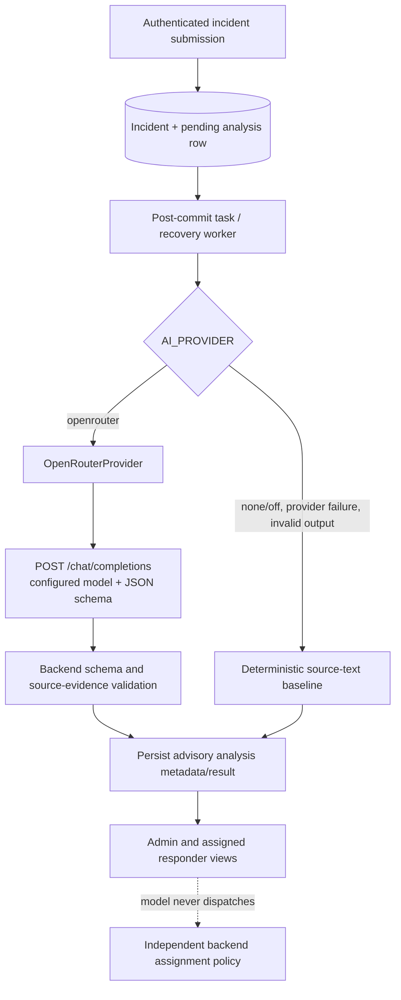

# Gemma 4 / OpenRouter integration audit

**Audit date:** 2026-10-25
**Scope:** checked-out source, current local backend configuration, focused automated tests, and public OpenRouter catalog information. This is a source and development-environment audit, not a production certification.

## Local diagnosis of the controlled connection failure (2026-10-25)

- **First controlled run (approximately 2026-10-25 00:04 Asia/Kolkata):** one adapter invocation and one outbound POST attempt were observed. No HTTP response or status was received. The caller recorded only `ProviderConnectionError`; it did not save a traceback or exception representation.
- **First-run exception-chain availability:** that run preceded the safe-diagnostics change. At that point the adapter raised `RuntimeError("ProviderConnectionError") from None`, explicitly suppressing the lower-level HTTPX cause. The exception chain from this run cannot be recovered.
- **Logs:** no backend log or saved traceback was found in the repository. The Flutter log files are not records of this backend request and were not inspected for user data.
- **HTTP client configuration:** the adapter uses `httpx.AsyncClient(timeout=httpx.Timeout(settings.ai_timeout_seconds))` without an explicit proxy, transport, or TLS override. The configured timeout was 8 seconds. HTTPX 0.28.1 defaults observed locally are `trust_env=True`, TLS certificate verification enabled (`verify=True`), and transport retries 0. No standard proxy (`HTTP_PROXY`, `HTTPS_PROXY`, `ALL_PROXY`, `NO_PROXY`, including lowercase forms) or certificate override (`SSL_CERT_FILE`, `SSL_CERT_DIR`, `CURL_CA_BUNDLE`) variables were set in the diagnostic shell. These are local environment observations, not a preserved snapshot of every setting in the failed process.
- **Cause assessment:** local evidence supports only a request/connection-layer failure before an HTTP response. It does not identify DNS resolution, TCP connection, TLS validation, proxy behavior, or local/network policy as the specific cause. No more specific cause is established.
- **Safe error reporting:** recording a fixed diagnostic category without exception text, headers, prompt, or response body is safe. The first run cannot be more specifically classified because its cause was suppressed. The second run's finer-grained category is described below.
- **Diagnostics unavailable:** neither run persisted the HTTPX exception details or an OS/TLS cause. The exact DNS result, provider receipt/billing, and provider-side status are unavailable. No additional network diagnostic was performed.
- **Safest next step:** review OpenRouter Activity manually for the controlled attempt's time window to see whether it was recorded. If it was not, have the local network/operator inspect DNS, outbound HTTPS, TLS trust, proxy, and firewall policy using local diagnostic tools. Do not retry inference until explicitly authorized; if further diagnosis requires another provider call, it must be separately authorized.

## Safe connection diagnostics implementation (2026-10-25)

The OpenRouter adapter now keeps the original HTTPX exception internally as the `__cause__` of the existing public `RuntimeError` or `ValueError`. The public exception types and safe messages are preserved, so existing fallback handling remains in place. A fixed allowlist classifies timeout, TLS, proxy, connection, transport, HTTP status, malformed response, provider-returned error, and transient provider errors. TLS is labeled only when an SSL exception is present in the local exception chain. HTTP status is stored as a numeric field where applicable. No raw exception text, request headers, API key, incident content, or response body is logged. The analysis service records only the allowlisted diagnostic category; deterministic fallback and incident persistence ordering are unchanged. No retry or alternate-provider request was added. The controlled verifier calls the adapter directly and does not use the incident service's configured retry loop.

Mocked HTTPX tests verify exception category and cause retention for connect, TLS, and timeout errors; safe classification for HTTP status, malformed response, and provider error payloads; and that diagnostic metadata/logs omit the synthetic credential marker and Authorization header text. A mocked connection failure still returns the rules-based deterministic result with `human_review_required=true`.

Provider-isolated test command run from `backend/`:

```text
AI_PROVIDER=none OPENROUTER_API_KEY= .venv/bin/pytest -q tests/test_intelligence.py
23 passed, 1 warning in 0.14s
```


## Repeated-failure local evidence review (2026-10-25)

| Attempt | Evidence captured | Diagnostic interpretation |
|---|---|---|
| First, approximately 00:04 Asia/Kolkata | One adapter invocation, one POST attempt, no status; safe category `ProviderConnectionError` | The then-current adapter used `raise ... from None`; the lower-level exception type/cause was discarded. No DNS, TCP, TLS, proxy, or timeout distinction is possible from this attempt. |
| Second, approximately 00:10 Asia/Kolkata | One adapter invocation, one POST attempt, no status; category `ProviderConnectionError`; verifier did not serialize the cause | At that time the updated classifier retained the HTTPX error as `__cause__` during the process. Its category means the classifier did not see a timeout, `ssl.SSLError`, or `httpx.ProxyError`; it classified the error as `httpx.ConnectError`/`httpx.NetworkError`. The exact subclass and nested OS error were not emitted or persisted. |

The second category means the classifier saw an `httpx.ConnectError` or another `httpx.NetworkError`. That family includes connection establishment and network read/write/close errors, so this does not prove the failure happened during DNS resolution or TCP connect. It argues against a surfaced `ssl.SSLError`, `httpx.ProxyError`, or HTTPX timeout in that attempt, but it cannot exclude every TLS handshake or intermediary failure. No HTTP response was received on either attempt, so neither indicates an OpenRouter HTTP/API error.

No backend traceback or request exception was persisted in logs, database records, or verifier output. The controlled calls directly invoked the adapter and did not run the incident persistence workflow. The first cause was discarded in code; the second was held only in the short-lived exception chain and then lost when the verifier process exited. **The exact root cause is not recoverable from the available evidence.**

Current local runtime inspection (not a preserved per-attempt runtime snapshot): the project virtual environment is Python 3.14.2 with HTTPX 0.28.1. HTTPX client defaults are `trust_env=True`, `verify=True`, `follow_redirects=False`; `AsyncHTTPTransport` defaults to zero retries. The adapter supplies its configured 8-second timeout and no explicit proxy/TLS override. Standard proxy and CA override environment variable names were unset in the diagnostic shell; their values were not read. The system OpenSSL default cafile/capath locations were unavailable, but HTTPX's default SSL-context implementation uses its `certifi` bundle when no CA override is set; that bundled file exists locally and contains CA certificates. This confirms local trust material is available, not that the remote certificate chain or network path succeeded. The exact Python executable used by each prior verifier was not recorded.

### Safest next diagnostics, in order

1. Ask the local network/operator to inspect already-existing resolver, firewall, proxy, and TLS/security logs around **2026-10-25 00:04 and 00:10 Asia/Kolkata**. This can distinguish local DNS failure, refused/reset outbound TCP, proxy rejection, or TLS interception without sending a new request.
2. If those logs do not contain evidence, preserve a future approved verifier's sanitized exception class chain and safe OS error number/category in its local output. Do not include exception messages, request objects, headers, prompts, or response bodies.
3. Only if local evidence remains inconclusive, request separate authorization before any network diagnostic or provider call. No DNS, socket, TLS, or HTTP probe was performed for this review.

Gemma remains **unverified**. No tests or network checks were run during this review.

## Safe exception-chain diagnostics refinement (2026-10-25)

### Inspection finding

The adapter already retained the original HTTPX exception as `__cause__`, but the incident-analysis handler recorded only a broad category. That was insufficient for future workflow diagnostics because it discarded the useful distinction between a resolver error, a refused TCP connection, and other `NetworkError` types. The controlled verifier called the adapter directly, so it could inspect `__cause__`, but prior verifier output did not preserve even the safe exception class chain.

### Local implementation

`backend/app/intelligence.py` now derives only allowlisted exception class names from the exception/cause/context chain and includes them with the safe category in service metadata and the structured analysis log. Existing public exception classes and safe messages are preserved. The audit event receives only the category, safe class-name list, and numeric status where available; it receives no exception strings or request/response data.

Classification is deliberately limited to what the concrete exception supports:

| Diagnostic | Classification rule |
|---|---|
| DNS resolution | `ProviderDNSResolutionError` only when an `httpx.ConnectError` chain contains `socket.gaierror`. |
| TCP connect | `ProviderTCPConnectionError` only when an `httpx.ConnectError` chain contains `ConnectionRefusedError`, `ConnectionResetError`, or `ConnectionAbortedError`. |
| Generic connection/network | `ProviderConnectionError` when the error is a connect/network error without the specific evidence above; no DNS/TCP guess is made. This includes read/write/close network errors. |
| TLS/certificate | `ProviderTLSFailure` when an `ssl.SSLError` occurs in the chain. |
| Proxy | `ProviderProxyError` for `httpx.ProxyError`. |
| Timeout | Connect/read/write/pool timeout classes have distinct diagnostic categories; the public exception message remains `ProviderTimeout`. |
| HTTP/provider response | HTTP failures retain numeric status and safe category; malformed response and provider error payloads retain safe categories without their bodies. |

The direct adapter still performs one POST per invocation with no adapter retry or alternate provider. The controlled test calls the adapter directly; it does not enter the outer incident service retry loop. Incident persistence and deterministic fallback logic were not changed.

### Isolated test evidence

Before running, `backend/tests/conftest.py` was inspected: it sets `AI_PROVIDER=none` and clears `OPENROUTER_API_KEY`. Every adapter test in `test_intelligence.py` replaces `httpx.AsyncClient` with a mock. The expanded cases cover DNS, TCP refusal, generic read reset without misclassifying it as a connect failure, TLS, proxy, read/connect timeouts, HTTP status, malformed output, provider error payload, safe chained class names, one POST per direct adapter call, no provider-factory/alternate-provider use, and unchanged deterministic fallback.

Command run from the internal repository's `backend/` directory:

```text
AI_PROVIDER=none OPENROUTER_API_KEY= .venv/bin/pytest -q tests/test_intelligence.py
28 passed, 2 warnings in 0.09s
```

One warning is the existing Starlette/httpx deprecation. The other reports that pytest could not write its cache under the internal repository. The pytest output also resolved the `.venv` package installation to the old external-drive venv path; the test/source working directory was the internal copy, and no external repository files were modified, but the runner was not fully internal-storage-only. Do not rely on this result as a clean internal-environment build; use a verified internal Python environment for the next local test run. Tests were provider-isolated and used mocks; no provider request was sent.

At this point in the historical audit, real Gemma inference remained unverified. The later Phase 5 result below records the first validated completion.

## Internal-only Python environment preparation (2026-10-25)

The authoritative repository root was confirmed as `/Users/qazizaid/Desktop/emergency_coordination_system`. The existing `backend/.venv` is a directory, not a symlink; its internal `pyvenv.cfg` contains a prior creation command referencing the external-drive project. That environment was not activated, executed, or followed. No external project source was inspected.

The absolute system interpreter `/Library/Frameworks/Python.framework/Versions/3.14/bin/python3` was verified as Python 3.14.2, arm64, then used to create a new root-level `.venv-internal`. Its interpreter reports:

| Isolation evidence | Value |
|---|---|
| `sys.executable` | `/Users/qazizaid/Desktop/emergency_coordination_system/.venv-internal/bin/python` |
| Python / architecture | 3.14.2 / arm64 |
| `sys.prefix` | `/Users/qazizaid/Desktop/emergency_coordination_system/.venv-internal` |
| `sys.base_prefix` | `/Library/Frameworks/Python.framework/Versions/3.14` |
| System site packages | Disabled (`include-system-site-packages = false`) |
| External project path in isolated `sys.path` | No |
| `pip` package | Located under `.venv-internal/lib/python3.14/site-packages` |
| Git ignore | `.venv-internal/` added to root `.gitignore`; `git check-ignore` confirms the environment is ignored. |

After authorization to download packages from PyPI, the backend and test dependencies were installed only into `.venv-internal` from `backend/requirements-dev.txt`, using pip isolated mode:

```text
env -u PYTHONPATH -u PYTHONHOME .venv-internal/bin/python -I -m pip install --isolated --disable-pip-version-check --retries 0 -r backend/requirements-dev.txt
```

The verified package origins for HTTPX 0.28.1, pytest 8.4.2, FastAPI 0.162.0, Uvicorn 0.54.0, SQLAlchemy 2.1.6, Alembic 1.20.1, psycopg 3.3.6, PyJWT 2.15.1, pwdlib 0.3.1, pydantic-settings 2.16.1, and email-validator 2.3.0 are all inside `.venv-internal/lib/python3.14/site-packages`. The interpreter has no external-project path in `sys.path`.

Test isolation was confirmed before execution: `conftest.py` sets provider-off and clears the key before importing the application, and every OpenRouter adapter test in the selected file replaces the HTTPX client with a mock. The test command, run from `backend/`, was:

```text
AI_PROVIDER=none OPENROUTER_API_KEY= PYTHONDONTWRITEBYTECODE=1 ../.venv-internal/bin/python -m pytest -q -p no:cacheprovider tests/test_intelligence.py
28 passed, 1 warning in 0.11s
```

The warning is the existing Starlette deprecation for its HTTPX test client. The tests used the internal interpreter and package paths, contacted no provider, and exercised no incident workflow or background worker.

**Environment status:** `.venv-internal` is ready for future local-only backend testing and does not depend on the old external-drive project. The old `backend/.venv` was not activated or executed during this phase. The prior Gemma connection failures remain unresolved; no OpenRouter request or live inference occurred. No production setting, database, Admin Copilot, or UI change was made.

## Final local system-log review (2026-10-25)

### Timestamp precision

The audit records the first request as approximately **00:04 Asia/Kolkata** and the second as approximately **00:10 Asia/Kolkata** on 2026-10-25. The timezone is known (IST, UTC+05:30), but seconds and exact start/end times were not captured. System logs therefore cannot be correlated to the exact request instants; only a broader local window can be reviewed.

### Local sources inspected

| Source | Access/result |
|---|---|
| macOS unified log (`log show`) | A query for 2026-10-25 00:00–00:15 IST, filtered to resolver, firewall, trust, network, and proxy-related processes, exited with status 64 and yielded no event records. A recent-window query returned no useful event detail. Historical unified-log evidence was therefore not available to inspect in this run; the command failure was not enough to distinguish permissions, date parsing, or another CLI issue. |
| `/var/log/system.log` | Readable; the file contained only 2 lines. A local scan for the 00:00–00:15 IST window and DNS, firewall, proxy, TLS/certificate, trust, and connection indicators found no matching event. Raw log lines were not printed. |
| `/var/log/appfirewall.log` | Not readable at this path. |
| `/Library/Logs` | A filename-only search to depth 3 for DNS, firewall, proxy, TLS, trust, and network log names found no matches. |
| Proxy and CA environment | No standard proxy or CA-override variable names were set in the current diagnostic shell. Values were not read. This is not a preserved environment snapshot from either request. |

Current local configuration remains HTTPX 0.28.1 in the project virtual environment, with `trust_env=True`, certificate verification and hostname checks enabled, redirects disabled, and zero transport retries. HTTPX uses an existing local `certifi` bundle (present); the system OpenSSL default cafile/capath paths themselves are unavailable. The adapter configures no explicit proxy or TLS override. These observations do not prove what the network path or remote TLS handshake did during either attempt.

### Evidence and remaining uncertainty

No useful resolver, firewall, proxy, or TLS event was found in the accessible local text log. The unified-log query did not provide historical records. There is no exact timestamp or persisted exception chain to correlate. The first attempt's lower-level exception was suppressed; the second's cause existed only in memory and was not recorded. No specific DNS, TCP, TLS, proxy, timeout, or firewall cause is established, and the exact root cause is not recoverable from the evidence reviewed.

### Safest next step

Use macOS Console or a system administrator's existing local log access to inspect the broader **2026-10-25 00:00–00:15 IST** window for `mDNSResponder`, firewall, proxy/VPN, `trustd`, and network-extension events. This is read-only and sends no network traffic. If those historical logs are unavailable or empty, the cause remains unknown; any new network diagnostic would require separate authorization. No network lookup/probe or further provider request was made for this review.

## macOS Console options and future evidence plan (2026-10-25)

The macOS Console application is present at `/System/Applications/Utilities/Console.app`. It can display retained local unified-log events; it cannot recreate events that were not recorded or have expired. The existing audit's system-log search did not find an event, and the scoped `log show` query did not return historical records. `log config --status` also returned status 64 without readable settings. The local `log` manual says changing or reading logging configuration requires root access. No logging configuration was changed, and the current persist/debug levels remain unknown. Do not enable broader or persistent logging just for this diagnosis without system-administrator review.

### Read-only Console review

1. Open **Console** and select the local Mac under **Devices**.
2. Review retained events covering **2026-10-25 00:00–00:15 Asia/Kolkata** (the audit records only approximate attempt minutes, not seconds). Search separately for `mDNSResponder`, `trustd`, `networkd`, `configd`, `socketfilterfw`, and any installed VPN/proxy/network-extension process; then look for DNS/resolve, connect/socket, TLS/certificate/trust, proxy, timeout, and block/deny terms.
3. If info/debug messages are hidden, use Console's view filters to display already-retained messages. Do not change system logging levels or persistence settings. If the events are absent, record that no retained evidence is available; do not infer that no failure occurred.
4. Share only timestamp, process/subsystem, and a redacted event category with the administrator. Do not export a full log archive or share raw entries, which can contain unrelated private data.

### What would distinguish the causes

| Cause | Useful evidence if already logged or safely captured in a future authorized attempt |
|---|---|
| DNS resolution | Nested `socket.gaierror` / `EAI_NONAME` / `EAI_AGAIN`; matching resolver (`mDNSResponder`) lookup failure or timeout. |
| TCP connection | Nested refused/reset/unreachable socket error or corresponding firewall/network event. A generic `ConnectError` alone does not identify which. |
| TLS/certificate | `ssl.SSLCertVerificationError` / `ssl.SSLError`, a certificate verification code, or a matching `trustd` evaluation event. Do not capture or share private certificate data. |
| Proxy/VPN | `httpx.ProxyError` or a matching proxy/VPN/network-extension rejection. Never expose proxy URLs or credentials. |
| Timeout | Concrete HTTPX timeout subclass (connect, read, write, or pool) and stage; the current safe category `ProviderTimeout` does not retain that stage. |

For the second attempt, `ProviderConnectionError` means the classifier saw `httpx.ConnectError` or another `httpx.NetworkError`; it did not observe a timeout, `ssl.SSLError`, or `httpx.ProxyError` in the in-memory chain. `NetworkError` also includes read/write/close failures, so the category does not establish DNS or TCP connection establishment as the cause.

If another attempt is explicitly authorized later, first prepare a one-request verifier to retain only allowlisted exception class names, safe OS error symbols/numbers, and the diagnostic category in local output. Do not print exception messages, request objects, headers, prompts, or response bodies. A local Console stream may be viewed during that already-authorized attempt, but no provider request or live log stream was started for this review. The original two root causes cannot be reconstructed from currently retained evidence.

## Current controlled-verification verdict (2026-10-25)

**FAILED.** Two separately authorized controlled verification runs have now each made exactly one adapter invocation and one outbound POST attempt. Both returned `ProviderConnectionError` before receiving an HTTP response. The latest run is detailed below. No successful completion has been received. A locally observed POST attempt does not prove whether OpenRouter received or billed it. Do not retry without separate authorization.

Preflight confirmed the local selection was `openrouter`, the configured model matched `google/gemma-4-31b-it`, the configured endpoint was `https://openrouter.ai/api/v1/chat/completions`, and a server key was present (its value was not read or printed). The adapter has one direct `AsyncClient.post` call, HTTPX transport retries default to 0, and redirect following defaults to false. The normal analysis service's retry/fallback wrapper was deliberately bypassed; the adapter was invoked directly once with synthetic data, then any returned data would have been validated locally. The configured local backend processes on ports 8001 and 8000 were stopped before the call to avoid competing background workers. No incident workflow, database operation, or production setting was used.

| Controlled-call evidence | Result |
|---|---|
| Adapter invocations | 1 |
| Outbound OpenRouter POST attempts observed in this process | 1 |
| HTTP response/status | None; connection failed before a response was received |
| Safe error category | `ProviderConnectionError` |
| Model/completion/finish/usage metadata | Unavailable |
| Structured output validation | Not reached |
| Deterministic fallback | No; direct adapter invocation only |
| Provider account activity checked | No |

### Final controlled connectivity attempt (2026-10-25, approximately 00:10 Asia/Kolkata)

The latest preflight confirmed the local settings still selected `openrouter`, the configured model was `google/gemma-4-31b-it`, the base URL was `https://openrouter.ai/api/v1` (adapter endpoint `https://openrouter.ai/api/v1/chat/completions`), and a server key was present. The key value was not printed. The adapter source contains one direct POST; HTTPX transport retries default to zero, redirects default to false, and ports 8000 and 8001 had no listening backend process. The direct adapter call bypassed incident workflows and persistence. A one-POST guard blocked any additional attempt.

| Latest attempt evidence | Result |
|---|---|
| Adapter invocations | 1 |
| Outbound POST attempts | 1 |
| HTTP status | None; no response received |
| Safe diagnostic category | `ProviderConnectionError` |
| Response model, completion ID, finish reason, token usage | Unavailable |
| Structured output validation | Not reached |
| Deterministic fallback | No |
| Verdict | **FAILED** |

No retry, follow-up request, endpoint probe, or database operation was performed. Provider receipt or billing remains unknown; account activity was not checked.

This outcome is not a successful Gemma inference. Review the OpenRouter Activity dashboard manually for the call window to determine whether the provider recorded it; do not share prompts or credentials. Any later live retry requires a separate explicit verification run.

## Finding

**The backend contains an actual, selectable OpenRouter integration for `google/gemma-4-31b-it`. The updated local environment resolves to `AI_PROVIDER=openrouter`, with the expected model ID and official API base URL.** The key is loaded server-side; its value is not recorded. Configuration loading is verified, but a successful live inference is not.

OpenRouter's public model catalog currently lists the exact ID, JSON-schema structured output support, and standard rates of $0.09 per million input tokens and $0.34 per million output tokens. This establishes catalog availability, not authorization, balance, account access, or a successful request from this project. The exact model page also reports multiple serving providers and routing. [OpenRouter model details and pricing](https://openrouter.ai/google/gemma-4-31b-it)

In the first follow-up test run after the local provider was enabled, the workflow test showed an initial stored analysis from `rules_baseline`, then its analysis-retry endpoint returned 202 instead of the test's expected 409. The retried result was not inspected. At that time the test suite had not forced `AI_PROVIDER=none`, so provider selection may have been active. No provider request counter, HTTP status, or model response was recorded for that run. The exact request count and outcomes are **unknown**; they must not be inferred from the workflow paths or retry limit. This is **not** evidence of a successful live inference. The two later controlled attempts are reported above; both failed at the connection stage.

## Actual request and feature paths



- `backend/app/config.py` defaults `AI_PROVIDER` to `none`, `OPENROUTER_BASE_URL` to `https://openrouter.ai/api/v1`, and `OPENROUTER_MODEL` to `google/gemma-4-31b-it`. OpenRouter settings are server-side only. `AI_PROVIDER=openrouter` requires a key and clean HTTPS URL.
- `backend/app/intelligence.py` selects `OpenRouterProvider` only when `AI_PROVIDER=openrouter`. It sends `POST {base_url}/chat/completions` with the configured model, a strict JSON-schema response format, temperature 0, max output 1200 tokens, and an 8-second default timeout. It sends the incident category, description, severity, and urgency; location label/accuracy are omitted unless `AI_SHARE_INCIDENT_LOCATION=true`; coordinates are not included.
- Incident submission persists the incident and pending `IncidentAnalysis` row before analysis. A post-commit FastAPI task handles normal work; a database polling recovery loop reclaims pending/stale work. Analysis is advisory and separate from automatic assignment.
- The backend validates output fields and quoted evidence against the original report. It rejects unsupported content and falls back to deterministic source-text analysis. The prompt treats incident text as untrusted. Logs include provider/outcome/latency/token metadata, not report content.
- Explicit transient HTTP status failures may be retried within the configured attempt limit. A timeout is not retried because the upstream request may have been processed or billed. Provider HTTP errors do not expose response bodies.
- The responder's “Improve with AI” action calls `/responder/incidents/{id}/rewrite`; it is an optional OpenRouter text rewrite, constrained and returned as a draft requiring responder review. With the provider disabled, it returns the source note unchanged.
- `/admin/copilot` is fixed, read-only database query logic and labels its result `generated_by: rules_based`. It does **not** invoke Gemma.
- Neither model output nor the responder rewrite can authorize dispatch, alter status, or create records. The model has no tools or database access.

## Configuration and secret handling

| Setting | Current local effective value | Source behavior |
|---|---|---|
| `AI_PROVIDER` | `openrouter` in the updated local backend environment | Selects the existing OpenRouter adapter |
| `OPENROUTER_MODEL` | `google/gemma-4-31b-it` | Configurable server-side model ID |
| `OPENROUTER_BASE_URL` | `https://openrouter.ai/api/v1` | Configurable HTTPS gateway |
| Server key | Loaded in the updated local backend environment | Value deliberately not inspected, logged, or documented |
| `AI_TIMEOUT_SECONDS` | `8` | Pydantic bounds: 1–30 seconds |
| `AI_MAX_ATTEMPTS` | `2` | Pydantic bounds: 1–3 attempts |
| `AI_RATE_LIMIT_PER_MINUTE` | `60` | Process-local counter; not shared across API workers |
| `AI_SHARE_INCIDENT_LOCATION` | `false` | No incident location text sent by default |

The tracked `.env.example` contains only a placeholder, and `backend/.env` is ignored by Git. The actual credential was not read out to the terminal or included in this report. The user reports that the previously exposed key was rotated. Keep the replacement secret out of Git, browser/mobile config, logs, and screenshots.

## Evidence table

| Claim | Status | Evidence / limitation |
|---|---|---|
| Exact Gemma model ID is in OpenRouter's current public catalog | **Verified** | Official model page; catalog presence does not prove this account can invoke it. |
| OpenRouter adapter exists and targets the configured model | **Verified in source** | `backend/app/intelligence.py`; mocked request test checks endpoint, model, bearer header, schema and omitted location. |
| Backend analysis service exposes successful HTTP status metadata | **Implemented and mocked** | `ProviderOutput.http_status_code` is returned in service metadata; mock asserts status 200. No real status was captured. |
| Server configuration currently invokes Gemma | **True, configured** | Effective local setting is `AI_PROVIDER=openrouter`; this confirms selection only, not connectivity. |
| A successful live inference works with this account | **VERIFIED WORKING (one controlled completion)** | On 2026-10-25, one provider-isolated invocation received HTTP 200 from the configured Gemma model, and the existing adapter validation accepted the completion. See the Phase 5 result below; this verifies one completion only. |
| Analysis output cannot dispatch or overwrite source incident facts | **Verified in source/tests** | Server-side evidence validation; fallback rules; dispatch code is separate. |
| Admin Copilot is Gemma-powered | **False** | Endpoint performs fixed authorized queries and returns `generated_by: rules_based`. |
| Notification delivery is caused by Gemma | **False** | Model analysis does not establish notification delivery; notification workflow is separate. |
| Model costs are zero | **False** | Standard endpoint is priced per token; verify account pricing/limits before enabling. Prices can change. |

## Test evidence

Focused command run from `backend/` with provider access explicitly disabled to prevent network requests from tests:

```text
.venv/bin/pytest -q tests/test_intelligence.py tests/test_analysis_queue.py tests/test_workflow.py
23 passed, 1 warning in 1.76s
```

The warning is Starlette's deprecation warning for its `httpx` test client. This isolated run used `AI_PROVIDER=none OPENROUTER_API_KEY=`. Tests use mocked/local execution and do not make paid network requests. Coverage includes exact endpoint/model/schema request construction, settings loading, missing-key, provider HTTP error, timeout, transient HTTP error, malformed output, deterministic fallback, analysis persistence/recovery, and incident workflow. The test harness now forces provider-off by default so developer `.env` settings cannot make network calls.

## Local evidence review and safe next steps

- No persistent backend `.log` file was found. The available log output from the restarted local process contains startup and `/health/ready` only; it contains no inference request.
- `analyze_incident_payload` logs provider, outcome, latency, and token count only after analysis completes. It does not log HTTP status, provider request count, or retry attempt number. The `ProviderOutput.http_status_code` metadata was added after the earlier test run, so it cannot recover that run's status.
- The earlier workflow test's available output confirms that the stored analysis provider was `rules_baseline`. The test database was in-memory and dropped after the test. It does not reveal whether an outbound call happened or why fallback occurred.
- Current provider configuration and API readiness are verified locally (`AI_PROVIDER=openrouter`; API health returned HTTP 200). Neither establishes model connectivity.

### Check account activity manually

I did not access the OpenRouter account or check private activity. Open the official [OpenRouter Activity dashboard](https://openrouter.ai/activity) while signed in. Review the full local day **2026-10-24, Asia/Kolkata** for the earlier suite run, whose time was not retained, and the controlled attempt around **2026-10-25 00:04 Asia/Kolkata** (**2026-10-24 18:34 UTC**). Filter/group by `google/gemma-4-31b-it` and the relevant API key if the dashboard offers that filter. Inspect request count, timestamps, routed provider/model, finish/status details, token usage, and cost. Avoid opening or exporting prompt content. OpenRouter describes request-level logs and generation details in its [Activity dashboard guide](https://openrouter.ai/blog/announcements/activity-dashboard/).

No account usage information has been provided yet. Once you share only the non-secret dashboard findings (counts, timestamps, model/provider, statuses, tokens, cost), record them below. Do not share the API key or prompt text.

Other remaining checks: review current model pricing/account limits and provider data handling before using incident descriptions; usage may incur charges. [Current model page](https://openrouter.ai/google/gemma-4-31b-it). For multiple API processes, use a shared limiter if aggregate rate control is required.

## Earlier configuration and test follow-up (2026-10-24)

- **Code/config inspected:** `AI_PROVIDER=openrouter` selects the existing adapter. The backend-resolved model and endpoint are the requested Gemma ID and OpenRouter chat-completions URL.
- **Live inference at that time:** **Not verified.** The first test run after activation did not isolate the suite from `.env`; its initial workflow analysis was rules-based and the subsequent retry result was not inspected. No local evidence establishes whether an external request occurred, the count, or outcomes. Both controlled attempts on 2026-10-25 are separately recorded above.
- **Local configuration:** The user-provided environment resolves to `AI_PROVIDER=openrouter`; no key value was printed. The API was restarted on `127.0.0.1:8001` and `/health/ready` returned HTTP 200. The database-backed analysis queue was empty before restart. No production or hosted setting was changed.
- **Automated evidence:** `23 passed, 1 warning` for the focused tests, rerun with provider access explicitly disabled. These tests are not a successful OpenRouter API call.
- **OpenRouter account activity:** Not checked. User review required; no usage findings have been supplied.
- **Admin Copilot:** remains rules-based, read-only behavior; it was not changed or represented as Gemma-powered.
- **Safety:** incident persistence is committed before analysis; the isolated workflow test confirms intake succeeds with deterministic fallback. Dispatch remains independent from model output.

### Historical blocker before controlled attempt

The exact number and outcomes of any provider requests from the first test execution are unknown; do not estimate the count from the test's workflow steps. Do not mark Gemma as working from current evidence. Review OpenRouter account activity manually; only after reconciling it should a separate controlled live verification be considered. Automated tests now force provider-off and must remain isolated.

This academic/demo system is not certified for emergency-services dispatch.

### Internal environment isolation test (2026-10-25)

- Repository root verified as `/Users/qazizaid/Desktop/emergency_coordination_system`; the command used only `.venv-internal/bin/python` (Python 3.14.2, arm64).
- Exact command from `backend/`: `AI_PROVIDER=none OPENROUTER_API_KEY= ../.venv-internal/bin/python -m pytest -q tests/test_intelligence.py`.
- Result: **1 failed, 34 passed, 1 warning**. The failure is `test_openrouter_errors_keep_safe_categories_without_credentials[empty-ProviderMalformedResponse-ValueError-None]`: for a mocked 204/empty response, the implementation exposes `('ValueError',)` in `diagnostic_exception_types`, while the test expects `()`.
- Provider access was disabled in the command environment and by `backend/tests/conftest.py` before application imports. Every OpenRouter adapter HTTP interaction in the selected test file used a monkeypatched `httpx.AsyncClient`; no live provider request was made.
- `git diff --check` passed. This run did not modify application code or configuration.

### Diagnostic metadata regression follow-up (2026-10-25)

- Root cause: the empty-response mock raised a generic `ValueError`, while the assertion expected no diagnostic cause. Empty or malformed JSON is a provider response decoding failure; retaining its safe decoder exception type is intentional and consistent with the malformed-response path.
- Updated the focused mock to raise `json.JSONDecodeError`, matching HTTPX response decoding, and asserted that both malformed and empty bodies retain `JSONDecodeError` in diagnostic metadata. Production behavior and public exception messages were unchanged.
- Internal-environment command from `backend/`: `AI_PROVIDER=none OPENROUTER_API_KEY= ../.venv-internal/bin/python -m pytest -q tests/test_intelligence.py`.
- Result: **35 passed, 1 warning in 0.10s**. All provider HTTP interactions in this file remain mocked; no live provider request was made.

### Phase 5: one controlled live Gemma verification (2026-10-25)

- **Outcome: VERIFIED WORKING for one controlled completion.** The effective settings selected `AI_PROVIDER=openrouter`, model `google/gemma-4-31b-it`, and endpoint `https://openrouter.ai/api/v1/chat/completions`; key presence was confirmed without printing its value.
- Exactly **1 adapter invocation** produced exactly **1 outbound POST**. The in-memory attempt limit was set to one, redirects were disabled, and the HTTPX transport retry default was zero. No alternate provider, incident workflow, background task, database write, or follow-up request was used.
- Result: HTTP **200**; response model `google/gemma-4-31b-it`; completion ID `gen-1792870014-cvvW2sqbxvLp8XmzHBbR`; finish reason `stop`; usage **228 tokens**. The genuine completion passed the existing structured analysis validation. Deterministic fallback was **not** returned.
- No diagnostic error was produced. The request used synthetic, non-sensitive verification text. No key, authorization header, or raw environment value was printed.

## Phase 6: application integration and safety audit (2026-10-25)

### Incident-analysis execution path

1. **Submission and durable intake:** `POST /api/v1/user/incidents` is handled by `backend/app/api.py:create_user_incident`. The caller's category, description, severity, and urgency are stored as an `Incident`; priority is calculated by `priority_for`. The handler inserts a pending `IncidentAnalysis` row and commits the transaction before adding `analyze_incident_task` to FastAPI `BackgroundTasks`. The initial response deliberately omits analysis (`incident_view(..., include_analysis=False)`).
2. **Payload construction:** `backend/app/intelligence.py:analyze_incident_task` claims a pending analysis row, increments its task-attempt count, and constructs the analysis payload from the persisted incident. It then calls `analyze_incident_payload`; the function does not merely rely on module imports to establish a connection.
3. **Provider selection:** `backend/app/config.py:get_settings` loads effective settings. `backend/app/intelligence.py:_configured_provider` returns no provider for `AI_PROVIDER=none/off`, `OpenRouterProvider` for `openrouter`, or `OpenAICompatibleProvider` for `openai_compatible`. The adapter sends the configured model ID. The live baseline verification confirmed `openrouter` and `google/gemma-4-31b-it`; the automated workflow tests force the provider off.
4. **OpenRouter call and input:** `OpenRouterProvider.analyze` in `backend/app/intelligence.py` sends one `POST` to `{openrouter_base_url}/chat/completions` with a strict JSON-schema request. It sends emergency category, description, severity, and urgency. Location label and accuracy are included only when `AI_SHARE_INCIDENT_LOCATION=true`; coordinates are not sent by this adapter.
5. **Parsing and validation:** The adapter checks HTTP status, decodes the JSON body, and extracts `choices[0].message.content`. `validate_analysis` validates the Pydantic schema, constrains summary terms to report text, checks exact quoted evidence, and requires human review. It replaces model-authored explanation/confidence text with fixed safe text. Invalid or malformed content is rejected.
6. **Storage and retrieval:** `analyze_incident_task` serializes the result and commits it with provider, model, validation outcome, token usage, latency, and safe error metadata on `IncidentAnalysis`; it adds an `incident.analysis_completed` audit event. Authorized non-caller views expose the analysis via `incident_view`; the submitting user does not receive it from the initial submission response.
7. **Fallback behavior:** `analyze_incident_payload` returns `deterministic_analysis` when no provider is configured, when output validation fails, when a provider error occurs, or when the rate limiter blocks a call. The task has an outer exception guard that attempts the deterministic result so an analysis defect does not roll back the already committed incident. If even deterministic analysis fails, the analysis record becomes unavailable.
8. **Retries and queueing:** Explicit provider transient statuses (408, 429, and 5xx) raise `ProviderTransientError` and may be retried up to `ai_max_attempts` (settings bound this to 1–3). Network errors and timeouts go to fallback without an adapter retry; the timeout path explicitly avoids replay because the upstream call may have been billed. `run_analysis_recovery_worker` polls persisted work outside the `test` environment. `next_pending_analysis_job` recovers stale processing rows and stops rows at `_ANALYSIS_MAX_JOB_ATTEMPTS=3`. A process crash after a POST but before task completion can therefore cause a later recovery attempt to repeat analysis. An authorized administrator can also explicitly request a new attempt through `POST /admin/incidents/{id}/analysis/retry`; that endpoint rejects an already successful result and a recent in-progress task. These mechanisms can produce additional provider requests after the original task, even though each individual adapter invocation makes one POST absent the service-level transient retry loop.

### Feature integration status

| Feature | Status | Source finding |
|---|---|---|
| Authoritative incident category and dispatch priority | `RULE-BASED OR DETERMINISTIC` | Category is submitted by the caller; `priority_for` uses category, severity, and urgency. AI does not rewrite the incident fields. |
| Advisory AI-suggested category | `CONFIRMED CONNECTED TO GEMMA ADAPTER` | `IncidentAnalysisResult.suggested_category` is part of the response produced by `OpenRouterProvider` and stored as analysis output when OpenRouter is selected. It remains advisory. |
| Incident analysis summary | `CONFIRMED CONNECTED TO GEMMA ADAPTER` | The same validated adapter result contains `summary` and is persisted in the analysis result. The Phase 5 live check validated an adapter/service result, not an application endpoint/database workflow. |
| Conversational follow-up questions | `RULE-BASED OR DETERMINISTIC` | `get_incident_intake` chooses questions using the incident category and report text. It also returns `ai_missing_information` from a stored analysis when available; user answers are stored as user-reported data and do not call a model. |
| Responder candidate recommendations | `RULE-BASED OR DETERMINISTIC` | `responder_recommendations` scores eligible profiles using capability, active assignment, workload, and fresh accurate location. It returns `human_approval_required: true`. Automatic assignment is a separate deterministic policy path. |
| Responder-note rewriting | `CONFIRMED CONNECTED TO GEMMA ADAPTER` | `rewrite_responder_note` makes its own OpenRouter `POST` using the configured base URL/model when enabled. It is a separate HTTP path rather than `OpenRouterProvider`; output is checked for unsupported terms and changed uncertainty/negation and falls back to the original note. Its selected test mocks HTTPX; no feature-specific live request was made. |
| Resolution reports | `RULE-BASED OR DETERMINISTIC` | `create_resolution_report` builds an evidence template from persisted incident/update/assignment records and labels it `generated_by="evidence_template"`; it states that cause and outcomes are not independently verified. |
| Admin Copilot | `RULE-BASED OR DETERMINISTIC` | `admin_copilot` routes to fixed read-only database queries and returns `generated_by="rules_based"`. No model call exists in this path. |
| Full live incident submission-to-analysis persistence with Gemma | `UNVERIFIED` | The live verification exercised the configured analysis service/adapter with synthetic data. It did not submit an incident through the API or persist a live Gemma result end to end. |

### Safety boundaries and evidence

- **Dispatch is independent of AI output.** Initial priority uses `priority_for` and persisted caller-selected category/severity/urgency. Manual `assign_incident` requires an authorized admin, an active responder, capability/availability checks, no conflicting assignment, and a compatible available resource. `automatic_candidate` is deterministic and requires the configured policy plus capability, availability, no active assignment, and fresh accurate incident/responder locations. The automatic policy defaults disabled and is enabled only through the super-admin policy route. No model output authorizes or selects a responder.
- **Persistence does not depend on inference success.** The incident and pending analysis row commit before the background task starts. Provider-disabled and failure paths return deterministic analysis; an outer task guard records fallback or unavailable without rolling back the incident.
- **Malformed output, provider failures, and timeouts are covered.** `test_intelligence.py` checks schema/evidence rejection, deterministic fallback, transient retry bounds, HTTPX transport/timeouts through mocked clients, and preserved priority. Tests assert safe error categories/class names without credential markers, Authorization header text, or incident descriptions in logs.
- **Logs and audit metadata are limited.** `analyze_incident_payload` logs provider/outcome, safe category and allowlisted exception classes, latency, and token count. The task records safe provider metadata and status in the audit event, not exception strings, headers, API keys, or incident descriptions. The rewrite endpoint audits only the rewrite outcome. The analysis result itself is stored separately as operational data.
- **Existing tests provide source-path evidence, with limits.** `test_workflow.py` checks that provider-off incident submission completes with `rules_baseline`, preserves user/admin scoping, and requires authorization for analysis retry and assignment. `test_notifications_automation.py` checks the explicit-policy automatic assignment path and conservative eligibility requirements. `test_conversational_features.py` checks optional follow-up, report scoping/unknown cause, and a mocked rewrite fallback. `test_intelligence.py` checks model-output validation and mocked provider behavior.
- **Queue-test limit at Phase 6:** `test_analysis_queue.py` was not run then because it created temporary on-disk SQLite databases. Phase 7 converted its database fixture to in-memory SQLite and ran the queue tests; details follow below. The `test` environment prevents `main.py` from starting the polling recovery worker during the selected TestClient runs.

### Provider-isolated application tests

Before execution, `backend/tests/conftest.py` was read: it sets `ENVIRONMENT=test`, `DATABASE_URL=sqlite:///:memory:`, `AI_PROVIDER=none`, and an empty `OPENROUTER_API_KEY` before importing the application. In `test_intelligence.py`, each actual adapter HTTP path replaces `httpx.AsyncClient` with a mock; the transient retry test uses an in-memory fake provider. The rewrite test also replaces `httpx.AsyncClient`. The selected workflow and feature tests use FastAPI's in-process TestClient and the in-memory database; they do not configure SMTP or make external HTTP requests. The one settings test that temporarily sets `AI_PROVIDER=openrouter` only constructs `Settings` and does not invoke a provider.

Exact command from `backend/`:

```text
AI_PROVIDER=none OPENROUTER_API_KEY= ../.venv-internal/bin/python -m pytest -q tests/test_intelligence.py tests/test_workflow.py tests/test_conversational_features.py tests/test_notifications_automation.py
```

Result: **47 passed, 1 warning in 2.26s**. The warning is Starlette's deprecation notice for its HTTPX test client. No live provider request or external network request was made. Queue-specific tests were excluded for the temporary database reason above.

### Verification boundary and recommended next step

The Phase 5 result establishes one successful live OpenRouter/Gemma adapter/service completion with structured validation. The Phase 6 suite establishes safe provider-off workflow behavior and feature-specific deterministic/mock behavior. Phase 7 verifies `analyze_incident_task` persistence, validation, and fallback with a mocked provider and in-memory SQLite. Phase 8 adds a provider-mocked API submission-to-background-task integration test. There is still no live Gemma call from incident submission through task persistence; do not describe the live end-to-end workflow as verified.

## Phase 7: incident-analysis task regression tests (2026-10-25)

`backend/tests/test_analysis_queue.py` now uses an in-memory SQLite engine for its task and queue tests. The tests reuse `_queued_incident`, monkeypatch only the `OpenRouterProvider` boundary, and execute the real `analyze_incident_task`, `analyze_incident_payload`, validation, fallback, and persistence code. Provider-off environment variables remain set by both the command and `backend/tests/conftest.py`; the synthetic key exists only in an in-memory `Settings` instance and is never used by the mock.

- **Successful result:** valid mock output passes normal schema/evidence validation; the validation-overwritten explanation/confidence values, provider/model, token usage, completion time, and audit metadata are persisted and read through a fresh SQLAlchemy session.
- **Provider failure:** a single controlled transient failure is not retried (`ai_max_attempts=1`), and the task persists the deterministic result with the existing `ready` status, `rules_baseline` provider, `transient_provider_failure` validation outcome, and `ProviderTransientError` last-error value. The incident remains present in the fresh session; no error is represented as validated AI output.
- **Malformed response data:** incomplete model output fails schema validation, is not persisted as AI analysis, and the existing deterministic fallback is stored with the implementation's `ready` / `rules_baseline` / `invalid_or_unavailable` values. This adds task-persistence coverage beyond the existing service-level malformed-output cases in `test_intelligence.py`.
- Existing pending-job claim and stale-job recovery tests were retained and converted from temporary file databases to the same in-memory fixture. No recovery worker was started.

Focused task/queue test command from `backend/`:

```text
AI_PROVIDER=none OPENROUTER_API_KEY= ../.venv-internal/bin/python -m pytest -q tests/test_analysis_queue.py
```

Result: **5 passed, 1 warning in 0.08s**.

The requested provider-isolated regression suite was rerun from `backend/`:

```text
AI_PROVIDER=none OPENROUTER_API_KEY= ../.venv-internal/bin/python -m pytest -q tests/test_intelligence.py tests/test_workflow.py tests/test_conversational_features.py tests/test_notifications_automation.py
```

Result: **47 passed, 1 warning in 2.27s**. The warning in both runs is Starlette's HTTPX test-client deprecation. No live provider or external network requests were made. `git diff --check` passed.

**Remaining gap:** tests now establish provider-mocked task-to-database persistence and provider-off application workflows. They do not exercise the full `create_user_incident` HTTP submission → FastAPI background task → mocked successful provider → persisted Gemma-shaped result path as one integrated test. Live end-to-end inference remains unverified.

## Phase 8: incident-to-analysis background execution audit (2026-10-25)

### Verified route and dispatch path

- `backend/app/api.py:create_user_incident` validates the request, creates the `Incident` and pending `IncidentAnalysis`, records submission metadata/notifications in the same database transaction, and commits at `db.commit()` before scheduling `analyze_incident_task` with `background_tasks.add_task`. The returned submission view omits analysis.
- `backend/tests/conftest.py` sets `ENVIRONMENT=test` and `DATABASE_URL=sqlite:///:memory:` before importing `app.main`. `backend/app/main.py:lifespan` starts `run_analysis_recovery_worker` only when the environment is not `test`, so the TestClient fixture does not launch the polling worker.
- The API test uses the existing `client` fixture and real `POST /api/v1/user/incidents` endpoint. FastAPI's actual `BackgroundTasks` collection schedules the callback, and Starlette's in-process TestClient executes it before the request completes. A test-only wrapper around the callback opens a fresh session to assert the incident and pending analysis row are already committed, then delegates to the real `analyze_incident_task`.
- The task itself claims the pending row and increments `attempt_count` in a transaction, loads the incident through its module `SessionLocal`, calls `analyze_incident_payload`, then persists result/status/provider/validation/error fields and audit metadata using a later session. The new test reads the final state using another fresh session.
- Only the provider boundary is replaced: the service's normal `_configured_provider` selection is retained, while `OpenRouterProvider` is replaced by a fake returning either valid model data or a controlled `ProviderTransientError`. `AI_PROVIDER=none` and an empty key remain set in the process environment before application imports; the task receives an in-memory `Settings` object solely to select the fake. No HTTP client is invoked.

### Test boundary

The integration exercises API request handling, commit-before-schedule ordering, FastAPI background callback dispatch, real task/service/validation/fallback/persistence code, and fresh-session reads. It does **not** exercise the production polling recovery worker, a durable queue broker, a separate process, or live Gemma inference. The callback wrapper observes and delegates; it is test instrumentation and is not a production queue-worker simulation. No worker/recovery loop was started. User notifications are database rows only in this test; no invitation or SMTP path is called.

Focused new API scheduling test, from `backend/`:

```text
AI_PROVIDER=none OPENROUTER_API_KEY= ../.venv-internal/bin/python -m pytest -q tests/test_analysis_queue.py -k incident_submission_schedules_real_analysis_task
```

Result: **2 passed, 5 deselected, 1 warning in 0.16s** (one case with valid mock output, one controlled provider failure).

Full in-memory task/queue test file:

```text
AI_PROVIDER=none OPENROUTER_API_KEY= ../.venv-internal/bin/python -m pytest -q tests/test_analysis_queue.py
```

Result: **7 passed, 1 warning in 0.19s**.

Existing provider-isolated regression suite:

```text
AI_PROVIDER=none OPENROUTER_API_KEY= ../.venv-internal/bin/python -m pytest -q tests/test_intelligence.py tests/test_workflow.py tests/test_conversational_features.py tests/test_notifications_automation.py
```

Result: **47 passed, 1 warning in 2.17s**. The warning is Starlette's HTTPX test-client deprecation. All test databases are in memory; no network calls or live provider requests occurred. `git diff --check` passed.

### Verification status

| Path element | Status | Evidence |
|---|---|---|
| API request handling | **VERIFIED** | Synthetic request passed through `POST /api/v1/user/incidents` and returned 201 in both mocked-provider cases. |
| Database commit before scheduling | **VERIFIED** | Scheduled callback observed the incident and its analysis row in `pending` state via a new session. |
| Scheduling/dispatch | **VERIFIED** | Real FastAPI `BackgroundTasks` scheduling and TestClient in-process dispatch ran the wrapped callback. The wrapper is instrumentation, not a production worker. |
| Task execution | **VERIFIED** | The wrapper delegated to the unmodified `analyze_incident_task`; provider fake was invoked once in each case. |
| Provider validation | **VERIFIED** | Valid response passed normal schema/evidence validation; the failure case took the transient-error fallback path. |
| Persistence/fallback | **VERIFIED** | Fresh sessions read validated AI-shaped analysis or the `rules_baseline` deterministic fallback with the expected existing status and error metadata. |

**Production-worker limitation:** no claim is made that the production polling worker, crash recovery, multi-process scheduling, or live incident-to-Gemma execution was verified. The remaining safe gap is a separate-process/worker integration harness with in-memory or isolated test storage and provider access mocked; live end-to-end inference remains unverified.

## Phase 9: production worker, recovery, and duplicate-processing audit (2026-10-25)

### Baseline confirmation

The source, tests, and prior audit entries agree with the reported baseline: one live adapter/service completion is recorded in Phase 5; provider-mocked task persistence/fallback and API-to-FastAPI-BackgroundTasks tests are in `backend/tests/test_analysis_queue.py`; the file has seven tests; and the provider-isolated suite has 47 tests. Phase 8 explicitly leaves the production polling worker and live incident-to-Gemma execution unverified. The seven-test queue result is historical Phase 8 evidence; this phase deliberately did not rerun the test that invokes stale recovery.

### Worker lifecycle and state transitions

- **Startup/shutdown:** `backend/app/main.py:lifespan` creates one `asyncio` task for `run_analysis_recovery_worker` whenever `settings.environment != "test"`. At lifespan exit it cancels the task and awaits its cancellation. There is no leader election or separate scheduler registration in this path; every non-test API process starts its own polling coroutine. `backend/tests/conftest.py` sets `ENVIRONMENT=test`, so TestClient runs do not start it.
- **Deployment configuration:** the checked-in `render.yaml` sets `ENVIRONMENT=production` but also `AI_PROVIDER=none`, and launches `sh ./start.sh`; that script migrates then execs Uvicorn without an explicit `--workers` setting. The checked-in deployment therefore configures the polling worker to run but analysis to use the deterministic baseline. Actual hosted environment overrides, replica count, and deployed process count were not inspected. There is no Celery/RQ/other broker or separate scheduler command in the checked-in deployment files. `backend/README.md` notes the provider rate limit is process-local, so it is not an aggregate limit across replicas/processes.
- **Polling:** `run_analysis_recovery_worker` calls `next_pending_analysis_job` in `asyncio.to_thread`, runs `analyze_incident_task` for a returned ID, immediately polls again after work, and sleeps one second when no job is found. It re-raises cancellation and catches other polling errors, logging only the exception class before continuing.
- **Recovery scan:** `next_pending_analysis_job` uses a five-minute `_ANALYSIS_RECOVERY_AFTER` threshold. Inside `SessionLocal.begin()`, it locks stale `processing` rows with `FOR UPDATE SKIP LOCKED`; rows below `_ANALYSIS_MAX_JOB_ATTEMPTS=3` become `pending` with `recovered_after_restart`, while rows already at three claims become `unavailable` / `retries_exhausted`. It then selects the oldest pending ID with `FOR UPDATE SKIP LOCKED` and commits the transaction when returning. The selector does not itself persist a claim before returning the ID.
- **Task claim:** `analyze_incident_task` opens a short `SessionLocal.begin()` transaction and runs an atomic `UPDATE ... WHERE incident_id=? AND status='pending'`, setting `processing`, incrementing `attempt_count`, and recording `last_attempt_at`. A non-one `rowcount` returns without calling the provider. It reads the persisted incident and builds the payload before that transaction closes. Provider analysis occurs outside the database transaction. The result is persisted in a separately scoped session; the task writes only if the analysis row still exists and currently has `processing` status.
- **State validation:** these functions enforce the main transitions in code (`pending → processing → ready/unavailable`, stale `processing → pending/unavailable`, and admin retry → `pending`). `IncidentAnalysis.status` and `validation_outcome` are plain string columns in `backend/app/models.py`; there is no database enum/check constraint or central state-transition validator. The conditional claim and final `processing` check are the guards. Unit tests cover successful claim, stale recovery/exhaustion, and expected persisted outcomes, but not invalid state values or multi-process races.
- **Session boundaries:** poll/recovery uses `SessionLocal.begin()` and exits before returning. Each task claim uses a separate transaction; provider I/O is not inside a DB transaction; result persistence and audit event use a new session and commit. The async worker offloads the poll function to a thread. No worker process or database connection was started for this audit.

### Duplicate execution and delivery semantics

| Event | Finding |
|---|---|
| Duplicate task invocation | Possible. FastAPI BackgroundTasks and the poller may both receive the same incident ID, and the poll selector releases its row lock before the task claims. The conditional `UPDATE` in `analyze_incident_task` normally lets only one caller move a pending row to processing; the losing invocation exits before provider access. A stale recovery or manual retry can deliberately make the row pending again while an earlier task may still be alive. |
| Duplicate outbound inference | Possible; exactly-once provider delivery is not guaranteed. A single `analyze_incident_payload` call may issue up to `ai_max_attempts` POSTs for explicit transient HTTP statuses. A stale recovery or manual retry can issue new POSTs in a later task execution. A crash after OpenRouter accepts a POST but before the application commits the result leaves only a stale `processing` row; recovery cannot tell whether the upstream request completed, and the retry may submit it again. The request has no provider idempotency key. |
| Duplicate analysis rows | Prevented per incident by `IncidentAnalysis.incident_id` being the table primary key. Re-executions update the same row; they do not insert a second analysis row. |
| Duplicate incident creation | Prevented for the same reporter/idempotency key by the `uq_incident_reporter_idempotency` database constraint, plus the endpoint's early lookup and `IntegrityError` recovery. `test_workflow.py` verifies that sequential identical submissions return the same incident ID. This is independent of analysis task duplication. |

The task's final `status == "processing"` check prevents a late task from overwriting a row already committed as `ready` or `unavailable`. There is no per-attempt lease/claim token, however. If a stale or manual retry resets a row while an older execution remains active, both may call the provider; whichever execution first persists while the row is `processing` wins, and the other later returns after seeing a terminal state. This can discard a later execution's result, even though it does not create a second `IncidentAnalysis` row.

### Retry limits and failure paths

- `Settings.ai_max_attempts` defaults to two and is bounded to 1–3 in `backend/app/config.py`. `analyze_incident_payload` enforces this only for `ProviderTransientError`, raised by the OpenRouter adapter for 408, 429, and 5xx responses. Each retry is another provider POST. Non-transient HTTP errors, malformed output, validation failures, HTTPX network errors, and timeouts fall back without this loop retry; timeouts are intentionally not replayed by the service.
- `_ANALYSIS_MAX_JOB_ATTEMPTS=3` counts successful task claims, not HTTP POSTs. It is enforced when a `processing` row is found stale. A task that catches a provider error normally writes a `ready` deterministic fallback, so the recovery poller does not automatically requeue it. The automatic three-claim ceiling therefore covers abandoned/crashed processing work, not all future executions.
- The admin route `retry_incident_analysis` requires an admin, rejects a `ready` row with no `last_error_type`, and rejects a `processing` row younger than 90 seconds. Otherwise it resets `attempt_count` to zero, clears timestamps/error state, commits `pending`, and schedules another FastAPI background task. There is no cumulative cap or rate limit on authorized manual retries; each request can restart the automatic claim allowance. Repeated manual retries can therefore repeatedly call the provider for permanently malformed output or persistent provider failures.
- Because stale recovery waits five minutes while admin retry allows reopening a `processing` row after 90 seconds, an admin retry can overlap a still-running task. The age check is not proof that the original task stopped. Likewise, a provider call that runs beyond the stale threshold can be reclaimed by the poller. No heartbeat or ownership token distinguishes the old and new execution.
- A persisted fallback from a provider error has `status=ready` and a non-empty `last_error_type`; it may later be replaced by a successful admin retry in the same row. A provider-disabled deterministic baseline has `last_error_type=None`, so the admin route treats it as already complete and returns 409 even though its outcome is `baseline`. The route's 409 message says “Validated analysis is already available,” which is broader than that actual condition.
- A completion already committed as `ready` is not overwritten by a later task because of the final status check. If an older active task and a reopened retry race while the row is again `processing`, there is no generation check; whichever persists first may be retained, and a later result is discarded. No exactly-once or newest-attempt-wins guarantee exists.

### Safe tests run for Phase 9

Provider-off fixtures were rechecked: `backend/tests/conftest.py` sets `AI_PROVIDER=none`, clears `OPENROUTER_API_KEY`, forces test environment, and configures in-memory SQLite before app imports. The selected queue filter excludes both `test_persisted_pending_analysis_is_claimed_and_completed` (which calls the poll selector) and `test_abandoned_analysis_is_recovered_and_exhausted_jobs_are_stopped` (which performs stale recovery). It therefore exercised task/API paths only; it did not run the production poller, a recovery selection, or an admin retry.

Focused safe task/API tests from `backend/`:

```text
AI_PROVIDER=none OPENROUTER_API_KEY= ../.venv-internal/bin/python -m pytest -q tests/test_analysis_queue.py -k 'analysis_task or incident_submission'
```

Result: **5 passed, 2 deselected, 1 warning in 0.18s**. The warning is Starlette's HTTPX test-client deprecation.

Provider-isolated regression suite from `backend/`:

```text
AI_PROVIDER=none OPENROUTER_API_KEY= ../.venv-internal/bin/python -m pytest -q tests/test_intelligence.py tests/test_workflow.py tests/test_conversational_features.py tests/test_notifications_automation.py
```

Result: **47 passed, 1 warning in 2.17s**. No provider HTTP boundary was live, no external network request was made, and TestClient did not start the recovery worker. The existing retry-route checks reject a successful analysis and an unauthorized caller; they do not schedule a real retry.

### Verified guarantees and remaining risks

- **Verified by source plus single-process tests:** intake persists before scheduling; repeated sequential idempotent submissions reuse an incident; a pending claim is conditional and increments its task counter once; service-level transient retries are bounded; normal provider failures fall back; one analysis row exists per incident; persisted terminal rows are not rewritten by a late task that observes a non-processing status.
- **Source-supported but not concurrency-tested:** the conditional SQL update is the intended cross-worker claim guard, and production requires PostgreSQL, which supports the row-locking clauses used. No multi-process, concurrent-worker, crash-window, or database-isolation test was run. SQLite/TestClient results do not establish those production properties.
- **Not guaranteed:** exactly-once inference, no duplicate provider calls across crashes/recovery/manual retries, cumulative manual retry limits, stale-task ownership, newest-attempt-wins, or durable completion if the final database transaction fails.
- **Not verified:** production worker startup/shutdown under deployment, real queue polling, real stale recovery, multi-process behavior, external database locking semantics, admin retry execution, and live incident-to-Gemma processing.

No recovery job, production worker, or admin retry was executed in this phase. No tests were added and no production code was changed. `git diff --check` passed.

**Smallest safe next verification:** use a dedicated test process with in-memory or disposable PostgreSQL-compatible test storage, provider HTTP fully mocked, and an explicitly controlled worker lifecycle. Add deterministic race tests around conditional claims, stale recovery versus an active lease, and manual retry versus an in-flight task. Keep the provider disabled except for the injected fake. This can verify database claim behavior; only a separate disposable multi-process test can establish real production-database locking semantics.

## Phase 10: controlled multi-process analysis races (2026-10-25)

### Verification topology and safety

The race tests in `backend/tests/test_analysis_queue.py` use Python's `spawn` multiprocessing context, so task claimants run in separate OS processes. Each test creates a uniquely named SQLite file under its pytest `tmp_path`, asserts the resolved database path is that temporary file, and drops/disposes/removes the database and SQLite sidecars during fixture cleanup. No configured application database is used by the spawned tasks. The authenticated retry test patches the app's database session dependency and lifespan engine to the same temporary database, with `ENVIRONMENT=test` so app startup cannot launch the recovery worker.

The process environment and child `Settings` keep `AI_PROVIDER=none` and the OpenRouter key empty. Task tests inject a controlled fake provider at the configured-provider boundary; the HTTPX client and urllib `urlopen` boundaries raise immediately if reached. The retry case invokes the real authenticated admin endpoint through in-process `TestClient`, and its FastAPI BackgroundTask executes the real analysis task synchronously. No polling worker is started, no external service is invoked, and no provider HTTP request is possible through the test boundary.

### Race results

| Scenario | Evidence and outcome |
|---|---|
| Concurrent pending claims | Two spawned processes start from a shared barrier against one pending row. Both task calls return normally, exactly one reaches the fake provider, the row ends `ready` with `attempt_count=1`, and one fake model result is persisted. This verifies the conditional claim behavior for this file-backed SQLite test. |
| Stale recovery, recovered task completes first | The first process is held inside its fake provider. The test ages its `last_attempt_at` by six minutes and invokes `next_pending_analysis_job()` directly against the temporary DB. Recovery changes `processing → pending`; the second process claims and enters the provider. The second result commits first; the late original result sees terminal `ready` and cannot overwrite it. Two fake provider invocations occurred; persisted model metadata identifies the recovered execution. |
| Stale recovery, original task completes first | The same recovery and second claim occur, then the original is released first. It persists while the shared row is `processing`; the recovered task later sees `ready` and cannot overwrite it. Two fake provider invocations occurred; the original model metadata remains. Thus first successful persistence wins, not newest attempt. |
| Authenticated manual retry during an in-flight task | A spawned task is held at the fake provider. After its timestamp is aged by 91 seconds, a super-admin token submits the real retry endpoint through `TestClient`. The endpoint returns 202, resets the counter and dispatches the real task through FastAPI BackgroundTasks; the retry completes with `attempt_count=1` and its model metadata. Releasing the original afterward does not overwrite the completed row. Two fake provider invocations occurred. |

These results confirm duplicate analysis task execution and duplicate provider-boundary invocations are possible when stale recovery or authorized manual retry reopens a row whose prior task is still alive. The database still has one analysis row per incident. Both controlled completion orders show the task's status guard prevents a write after the row has become terminal, but there is no attempt-generation ownership: the first result to persist while the shared row is `processing` wins. Concurrent initial claims yielded one provider call in this SQLite scenario.

### Guarantees and limitations

- **Verified in a real multi-process harness:** concurrent conditional claims on file-backed SQLite resulted in one provider call; stale recovery and authenticated manual retry can each reopen an in-flight task and cause a second mocked provider invocation; terminal status blocks a later result from replacing the first persisted completion.
- **Still not guaranteed:** exactly-once provider delivery, a cumulative cap across manual retries, stale-task ownership, or newest-attempt-wins. A crash after provider acceptance and before persistence remains ambiguous; recovery may issue another request. Adapter-level transient HTTP status retries remain separate outbound POST attempts, as described above.
- **Not verified:** PostgreSQL row-lock/`SKIP LOCKED` behavior under concurrent workers, production polling-worker startup/shutdown, process crashes, provider receipt/billing, and live incident-to-Gemma execution. SQLite is not a substitute for production-database concurrency semantics, and these tests do not launch the production worker.

### Tests run

Focused race tests from `backend/`:

```text
AI_PROVIDER=none OPENROUTER_API_KEY= PYTHONDONTWRITEBYTECODE=1 ../.venv-internal/bin/python -m pytest -q -p no:cacheprovider tests/test_analysis_queue.py -k 'multiprocess_pending_claim or stale_recovery_can_reopen or authenticated_admin_retry'
4 passed, 7 deselected, 1 warning in 3.58s
```

Complete task/queue test file:

```text
AI_PROVIDER=none OPENROUTER_API_KEY= PYTHONDONTWRITEBYTECODE=1 ../.venv-internal/bin/python -m pytest -q -p no:cacheprovider tests/test_analysis_queue.py
11 passed, 1 warning in 3.63s
```

Provider-isolated regression suite:

```text
AI_PROVIDER=none OPENROUTER_API_KEY= PYTHONDONTWRITEBYTECODE=1 ../.venv-internal/bin/python -m pytest -q -p no:cacheprovider tests/test_intelligence.py tests/test_workflow.py tests/test_conversational_features.py tests/test_notifications_automation.py
47 passed, 1 warning in 2.29s
```

Each warning is the existing Starlette/httpx TestClient deprecation. Provider calls were fakes and both network boundaries were guarded; no live provider request or other network request was made. `git diff --check` passed.

### Recommended remediation

The minimal robust follow-up is to assign each claim a monotonically changing attempt token (or lease identifier) and require that token in the final persistence update. Recovery and manual retry should create a new token; an old task must not persist against it. That prevents stale executions from winning persistence but does not eliminate duplicate upstream calls after a retry or crash. Exactly-once upstream delivery would require provider-supported idempotency or a separate reconciliation design. Before implementing either, add equivalent tests against disposable PostgreSQL to validate the production locking semantics.

## Phase 11: analysis attempt ownership (2026-10-25)

### Change and invariant

`IncidentAnalysis.claim_token` is a nullable 36-character UUID field. Each successful conditional `pending → processing` claim writes a newly generated UUID in the same atomic update that increments the attempt count. Final success, deterministic fallback, and unavailable outcomes are persisted by one conditional update requiring the incident ID, `processing` status, and the exact token held by that task. The update clears the token and adds the completion audit event in the same transaction only when exactly one row matched. If recovery or retry has invalidated the token or a newer task has claimed the row, the obsolete task's update matches zero rows and cannot modify analysis fields, terminal status, or audit completion data.

Stale recovery clears the token as it changes a processing row to `pending` or terminal `unavailable`. The authenticated manual retry clears the token as it reopens the row; its scheduled task then claims with a fresh UUID. This is a persistence-ownership guard. It does not cancel an older request already sent to a provider and does not prevent duplicate inference calls.

### Migration

The repository uses Alembic (`backend/alembic.ini`, `backend/migrations/env.py`) and supports PostgreSQL deployments as well as SQLite tests. Revision `4e5b0b6a92d1`, based on current head `c2a71d0e48bf`, adds nullable `claim_token VARCHAR(36)` through the repository's `batch_alter_table` migration convention. Existing rows remain valid with `NULL`; there is no backfill or default requirement. A downgrade drops only the additive field. No application or production database was accessed.

Migration verification ran Alembic `upgrade head` against a fresh database inside a temporary directory, then inspected `incident_analyses` and confirmed `claim_token` exists and is nullable. No dedicated migration test suite exists in `backend/tests`.

### Regression coverage

`backend/tests/test_analysis_queue.py` now verifies:

- Two spawned processes contending for one pending row still yield one fake provider invocation and one successful owner.
- Stale recovery clears the old token and a subsequent claim has a distinct token.
- An obsolete successful result cannot persist whether it finishes before or after the new owner.
- An obsolete provider failure and its deterministic fallback cannot replace the new owner's successful result.
- An authenticated manual retry clears/replaces the original token; a real task invoked by its FastAPI background dispatch persists under the new token, and the older result cannot replace it.
- Current-token validated success and deterministic fallback still persist with the token cleared at completion.

The spawned cases use isolated file-backed SQLite under pytest temporary paths, provider-off settings, fake providers, and guards on HTTPX and urllib provider boundaries. The authenticated retry case uses TestClient against the same temporary file with test environment startup, so the recovery worker does not start. No live provider or other network request was made.

Focused ownership/race command, from `backend/`:

```text
AI_PROVIDER=none OPENROUTER_API_KEY= PYTHONDONTWRITEBYTECODE=1 ../.venv-internal/bin/python -m pytest -q -p no:cacheprovider tests/test_analysis_queue.py -k 'multiprocess_pending_claim or stale_recovery_invalidates or authenticated_admin_retry'
5 passed, 7 deselected, 1 warning in 4.82s
```

Complete queue test file:

```text
AI_PROVIDER=none OPENROUTER_API_KEY= PYTHONDONTWRITEBYTECODE=1 ../.venv-internal/bin/python -m pytest -q -p no:cacheprovider tests/test_analysis_queue.py
12 passed, 1 warning in 4.93s
```

Provider-isolated regression suite:

```text
AI_PROVIDER=none OPENROUTER_API_KEY= PYTHONDONTWRITEBYTECODE=1 ../.venv-internal/bin/python -m pytest -q -p no:cacheprovider tests/test_intelligence.py tests/test_workflow.py tests/test_conversational_features.py tests/test_notifications_automation.py
47 passed, 1 warning in 2.15s
```

The warning is the existing Starlette/httpx TestClient deprecation. `git diff --check` passed.

### Remaining limitations

The earlier Phase 10 finding remains: stale recovery/manual retry can initiate another provider invocation while an old request is in flight. This phase verifies stale persistence prevention, not provider exactly-once delivery. A crash after provider acceptance and before persistence can still lead to another request after recovery. The concurrency tests establish behavior with separate processes and file-backed SQLite only; they do not establish PostgreSQL row-locking behavior or production-worker lifecycle. The smallest next verification is to run these ownership races against a disposable PostgreSQL database in a separately controlled test environment before deployment.

## Phase 12: adversarial claim-ownership review (2026-10-25)

### Analysis-row write-path inventory

Current application write sites are limited to these paths (`rg` review of `IncidentAnalysis`, `incident_analyses`, and analysis status/token assignments under `backend/app`):

| Path | Write behavior and ownership result |
|---|---|
| Incident intake, `backend/app/api.py:create_user_incident` | Inserts a new `pending` row with no result or token in the incident transaction. This is job creation before a task owns a claim. |
| Task claim, `backend/app/intelligence.py:analyze_incident_task` | Atomic update conditional on incident ID and `status='pending'`; sets a fresh UUID, `processing`, the incremented attempt count, and attempt timestamp together. `rowcount != 1` returns before analysis/provider work and writes no completion event. |
| Validated success, deterministic baseline/fallback, provider exception/timeout, outer task failure | All converge on one atomic final update conditional on incident ID, `status='processing'`, and the exact captured token. Result, provider/model, validation/error fields, terminal status, and completion time are written together; token is cleared. The completion audit event is inserted in that transaction only if one row matched. A stale task writes none of those fields and creates no completion event. |
| Stale recovery, `next_pending_analysis_job` | In its recovery transaction, changes stale processing to `pending` or exhausted `unavailable` and clears the token. It does not write provider results or a completion event. The returned ID is claimed later by the task's conditional update. |
| Manual retry, `retry_incident_analysis` | Requires `Depends(require_roles('admin'))`, which also admits `super_admin`; existing workflow tests confirm regular users receive 403. It changes the state/counter/timestamps and clears the token in the same request transaction, records a retry-request audit event, commits, then schedules the task. This event describes the authorized retry request, not analysis completion. |

No other application analysis-row reset, result write, or terminal-status write was found. The retry-request event is not a task completion event and appropriately has no task-owner predicate. Claim tokens are not logged or included in audit metadata; existing audit details contain provider/result metadata only, not incident text, credentials, or authorization headers.

### Adversarial ordering evidence

The focused tests use spawned processes, temporary file-backed SQLite, fake providers, and synchronization events:

- **Old success after new success:** after recovery changes ownership, the new result persists; the old conditional update matches zero rows. Exactly one completion event remains.
- **Old failure/fallback after new success:** an obsolete provider error and its deterministic fallback cannot replace the newer result or add a completion event.
- **Old success after new fallback:** the current owner's provider failure persists the deterministic fallback; a late old success cannot replace it.
- **Recovery before final write:** a validated task is paused just before persistence. Recovery clears its token and returns the row to pending. Releasing the task leaves the row pending without its result or a completion audit event.
- **Zero-row claim:** two spawned callers contend for one pending row. Both return, only one reaches the fake provider, and the attempt count and completion-event count remain one.
- **Manual retry:** the authenticated route clears the original token in its state-reset transaction. The newly scheduled task claims with a different token and persists; the original in-flight task cannot overwrite it.

Current-owner validated success and deterministic fallback persistence remain covered by the queue tests. The stale recovery versus final-write test controls the ordering with a gate; it verifies the recovery-wins serialization outcome. The opposite ordering is covered by the terminal-row guard in the stale-success scenarios, but neither ordering is a PostgreSQL concurrency test.

### Migration and deployment compatibility

The model and Alembic revision agree on nullable `String(36)`. The migration adds only `claim_token`; downgrade drops only that column. A fresh temporary SQLite database upgraded to `head`, showed the field nullable, then downgraded to `c2a71d0e48bf` and showed the field removed. No configured application database was accessed.

`backend/start.sh` runs `alembic upgrade head` before starting Uvicorn, and `render.yaml` launches that script. This confirms the checked-in migration step, but not the host's process replacement order. The added nullable column is structurally compatible with old code that ignores it; **mixed-version job processing is not behaviorally safe**. An old process can claim/finalize by status alone and bypass the new token predicate, potentially overwriting a new-version result. Drain/stop old API and worker processes before new-version queue processing begins, or ensure old processes cannot process analysis jobs during rollout. The repository does not establish that the hosting platform guarantees this sequencing. Verify the deployment platform's rollout behavior before deploying; production PostgreSQL migration and mixed-version operation were not exercised.

### Tests and limits

Focused ownership/race tests from `backend/`:

```text
AI_PROVIDER=none OPENROUTER_API_KEY= PYTHONDONTWRITEBYTECODE=1 ../.venv-internal/bin/python -m pytest -q -p no:cacheprovider tests/test_analysis_queue.py -k 'multiprocess_pending_claim or stale_recovery_invalidates or recovery_winning_before_final or authenticated_admin_retry'
7 passed, 7 deselected, 1 warning in 6.49s
```

Full queue tests:

```text
AI_PROVIDER=none OPENROUTER_API_KEY= PYTHONDONTWRITEBYTECODE=1 ../.venv-internal/bin/python -m pytest -q -p no:cacheprovider tests/test_analysis_queue.py
14 passed, 1 warning in 6.76s
```

Provider-isolated regression suite:

```text
AI_PROVIDER=none OPENROUTER_API_KEY= PYTHONDONTWRITEBYTECODE=1 ../.venv-internal/bin/python -m pytest -q -p no:cacheprovider tests/test_intelligence.py tests/test_workflow.py tests/test_conversational_features.py tests/test_notifications_automation.py
47 passed, 1 warning in 2.16s
```

Temporary Alembic upgrade/downgrade verification passed. Tests kept provider access off and guarded HTTPX/urllib boundaries; no network request, production worker, or production database was used. The warning is the existing Starlette/httpx TestClient deprecation. `git diff --check` passed.

**Remaining risks:** recovery/retry may still cause duplicate provider calls while an older request is in flight, and a crash after provider acceptance but before persistence remains ambiguous. SQLite process tests do not prove PostgreSQL row-locking/transaction semantics. Production worker lifecycle and host rollout sequencing remain unverified.

## Phase 13: deployment readiness and runtime configuration audit (2026-10-25)

### Checked-in deployment configuration

| Area | What the repository specifies | What remains unknown |
|---|---|---|
| Render service | `render.yaml` defines one Docker **web service**, `emergency-coordination-api`, with `dockerCommand: sh ./start.sh`, `/health/ready`, `ENVIRONMENT=production`, and `AI_PROVIDER=none`. It does not define a separate worker service or a replica/instance count. | Actual Render service settings, instance count, scale events, deploy strategy, and live environment overrides were not accessed. The file does not establish whether old/new instances overlap during deploy. |
| Database | Render declares `DATABASE_URL` with `sync: false`, so the URL must be supplied outside the checked-in manifest. Production settings in `backend/app/config.py` reject URLs that are not `postgresql+psycopg://...`; `psycopg` is in `backend/requirements.txt`. `backend/compose.yaml` explicitly describes local PostgreSQL 17 with a persistent volume. | The actual production URL/backend/host/version and PostgreSQL service configuration are unknown. The application default and local `.env.example` use SQLite, but that default is invalid for production. No actual database value was read. |
| Provider | Render explicitly sets `AI_PROVIDER=none`; the application default and local template also use `none`. With this value, analysis uses deterministic local fallback. | A host-side override is not observable in this repository. No live provider setting or credential was inspected. The manifest does not declare `OPENROUTER_API_KEY`. |
| Secrets and runtime values | Render generates `JWT_SECRET`; it expects `DATABASE_URL`, `CORS_ORIGINS`, and `PUBLIC_APP_URL` to be supplied (`sync: false`). Local Compose gets `POSTGRES_PASSWORD` through environment interpolation and passes a constructed URL to its API container. | Values held in the host's secret/configuration store are unavailable. This audit read variable names and wiring only, not credential values. SMTP/provider values are not declared in the Render file. |
| Migrations/startup | Render's `dockerCommand` invokes `backend/start.sh`. That script retries `alembic upgrade head` up to five attempts and refuses to start Uvicorn if migration fails; migrations run before the process binds. `backend/migrations/env.py` uses the configured `DATABASE_URL`. | No deployment was run. The manifest does not show a one-time migration job or coordination preventing multiple newly starting instances from attempting the startup migration concurrently. |
| Processes and queue worker | Both `start.sh` and the Dockerfile's default `CMD` omit `--workers`. The checked-in Render environment does not set `WEB_CONCURRENCY`; the inspected internal Uvicorn configuration uses one worker by default but accepts `WEB_CONCURRENCY` as an override. `backend/app/main.py:lifespan` starts the polling coroutine in every non-test app process. Render declares only the web service; there is no distinct queue worker command. | The dependency manifest permits a range of Uvicorn versions, and host-side `WEB_CONCURRENCY`, instance count, external process-manager behavior, runtime overrides, and actual process topology are unknown. Multiple processes/instances or overlapping deployments would each run a polling worker. |
| Local container path | `backend/Dockerfile` defaults directly to Uvicorn, which does not run Alembic. `backend/compose.yaml` uses that image command and its README instructs developers to run `alembic upgrade head` separately. Render overrides the Dockerfile command with `start.sh`. | This local developer workflow is separate from production startup. |

The image uses `python:3.12-slim`; the isolated test environment used Python 3.14.2. Requirements are version ranges rather than a fully locked production dependency set, so the test run does not establish exact image/runtime dependency parity.

### Claim-token migration rollout

The nullable column is schema-additive, but the ownership guarantee is not compatible with old processing code. Old code can finalize by status alone and bypass the new token comparison. Therefore, use a coordinated rollout with a maintenance window or equivalent traffic/queue coordination:

1. Drain ingress and gracefully stop **all** old API processes so their FastAPI tasks and per-process polling loops cannot continue. Confirm no old worker/process remains capable of touching the queue.
2. Apply Alembic revision `4e5b0b6a92d1` once against the production PostgreSQL database using the deployment's controlled migration step. Do not let multiple app instances race to apply schema changes.
3. Start only the new compatible application version. Its startup migration check should be a no-op after the controlled migration.
4. Verify `/health/ready` and observe queue claims/completions using approved safe operational evidence. Do not use live provider inference as a health check.
5. Resume ingress/normal traffic after health and queue behavior are confirmed.

This sequence assumes old processes can be drained/stopped, one migration runner can be selected, and a short period without API capacity/queue processing is acceptable. The checked-in Render manifest does not promise drain-before-upgrade or single-run migration behavior. Confirm those operational capabilities with the deployment operator before scheduling a rollout; no rollout was executed here.

### PostgreSQL concurrency verification gap

PostgreSQL is explicitly required by production configuration and intended by the local Compose manifest, but the repository contains no PostgreSQL-backed pytest service or integration-test harness. The existing spawned-process ownership tests use isolated file-backed SQLite and do not prove PostgreSQL row locks, `SKIP LOCKED`, transaction isolation, or concurrent `UPDATE` behavior.

The smallest useful follow-up is a disposable PostgreSQL 17 test database (matching the checked-in Compose major version) with a dedicated DSN, migrations at `head`, and provider access disabled. Reuse the spawned-process barriers and fake provider boundary to test (a) two atomic pending claims produce one owner, (b) recovery/retry invalidates an old token, and (c) final success/fallback updates with an obsolete token match zero rows and add no completion audit event. Destroy only that explicitly temporary service/database after the test. No service was installed or started for this audit.

### Baseline confirmation and safe tests

The current code, migration, tests, and audit confirm the Phase 12 baseline: claim UUIDs and owner-conditional completion writes are present; adversarial queue tests cover stale success/failure and recovery-before-final-write; the additive nullable migration is current Alembic head; `start.sh` migrates before Uvicorn; and old/new mixed-version processing is unsafe. The test runs below revalidated current queue and provider-isolated behavior. No network request, live inference, production worker, host setting, or production database was accessed.

Queue tests from `backend/`:

```text
AI_PROVIDER=none OPENROUTER_API_KEY= PYTHONDONTWRITEBYTECODE=1 ../.venv-internal/bin/python -m pytest -q -p no:cacheprovider tests/test_analysis_queue.py
14 passed, 1 warning in 6.79s
```

Provider-isolated regression suite:

```text
AI_PROVIDER=none OPENROUTER_API_KEY= PYTHONDONTWRITEBYTECODE=1 ../.venv-internal/bin/python -m pytest -q -p no:cacheprovider tests/test_intelligence.py tests/test_workflow.py tests/test_conversational_features.py tests/test_notifications_automation.py
47 passed, 1 warning in 2.13s
```

The warning is the existing Starlette/httpx TestClient deprecation. `git diff --check` passed. **Deployment readiness is not established:** live database configuration, deployment topology/rollout guarantees, PostgreSQL concurrency, production worker operation, and live incident-to-Gemma execution remain unverified. Duplicate provider requests remain possible after ownership changes or an uncertain crash window.

## Phase 14: PostgreSQL claim ownership verification status (2026-10-25)

### Baseline and test-target review

The current source confirms UUID claim tokens, conditional claim and completion updates, token invalidation in recovery/retry, and completion audit insertion only after a successful ownership update. The current `backend/tests/conftest.py` sets `ENVIRONMENT=test`, `DATABASE_URL=sqlite:///:memory:`, `AI_PROVIDER=none`, and an empty OpenRouter key before application imports. Queue race fixtures use temporary file-backed SQLite, spawned processes, fake providers, and HTTPX/urllib guards. The existing SQLite queue and provider-isolated suites were rerun below.

No safe PostgreSQL test target is established in the repository. `backend/compose.yaml` defines PostgreSQL 17, but its database uses a persistent `coordination-data` volume and the ordinary `coordination` database; it is a local development service, not a disposable test database. `backend/tests` has no PostgreSQL fixture, test DSN, or isolated service definition. Render only leaves `DATABASE_URL` externally supplied, and no hosted value was accessed. Therefore this phase did not connect to any PostgreSQL service, run PostgreSQL migrations, or claim PostgreSQL concurrency verification. No container or service was installed or started.

**Exact prerequisite for PostgreSQL verification:** provide or explicitly authorize a dedicated disposable PostgreSQL 17 test instance/database and a DSN whose target is confirmed test-only without exposing its credentials. The test harness should point Alembic and the spawned-process tests only at that isolated target, keep `AI_PROVIDER=none`, inject a fake provider, and retain the existing network guards. Do not use the persistent Compose volume or a hosted/production `DATABASE_URL` for that test.

### Safe tests run

Queue regression tests from `backend/`:

```text
AI_PROVIDER=none OPENROUTER_API_KEY= PYTHONDONTWRITEBYTECODE=1 ../.venv-internal/bin/python -m pytest -q -p no:cacheprovider tests/test_analysis_queue.py
14 passed, 1 warning in 6.63s
```

Provider-isolated regression suite:

```text
AI_PROVIDER=none OPENROUTER_API_KEY= PYTHONDONTWRITEBYTECODE=1 ../.venv-internal/bin/python -m pytest -q -p no:cacheprovider tests/test_intelligence.py tests/test_workflow.py tests/test_conversational_features.py tests/test_notifications_automation.py
47 passed, 1 warning in 2.11s
```

Both suites ran with provider access disabled; provider interactions were mocked/guarded and no external requests were made. Each warning is the existing Starlette/httpx TestClient deprecation. `git diff --check` passed.

### Status and remaining risks

- **VERIFIED:** current SQLite-based claim-token and adversarial regressions pass; current model/migration paths and safety fixtures match the prior audit.
- **PARTIALLY VERIFIED:** SQL source implements atomic conditional ownership updates, but behavior has not been observed under PostgreSQL transaction/locking semantics.
- **NOT VERIFIED:** PostgreSQL competing claims, recovery/retry transaction races, ownership-checked persistence after migration, PostgreSQL rollback/session behavior, production worker behavior, and production deployment topology.

Duplicate provider calls remain possible when recovery/retry takes ownership during an in-flight provider request or after a crash between provider acceptance and persistence. Mixed-version processing remains unsafe because older binaries can bypass the token predicate. No application code, migrations, deployment settings, credentials, or databases were changed in this phase.

## Phase 15: isolated PostgreSQL concurrency test plan (2026-10-25)

### Verified environment requirements

- `backend/compose.yaml` specifies PostgreSQL `17-alpine`, with services `db` and `api`. The database persists to the named `coordination-data` volume. It is a local development database, not a disposable test target; never use `docker compose down -v` or this volume for test cleanup.
- `backend/app/config.py:Settings` selects `DATABASE_URL` from the process environment ahead of `.env`, falling back to `sqlite:///./data/coordination.db`. Production validation accepts only `postgresql+psycopg://...`. Compose supplies the API container's URL from its `POSTGRES_PASSWORD` variable. No credential value was read.
- `backend/tests/conftest.py` deliberately sets provider-off variables and forces `DATABASE_URL=sqlite:///:memory:` before application imports. Consequently an exported `DATABASE_URL` alone cannot direct the current pytest suite to PostgreSQL; the conftest overwrites it. A future explicit opt-in PostgreSQL fixture must validate a dedicated test target, use `ECS_TEST_DATABASE_URL` (or an equivalently explicit test-only variable), and configure the app's engine/session references before the test imports or creates app state. The default SQLite behavior must remain unchanged.
- `backend/migrations/env.py` replaces `alembic.ini`'s SQLite placeholder with `get_settings().database_url`. A standalone Alembic command therefore uses a process-environment `DATABASE_URL` ahead of `.env`; the existing pytest conftest does not run in that standalone command.
- Required Python packages are already declared: SQLAlchemy, `psycopg[binary]`, Alembic, pytest, and HTTPX. No package installation is needed for the proposed plan.
- The current migrations are linear through `4e5b0b6a92d1`; that revision adds nullable `claim_token` and its downgrade drops that column. The prior migration verification used temporary SQLite only. No PostgreSQL migration has been applied or tested.

### Isolation gates before a future run

1. Obtain an explicitly disposable PostgreSQL 17 instance and a dedicated database created only for this test run. Do not point at Render, a hosted URL, production, or the persistent Compose volume. The current repository has no PostgreSQL test service or test DSN.
2. Supply the DSN through a protected process environment, never a command-line literal or repository file. Before connecting, a fail-closed preflight must parse it without printing it and compare the database host and database name with separately supplied, operator-approved test-only allowlist values. Require a unique test database name/run marker. A DSN alone is not evidence that its target is disposable.
3. Restrict the test role to the disposable database and only the privileges needed for schema migration and test setup. Do not grant access to other databases. Do not reuse or drop shared resources.
4. Add an opt-in pytest fixture that refuses to run unless the test-only marker and host/database allowlist match. It must set `ENVIRONMENT=test`, `AI_PROVIDER=none`, and an empty provider key before app imports; bind app, task, and API sessions to the dedicated test database; and pass that explicit target to spawned processes. Existing provider HTTP boundaries must remain replaced by fakes/guards. Test startup must not launch the polling worker.
5. Use only uniquely named rows and resources created by that run. Cleanup may drop only the database or schema that the setup itself created and has independently revalidated as test-only. Never remove the existing Compose volume or run broad volume/container cleanup.

No instance was provisioned, started, connected to, migrated, or cleaned up in this phase.

### Planned PostgreSQL test matrix

| Scenario | Synchronization and process topology | Expected state and calls |
|---|---|---|
| Competing claims | Two independent spawned processes, each with its own engine/session/transaction, meet at a process barrier before the conditional claim update. | Exactly one claim update matches and receives the non-null token; the loser sees zero affected rows. Only the owner enters the fake provider (one invocation); one `ready` analysis with `attempt_count=1` and one completion event remains. |
| Recovery invalidates in-flight owner | Spawned task A is held inside its fake provider by an event. A separate transaction marks its claim stale and calls the recovery function; task B then claims the pending row. Release A after B has the new token. | A's old token cannot persist. With B successful, one `ready` result belongs to B and one completion event exists. Two fake provider invocations are expected because ownership fencing does not cancel an in-flight request. Also run A as a controlled failure/fallback. |
| Manual retry invalidates owner | Hold task A at the provider boundary. Use authenticated TestClient dispatch against the same isolated DB (no server/worker) to exercise the admin retry and actual background callback. Synchronize B's fake provider at entry, then release A. | Retry transaction resets to pending and clears A's token; B claims a different token. B's result remains, A cannot overwrite it, and there is one analysis completion event (plus the separate retry-request event). Two fake provider invocations are expected. |
| Late-result matrix | Use provider gates to order old success/new success, old failure/new success, old success/new fallback, and old fallback/new success. These can be variants of the in-flight process test. | Only the current token's final update changes fields/status. Obsolete completion writes match zero rows and do not create completion events. Two fake provider invocations per overlapping pair. New fallback retains existing `ready` / `rules_baseline` semantics. |
| Recovery versus final persistence | Gate one transaction after provider validation but before final persistence. First let recovery clear the token and commit, then release the task. In a second ordered case, let final persistence commit before invoking recovery. | Recovery-first: no stale result or completion event; the row is pending and claimable. Persistence-first: recovery ignores the terminal row; result and its single completion event remain. This is a multi-process orchestration test, not an arbitrary-sleep race. |
| Audit ownership | Count `incident.analysis_completed` for the test incident after the above current/stale orderings. | Exactly one event for the accepted owner; zero event when recovery invalidates the only paused task before a new task completes. Retry-request audit is counted separately. |
| Claim transaction and rollback/session cleanup | Race separate transactions at a barrier; verify the loser can query and close its session after the zero-row update. In a separate transaction, force rollback of a test-only state change, then re-read using a fresh session. | Committed owner state remains consistent; rolled-back changes do not invalidate the stored token; connections/sessions are reusable and closed. No provider call for a zero-row claim. |
| Alembic upgrade/downgrade | On the new disposable database only, apply the actual repository chain to `head`; inspect `incident_analyses` and run claim/persist checks. If the disposable database is solely owned by this run, downgrade to the parent of the ownership revision after test completion. | `claim_token` exists and is nullable after upgrade, claim/persistence operations work, and the column is absent after supported downgrade. Never downgrade a shared database. |

The competing-claim and ownership scenarios must use independent PostgreSQL connections and spawned processes; a single-process `asyncio` task test or one shared SQLite connection is not PostgreSQL concurrency verification. Where transaction ordering is deliberately gated, report it as a controlled interleaving rather than probabilistic stress coverage.

### Future commands (not run; require the isolation gates above)

These templates contain no DSN. The operator must supply a protected `ECS_TEST_DATABASE_URL` only after the isolated target and allowlist have been established. The PostgreSQL pytest module and opt-in fixture described above do not exist yet, so the test command is a plan, not currently runnable.

From `backend/`, standalone migration commands can use the process environment because Alembic's `env.py` reads `DATABASE_URL` through settings:

```text
AI_PROVIDER=none OPENROUTER_API_KEY= ENVIRONMENT=test DATABASE_URL="$ECS_TEST_DATABASE_URL" ../.venv-internal/bin/python -m alembic upgrade head
```

After adding the fail-closed PostgreSQL test fixture/module, invoke tests with the explicit opt-in variable (the fixture must validate it before application imports and must not fall back silently):

```text
AI_PROVIDER=none OPENROUTER_API_KEY= ENVIRONMENT=test ECS_TEST_DATABASE_URL="$ECS_TEST_DATABASE_URL" ../.venv-internal/bin/python -m pytest -q -p no:cacheprovider tests/postgres/test_analysis_claim_ownership.py
```

Only after successful tests and revalidation that the same database is uniquely disposable, the migration downgrade command would be:

```text
AI_PROVIDER=none OPENROUTER_API_KEY= ENVIRONMENT=test DATABASE_URL="$ECS_TEST_DATABASE_URL" ../.venv-internal/bin/python -m alembic downgrade c2a71d0e48bf
```

Do not run these commands until a future authorized phase supplies the isolated target and implements the opt-in fixture. The current safe next action is to provision or designate that disposable PostgreSQL 17 test instance and provide its test-only target through a protected environment, without using Compose's persistent database.

## Phase 16: Fail-closed PostgreSQL test fixture (2026-10-25)

This phase implements a separate opt-in PostgreSQL test path without connecting to PostgreSQL or changing the ordinary test database behavior. The normal suite still sets provider access off and forces in-memory SQLite before application imports. PostgreSQL mode is selected only with `ECS_POSTGRES_TEST_MODE=1`; any other non-empty value is rejected. The root test configuration validates the supplied target before importing application modules and never silently falls back to SQLite. PostgreSQL mode is restricted to tests collected from `tests/postgres/`, and the existing generic `client` fixture refuses PostgreSQL mode because it creates/drops schema. The PostgreSQL fixture binds to the validated application engine but does not create, drop, migrate, or reset schema. Provider HTTP boundaries are guarded in that test subtree.

The opt-in contract requires all of the following through the process environment: `ECS_POSTGRES_TEST_DATABASE_URL` (a SQLAlchemy `postgresql+psycopg` URL), `ECS_POSTGRES_TEST_TARGET_DISPOSABLE=1`, `ECS_POSTGRES_TEST_RUN_ID` (8–32 lowercase alphanumeric characters), and exact `ECS_POSTGRES_TEST_ALLOWED_HOSTS` and `ECS_POSTGRES_TEST_ALLOWED_DATABASES` allowlists. The database name must be exactly `ecs_test_<run_id>`. Empty or wildcard allowlists, missing URL components, non-PostgreSQL drivers, unlisted host/database, the Compose host `db`, Compose database `coordination`, and a target sharing the configured runtime PostgreSQL host/port are rejected. Validation parses URL metadata only; it does not resolve DNS or open a connection. Configuration errors are sanitized and do not include the URL or credentials. These checks reduce accidental target selection but do not independently prove a remote database is disposable: an operator must explicitly designate and isolate it, and the test role must have access only to that target.

`tests/postgres/test_fixture_smoke.py` is the opt-in fixture smoke test for a future designated target; it was not run because no disposable PostgreSQL target has been designated. The synthetic validation tests exercise acceptance/rejection with fabricated URLs and guard against socket connection attempts. No PostgreSQL claim, migration, locking, or concurrency behavior was tested. This fixture provides safe configuration gates; it is not a substitute for target provisioning and review.

### Phase 16 verification

All commands were run from `backend/` with `.venv-internal/bin/python`, `ECS_POSTGRES_TEST_MODE=0`, and provider access explicitly disabled. Pytest's cache provider was disabled and bytecode writing was turned off.

```text
ECS_POSTGRES_TEST_MODE=0 AI_PROVIDER=none OPENROUTER_API_KEY= PYTHONDONTWRITEBYTECODE=1 ../.venv-internal/bin/python -m pytest -q -p no:cacheprovider tests/test_postgres_test_safety.py
17 passed, 1 warning

ECS_POSTGRES_TEST_MODE=0 AI_PROVIDER=none OPENROUTER_API_KEY= PYTHONDONTWRITEBYTECODE=1 ../.venv-internal/bin/python -m pytest -q -p no:cacheprovider tests/test_analysis_queue.py
14 passed, 1 warning

ECS_POSTGRES_TEST_MODE=0 AI_PROVIDER=none OPENROUTER_API_KEY= PYTHONDONTWRITEBYTECODE=1 ../.venv-internal/bin/python -m pytest -q -p no:cacheprovider tests/test_intelligence.py tests/test_workflow.py tests/test_conversational_features.py tests/test_notifications_automation.py
47 passed, 1 warning
```

The warnings are the existing Starlette/httpx `TestClient` deprecation. No provider requests, database connections, containers, or external services were used. `git diff --check` was run after this documentation update.

**Remaining prerequisite:** explicitly designate a disposable PostgreSQL 17 test instance/database separate from the persistent Compose `coordination-data` volume. Supply its protected test-only URL, exact approved host/database allowlists, disposable designation, and unique run ID. Only then, in a separately authorized phase, can the PostgreSQL fixture or claim-ownership/migration tests be run. This phase does not verify PostgreSQL concurrency or migration behavior.

## Phase 17: PostgreSQL target preflight (2026-10-25)

The current process environment contains none of the six required opt-in target variables (`ECS_POSTGRES_TEST_MODE`, `ECS_POSTGRES_TEST_DATABASE_URL`, `ECS_POSTGRES_TEST_TARGET_DISPOSABLE`, `ECS_POSTGRES_TEST_RUN_ID`, `ECS_POSTGRES_TEST_ALLOWED_HOSTS`, `ECS_POSTGRES_TEST_ALLOWED_DATABASES`). No target was supplied, so no URL could be syntactically validated. No connection was attempted.

The verified contract is implemented in `backend/postgres_test_safety.py` and enforced by `backend/tests/conftest.py`. The later opt-in smoke test is `tests/postgres/test_fixture_smoke.py`, invoked from `backend/` with the internal interpreter as:

```text
AI_PROVIDER=none OPENROUTER_API_KEY= ECS_POSTGRES_TEST_MODE=1 ../.venv-internal/bin/python -m pytest -q -p no:cacheprovider tests/postgres/test_fixture_smoke.py
```

That command was not run. Before a separately authorized test run, an operator must provide through a protected environment a dedicated PostgreSQL 17 test URL; the exact approved hostname and disposable database name; `ECS_POSTGRES_TEST_TARGET_DISPOSABLE=1`; a unique 8–32 character lowercase alphanumeric run ID matching the `ecs_test_<run_id>` database naming rule; and exact host and database allowlists. The URL, credentials, and allowlist values must not be placed in chat, logs, source control, or generated reports. The target must be independently designated as disposable and separate from production and the persistent Compose database. Supplying a URL alone is insufficient.

No application/fixture changes, tests, database operations, container operations, or network requests were performed for this preflight. PostgreSQL concurrency and migration behavior remain unverified.

## Phase 18: Isolated PostgreSQL 17 ownership verification (2026-10-25)

### Target and safety

The approved target was syntactically validated before connecting: PostgreSQL driver `postgresql+psycopg`, host `127.0.0.1`, port `55099`, database `ecs_test_9efaaae9c5a4`, run ID `9efaaae9c5a4`, exact matching host/database allowlists, and disposable designation enabled. The fixture also compared it against application runtime settings and found no PostgreSQL host/port collision. Provider access was set to `AI_PROVIDER=none` with an empty key before application imports. The protected environment file was not displayed or copied into output.

The PostgreSQL 17.11 server was bound only to loopback. Its database cluster lives under `/private/tmp/ecs-pg17-disposable-9efaaae9c5a4/data`, with no Compose volume. The target does not use the persistent `coordination-data` volume, the Compose `coordination` database, or the Homebrew default cluster. Provider HTTP boundaries are guarded in `tests/postgres/conftest.py`; all provider invocations in the ownership cases use a synthetic provider. No external or provider network requests were made. PostgreSQL connections were made only to the approved local disposable database.

The original fixture smoke test only compared configured engine URLs and did not open a database connection. It was updated to make a read-only `SELECT` and verify the connected database name, PostgreSQL major version, loopback address, and port. It does not create, drop, or migrate schema.

### Migration verification

The inspected Alembic chain is linear from initial revision `de28b59bc889` to head `4e5b0b6a92d1`. On the newly created empty test database, the full `upgrade head` succeeded through all nine revisions. Read-only inspection confirmed PostgreSQL `17.11`, head revision `4e5b0b6a92d1`, required tables (`incidents`, `incident_analyses`, `audit_events`), and nullable `incident_analyses.claim_token VARCHAR(36)`.

The commands were run from `backend/` after loading the protected test environment; `DATABASE_URL` was set only in the command process from `ECS_POSTGRES_TEST_DATABASE_URL`:

```text
DATABASE_URL="$ECS_POSTGRES_TEST_DATABASE_URL" ../.venv-internal/bin/python -m alembic upgrade head
DATABASE_URL="$ECS_POSTGRES_TEST_DATABASE_URL" ../.venv-internal/bin/python -m alembic downgrade c2a71d0e48bf
DATABASE_URL="$ECS_POSTGRES_TEST_DATABASE_URL" ../.venv-internal/bin/python -m alembic upgrade head
```

The ownership migration's explicit downgrade to parent revision `c2a71d0e48bf` succeeded; inspection confirmed that revision and absence of `claim_token`. The database was then upgraded back to head. Final inspection confirmed head, nullable `claim_token`, and zero remaining rows in `incidents`, `incident_analyses`, and `audit_events` after test cleanup. No other database or volume was touched.

### PostgreSQL ownership tests

Added `backend/tests/postgres/test_analysis_ownership_postgres.py`. Its competing-claim case uses two spawned OS processes, separate SQLAlchemy engines/sessions, and a process barrier. Exactly one process entered the fake provider and one completion event persisted. Recovery races use separate task processes with deterministic provider gates and cover old success/failure arriving after a newer success/fallback; obsolete completion writes did not replace the current owner’s result or add completion events. Manual retry cases hold an old task in a separate process while invoking the actual retry handler directly and running its scheduled task against PostgreSQL; the handler call is direct, so this does not verify HTTP authentication middleware. Commit visibility, rollback retention, and fresh-session reads were also checked.

The first PostgreSQL ownership run had four recovery-matrix failures: recovery changed the row to `pending`, but the same call returned no job. PostgreSQL uses the production session configuration with `autoflush=False`; the recovery changes were not flushed before the pending-row query. `backend/app/intelligence.py` now explicitly flushes stale-row transitions before selecting pending work. This is the minimal fix, and the recovery tests reproduce the previous behavior when that flush is absent.

Final PostgreSQL command, run from `backend/` with the protected environment loaded and `.venv-internal/bin/python`:

```text
../.venv-internal/bin/python -m pytest -q -p no:cacheprovider tests/postgres/test_fixture_smoke.py tests/postgres/test_analysis_ownership_postgres.py
9 passed, 1 warning
```

The warning is the existing Starlette/httpx `TestClient` deprecation. A prior smoke assertion needed to account for PostgreSQL rendering the loopback address as `127.0.0.1/32`; after that assertion was corrected, the smoke test passed. No unexpected schema operations occurred during tests.

### Provider-isolated regression suite

Run separately in ordinary SQLite mode with provider access disabled:

```text
ECS_POSTGRES_TEST_MODE=0 AI_PROVIDER=none OPENROUTER_API_KEY= PYTHONDONTWRITEBYTECODE=1 ../.venv-internal/bin/python -m pytest -q -p no:cacheprovider tests/test_analysis_queue.py tests/test_intelligence.py tests/test_workflow.py tests/test_conversational_features.py tests/test_notifications_automation.py
61 passed, 1 warning
```

`git diff --check` passed after this update.

### Verification limits

The claim race was exercised across two local OS processes on PostgreSQL 17.11; this is PostgreSQL-specific concurrency evidence, not a hosted/production database test. The production polling loop and separate production worker lifecycle were not started. Manual retry was tested through its handler directly, not the HTTP authorization layer. The tests do not establish exactly-once provider delivery: a recovery or retry may still issue a second provider call while an earlier call is in flight, and a crash after provider acceptance but before persistence remains ambiguous. No live Gemma inference or production readiness claim is made.

## Phase 19: Final regression and release-readiness audit (2026-10-25)

### Final verification results

After reviewing the current tracked and untracked changes, the disposable target gates were revalidated from the protected environment. The exact approved loopback host/port, run ID, database name, and allowlists matched; the target remained separate from runtime PostgreSQL configuration; provider access remained disabled. The target was still at Alembic head before tests.

Commands were run from `backend/` with `.venv-internal/bin/python`; pytest cache and bytecode writes were disabled:

```text
ECS_POSTGRES_TEST_MODE=0 AI_PROVIDER=none OPENROUTER_API_KEY= PYTHONDONTWRITEBYTECODE=1 ../.venv-internal/bin/python -m pytest -q -p no:cacheprovider tests/test_analysis_queue.py
14 passed, 1 warning

# Protected PostgreSQL environment loaded; values not printed.
../.venv-internal/bin/python -m pytest -q -p no:cacheprovider tests/postgres/test_fixture_smoke.py tests/postgres/test_analysis_ownership_postgres.py
9 passed, 1 warning

ECS_POSTGRES_TEST_MODE=0 AI_PROVIDER=none OPENROUTER_API_KEY= PYTHONDONTWRITEBYTECODE=1 ../.venv-internal/bin/python -m pytest -q -p no:cacheprovider tests/test_analysis_queue.py tests/test_intelligence.py tests/test_workflow.py tests/test_conversational_features.py tests/test_notifications_automation.py
61 passed, 1 warning
```

Each warning is the existing Starlette/httpx `TestClient` deprecation. No live provider or external network request was made. PostgreSQL tests connected only to the approved loopback disposable database. The full local PostgreSQL migration chain, ownership migration downgrade/re-upgrade, head revision, nullable `claim_token VARCHAR(36)`, and cleanup of all test rows were confirmed in Phase 18; final read-only verification again found revision `4e5b0b6a92d1`, the nullable column, and zero incident/analysis/audit rows. `git diff --check` passed.

### Recovery and ownership review

`next_pending_analysis_job` selects stale rows with `FOR UPDATE SKIP LOCKED` and performs the recovery state transition inside `SessionLocal.begin()`. Because the configured session factory uses `autoflush=False`, the following pending-row query otherwise cannot see in-memory `pending` transitions from this same transaction. The explicit `db.flush()` runs only when stale rows were changed, before that query, and does not commit. The row locks and recovery state/token invalidation remain part of the same transaction. PostgreSQL regression tests demonstrated the missing visibility before the fix and confirmed that recovery now returns a requeued job. Separate transaction tests confirmed that rollback restores the committed token/state and fresh sessions see committed updates.

Every terminal analysis outcome (validated provider result, deterministic fallback after provider error/invalid response, and `unavailable` if deterministic fallback itself fails) is written through one conditional update requiring both `status='processing'` and the task's current `claim_token`. A zero-row update returns without clearing another owner's token, changing result/status fields, or adding `incident.analysis_completed`. Success and fallback therefore share the same ownership fence. Recovery and manual retry clear the previous token as part of their respective state transition; the retry endpoint commits before scheduling the task. These guarantees cover persistence ownership, not provider delivery: recovery/retry may start a duplicate provider request while a former call is in flight, and a crash after provider acceptance but before persistence remains ambiguous.

### Claim classifications

- **VERIFIED:** Internal repository and protected target matched the approved configuration; test processes used `.venv-internal/bin/python` with provider access disabled and mocked provider boundaries.
- **VERIFIED:** PostgreSQL 17.11 disposable-target smoke, migration upgrade/downgrade/re-upgrade, two-process competing claim, deterministic recovery/late-result matrix, retry invalidation handler/task path, conditional completion-event behavior, commit visibility, rollback, and test-row cleanup passed as listed above.
- **VERIFIED:** The recovery flush is required for same-transaction query visibility under `autoflush=False`; it preserves atomicity and does not commit.
- **PARTIALLY VERIFIED:** Manual retry logic was called directly with a synthetic admin object; HTTP authentication/authorization middleware was not exercised in PostgreSQL mode. The competing-claim test used two spawned local OS processes; this does not represent hosted deployment topology.
- **NOT VERIFIED:** Production polling-worker startup/shutdown, deployment replica/rollout behavior, hosted PostgreSQL configuration/locking, live incident-to-Gemma execution, and provider exactly-once delivery. Duplicate provider calls remain possible. Production readiness is not established.

No production worker was started, no other database or volume was contacted, and no `.env`, production configuration, or migration source was changed in this phase.

## Phase 20: Manual retry authorization and worker lifecycle (2026-10-25)

### Manual retry HTTP authorization

The route is `POST /api/v1/admin/incidents/{incident_id}/analysis/retry` in `backend/app/api.py`, with `admin: User = Depends(require_roles("admin"))`. `require_roles` accepts both `admin` and `super_admin`. For a regular `admin`, the permission resolver sees an incident-path POST and requires `update_incidents`; `super_admin` bypasses the per-admin permission check. Missing/invalid authentication returns 401, while insufficient role or permission returns 403.

The route returns 404 when the incident does not exist. It rejects a validated `ready` result without `last_error_type` with 409 (`Validated analysis is already available`), and rejects a `processing` result younger than 90 seconds with 409 (`Incident analysis is already running`). Otherwise it resets the analysis to pending, clears the previous `claim_token` and attempt state, records `incident.analysis_retry_requested`, commits, and then schedules `analyze_incident_task` through FastAPI `BackgroundTasks`, returning 202 with the incident ID and pending status.

New in-memory SQLite HTTP tests cover unauthenticated access, a regular user, an `admin` lacking `update_incidents`, an authorized `admin`, both business-rule conflicts with state preservation/no dispatch, committed token invalidation before dispatch, and a controlled in-flight old task that completes after the accepted retry. In the final race, the retry result stayed persisted, the old task did not overwrite it, one completion event remained, and exactly two mock provider invocations occurred. All HTTPX/urllib provider boundaries were guarded; the race used an injected fake provider and made no network request.

### Polling worker lifecycle

`backend/app/main.py` creates one `run_analysis_recovery_worker` asyncio task in each application lifespan when `settings.environment != "test"`; test mode does not start it. The lifespan cancels the task on shutdown and awaits it while suppressing the expected `CancelledError`. Uvicorn's checked-in `backend/start.sh` runs `alembic upgrade head` (retrying up to five attempts) before `exec uvicorn`; therefore the application lifespan and poller start after that migration command succeeds. The script does not set a Uvicorn worker count. Multiple server processes/replicas each run their own lifespan and poller; the repository does not provide a drain-before-upgrade guarantee.

The poller executes synchronous `next_pending_analysis_job` through `asyncio.to_thread`, then runs the returned task. Queue database work is enclosed in `SessionLocal.begin()`; the context closes sessions and commits/rolls back before the function returns or raises. The analysis task likewise closes its claim session before provider work and uses a separate ownership-checked persistence transaction. Iteration exceptions are logged by safe exception type and the polling loop continues after a one-second delay. Cancellation propagates and terminates the loop. If shutdown/cancellation or an uncaught task error leaves a row processing, its ownership token remains until stale recovery (after five minutes); it can then be requeued if under the attempt limit or marked unavailable at the limit. A thread already running inside `asyncio.to_thread` cannot be force-stopped by cancelling its awaiter, but its managed SQLAlchemy transaction still completes/closes in that thread.

New controlled tests exercise `main.lifespan` with a fake worker to verify one task is started and awaited cancellation on shutdown, verify test mode does not start a worker, and run the actual polling loop with injected polling/task functions to verify iteration exceptions do not terminate it and cancellation propagates. They do not start a database poller, production worker, server, or external service. They do not establish hosted process replacement or replica behavior.

### Phase 20 verification

All tests used `.venv-internal/bin/python`, ordinary in-memory SQLite fixtures, `ECS_POSTGRES_TEST_MODE=0`, provider access disabled before imports, and mocked/guarded provider boundaries. The PostgreSQL target was not used because no PostgreSQL-specific code changed.

```text
ECS_POSTGRES_TEST_MODE=0 AI_PROVIDER=none OPENROUTER_API_KEY= PYTHONDONTWRITEBYTECODE=1 ../.venv-internal/bin/python -m pytest -q -p no:cacheprovider tests/test_analysis_retry_authorization.py tests/test_analysis_worker_lifecycle.py
10 passed, 1 warning

ECS_POSTGRES_TEST_MODE=0 AI_PROVIDER=none OPENROUTER_API_KEY= PYTHONDONTWRITEBYTECODE=1 ../.venv-internal/bin/python -m pytest -q -p no:cacheprovider tests/test_analysis_queue.py
14 passed, 1 warning

ECS_POSTGRES_TEST_MODE=0 AI_PROVIDER=none OPENROUTER_API_KEY= PYTHONDONTWRITEBYTECODE=1 ../.venv-internal/bin/python -m pytest -q -p no:cacheprovider tests/test_analysis_queue.py tests/test_intelligence.py tests/test_workflow.py tests/test_conversational_features.py tests/test_notifications_automation.py
61 passed, 1 warning
```

The warning is the existing Starlette/httpx `TestClient` deprecation. `git diff --check` passed after the audit update.

### Phase 20 classifications

- **VERIFIED:** retry route role/permission rules and 401/403/409/202 behavior listed above; rejected retries preserve the current analysis/token and do not dispatch; accepted retry commits invalidation before dispatch.
- **VERIFIED:** in-memory SQLite regression ordering shows a stale old attempt cannot overwrite the HTTP retry result or record an extra completion event.
- **VERIFIED:** source lifecycle starts one polling task per non-test application lifespan, cancels and awaits it at shutdown, and runs after the startup migration command. Controlled tests confirm lifespan task creation/cancellation and loop continuation after iteration errors.
- **PARTIALLY VERIFIED:** session cleanup and stale recovery behavior are supported by transaction/context-manager source inspection and isolated database tests; lifecycle tests inject the poller rather than running a production poller. Cancellation cannot stop a synchronous thread already executing a DB operation, though the operation remains scoped to its managed session/transaction.
- **NOT VERIFIED:** production worker startup/shutdown under Uvicorn, multiple deployed replicas, hosted deployment drain/rollout behavior, and end-to-end hosted PostgreSQL operations. Duplicate provider requests remain possible when retry/recovery overlaps an in-flight provider call; no exactly-once guarantee is claimed. Production readiness is not established.

## Phase 21: Final release gate and deployment runbook (2026-10-25)

### Current checked-in deployment facts

- `render.yaml` declares one Docker web service (`emergency-coordination-api`), `plan: free`, `dockerCommand: sh ./start.sh`, `/health/ready`, auto-deploy after checks pass, `ENVIRONMENT=production`, and `AI_PROVIDER=none`. `DATABASE_URL`, CORS origins, and public app URL are externally supplied; `JWT_SECRET` is generated by the platform. The manifest declares no replica count, autoscaling rule, worker service, or drain-before-replace guarantee. These are manifest facts, not observations of current hosting settings.
- `backend/start.sh` runs `alembic upgrade head` before Uvicorn, retries failure up to five attempts with delays, then exits if migration still fails. The checked-in Render command selects this script. The script runs per service process start; the repository does not establish that the host serializes startup migrations across replicas.
- `backend/app/main.py` starts one polling coroutine in each non-test application lifespan. Uvicorn is invoked without `--workers`, so one Uvicorn worker process per container is the checked-in command default; the number of deployed containers/replicas is unknown. Each process can therefore run its own poller.
- The claim-token migration is the linear head `4e5b0b6a92d1`, adding nullable `incident_analyses.claim_token VARCHAR(36)`. Local disposable PostgreSQL 17.11 upgrade, downgrade to `c2a71d0e48bf`, re-upgrade, and ownership/concurrency tests passed as recorded in Phase 18. No production or hosted database was inspected.
- Claim acquisition is conditional on pending status. Recovery clears ownership while changing stale state inside a transaction, flushes before the same-transaction pending selection, and uses `FOR UPDATE SKIP LOCKED`. Final success/fallback/unavailable persistence requires the same current claim token and processing status; completion audit is added only after a matching update.
- `AI_PROVIDER=none` is the checked-in Render value and application default. The manifest does not declare an OpenRouter key. Optional provider credentials must be separately supplied as protected runtime secrets only after approval. No current hosted runtime values were accessed.

### Release gate

| Area | Gate | Evidence or required action |
|---|---|---|
| Provider-isolated regressions | **PASS — VERIFIED** | Internal `.venv-internal` runs: queue 14 passed; provider-off regression group 61 passed; Phase 20 authorization/lifecycle tests 10 passed. Existing warning is Starlette/httpx `TestClient` deprecation. No live provider call was made in these runs. |
| PostgreSQL evidence | **PASS — VERIFIED** | Dedicated local PostgreSQL 17.11 target: smoke, migration/ownership suite 9 passed; migration downgrade/re-upgrade verified. This does not represent hosted PostgreSQL or host topology. |
| Migration readiness | **CONDITIONAL — NEEDS STAGING VERIFICATION** | The additive migration works on a fresh local PostgreSQL 17.11 target. Before production, verify the actual staging schema/revision, backup/restore, locking duration, permissions, and the platform's migration invocation/serialization. |
| Ownership fencing and stale recovery | **PASS — VERIFIED** | Deterministic local PostgreSQL multi-process races and SQLite regressions verified the tested claim, recovery, retry, stale-result and audit-event cases. An in-flight provider request is not cancelled when ownership changes. |
| Manual retry authorization | **PASS — VERIFIED** | HTTP tests verify 401, 403, business-rule 409 and authorized 202 behavior, permission requirements, committed token invalidation and stale-task fencing. |
| Provider configuration and secrets | **CONDITIONAL — NEEDS STAGING VERIFICATION** | Checked-in deployment defaults to `AI_PROVIDER=none`; the key is not declared in the manifest. Confirm actual runtime values without displaying them. Keep inference disabled unless approved; if enabled, provision only a protected key and verify allowlisted endpoint/model and safe logs in staging. |
| Production worker lifecycle | **CONDITIONAL — NEEDS STAGING VERIFICATION** | Lifespan and poll-loop behavior were tested with controlled fakes. Exercise actual staging startup, graceful stop, restart recovery and timeout handling. No production poller was launched in tests. |
| Replica count and competing pollers | **BLOCKED — MUST BE RESOLVED BEFORE PRODUCTION** | The manifest does not specify replica count or worker topology. Obtain the actual process/replica topology and verify competing pollers against staging PostgreSQL before approval. |
| Old/new version compatibility | **BLOCKED — MUST BE RESOLVED BEFORE PRODUCTION** | Mixed-version queue processing is known unsafe: old code can finalize by status without the new ownership-token predicate. Ensure old API and worker processes cannot claim or finalize work after the migration/new version is active. |
| Drain-before-migration coordination | **BLOCKED — MUST BE RESOLVED BEFORE PRODUCTION** | No checked-in or verified hosting guarantee drains old processes. The operator/platform must provide and rehearse a stop/drain/scale-to-zero sequence and ensure no old poller remains before queue work resumes. |
| Migration execution serialization | **BLOCKED — MUST BE RESOLVED BEFORE PRODUCTION** | `start.sh` invokes Alembic on each service process start; the manifest contains no separate one-shot migration job. Confirm a single serialized schema-changing migration execution and prevent overlapping old/new startup. Do not assume concurrent `upgrade head` calls are safe. |
| Rollback | **CONDITIONAL — NEEDS STAGING VERIFICATION** | Prefer application rollback while leaving the additive nullable column in place. Stop all new-version workers before starting old code; never run the downgrade while new code may query/write `claim_token`. Rehearse recovery from a backup. The migration downgrade was verified only on the disposable local database. |
| Monitoring and recovery | **CONDITIONAL — NEEDS STAGING VERIFICATION** | `/health/live` is process liveness; `/health/ready` checks a DB connection. The worker logs exception class on poll errors; analysis logs provider/outcome/category/timing/token usage without incident text. No queue-age/retry dashboard or duplicate-call alert is declared in the manifest. Establish staging alerts and verify operator access to queue state before production. |
| Duplicate provider request risk | **BLOCKED — MUST BE RESOLVED BEFORE PRODUCTION** | Claim tokens prevent stale persistence, not delivery duplication. Recovery/manual retry during an in-flight call, or a crash after provider acceptance but before persistence, may cause another billed request. A risk owner must explicitly accept this residual risk and cost/impact or approve a later idempotency/reconciliation design before production. |

**Release decision:** staging verification is allowed only after its database, replica topology, provider policy, and synthetic-data boundaries are identified. Production is **not approved** until all `BLOCKED` items are resolved and every conditional item has recorded staging evidence and an owner sign-off.

### Operator runbook (staging first; repeat only after separate production approval)

This runbook documents checks and sequencing; no deployment or migration was performed in this phase.

1. **Establish the target and topology.** Record the exact release commit/image digest, database engine/version and current Alembic revision, API replica count, Uvicorn process count, and poller count. Inspect the actual hosting settings separately; `render.yaml` does not establish live values or replica behavior. Confirm `AI_PROVIDER=none` unless controlled staging inference is separately approved. Stop if the DB is not the approved target or any setting is ambiguous.
2. **Verify recovery.** Confirm recent backups, retention, restore permissions, and a successful restore rehearsal to a separate staging target. Identify the person authorized to stop API/worker processes and restore service. Do not use the persistent local Compose volume as a disposable target.
3. **Schedule and isolate.** Use a maintenance window if traffic or job draining requires it. Use synthetic incidents only. Disable or isolate responder notifications/dispatch integrations in staging, and ensure staging has no route to real operational recipients. Stop if this isolation cannot be demonstrated.
4. **Drain old code.** Stop intake or enable the platform's confirmed maintenance mechanism, allow in-flight requests to finish, and stop every old API and poller process. Verify old process count is zero before changing schema or allowing new queue claims. The repository supplies no platform drain command; use only a verified operator/platform procedure. Stop if an old process cannot be excluded.
5. **Apply the schema change once.** On the approved target, from the release image's application directory and with the protected deployment environment, the repository migration command is `alembic upgrade head`. Verify `alembic_version` is `4e5b0b6a92d1` and `incident_analyses.claim_token` is nullable `VARCHAR(36)`. The checked-in `start.sh` also runs `alembic upgrade head` at every service start; coordinate startup so migration execution is serialized and does not overlap old processes. If the platform cannot guarantee this sequence, stop and resolve the migration-job design before release.
6. **Start the new version in a controlled topology.** Start one new API instance first using the repository's `sh ./start.sh` command (or the platform's verified equivalent), then check `/health/live` and `/health/ready`. Confirm the actual image/commit and worker count. Add additional replicas only after the initial instance is healthy and the platform's migration startup behavior has been confirmed. Keep AI disabled unless approved.
7. **Verify staging queue behavior.** With isolated synthetic records, verify a pending row is claimed once, validated analysis persists, deterministic fallback persists after a safely controlled provider failure, stale work is recovered, and a stale owner cannot overwrite the current result. Do not use a real incident or production worker. This repository has no deployed failure-injection endpoint; if safe fallback injection is unavailable, use the provider-mocked test harness against a separately disposable staging database and record that boundary rather than inducing a real provider failure.
8. **Monitor before and after resuming traffic.** Review health checks, migration logs, `analysis_recovery_worker error_type` logs, provider outcome/error-category logs, queue status/age, attempt counts, unavailable rows, fallback rate, and provider billing/request counts. Use read-only queries restricted to the approved database, and do not log incident descriptions, credentials, authorization headers, or full DSNs. Establish alert thresholds and on-call ownership before production; these are not supplied by the repository.
9. **Stop conditions.** Keep traffic paused if migration fails or revision/column checks disagree; any old process remains; health checks fail; queue age grows without recovery; attempts reach the retry limit unexpectedly; fallback/error rates spike; analysis persistence/audit counts disagree; provider configuration differs from approval; or duplicate-call/billing symptoms appear. Preserve logs without secrets and record the current revision and queue state.
10. **Rollback.** Stop intake and all new-version API/poller processes first. Prefer rolling the application image back while leaving the additive `claim_token` column and migration revision in place; old code ignores the extra nullable column at the schema level, but must never coexist processing queue work with new code because its ownership semantics differ. Do not downgrade while any new process may run. Downgrade only under a separately reviewed recovery plan after all new code is stopped and the database owner approves; restore from the verified backup if schema/data state is uncertain. Re-verify health and queue state before reopening traffic.
11. **Production approval.** Repeat only after the staging evidence is signed off, real hosting replica/drain/migration behavior is documented, rollback is rehearsed, monitoring/on-call is ready, and the duplicate-provider risk is formally accepted or separately mitigated. Record the approver and deployment window; do not infer approval from passing tests.

### Explicit provider-delivery risk

Ownership tokens fence database persistence. They cannot retract a provider request already accepted upstream. If a provider request is in flight when recovery/manual retry changes ownership, the new attempt may issue another request; if a process crashes after upstream acceptance but before local persistence, recovery can also repeat the inference. Duplicate provider calls and associated cost remain possible. This phase does not add idempotency behavior or claim exactly-once delivery.

### Phase 21 verification

Source/configuration review only; no tests were needed for this documentation-only phase. No deployment, database connection/migration, live inference, or network request occurred. `git diff --check` passed after this update.

## Phase 22: Migration serialization design and safety audit (2026-10-25)

### Verified baseline and migration execution path

The current tracked/untracked working tree remains modified; no existing changes were reset or overwritten. The Phase 21 evidence remains present in this audit: queue tests 14 passed, Phase 20 authorization/lifecycle tests 10 passed, provider-isolated regression group 61 passed, and the dedicated disposable PostgreSQL 17.11 suite 9 passed. Those results are local and do not establish hosted startup or deployment behavior.

- **Render path:** `render.yaml` defines a Docker web service whose `dockerCommand` is `sh ./start.sh`. `backend/start.sh` invokes `alembic upgrade head` in a retry loop before `exec uvicorn app.main:app`; after five failed attempts it exits without starting the API. The script does not coordinate with another service start. The manifest defines no migration job, migration lock, replica count, or rollout/drain guarantee.
- **Docker and Compose path:** `backend/Dockerfile` has a default command that launches Uvicorn directly and does not run Alembic. `backend/compose.yaml` builds that image without overriding its command, and its API depends on the persistent PostgreSQL service only being healthy. The local hosting guide instructs operators to migrate separately. Therefore the repository has multiple startup paths; only the Render override runs migrations automatically.
- **Alembic path:** `backend/migrations/env.py` gets the URL from application settings, creates a `NullPool` engine, opens one connection, configures Alembic, then runs migrations inside `context.begin_transaction()`. The chain is linear from `de28b59bc889` through `4e5b0b6a92d1`. Current revisions use Alembic operations; inspection found no `autocommit_block` or explicit migration commit. PostgreSQL uses transactional DDL for this path, as observed in the disposable migration verification.
- **Existing lock:** `backend/app/provision_admin.py` uses `pg_advisory_xact_lock(827364510219)` to serialize Super Admin bootstrap. No lock is present in Alembic or `start.sh`; the provisioning lock does not cover migrations and uses a distinct application operation.
- **Worker ordering:** `backend/app/main.py:lifespan` creates the non-test recovery worker only after Uvicorn imports/starts the app. Under Render's checked-in `start.sh` path, successful Alembic completion precedes Uvicorn and therefore precedes that lifespan worker. If migration fails, Uvicorn and the worker do not start. Under the Dockerfile/Compose default path, there is no automatic migration-before-worker guarantee; the operator's separate migration step is required.
- **Concurrent startup:** If two `start.sh` processes reach the same PostgreSQL database together, each may attempt Alembic while there is no repository-level serialization. PostgreSQL DDL locks and transactional DDL do not provide an application-level guarantee that both Alembic runners will safely coordinate version discovery and migration application. The exact race outcome was not reproduced in this phase; a duplicate DDL/revision failure or waiting followed by a conflict is possible. The current five-attempt loop retries any Alembic failure and is not a lock.
- **Rollback:** The claim-token revision has a downgrade to `c2a71d0e48bf`, verified on the disposable PostgreSQL target. That proves the migration operation can be reversed on that target, not that production downgrade is an appropriate application rollback. The column is additive/nullable, so the safer application rollback is to stop all new processes and keep the column. Downgrade must not run while new code can access the column. Old code can ignore the column structurally, but old queue processing bypasses ownership checks, so old/new queue workers must not overlap.
- **Hosting evidence:** `docs/operations/hosting.md` says the cloud target is not deployed and describes the Render Free startup-migration path; it also states that Render Free has no pre-deploy command. These are checked-in design notes, not evidence of current account settings or guarantees. No platform or database was queried.

### Migration serialization options

| Option | Fit and safety in this repository | Trade-offs / required evidence |
|---|---|---|
| **A — Dedicated migration release step** | Clean separation: a single release process applies Alembic, then compatible API instances start without migration privileges or races. It makes ordering explicit if the deployment orchestrator truly gates app startup on release-step success. | Not available in the checked-in Render Free design according to `docs/operations/hosting.md`; `render.yaml` has no release command/job, and `start.sh` currently migrates on every start. Adopting it requires a deployment plan/platform capability that provides a one-shot task, modifying the manifest/startup behavior in a future phase, and ensuring regular startup fails closed if the expected schema is absent. The orchestration and ordering would still need staging verification. |
| **B — PostgreSQL database-level migration lock** | Best fit for the current startup path: all Alembic callers can remain in `start.sh`, but contend on one PostgreSQL lock before reading/applying revisions. A transaction-scoped advisory lock acquired inside Alembic's online `context.begin_transaction()` and before `context.run_migrations()` would cover the current full transactional migration chain. The lock is cross-process/cross-replica, released automatically on transaction commit/rollback or connection loss, and would cause a later runner to inspect the revision after the previous runner finishes. It requires a dedicated lock key that cannot collide with unrelated advisory-lock users. | Requires a code change to `backend/migrations/env.py`, PostgreSQL-only lock behavior and a clear policy for non-PostgreSQL/test/offline migration modes. This depends on migrations remaining transactional and not introducing autocommit blocks that release the transaction lock. A blocked runner may wait; a bounded lock timeout and fail-closed startup behavior need design. It serializes migrations only; it does not drain old app/worker processes or make mixed-version queue processing safe. It must be validated with concurrent PostgreSQL migration processes and the actual staging database/pooler path. |
| **C — Retain startup migrations with explicit coordination** | A single-process mutex, Python lock, shell `flock`, or local filesystem marker is insufficient across containers/hosts and cannot protect separate replicas. Merely setting replica count to one is not enough unless the platform also guarantees no old/new overlap and serializes restarts. A confirmed platform-wide deployment lock could coordinate starts, but none is defined here. | Without a verified cross-instance coordinator this is not safe. If the coordinator is the PostgreSQL advisory lock described in B, this option is B in implementation terms. The current retry loop, Docker process ordering, and health check are not migration serialization mechanisms. |

### Recommendation

**Recommend Option B for the smallest safe change that fits the checked-in startup design.** Add a PostgreSQL transaction-level advisory lock in the online Alembic environment after the migration transaction has begun and immediately before `context.run_migrations()`. Every startup runner then shares the same database-scoped serialization point; only one runner can inspect/apply the chain at a time, and the transaction releases the lock on normal completion or rollback. Keep the application process behind the existing fail-closed migration command so no worker starts if lock acquisition or migration fails.

The lock would prevent concurrent Alembic attempts from racing each other. It would not solve the separate version-compatibility hazard: old API/worker processes must still be drained/stopped before the new queue behavior is allowed to run. A migration lock does not serialize migration against application writes, does not coordinate a rollback, and does not provide a platform rollout guarantee.

Option A is the preferred longer-term deployment boundary if a deployment plan is selected that actually supports an ordered one-shot release task. It is not the smallest change compatible with the currently documented Render Free setup because that setup lacks a pre-deploy command and currently relies on startup migration. Do not claim Option A is available until the operator confirms the actual platform capability and sequencing.

### Future implementation and verification scope (deferred)

No implementation was made in this phase. A later authorized implementation phase should:

1. Change only the Alembic online migration path to acquire one documented, namespaced PostgreSQL transaction advisory lock inside the active Alembic transaction and before migration revision discovery/execution; preserve existing SQLite ordinary tests and offline SQL generation behavior.
2. Keep lock acquisition failure fail-closed. Decide and document a bounded lock-wait policy so a wedged/long-running migration does not silently start an application; do not retry non-transient migration defects as if serialization fixed them.
3. Add synthetic/unit coverage for dialect handling and isolated PostgreSQL tests with two independent OS processes starting the same migration target concurrently. Verify one serialized migration chain reaches head, the waiting runner observes head and exits cleanly, failure/rollback releases the lock, and a new runner can acquire it afterward. Do not use the persistent Compose or hosted database for these tests.
4. Verify in staging that the selected connection/pooler preserves the transaction semantics required by `pg_advisory_xact_lock`, that the actual startup command fails closed, and that no worker starts before migration success.
5. Separately rehearse the queue rollout: stop/drain old API and poller processes, serialize migration, then start only the compatible version. Confirm the platform's actual replica replacement and rollback behavior; the advisory lock cannot replace this step.

### Safe rollout ordering

For staging now, and production only after separate approval:

1. Record the actual database engine/version/revision and platform topology (replicas, processes per instance, poller count, deployment overlap behavior). Stop if any of these are unknown.
2. Verify a recent backup and rehearse restore to a separate isolated target. Production backup/restore capability is not established by this repository.
3. Schedule a maintenance window if intake/queue draining requires it. Stop intake as needed, wait for in-flight API requests, and stop every old API and worker process. Confirm no old process can claim or finalize analysis jobs.
4. Run one serialized migration attempt with the approved release image and protected database environment. With the recommended lock, simultaneous startup attempts serialize at the DB; the rollout should still designate one runner where possible and capture the resulting revision. Abort on lock timeout, migration error, unexpected revision, or schema mismatch.
5. Start only the compatible new application version after migration succeeds. Confirm `/health/live`, `/health/ready`, expected version, and that the polling worker starts only after the API lifespan begins.
6. In staging with synthetic incidents, verify one claim, validated persistence, deterministic fallback using a safe mocked/failure-injection path, stale recovery, and no stale completion event. Keep provider/network access disabled unless separately authorized for a controlled staging verification.
7. Confirm queue age, attempt counts, unavailable rows, worker error logs, migration logs, and provider-call/billing symptoms have an on-call owner and alert thresholds. These metrics/alerts are not configured by this repository.
8. If any health/schema/queue/ownership check fails, keep intake paused and stop the new processes. Prefer application rollback while leaving the additive nullable column in place. Do not let old and new queue workers overlap. Downgrade only after all new code is stopped and a separate database owner approves; restore from the rehearsed backup if state is uncertain.

### Phase 22 classifications

- **VERIFIED:** current startup commands and manifest paths, Alembic transaction boundary, migration chain, worker-after-Uvicorn ordering on the Render override, and absence of an Alembic migration lock/one-shot job were established by repository inspection.
- **PARTIALLY VERIFIED:** local PostgreSQL 17.11 upgrade/downgrade and ownership tests passed previously; PostgreSQL transaction-level locking is a proposed design, not implemented or tested. The outcome of simultaneous current startup migrations was not executed or inferred as a guaranteed specific failure.
- **NOT VERIFIED:** actual hosting replica count, platform startup ordering/drain guarantees, migration lock/pooler behavior, staging rollout, production backup/restore, and old/new process termination. Production remains unapproved.

No source, deployment, Docker/Compose, migration, credentials, or environment files were modified. No database connection, migration, test, service startup, or network request occurred in Phase 22.

## Phase 23: PostgreSQL advisory lock for Alembic (2026-10-25)

### Lock implementation and transaction semantics

`backend/app/migration_lock.py` defines the dedicated bigint key `0x4543534D494752` (ASCII namespace `ECSMIGR`) and acquires it with `pg_advisory_xact_lock`. This differs from the Super Admin bootstrap lock key `827364510219`. For PostgreSQL the helper requires `connection.in_transaction()` and propagates lock/SQL errors; it does not catch failures or continue without a lock. For non-PostgreSQL dialects it is a no-op.

`backend/migrations/env.py:run_migrations_online` calls the helper on the same SQLAlchemy connection, inside Alembic's outer `context.begin_transaction()`, immediately before `context.run_migrations()`. Inspection of the installed Alembic runtime confirmed that PostgreSQL's transactional DDL path opens a real connection transaction here; with the current default `transaction_per_migration=False`, the inner per-revision contexts do not end that outer transaction. `MigrationContext.run_migrations()` reads database current heads and computes migration steps after the lock call. Thus the transaction-scoped lock covers database revision lookup, all current revision operations, and Alembic version updates, and is released by commit or rollback/connection termination. Alembic's filesystem `ScriptDirectory` reads the migration graph before `env.py`; that local read-only file scan is not database state and is not covered by the lock. Current migration files contain no `autocommit_block`; a future revision that uses autocommit would break the full-chain transaction-lock invariant and must be reviewed before use.

Lock acquisition errors propagate out of Alembic. Under the checked-in Render startup path, Uvicorn and its worker do not start unless `alembic upgrade head` succeeds; `start.sh` retries failures up to five times, then exits. The lock has no explicit bounded wait timeout in this implementation, so a live, stuck transaction holding it can delay another startup indefinitely. That is an availability limitation to address or accept during staging design review; it does not cause an unlocked migration to proceed.

### Tests and results

The protected disposable target was revalidated before PostgreSQL tests. It remained the approved local loopback target; provider configuration was `AI_PROVIDER=none` with an empty key. All Alembic subprocesses inherited the validated test environment and were invoked with `.venv-internal/bin/python`; the URL was not placed in subprocess arguments or output. PostgreSQL tests used only that disposable database. No provider/network requests or application workers were started.

```text
ECS_POSTGRES_TEST_MODE=0 AI_PROVIDER=none OPENROUTER_API_KEY= PYTHONDONTWRITEBYTECODE=1 ../.venv-internal/bin/python -m pytest -q -p no:cacheprovider tests/test_migration_lock.py
3 passed, 1 warning

# Protected PostgreSQL environment loaded; values withheld.
../.venv-internal/bin/python -m pytest -q -p no:cacheprovider tests/postgres/test_migration_advisory_lock_postgres.py
2 passed, 1 warning

../.venv-internal/bin/python -m pytest -q -p no:cacheprovider tests/postgres/test_fixture_smoke.py tests/postgres/test_analysis_ownership_postgres.py tests/postgres/test_migration_advisory_lock_postgres.py
11 passed, 1 warning

ECS_POSTGRES_TEST_MODE=0 AI_PROVIDER=none OPENROUTER_API_KEY= PYTHONDONTWRITEBYTECODE=1 ../.venv-internal/bin/python -m pytest -q -p no:cacheprovider tests/test_analysis_queue.py
14 passed, 1 warning

ECS_POSTGRES_TEST_MODE=0 AI_PROVIDER=none OPENROUTER_API_KEY= PYTHONDONTWRITEBYTECODE=1 ../.venv-internal/bin/python -m pytest -q -p no:cacheprovider tests/test_analysis_queue.py tests/test_intelligence.py tests/test_workflow.py tests/test_conversational_features.py tests/test_notifications_automation.py
61 passed, 1 warning
```

The unit tests verify non-PostgreSQL behavior is unchanged, PostgreSQL lock acquisition refuses to run outside a transaction, the key is distinct from the provisioning key, and acquisition errors propagate. The first PostgreSQL concurrency test starts two separate Alembic OS processes. A test-held table lock pauses the first after it has acquired the advisory lock; PostgreSQL reports the first holding the advisory lock while waiting for the table and the second waiting on that same advisory lock. Releasing the table lock lets the first migrate to head and the second then observe head and exit successfully. This uses observable PostgreSQL lock state and controlled process synchronization, not sleep-only ordering.

The failure test downgrades the disposable target to `c2a71d0e48bf`, injects a separately committed duplicate `claim_token` column so the real Alembic revision fails, confirms Alembic's version remains at the parent after rollback, removes only that injected test fault, and successfully retries the upgrade. This verifies that a failed migration transaction releases its transaction-scoped lock and that normal downgrade/upgrade behavior remains intact. Final read-only inspection found revision `4e5b0b6a92d1`, nullable `claim_token VARCHAR(36)`, and zero incident, analysis, or audit test rows. The existing warning is the Starlette/httpx `TestClient` deprecation. `git diff --check` passed.

### Phase 23 classifications and limits

- **VERIFIED:** one PostgreSQL transaction advisory lock is acquired before database current-head lookup on the Alembic connection; it remains held across the current transactional migration chain and releases on commit/rollback. SQLite behavior is unchanged.
- **VERIFIED:** two real Alembic OS processes serialized against PostgreSQL 17.11; the second was observed waiting for the first. A deliberately failed Alembic migration rolled back, released the lock, and a later upgrade succeeded.
- **PARTIALLY VERIFIED:** concurrency evidence is for the local disposable PostgreSQL target and this connection mode. Hosted database/pooler semantics and simultaneous deployment startup were not tested. A live transaction that hangs while holding the lock can block another migration because no lock timeout is configured.
- **NOT VERIFIED:** production migration rollout, platform replica/start ordering, old/new process draining, backup/restore, production worker lifecycle, or hosted PostgreSQL behavior. This lock serializes Alembic migrations only; it does not prevent old and new application versions from overlapping or eliminate duplicate provider requests. Production readiness is not established.

## Phase 24: Deployment compatibility and rollout safety (2026-10-25)

### Verified repository behavior

- `backend/start.sh:4-17` runs `alembic upgrade head` before `exec uvicorn`. It retries a failed migration up to five times and exits without starting the API after the final failure. `render.yaml:1-24` selects this script as the Docker command, but declares no migration job, replica count, process count, drain behavior, or overlapping-deployment guarantee. This describes checked-in configuration only; actual platform settings were not inspected.
- `backend/migrations/env.py:38-48` opens one SQLAlchemy connection, starts Alembic's outer transaction, acquires the migration lock, then calls `context.run_migrations()`. `backend/app/migration_lock.py` uses transaction-scoped PostgreSQL advisory lock key `0x4543534D494752`; errors propagate. The current migration chain is transactional and has no `autocommit_block`. The lock serializes current database revision discovery and migration execution among runners using this code. It does not coordinate application rollout or prevent old code from processing queue rows.
- `backend/app/main.py` starts `run_analysis_recovery_worker` in each non-test application lifespan after startup reaches Uvicorn. Shutdown cancels and awaits the task. Under the Render `start.sh` command, a failed migration prevents that process from reaching Uvicorn and worker startup. `backend/Dockerfile`'s default command and `backend/compose.yaml` start Uvicorn directly and do not run migrations; behavior therefore depends on the configured entrypoint.
- Each application process has its own polling worker. The manifest does not establish the deployed process or replica count. The recovery loop catches iteration errors and continues; cancellation is propagated. Work already claimed when a process stops can remain `processing` until stale recovery makes it eligible again. The recovery interval, external process termination grace, and actual platform shutdown behavior are not verified here.
- New task claims use UUID ownership tokens. Final success/fallback/unavailable updates in `backend/app/intelligence.py` are conditional on both `processing` status and the current token; completion audit creation follows only a successful conditional update. The manual retry route in `backend/app/api.py` is `POST /api/v1/admin/incidents/{incident_id}/analysis/retry`; it enforces administrator role/permission checks and invalidates the prior token as part of its accepted state transition before scheduling the task. Previous-version code can finalize without the token predicate, so old and new queue processors must not overlap.
- Ownership fencing is a persistence guard, not provider request cancellation or idempotency. Recovery or manual retry may happen while an earlier request is in flight; a crash after provider acceptance but before result persistence can also lead to another request. Duplicate outbound calls remain possible.

### Compatibility and release gate

| Requirement | Status | Evidence / condition |
|---|---|---|
| Current local migration lock and current transactional chain | **VERIFIED** | Source ordering and disposable PostgreSQL 17.11 tests recorded in Phase 23 show separate Alembic processes serialize, and rollback releases the lock. This is local evidence, not hosted rollout verification. |
| Provider-off application regressions | **VERIFIED** | This phase's internal-environment run: 61 passed, with the existing Starlette/httpx `TestClient` deprecation warning. No provider request was made. |
| New/old queue schema compatibility | **PARTIALLY VERIFIED** | The claim-token migration is additive and nullable, but old code does not enforce ownership. Structural schema compatibility does not make mixed-version processing behavior safe. |
| Migration invocation ordering | **VERIFIED** for the checked-in Render startup command; **NOT VERIFIED** for live deployment | `start.sh` migrates before Uvicorn. The manifest does not establish how many instances start, whether starts overlap, or whether old instances remain active. |
| Worker-per-process behavior | **VERIFIED** by source and isolated lifecycle tests; **NOT VERIFIED** on hosting | Each non-test application lifespan creates a poller. Deployed topology, graceful-stop window, and process termination are unknown. |
| Drain-before-migration and rollback coordination | **NOT VERIFIED** | No repository command or platform guarantee drains every old API/worker process. Operator/platform procedure and rehearsal are required. |
| Duplicate provider delivery prevention | **NOT VERIFIED / NOT GUARANTEED** | Ownership checks fence persistence only. No exactly-once provider delivery guarantee exists. |
| Production readiness | **BLOCKED** | Do not approve until actual database/topology, migration serialization, drain/rollback, backup recovery, and staging worker behavior have been established and recorded. Explicitly assign an owner to accept or mitigate duplicate-call risk. |

### Safe rollout sequence (staging first; production only after separate approval)

The repository does not supply hosting-specific scale, drain, or release commands. Use only an operator-verified platform procedure; if it cannot prove the required ordering, stop the rollout.

1. Record the exact release commit/image, database engine/version and Alembic revision, API replica/process count, and number of polling workers. Confirm the actual service command uses the intended startup script. Keep provider access off unless separately approved for staging.
2. Verify a recent backup and a successful restore rehearsal to a separate isolated target. Confirm an operator can stop every API/worker process. Do not treat repository-local PostgreSQL tests as backup or hosted recovery evidence.
3. Schedule a maintenance window where required. Pause intake, allow ordinary in-flight requests to finish, then stop or drain all old-version API and worker processes. Independently verify that no old process can claim or finalize analysis work. If the platform cannot provide this evidence, stop.
4. Run the approved release's `alembic upgrade head` once using its protected runtime configuration. The advisory lock serializes concurrent new-code migration runners, but designate one runner where possible. Confirm the expected Alembic head and nullable `claim_token` column before starting application workers. On migration/lock failure, keep services stopped, capture safe diagnostics, inspect the database revision, and do not start the new application.
5. Start one compatible new-version instance with the verified `sh ./start.sh` path. Verify `/health/live`, `/health/ready`, release identity, completed schema revision, and expected worker count. Only then add further new-version instances using a platform procedure whose repeated startup migrations are known to serialize. Keep all old processors stopped.
6. In staging, exercise queue claim, validated result persistence, deterministic fallback, stale recovery, and manual retry with synthetic data and provider/network boundaries disabled or explicitly mocked. Confirm the worker recovers after a controlled process restart. These checks still do not prove all hosted failures or multi-region behavior.
7. Monitor health, migration/worker errors, queue age and status, attempt counts, fallback/unavailable rates, completion events, and provider billing/request counts if provider access is enabled. Stop intake and investigate if schema checks fail, old processes reappear, queue age grows, attempts exhaust unexpectedly, or persistence and completion events diverge.
8. For rollback, stop intake and every new-version process before starting an old version. Prefer application rollback while leaving the additive nullable column in place; do not downgrade while any new version may access `claim_token`. Old-only operation with the extra column still requires a deliberate rollback decision because old workers lack ownership fencing. Restore a database only from a verified backup using an isolated recovery procedure. A rollback does not reverse provider calls already accepted.

This sequence may require downtime. No zero-downtime or drain-before-replace guarantee is established by checked-in files. The PostgreSQL advisory lock serializes migration attempts only; it does not make mixed-version queue processing safe, coordinate application writes, or prevent duplicate inference requests.

### Phase 24 verification

Commands were run from `backend/` with `.venv-internal/bin/python`, `ECS_POSTGRES_TEST_MODE=0`, `AI_PROVIDER=none`, an empty `OPENROUTER_API_KEY`, bytecode disabled, and pytest cache disabled:

```text
ECS_POSTGRES_TEST_MODE=0 AI_PROVIDER=none OPENROUTER_API_KEY= PYTHONDONTWRITEBYTECODE=1 ../.venv-internal/bin/python -m pytest -q -p no:cacheprovider tests/test_migration_lock.py
3 passed, 1 warning

ECS_POSTGRES_TEST_MODE=0 AI_PROVIDER=none OPENROUTER_API_KEY= PYTHONDONTWRITEBYTECODE=1 ../.venv-internal/bin/python -m pytest -q -p no:cacheprovider tests/test_analysis_worker_lifecycle.py
3 passed, 1 warning

ECS_POSTGRES_TEST_MODE=0 AI_PROVIDER=none OPENROUTER_API_KEY= PYTHONDONTWRITEBYTECODE=1 ../.venv-internal/bin/python -m pytest -q -p no:cacheprovider tests/test_analysis_retry_authorization.py
7 passed, 1 warning

ECS_POSTGRES_TEST_MODE=0 AI_PROVIDER=none OPENROUTER_API_KEY= PYTHONDONTWRITEBYTECODE=1 ../.venv-internal/bin/python -m pytest -q -p no:cacheprovider tests/test_analysis_queue.py tests/test_intelligence.py tests/test_workflow.py tests/test_conversational_features.py tests/test_notifications_automation.py
61 passed, 1 warning
```

The warning is the existing Starlette/httpx `TestClient` deprecation. No PostgreSQL target, production worker, external service, provider, or network was accessed in Phase 24. `git diff --check` passed. Production and hosted deployment behavior remain unverified; this audit is not release approval.

## Phase 25: Final deployment readiness gate (2026-10-25)

### Migration and rollback compatibility

Revision `4e5b0b6a92d1` follows `c2a71d0e48bf` and adds only nullable `incident_analyses.claim_token VARCHAR(36)`. The ORM maps it as optional `String(36)`. Upgrade does not rewrite existing analysis data. Downgrade drops the column and therefore discards any currently stored claim tokens; it removes the ownership-fencing capability and is not a data-preserving operational rollback for in-progress work.

The previous application schema is structurally compatible with the upgraded table: its ORM can continue selecting/inserting its known columns while the additional column is nullable and has no required default. However, the previous application does not enforce token ownership and can finalize queue rows without the new fence. Thus additive schema compatibility does not make old/new queue processing safe. New application code expects `claim_token`; downgrading while any new process is running can cause SQL failures when it reads or writes that column. Treat application rollback and database downgrade as separate operations. Prefer rolling application code back while leaving the nullable column in place, and only consider schema downgrade after all new code is stopped, queue state is understood, and a database owner approves it.

### Queue and provider failure semantics

`analyze_incident_task` commits a conditional `pending -> processing` claim, increments attempts, and stores a fresh UUID token before calling analysis. It does not hold the database session open during provider work. Success, deterministic fallback, and unavailable completion use a final conditional update requiring both `processing` and that attempt's token; the completion audit event is written only after the update succeeds. Stale recovery in `next_pending_analysis_job` selects old processing rows under row locks, clears their token, and either requeues them or marks them unavailable at the attempt limit. Manual retry also invalidates the prior token on an accepted retry. The polling worker rethrows cancellation, catches other loop errors, logs only the exception class, and continues polling.

If a process terminates after claim but before final persistence, the row can remain `processing` until stale recovery runs (five-minute stale threshold in the current implementation). Recovery may requeue it, subject to the attempt limit. If the provider accepted the earlier request before the process stopped or ownership changed, a later attempt can make a duplicate provider call. Tokens prevent an obsolete attempt from changing persisted results or adding its completion event; they do not cancel requests, guarantee completion, or provide exactly-once delivery. Incomplete work and duplicate calls remain possible. Local tests cover mocked fallback, stale ownership and worker-loop behavior; they do not establish hosted crash, termination-grace, or provider delivery behavior.

### Release gate

| Gate | Current evidence | Remaining action / status |
|---|---|---|
| Provider-off regressions | Current run: 61 passed, 1 existing deprecation warning; provider was disabled. | **VERIFIED locally.** Re-run against the release commit in CI/staging; this does not prove hosted behavior. |
| Migration lock and ownership migration | Phase 23 recorded 11 passing PostgreSQL tests on an explicitly disposable local PostgreSQL 17.11 target, including migration and multi-process serialization. | **VERIFIED locally only.** In staging, verify database/version, connection path/pooler, migration head/column, and lock behavior. No PostgreSQL target was accessed in Phase 25. |
| Backup and restore | No hosted backup or restore evidence in this repository. | **NOT VERIFIED.** Verify a backup and restore rehearsal to a separate isolated target before staging rollout. |
| Hosting topology | Manifest defines one web service but no live replica/process count, poller count, or deployment overlap guarantee. | **NOT VERIFIED.** Record actual instance count, Uvicorn processes per instance, workers/pollers, and shutdown/drain behavior. |
| Old/new no-overlap transition | Old code does not enforce claim ownership. | **NOT VERIFIED.** Demonstrate that all old API and worker processes are stopped before new queue processing starts. |
| Staging migration execution | Local advisory-lock tests exist; hosted startup path is not observed. | **NOT VERIFIED.** Apply the release migration under the staging deployment procedure; verify head, nullable column, startup ordering, and failure behavior. |
| Incident creation and analysis success | API-to-task SQLite tests and adapter-level live verification are documented separately. | **NOT VERIFIED in staging.** Submit a synthetic incident; verify commit, task execution, validated analysis, and fresh-session persistence. |
| Provider failure and fallback | Provider-mocked tests verify deterministic fallback locally. | **NOT VERIFIED in staging.** Exercise a controlled failure without exposing real incident data; verify fallback persistence and safe logs. |
| Manual retry and authorization | Local endpoint tests cover authentication/permission rejection, accepted retry, invalidation, business-rule rejection, and stale-task fencing. | **NOT VERIFIED in staging.** Verify with staging identities, actual middleware/session configuration, and synthetic data. |
| Queue recovery and shutdown | Isolated fake-worker and queue tests cover loop error/cancellation behavior and stale recovery. | **PARTIALLY VERIFIED.** Exercise a controlled staging worker restart and confirm stale recovery, bounded attempts, and session cleanup. Hosted termination behavior remains unknown. |
| Observability and stop/rollback criteria | Source logs safe metadata; deployment monitoring/alerts are not configured here. | **NOT VERIFIED.** Assign owners and thresholds for health, migration errors, queue age/status, attempts, fallback/unavailable results, completion events, and provider-call/billing symptoms. Rehearse stop and application rollback. |
| Duplicate provider calls | Ownership fence protects persistence only. | **NOT GUARANTEED.** A risk owner must explicitly accept this risk or approve a separate mitigation before production. |

### GO / NO-GO criteria

- **GO to a controlled staging rollout only when** the staging database is identified and isolated; a backup/restore rehearsal succeeds; actual topology and operator controls are documented; old-version drain can be demonstrated; provider and notification boundaries are controlled; and monitoring/on-call owners are assigned. Begin with traffic paused and the new compatible version only.
- **NO-GO for staging** if the target, topology, secret handling, drain procedure, database recovery path, or external side-effect isolation is unclear, or if any old queue processor may overlap the new version.
- **NO-GO for production now.** Production approval requires recorded staging evidence for every staging gate above, an approved backup/restore and rollback plan, confirmation of the actual production topology and migration serialization, a proven no-overlap rollout, operational monitoring and recovery ownership, and explicit acceptance or mitigation of duplicate provider-call risk. No staging or production gate is marked passed by this phase.

### Rollback constraints and required checks before production approval

1. Back up and rehearse restore before applying the migration; record the database engine/version and current Alembic revision.
2. Pause intake and stop/drain every old API and poller process. Confirm zero old processors before migration or new queue claims.
3. Apply the migration once through the approved serialized procedure. Verify the expected Alembic revision and nullable `claim_token` column before starting application workers.
4. Start only the compatible version. In staging, verify health, synthetic incident creation, successful analysis persistence, controlled failure/fallback, retry authorization and token invalidation, worker restart/recovery, and audit-event correctness.
5. Monitor queue age/status, attempts, worker/migration errors, fallback/unavailable outcomes, completion events, and provider-call symptoms. Define named operators, alert thresholds, stop conditions, and rollback authority.
6. On application rollback, stop all new processes before starting old code and do not run the schema downgrade by default. The extra nullable column is compatible structurally, but old code lacks ownership fencing. Do not downgrade while any new process may access `claim_token`; downgrade drops tokens and new code can fail against the resulting schema. If database restoration is required, use the rehearsed isolated restore procedure and confirm its data-loss point explicitly.

**Phase 25 decision:** local code and test evidence support proceeding to a separately controlled staging assessment once its prerequisites are met. They do not establish that those prerequisites are currently met. Production remains **NO-GO**. No deployment, database operation, provider call, or network request was made in this phase.

### Phase 25 validation

Commands were run from `backend/` using only `.venv-internal/bin/python`, with PostgreSQL test mode disabled, `AI_PROVIDER=none`, empty `OPENROUTER_API_KEY`, bytecode disabled, and pytest cache disabled:

```text
ECS_POSTGRES_TEST_MODE=0 AI_PROVIDER=none OPENROUTER_API_KEY= PYTHONDONTWRITEBYTECODE=1 ../.venv-internal/bin/python -m pytest -q -p no:cacheprovider tests/test_migration_lock.py tests/test_analysis_worker_lifecycle.py tests/test_analysis_retry_authorization.py
13 passed, 1 warning

ECS_POSTGRES_TEST_MODE=0 AI_PROVIDER=none OPENROUTER_API_KEY= PYTHONDONTWRITEBYTECODE=1 ../.venv-internal/bin/python -m pytest -q -p no:cacheprovider tests/test_analysis_queue.py tests/test_intelligence.py tests/test_workflow.py tests/test_conversational_features.py tests/test_notifications_automation.py
61 passed, 1 warning
```

Both warnings are the existing Starlette/httpx `TestClient` deprecation. `git diff --check` passed. No PostgreSQL fixture was run because no database test was needed; no alternate target was substituted.

## Phase 26: Staging rollout rehearsal preparation (2026-10-25)

### Available staging evidence

- **Staging target:** none is explicitly configured in the repository. `render.yaml` declares a web service with `ENVIRONMENT=production`; it does not define a staging service or staging database. `docs/operations/hosting.md` states no hosting project or remote database is connected/deployed. No staging URL, project, database name, or operator-approved target was supplied in this phase.
- **Configuration and secrets:** `backend/.env.example` is a local-development template and selects SQLite/provider-off defaults; it is not staging configuration. The local `backend/.env` exists, but its contents were not inspected. In this execution environment, `DATABASE_URL`, `AI_PROVIDER`, `OPENROUTER_API_KEY`, `ECS_STAGING_DATABASE_URL`, and `ECS_STAGING_TARGET` were all absent; only presence was checked, no values were read. This does not establish the state of any hosting environment.
- **Migration:** the Alembic transaction advisory lock and lock tests are present. The Render startup script runs migrations before Uvicorn on each process start; the manifest supplies no staging or one-shot migration job. No staging database compatibility or lock behavior has been exercised.
- **Process topology and health:** source starts one recovery poller per non-test application process. `/health/live` and `/health/ready` exist; readiness checks a DB connection. No staging replica count, process count, log access, drain control, or alert configuration is available from the repository.
- **Backup and restore:** `docs/operations/backup-and-recovery.md` defines protected logical backup and isolated restore procedures, but explicitly records that no backup/restore was performed and no backup destination, retention, or RPO/RTO is configured here.
- **Provider and side effects:** checked-in Render configuration selects `AI_PROVIDER=none`. The local adapter can select Gemma when configured, but no staging provider credentials/configuration or provider-off egress control is established. Notification/dispatch integrations must be independently shown to be isolated before staging workflow tests.
- **Rollback and recovery:** local migration downgrade/upgrade and queue recovery tests are documented. No staging rollback, restore, service restart, or incident recovery rehearsal has occurred. Old-version workers do not enforce claim-token ownership; old/new queue processors must not overlap. Duplicate provider calls remain possible.

### Staging rehearsal procedure — preparation only

No step below was executed. Use synthetic data only. Staging must be a separately authorized, isolated target; never substitute production or the persistent Compose volume. Retain evidence in the approved release record without credentials, full DSNs, incident descriptions, or sensitive payloads.

| # | Prerequisite | Action for the future rehearsal | Expected result | Evidence to retain | Stop condition |
|---|---|---|---|---|---|
| 1. Identify and authorize staging | Named owner, approved isolated staging API/database, protected credential delivery, and documented scope. | Record the staging service, database host/name and engine/version in the protected operator record; confirm it is distinct from production and persistent developer data. | One unambiguous staging target with authorized synthetic-data boundary. | Approval, target identifiers (no credentials), owner, and scope. | No explicit target/owner, ambiguous database, or credentials requested in chat/logs. |
| 2. Record baseline and topology | Read-only access to staging release and platform settings. | Record commit/image digest, current Alembic revision, API replicas, process count per replica, pollers, startup command, and termination/drain behavior. | Actual starting version and every queue processor are accounted for. | Timestamped baseline and platform evidence. | Any process/replica count or deployment overlap behavior is unknown. |
| 3. Verify backup and restore | Approved backup destination, protected PostgreSQL service credentials, disposable restore database, and restore operator. | Create/verify a backup under the approved backup runbook, restore only to a newly created isolated target, and validate revision, schema, integrity, and representative synthetic records. | Backup is readable and restoration is demonstrated without touching production. | Backup digest/time, restore target identifier, duration, schema/integrity results, operator sign-off. | Restore target cannot be proven disposable/isolated, backup fails verification, or source data exposure is uncontrolled. |
| 4. Confirm migration-lock compatibility | Staging engine/version and connection/pooler path identified; approved migration window. | Review deployed lock implementation/key and use two controlled migration processes only if staging test authorization permits; verify the transaction lock serializes them on the actual connection path. First determine whether a second migration process is necessary; do not run it against a non-disposable shared database. | Migration lock is held through the current transactional migration chain; waiting runner observes the resulting revision. | Safe migration logs, observed revision/lock result, engine and connection mode; no DSN. | Lock not supported through connection path, lock wait hangs, migration error, or target isolation uncertain. |
| 5. Drain incompatible old processes | Operator-confirmed maintenance control and inventory of all API/poller processes. | Pause intake; allow or account for in-flight work; stop every old-version API and poller; independently verify zero old processors. | No old code can claim or finalize analysis while new code is active. | Before/after process counts, drain timestamps, operator confirmation. | Any old processor remains or process inventory cannot be proven complete. |
| 6. Run one controlled migration step | Step 5 complete; backup verified; staging migration command and protected environment approved. | Apply `alembic upgrade head` once through the approved release procedure using the intended compatible code. Do not let uncoordinated application starts run migrations concurrently. | Migration exits successfully; expected head and nullable `claim_token VARCHAR(36)` are present. | Exit result, release identity, revision and schema check, migration-lock evidence. | Failure, unexpected revision/schema, unknown transaction outcome, or any old/new overlap. Keep application workers stopped. |
| 7. Start compatible application | Migration verified; all old processors stopped; staging side effects isolated. | Start one compatible API instance through its approved startup path, then add further instances only under the documented topology plan. | Health is live/ready and only the intended version/poller set is active. | Startup/health timestamps, release identity, process/poller counts. | Health fails, startup re-runs migrations unexpectedly without coordination, or incompatible processes appear. |
| 8. Exercise incident creation | Synthetic user identity and isolated notification/dispatch sinks; provider-off or separately approved inference setup. | Submit one synthetic incident through the real API using the normal idempotency behavior. | Incident and pending analysis row commit before scheduling; no real responder dispatch/notification occurs. | Request ID, response status, synthetic row identifiers/status and side-effect sink evidence. | Any real recipient/dispatch, production data, duplicate incident, or unexpected external side effect. |
| 9. Exercise successful analysis | Explicit staging approval for one minimal synthetic Gemma request, protected key, model/endpoint allowlist, and provider billing owner; otherwise use a provider mock and label it mocked. | Run the real staged analysis path once with non-sensitive synthetic content. | Validated provider result is persisted and read back from a fresh session. | Invocation/POST count, status, safe metadata, validation outcome, persisted status; never prompt/key/headers. | Wrong target/model, more requests than authorized, sensitive data, invalid result, or unapproved cost. |
| 10. Exercise provider failure/fallback | Staging-only controlled failure mechanism that cannot affect production or expose credentials; request count/cost cap. | Cause a deterministic provider-boundary failure using a controlled mock/stub or approved isolated failure injection. | Fallback is recorded as deterministic and is not mislabeled as validated AI; incident remains persisted. | Mock/failure method, safe error category/class, fallback state, request count. | Failure injection can escape staging, unexpected retry volume, secret/data leakage, or fallback not persisted. |
| 11. Exercise retry authorization | Synthetic accounts for unauthenticated, ordinary user, under-permissioned admin, and authorized admin. | Call `POST /api/v1/admin/incidents/{incident_id}/analysis/retry` through actual staging auth middleware for eligible and ineligible cases. | Unauthorized requests are rejected; eligible authorized retry is accepted, invalidates prior token, and dispatches expected work; business-rule rejection leaves state/token unchanged. | Response status/payload, redacted identity roles/permissions, before/after token-change booleans, dispatch and audit counts. | Unexpected acceptance/rejection, unauthorized state mutation, token not invalidated, or real provider call outside the approved cap. |
| 12. Exercise stale recovery and restart | Controlled staging queue record, approved worker restart procedure, all old versions absent. | Create/identify a safely recoverable stale processing attempt, restart only the compatible worker, and observe recovery and bounded attempts. | Stale token is invalidated; work is requeued or marked unavailable according to attempt limit; current owner alone may persist. | Timestamps, status/attempt transitions, safe worker logs and before/after ownership booleans. | A stale attempt overwrites a newer result, attempts exceed policy, or worker/session state is unclear. |
| 13. Verify persistence, audit and operations | Read-only staging database inspection and log/metrics access. | Check incident/analysis state, completion and retry audit events, queue age/status, attempts, fallback/unavailable rates, worker errors, and health. | Database, audit events, health and logs agree; monitoring identifies stuck work and repeated attempts. | Redacted query results, dashboard/alert snapshots, event counts and reviewer. | Sensitive content/secrets in logs, disagreement in state/events, no stuck-job visibility, or unexplained queue growth. |
| 14. Record duplicate-call evidence and decide rollback | Provider usage/count visibility if provider enabled; named incident commander and database operator. | Compare authorized adapter invocation/POST counts with provider-visible usage where available. Decide whether to proceed, stop, or roll application back; keep new and old processors mutually exclusive. | Duplicate-call risk is quantified as far as evidence permits and accepted by a named owner or separately mitigated. Rollback authority and operator are explicit. | Counts, uncertainty, risk acceptance/mitigation, named decision-makers and decision time. | Any unexplained extra call/cost, no named risk owner, or rollback would require unsafe mixed-version processing. |
| 15. Capture evidence and sign off | All prior steps complete and failures resolved. | Compile release record with test evidence, deviations, residual risks, and approvals; request separate production review. | Staging gates have recorded PASS/FAIL with accountable sign-off; this rehearsal alone does not authorize production. | Final evidence index and explicit staging/release approvals. | Missing evidence, unresolved failure, unaccepted duplicate-call risk, or attempt to infer production approval from local tests. |

### Measurable exit criteria

All criteria requiring staging evidence are **NOT RUN** because no staging target was configured or supplied. Local regression success is recorded separately and cannot satisfy those gates.

| Criterion | Status | Pass evidence required |
|---|---|---|
| Migration completes and expected revision/nullable claim-token column is recorded | **NOT RUN** | Staging migration result, revision and schema verification. |
| No incompatible old worker remains before new workers start | **NOT RUN** | Complete process inventory and operator-confirmed zero-old-worker evidence. |
| Incident analysis success is observable and persisted | **NOT RUN** | Synthetic API-to-analysis run and fresh-session persistence evidence. |
| Provider failure uses deterministic fallback and remains distinguishable from AI success | **NOT RUN** | Controlled failure evidence and persisted fallback metadata. |
| Retry authorization and ownership-token invalidation behave correctly | **NOT RUN** | Staging auth outcomes, accepted/rejected state comparisons, task/audit evidence. |
| Recovery prevents stale attempts from overwriting current state | **NOT RUN** | Controlled stale/restart result and ownership/audit verification. |
| Monitoring identifies stuck jobs and repeated attempts | **NOT RUN** | Demonstrated queue-age/attempt alerts with assigned on-call owner. |
| Backup restoration is verified | **NOT RUN** | Successful restore into a separate isolated target with schema/integrity checks. |
| Rollback does not downgrade while newer code is active | **NOT RUN** | Rehearsed operator sequence and explicit new-process stop check before any downgrade. |
| Duplicate provider-call risk is documented and accepted by a named owner or mitigated | **NOT RUN** | Recorded request/usage observations and signed risk decision. |
| Provider-off regression suite passes | **PASS — LOCAL ONLY** | Phase 25 local run: 61 passed, 1 existing Starlette/httpx deprecation warning. Re-run against the candidate release before staging sign-off. |

### GO / NO-GO

**Staging rehearsal: NOT READY; configuration and operator evidence are required first.** No staging target, staging database, staging credentials, process topology, backup destination, or drain control is established in this repository/execution environment. The local hosting guide describes a proposed prototype layout and explicitly says it is not deployed; it is not proof of a live staging service.

**Production: NO-GO.** Production remains blocked until the staging-dependent exit criteria pass with recorded evidence, the no-overlap migration/worker transition is demonstrated, backup restore and rollback are rehearsed, monitoring owners are assigned, and a designated owner explicitly accepts or mitigates duplicate provider-call risk. Local unit/regression results do not change this decision.

No deployment, service operation, migration, database access, live inference, or network request was performed in Phase 26.

### Phase 26 local validation

Using only `.venv-internal/bin/python` from `backend/`, with `ECS_POSTGRES_TEST_MODE=0`, `AI_PROVIDER=none`, empty `OPENROUTER_API_KEY`, bytecode disabled, and pytest cache disabled:

```text
ECS_POSTGRES_TEST_MODE=0 AI_PROVIDER=none OPENROUTER_API_KEY= PYTHONDONTWRITEBYTECODE=1 ../.venv-internal/bin/python -m pytest -q -p no:cacheprovider tests/test_migration_lock.py tests/test_analysis_worker_lifecycle.py tests/test_analysis_retry_authorization.py
13 passed, 1 warning

ECS_POSTGRES_TEST_MODE=0 AI_PROVIDER=none OPENROUTER_API_KEY= PYTHONDONTWRITEBYTECODE=1 ../.venv-internal/bin/python -m pytest -q -p no:cacheprovider tests/test_analysis_queue.py tests/test_intelligence.py tests/test_workflow.py tests/test_conversational_features.py tests/test_notifications_automation.py
61 passed, 1 warning
```

Both warnings are the existing Starlette/httpx `TestClient` deprecation. `git diff --check` passed; the audit document was also checked for trailing whitespace. These tests use the existing provider-off SQLite harness; they do not exercise staging or PostgreSQL.

## Phase 27: Staging infrastructure readiness assessment (2026-10-25)

### Re-verified repository state

- `render.yaml` contains one `ENVIRONMENT=production` web service with `AI_PROVIDER=none`; it does not declare a staging service, staging database, migration job, replica count, or process drain control. `docs/operations/hosting.md` says no cloud hosting project or remote database is connected/deployed. This is repository documentation/configuration evidence, not a fresh external account inspection.
- `backend/.env.example` explicitly describes local development defaults, including SQLite and provider-off. The local `backend/.env` was not read or used. No staging-specific URL/configuration is established by the checked-in template.
- `backend/app/config.py` reads `DATABASE_URL` and provider settings through application settings; production requires a `postgresql+psycopg://` URL. `backend/migrations/env.py` uses those settings and acquires the PostgreSQL transaction advisory lock before running migrations. `backend/start.sh` runs migrations on each startup before Uvicorn; no one-shot staging release job is present.
- The disposable PostgreSQL test safety contract is separate from staging. It requires `ECS_POSTGRES_TEST_MODE=1`, `ECS_POSTGRES_TEST_DATABASE_URL`, `ECS_POSTGRES_TEST_TARGET_DISPOSABLE=1`, an 8–32 character unique `ECS_POSTGRES_TEST_RUN_ID`, and exact `ECS_POSTGRES_TEST_ALLOWED_HOSTS` / `ECS_POSTGRES_TEST_ALLOWED_DATABASES` lists. The URL must be `postgresql+psycopg`, database `ecs_test_<run_id>`, and match the allowlists; the validator rejects the Compose database/host and a PostgreSQL host matching the configured runtime host. The smoke test additionally expects PostgreSQL 17 on loopback. This test fixture is not a staging target or a staging credential mechanism.
- `tests/postgres/test_fixture_smoke.py` performs a read-only connection/version/address check. The migration-lock tests do more than a smoke check: they issue Alembic upgrade/downgrade and alter the designated test schema to inject a failure, so they must only run against the explicitly disposable opt-in test database. No such fixture or database was run in Phase 27.
- `docs/operations/backup-and-recovery.md` contains protected `pg_dump`/`pg_restore` procedures but states no backup destination, encryption key, retention policy, or completed restore drill exists. No staging backup/restore evidence is present.
- Health routes exist (`/health/live`, `/health/ready`); readiness checks database reachability. Each non-test application lifespan starts a queue poller. No staging logs, metrics, alert rules, replica topology, or operator controls are checked in. Ownership protects persistence, not an already accepted provider request; duplicate calls remain possible.

### Operator prerequisites

These decisions and resources require an authorized operator/platform owner; local source inspection cannot establish or provision them safely.

| Requirement | Why it is required | Evidence that proves readiness | Must not happen before evidence |
|---|---|---|---|
| Explicitly authorized isolated staging hosting target | The repository has no staging service and the manifest is production-labeled. | Named owner, staging service/project identifier, scope, synthetic-data policy, and confirmation it is separate from production. | Do not deploy, point test clients at production, or assume the proposed hosting layout is active. |
| Separate disposable staging PostgreSQL database | Migration, workflow, backup-restore and queue tests must not alter production or persistent developer data. | Approved host and unique database identifier; written isolation/disposability confirmation; no shared production or persistent Compose volume. | Do not connect, migrate, restore, or run destructive PostgreSQL tests against an unidentified/shared target. |
| Compatible PostgreSQL version and connection mode | Production settings require PostgreSQL; migration locking depends on transaction semantics and deployed pooler/connection path. | Server-reported major/minor version, driver, TLS/pooler mode, and successful staging lock test evidence. Prefer matching the verified PostgreSQL 17 test baseline or document the compatibility basis. | Do not infer hosted lock semantics from SQLite or local PostgreSQL tests, or run migrations through an unverified pooler path. |
| Protected runtime configuration and secret delivery | API/JWT/database/provider credentials must not enter chat, logs, command history, source control, or reports. | Approved secret manager/platform settings; access list and rotation owner; non-secret presence/configuration check and masked validation. | Do not read `.env`, paste credentials, place DSNs in process arguments/logs, or enable provider access without explicit approval. |
| Controlled migration execution | Current startup script migrates on every service start; no one-shot staging job is declared. | Approved migration operator/procedure, target revision capture, lock behavior tested on actual target path, and confirmation only compatible code proceeds after migration success. | Do not allow uncontrolled parallel service starts or start workers after failed/uncertain migration. |
| Verified old-version drain and process inventory | Old queue code bypasses claim-token fencing. | Platform evidence of every API process/poller count; rehearsed pause/drain/stop method; independent confirmation no old processor remains. | Do not run new queue workers while an incompatible old process can claim/finalize work. |
| Logs, health checks, monitoring and response owner | Health endpoints alone do not expose queue age/retries or guarantee intervention. | Access-tested staging health/log views; queue age/status, attempt, fallback/unavailable, migration and worker error visibility; named on-call/operator and thresholds. | Do not start the rehearsal without a way to detect stuck jobs, repeated attempts, leaks, or errors and stop safely. |
| Backup destination and isolated restore target | The repository has a procedure but no verified backup or restore. | Approved encrypted destination, retention/keys/custody, verified backup digest, successful restore into a separate disposable database, and approved RPO/RTO expectations. | Do not migrate staging until recovery is demonstrated; never restore over production or the only source database. |
| Provider and external-side-effect policy | A successful live Gemma call can incur cost and send data outside the system; notifications/dispatch may reach real recipients if misconfigured. | Decide provider-off/mock/live-synthetic strategy; if live calls are approved, record exact model/endpoint, request/cost cap, synthetic prompt policy, protected key control, and egress allowlist. Demonstrate notification/dispatch sinks are isolated. | Do not call a provider or run incident workflows until each external boundary and billing owner is approved. |
| Named responsibilities and approval checkpoint | Migration, restore, traffic pause, rollback, provider cost, and risk decisions need accountable owners. | Named staging owner, database/migration operator, application/worker operator, backup/restore owner, provider-cost/risk owner, incident decision-maker, and signed authorization to begin. | Do not treat repository tests or this checklist as authorization to operate infrastructure. |

### Repository tasks

- **No missing application-code change is established by this inspection.** Existing Alembic locking, claim ownership, provider-off tests, health routes, and local fail-closed PostgreSQL test fixtures are present. Do not add a staging service, paid platform, provider, or deployment mechanism until an operator selects and authorizes the target and its topology.
- **Documentation updated in this phase:** this checklist, evidence transitions, and explicit boundaries between staging infrastructure and the disposable PostgreSQL test fixture.
- After an operator selects a real hosting topology, a separate implementation review may determine whether it needs checked-in staging deployment configuration or a one-shot migration job. That is conditional future work, not a proven defect or prerequisite to invent now.

### Readiness transitions and evidence

| Transition | Required evidence | Phase 27 status |
|---|---|---|
| **NO STAGING TARGET → STAGING CONFIGURED** | Authorized isolated host/service and disposable PostgreSQL target; version/connection mode; protected environment variables; process topology and drain controls; migration procedure; health/log/monitoring ownership; verified backup and isolated restore; provider/external-side-effect policy. No secret values in the record. | **NOT ACHIEVED.** No target or infrastructure settings supplied or verified. |
| **STAGING CONFIGURED → STAGING REHEARSAL AUTHORIZED** | Named owners and change window; approved synthetic data; side effects isolated; backup/restore accepted; migration/drain/rollback plan reviewed; provider mode/request cap approved; explicit authorization for the specific staging operations. | **NOT ACHIEVED.** Configuration and operator approvals are absent. |
| **STAGING REHEARSAL AUTHORIZED → STAGING REHEARSAL PASSED** | Completed step-by-step evidence: compatible migration/lock, zero old pollers, health, API incident creation, successful validated analysis, controlled fallback, retry authorization/token invalidation, stale recovery/restart, persisted state/audit events, monitoring, backup restore, rollback decision, duplicate-call observation and named risk acceptance/mitigation. All failures resolved and sign-off recorded. | **NOT RUN.** No staging operations occurred. |

All staging-dependent gates in Phases 25–26 remain **NOT RUN**. Local provider-off tests are evidence about the isolated local suite only and do not advance these transitions. Production remains **NO-GO**.

### Phase 27 validation

Documentation/source inspection only. No tests were run because no code changed and no test result is needed to validate the checklist. No `.env` contents or secret values were read; no database, service, provider, or network was accessed. `git diff --check` passed and the audit document was checked for trailing whitespace.

## Phase 28: Consolidated release readiness audit (2026-10-25)

### Repository state and scope

At the start of Phase 28, the authorized repository was dirty. The current working tree contains tracked modifications and untracked implementation/test/documentation files from earlier work. Git does not identify when individual edits were made; all were present before this phase and were preserved. Phase 28 changes this audit document only.

Queue/Gemma/ownership work includes tracked changes to `backend/app/api.py`, `backend/app/intelligence.py`, `backend/app/models.py`, `backend/migrations/env.py`, `backend/pytest.ini`, `backend/tests/conftest.py`, `backend/tests/test_analysis_queue.py`, and `backend/tests/test_intelligence.py`; untracked `backend/app/migration_lock.py`, `backend/migrations/versions/4e5b0b6a92d1_analysis_claim_ownership.py`, `backend/postgres_test_safety.py`, `backend/tests/postgres/`, `backend/tests/test_analysis_retry_authorization.py`, `backend/tests/test_analysis_worker_lifecycle.py`, `backend/tests/test_migration_lock.py`, and `backend/tests/test_postgres_test_safety.py`; and this audit document. `backend/tests/test_provision_admin.py` was also modified for the separate local Super Admin bootstrap flow.

Other pre-existing project edits outside this audit's queue scope include `backend/app/provision_admin.py`, `backend/tests/test_provision_admin.py`, `README.md`, `backend/README.md`, `docs/requirements/traceability-matrix.md`, `lib/data/api_client.dart`, and `lib/presentation/portals.dart`; `.gitignore` adds the project-local internal environment ignore rule. These were preserved. The tracked-diff scan found no common OpenRouter/OpenAI/AWS/GitHub/JWT or credential-bearing PostgreSQL URL signatures. A credential-shaped URL pattern appears in the untracked PostgreSQL safety validation test file as test fixture material; no actual credential value was emitted. Git's complete untracked status contains only the listed source, test and audit files; ignored local virtual-environment artifacts are not tracked and were not used or modified. No `.env` contents were inspected.

### Implementation consistency and remaining code risks

- **Claim ownership:** `analyze_incident_task` generates a UUID for each claim and atomically changes only a pending row to processing while recording the token. Final ready/fallback/unavailable persistence requires both processing status and that token, clears the token in the same conditional update, and emits `incident.analysis_completed` only after exactly one row was updated. Existing SQLite and previously run local PostgreSQL tests cover stale success/failure and completion-event races; these results are limited to those tested interleavings.
- **Recovery and retry:** `next_pending_analysis_job` locks stale processing rows, clears their tokens and transitions them within the same transaction; it flushes before selecting pending work because the session disables autoflush. Attempts at the limit become unavailable; otherwise work returns to pending. Accepted manual retry clears the old token and resets state before commit and task scheduling. The route is `POST /api/v1/admin/incidents/{incident_id}/analysis/retry`; `require_roles("admin")` accepts super-admins and requires `update_incidents` for an ordinary admin's write operation. Existing authorization and ownership tests cover the reviewed cases.
- **Migration serialization:** `backend/migrations/env.py` acquires `pg_advisory_xact_lock` on the same connection inside Alembic's outer transaction immediately before `context.run_migrations()`. The dedicated key is `0x4543534D494752`, distinct from the admin provisioning lock. The current transactional chain releases the lock at commit/rollback. Prior disposable PostgreSQL 17.11 tests recorded two independent Alembic processes serializing and rollback releasing the lock; they were not rerun in Phase 28 and do not prove hosted pooler/deployment behavior. Lock wait has no explicit bound.
- **Worker lifecycle:** each non-test ASGI lifespan starts one poller and cancels/awaits it at shutdown; tests suppress worker startup. The loop propagates cancellation and logs only an exception class for other iteration failures. If cancellation occurs after a job is claimed, the row can remain processing until stale recovery (five-minute threshold) requeues or exhausts it. Cancelling an await of `asyncio.to_thread` cannot stop a synchronous operation already executing in that thread, and an in-flight provider request may continue. A later retry/recovery may therefore duplicate an accepted provider call. Worker restart/cancellation tests use fakes and are not hosted process tests.
- **Provider isolation and fallback:** ordinary pytest setup sets `AI_PROVIDER=none`, empties `OPENROUTER_API_KEY`, and selects in-memory SQLite before application imports. Relevant configured HTTPX provider tests replace the client with mocks; queue/retry tests also replace HTTPX and urllib provider boundaries. The provider-off setup is not a process-wide socket/network deny rule, so new provider pathways still need explicit boundary mocks/guards. Provider transient errors have bounded adapter retries; invalid/unavailable responses use deterministic analysis; task-level defects also attempt deterministic fallback and use unavailable if fallback itself fails. Output validation precedes persistence. No tested AI response authorizes dispatch.
- **Schema compatibility:** migration `4e5b0b6a92d1` adds nullable `claim_token VARCHAR(36)` and downgrade removes it. The old ORM is structurally compatible with an unused nullable column, but old workers do not enforce ownership and must not overlap new ones. New code requires the column; a downgrade while new processes run can fail. Prefer application rollback leaving the additive column in place; database downgrade is a separately controlled operation.
- **Unverified paths:** no staging process topology, hosted shutdown grace, deployed migration lock/pooler behavior, backup restore, monitoring, real staging provider success/failure, or production approval is established. Duplicate outbound inference calls are not eliminated.

### Consolidated release gates

| Release gate | Status | Supporting evidence | Remaining action | Responsible party |
|---|---|---|---|---|
| Local provider-off analysis/queue regressions | **PASS (LOCAL ONLY)** | Phase 28 rerun: 61 passed, 1 existing Starlette/httpx deprecation warning; test setup forces provider off and in-memory SQLite. | Keep CI/release run green; maintain explicit provider mocks/network guards for new provider paths. | Repository maintainer |
| Claim-token ownership, stale recovery and audit fencing | **PASS (LOCAL ONLY)** | Focused SQLite tests rerun; Phase 23 documented disposable PostgreSQL race tests (11 PG fixture/migration/ownership tests) and Phase 25 queue tests. No PostgreSQL DB accessed now. | Reconfirm under the approved staging PostgreSQL connection path with synthetic data. | Repository maintainer; database operator |
| Migration upgrade/downgrade and schema compatibility | **PASS (LOCAL ONLY)** | Additive nullable column; Phase 23 recorded PostgreSQL 17.11 upgrade/downgrade/re-upgrade. Downgrade drops ownership tokens; new code cannot safely run after column removal. | Verify staging head/column. Keep application rollback separate; leave the column unless a coordinated downgrade is approved after all new processes stop. | Database operator; release approver |
| Alembic migration serialization | **PASS (LOCAL ONLY)** | Dedicated transaction-scoped advisory lock; Phase 23 recorded two independent migration processes and failed-transaction lock release on disposable local PG17. | Verify target PostgreSQL/pooler lock semantics and controlled migration execution; address/accept unbounded lock wait. | Repository maintainer; database operator |
| Old/new process overlap and topology | **BLOCKED** | Older code lacks claim-token finalization predicate; checked-in manifest gives no actual replica, overlap, drain or process-count evidence. | Inventory all API/poller processes and demonstrate old-version drain before new workers start. | Hosting operator |
| Staging target, credentials and configuration | **BLOCKED** | No staging service/database/configuration is checked in or supplied; hosting guide says no cloud project/remote DB is connected. Secret values were not inspected. | Authorize isolated staging target, protected settings/secret delivery, database version/mode, and side-effect boundaries. | Hosting operator; database operator |
| Backup restoration | **NOT RUN** | Runbook exists; it records no configured destination or completed backup/restore drill. | Verify backup and restore into a separate isolated target before migration. | Database operator |
| Incident creation and analysis success | **PASS (LOCAL ONLY)** | API-to-task tests and mocked persistence tests are documented; adapter-level live verification is separate and does not prove deployed workflow. | Run a synthetic end-to-end staging check and verify fresh-session persisted state. | Hosting operator; repository maintainer |
| Provider failure and deterministic fallback | **PASS (LOCAL ONLY)** | Mocked HTTPX/error/fallback tests in the provider-off suite; deterministic fallback and malformed-output behavior covered. | Demonstrate staging failure handling with a controlled mock/failure mechanism; if testing live success, obtain separate bounded provider/cost approval. | Repository maintainer; hosting operator; provider-risk owner |
| Retry authorization and token invalidation | **PASS (LOCAL ONLY)** | Phase 28 focused HTTP suite covers rejected and accepted retry paths, token fencing and task behavior. | Verify staging auth middleware and roles with synthetic identities. | Hosting operator; release approver |
| Queue recovery and worker restart | **PASS (LOCAL ONLY)** | Isolated worker lifecycle and queue tests cover fake cancellation/error continuation and stale state transitions. | Verify actual staging worker stop/restart, stale recovery, session cleanup and bounded attempts. | Hosting operator; repository maintainer |
| Monitoring and alert ownership | **NOT RUN** | Health endpoints exist; no staging log/alert/queue-age ownership evidence is available. | Assign owner and prove visibility/alerts for queue age/status, attempts, errors, fallback/unavailable, completion events and provider usage. | Hosting operator |
| Duplicate provider-call risk | **BLOCKED** | Token checks fence persistence only; in-flight calls are not canceled or deduplicated. | Record invocation/usage evidence and obtain named risk acceptance or approve a separate mitigation. | Provider-risk owner; release approver |
| Explicit production approval | **BLOCKED** | No staging gates have passed and no deployment/backup/restore evidence exists. | Require recorded staging evidence for every applicable gate, rollback sign-off, and explicit approval. | Release approver |

Statuses describe evidence scope: **PASS (LOCAL ONLY)** is not staging approval; **NOT RUN** means no execution evidence; **BLOCKED** means a required prerequisite or safety decision is outstanding; **FAIL** would require a demonstrated failed gate (none was demonstrated by this audit).

### Final release decision

**Decision: BLOCKED BEFORE STAGING REHEARSAL.** Local implementation and regression evidence is sufficient to begin staging configuration work, but no authorized staging target, database, backup/restore evidence, topology, or operational controls are present. Once operators configure and authorize those prerequisites, a separately approved staging rehearsal may begin. **Production remains NO-GO.** No staging or production gate is marked passed.

### Phase 28 tests rerun now

From `backend/`, using only `.venv-internal/bin/python`, with provider access disabled, PostgreSQL test mode disabled, bytecode disabled, and pytest cache disabled:

```text
ECS_POSTGRES_TEST_MODE=0 AI_PROVIDER=none OPENROUTER_API_KEY= PYTHONDONTWRITEBYTECODE=1 ../.venv-internal/bin/python -m pytest -q -p no:cacheprovider tests/test_migration_lock.py tests/test_analysis_worker_lifecycle.py tests/test_analysis_retry_authorization.py
13 passed, 1 warning

ECS_POSTGRES_TEST_MODE=0 AI_PROVIDER=none OPENROUTER_API_KEY= PYTHONDONTWRITEBYTECODE=1 ../.venv-internal/bin/python -m pytest -q -p no:cacheprovider tests/test_analysis_queue.py tests/test_intelligence.py tests/test_workflow.py tests/test_conversational_features.py tests/test_notifications_automation.py
61 passed, 1 warning
```

Both warnings are the existing Starlette/httpx `TestClient` deprecation. No PostgreSQL test was run because it would connect to a database; the previously approved disposable target was not revalidated or accessed in this phase. `git diff --check` passed. No provider, staging, production, database, service, or worker was contacted or started.

## Phase 29: Operator handoff and staging setup checklist (2026-10-25)

This is a handoff checklist, not deployment authorization. Current checked-in facts remain: there is no staging target in `render.yaml`; the hosting guide says no cloud project or remote database is connected; `start.sh` runs `alembic upgrade head` on each selected service start before Uvicorn; and the advisory lock serializes migration runners but does not drain old queue processors. The local PostgreSQL test suite includes destructive migration tests and is not staging configuration. No `.env` was read. No staging or production gates advanced in this phase.

### Project owner decisions

| Responsible role | Required decision/action | Evidence of completion | Stop condition |
|---|---|---|---|
| Project owner | Select or reject a staging platform; name the project/account owner and approve an isolated staging service. Choose service/replica/process topology, including how every old API process and per-process poller will be stopped and confirmed drained. No platform or plan is presumed. | Written platform/service selection, accountable owner, topology inventory, and documented drain/zero-old-process verification method. | No selected and authorized target, unknown poller count, or no way to prove old processors are stopped. |
| Project owner | Decide safe provider mode: keep `AI_PROVIDER=none` for non-provider checks; separately decide whether a bounded synthetic Gemma success call is approved and how failure/fallback will be induced safely. Approve notification/dispatch isolation and duplicate-call risk owner. | Written provider/off/mock/live-synthetic decision, model/endpoint and request/cost bounds if live, synthetic-data policy, side-effect isolation evidence, and named risk owner. | Provider mode, cost, prompt-data handling, or real notification/dispatch effects are unclear. |
| Project owner / release approver | Name staging, hosting, database/migration, backup/restore, monitoring/on-call, provider-risk, and rollback decision owners. Approve a change window and explicit authorization before deployment or migration. | Named roles and contact path, approval record with target and allowed operations, stop conditions, and rollback authority. | Any critical role or explicit operation approval is missing. |
| Project owner / release approver | Decide what evidence and unresolved risk are acceptable for requesting production approval; separately accept or mitigate possible duplicate provider calls. | Signed risk and release decision, backed by passed staging evidence and the production release gate review. | Any staging gate is unrun/failed or duplicate-call risk has no named decision. |

### Hosting and database operator tasks

| Responsible role | Required decision/action | Evidence of completion | Stop condition |
|---|---|---|---|
| Hosting operator | Configure the owner-approved staging service and protected environment injection. Record actual commit/image, service command, replica/process count, one poller per application process, health endpoints, logs, restart/shutdown behavior, and the procedure to pause intake and drain/stop every old process. | Redacted configuration inventory, release identity, topology/process evidence, successful access to `/health/live` and `/health/ready`, log access, and a rehearsed drain check. | Do not infer staging from the production Render manifest; stop if old/new overlap cannot be excluded or logs/health cannot be observed. |
| Database operator | Provide a distinct, authorized staging PostgreSQL database. Confirm server version, `postgresql+psycopg` driver, TLS and direct/pooler connection mode, access ownership, backups, and isolation from production and persistent Compose data. | Host/database identifiers only (no DSN), server-reported version, connection-mode evidence, access list, and written isolation/disposability confirmation. | No connection before target authorization; stop on shared/ambiguous host, database, volume, or unsupported lock semantics. |
| Hosting/database operators | Inject and validate required runtime settings using the platform's protected secret store; report presence/validity only, never values. Core names: `ENVIRONMENT`, `DATABASE_URL`, `JWT_SECRET`, `CORS_ORIGINS`, `PUBLIC_APP_URL`, `AI_PROVIDER`. For provider-off staging/tests set `AI_PROVIDER=none` and no provider key. Only if a live provider test is separately approved: `OPENROUTER_API_KEY`, `OPENROUTER_BASE_URL`, `OPENROUTER_MODEL`, `AI_TIMEOUT_SECONDS`, `AI_MAX_ATTEMPTS`, `AI_RATE_LIMIT_PER_MINUTE`, `AI_SHARE_INCIDENT_LOCATION`. Optional `SMTP_*` must remain disabled or safely isolated unless email testing is approved. | Protected-setting ownership and access review; masked presence checks; non-secret effective provider mode, model/endpoint allowlist, timeout/attempt bounds, and confirmation tests use `ECS_POSTGRES_TEST_MODE=0 AI_PROVIDER=none OPENROUTER_API_KEY=`. | Never read `.env` contents or put secrets/DSNs in chat, reports, logs, command arguments, or source. Stop if provider-off is not effective for safe tests or secret access is unprotected. |
| Database operator | Select a separate encrypted backup destination and create an isolated disposable restoration target. Follow `docs/operations/backup-and-recovery.md`; do not restore over the source. | Verified backup digest/time, protected retention/key-custody evidence, successful `pg_restore` into the isolated target, revision/schema/integrity checks, duration, and named restore operator. | No migration or rehearsal until backup validity and isolated restore are demonstrated; never use production or the persistent Compose volume as the drill target. |
| Database operator / release approver | Authorize one controlled migration step after backup and drain evidence. Because `start.sh` migrates per service start and no one-shot job is configured, agree which single approved release process runs migration; prevent uncoordinated app starts. Confirm the advisory lock on the actual target connection mode. | Written change authorization; migration runner identity; start/end revision; `claim_token` nullable schema verification; safe logs; lock/connection-mode test evidence; outcome and operator. | No migration before explicit approval, backup, and old-process drain. On lock/migration error or uncertain outcome, keep application workers stopped and do not retry blindly. |
| Hosting operator / monitoring owner | Configure ownership for health, migration/worker errors, queue backlog/age, stale processing, attempts/retry exhaustion, fallback/unavailable rate, completion-audit mismatch, and duplicate-provider-call investigation. | Named alert owner, accessible dashboards/logs, tested thresholds and escalation, and a read-only queue-state review procedure. | Do not start rehearsal without detection and response for stuck or repeatedly retried jobs and a way to stop the rollout. |

### Staging rehearsal authorization checkpoint

Before any staging deployment or migration, the project owner/release approver must explicitly authorize the named target and operations after receiving: (1) target and isolation proof; (2) topology and old-process drain procedure; (3) protected configuration readiness without secret values; (4) verified backup and isolated restore; (5) controlled migration and rollback plan; (6) provider-off or separately bounded provider test policy and side-effect isolation; and (7) named operator, monitoring, provider-risk, and rollback owners. Record scope, window, allowed actions, stop conditions, and approval. This document itself grants no authorization.

### Readiness transitions

| Transition | Exact evidence required | Status |
|---|---|---|
| **NO STAGING TARGET → STAGING CONFIGURED** | Owner-selected/authorized staging platform and service; distinct staging PostgreSQL target and compatible version/connection mode; protected required settings; actual service and worker topology; tested process-drain control; health/log access and monitoring owners; backup destination and successful isolated restore; migration runner/sequence identified. No credentials in evidence. | **NOT COMPLETE** — no target or operator evidence has been supplied. |
| **STAGING CONFIGURED → STAGING REHEARSAL AUTHORIZED** | All configuration evidence above reviewed; named owners and window; synthetic data and external side-effect boundaries proven; backup/restore accepted; rollback and no-overlap procedure reviewed; provider mode/request cap approved; explicit written authorization for deployment/migration and each planned staging operation. | **NOT COMPLETE** — no explicit staging authorization. |
| **STAGING REHEARSAL AUTHORIZED → STAGING REHEARSAL PASSED** | Recorded staging run proves migration revision/column and lock behavior; zero old pollers before new workers; health; synthetic incident persistence; validated success and controlled deterministic fallback; authorized/rejected retries and token invalidation; stale recovery/restart and stale-result fencing; audit/queue/log/alert checks; backup restore; rollback decision; provider-call count/uncertainty and named risk decision. All failures resolved and operators sign off. | **NOT RUN** — no staging action occurred. |
| **STAGING REHEARSAL PASSED → PRODUCTION APPROVAL REVIEW** | Complete passed staging evidence package, approved operational monitoring/on-call, production topology and migration/drain/restore plan, resolved blockers, explicit duplicate-call risk acceptance or approved mitigation, and formal request for separate production review. | **NOT COMPLETE** — staging rehearsal has not passed. |
| **PRODUCTION APPROVAL REVIEW → PRODUCTION APPROVED** | Separate explicit release decision by authorized approver after review of all required evidence, residual risks, rollback authority, and operational ownership. | **NO-GO** — no approval decision exists. |

No transition is complete based on local tests or documentation alone. Production remains **NO-GO**.

## Phase 32 — Proposed Render Staging Architecture

Planning only. The project has selected Render for a separate staging application service and a separate managed PostgreSQL database, but no approved/configured staging target exists. No resource, domain, environment group, credential, or deployment has been created. Provider policy for this phase is provider-off and mocked tests only; no live provider call is authorized.

### Proposed topology and isolation boundaries

- Create a Render staging service distinct from the production service in `render.yaml`. Use a staging-only runtime settings/secret set and a separate managed PostgreSQL database; never reuse production credentials/data or local Compose's persistent `coordination-data` volume. The current Compose service is PostgreSQL 17 with database `coordination`; it is development infrastructure, not staging.
- The source runs `run_analysis_recovery_worker()` inside each non-test API application's FastAPI lifespan (`backend/app/main.py`). A single API service can therefore host both HTTP handling and one poller per application process; a separate worker service is not required by the current architecture. Proposed initial rehearsal topology is one API process/poller. The operator must confirm Render's actual process/replica settings and stop/drain controls before choosing that topology; the repository does not establish them.
- `backend/start.sh` executes `alembic upgrade head` on every selected service start and starts Uvicorn only after success. There is no checked-in one-shot migration service. The PostgreSQL transaction advisory lock in `backend/migrations/env.py` serializes compatible Alembic runners on the same database; it does not stop old application processes. Old queue code lacks token fencing, so all incompatible old API/poller processes must be confirmed stopped before new workers process queue work.
- Health endpoints are `/health/live` and `/health/ready`; readiness performs a database `SELECT 1`. Application logs go through Python logging/stdout; the worker reports poll errors by exception class and analysis logs safe outcome metadata. Queue-age/retry dashboards and alerts are not provided by the source and require an operator plan.
- Required controls: separate staging data and credentials, no real incident or responder recipients, no unrelated notification/dispatch delivery, provider-off defaults, approved backup/restore, explicit migration operator, old-process drain proof, and named monitoring/rollback ownership. A successful migration lock does not prove process coordination.

### Environment-variable plan

Names below come from `backend/app/config.py`, code usage, `backend/start.sh`, Compose, and the test fixtures. Values are categories only; inject secrets through an operator-approved protected runtime mechanism, never `.env`, chat, command arguments, or reports. “Different” means staging must have its own value where identity/security/data boundaries require it.

| Variable | Purpose and consumption | Required? | Safe staging category | Secret? / differs from production? |
|---|---|---|---|---|
| `ENVIRONMENT` | App mode; production mode enables PostgreSQL/HTTPS validation; any non-test mode starts the queue worker. | Optional setting with a development default; explicitly choose for stage. | Use production-validation mode for realistic staging only after required settings are valid; do not use test mode for a deployed worker rehearsal. | No; staging-specific setting. No `DEBUG` variable is defined by app settings. |
| `DATABASE_URL` | SQLAlchemy and Alembic database connection; production requires `postgresql+psycopg://`. | Optional in development due SQLite default; required for production-mode stage. | Protected URL for the dedicated staging PostgreSQL database, never production/Compose. | Yes; must differ. |
| `JWT_SECRET` | Signs/verifies app tokens; non-test mode requires at least 32 characters. | Required outside test mode. | Random staging-only secret supplied by protected configuration. | Yes; must differ. |
| `CORS_ORIGINS`, `PUBLIC_APP_URL` | Browser origin allowlist and generated activation links; production mode requires real HTTPS origins. | Optional defaults in development; required/validated in production mode. | Actual staging dashboard origin and staging app origin, if used. | No; must differ from production origins. |
| `ACCESS_TOKEN_MINUTES`, `REMEMBER_ME_DAYS` | Token/session durations; defaults 30 minutes and 30 days. | Optional. | Defaults or owner-approved staging values. | No; may differ by policy. |
| `AI_PROVIDER` | Selects provider; default `none`. | Optional, defaults off; explicitly set for stage. | `none` for all first-pass staging tests. | No; set independently and keep off. |
| `OPENROUTER_API_KEY` | OpenRouter credential, required only when OpenRouter is selected. | Optional unless provider is OpenRouter. | Unset/empty for this phase. A later separately approved live test would need a protected staging credential. | Yes; never share with production. |
| `OPENROUTER_BASE_URL`, `OPENROUTER_MODEL` | OpenRouter endpoint/model; defaults are the OpenRouter API base and `google/gemma-4-31b-it`. | Optional; defaults provided; consumed only by that adapter. | Keep defaults inert while `AI_PROVIDER=none`; allowlist/verify before any separately approved call. | No; staging-specific policy. |
| `AI_BASE_URL`, `AI_API_KEY`, `AI_MODEL` | Legacy compatible-provider adapter settings, used only by `openai_compatible`. | Optional; required if that provider is selected. | Empty/unset; do not select this provider. | API key is secret; any later credential must be staging-only. |
| `AI_TIMEOUT_SECONDS`, `AI_MAX_ATTEMPTS`, `AI_RATE_LIMIT_PER_MINUTE`, `AI_SHARE_INCIDENT_LOCATION` | Provider timeout, bounded retries, rate cap, and optional location-label sharing; defaults 8 seconds, 2 attempts, 60/minute, false. | Optional. | Preserve bounded defaults; keep location sharing false. | No; location sharing is a privacy-sensitive policy to verify. |
| `SMTP_HOST`, `SMTP_PORT`, `SMTP_USERNAME`, `SMTP_PASSWORD`, `SMTP_FROM` | Optional responder invitation email; SMTP login is used if configured. | Optional; only needed if email is intentionally enabled. | Leave disabled or use an isolated test sink only after approval. | Password is secret; host/account must not target real recipients. |
| `RECOMMENDATION_DISTANCE_WEIGHT`, `RECOMMENDATION_CAPABILITY_WEIGHT`, `RECOMMENDATION_WORKLOAD_WEIGHT` | Deterministic recommendation weights; defaults 45/35/20. | Optional. | Defaults unless a separate test requires changed weights. | No; environment-specific only if intentionally changed. |
| `PORT` | Shell startup port `${PORT:-8000}`; not an application `Settings` field. | Optional shell variable with default 8000. | Use platform-provided value if required by selected service. | No. Platform behavior/value must be confirmed. |
| `POSTGRES_PASSWORD` | Compose interpolation for the local `db` service only; not read by app `Settings`. | Required only for local Compose database startup. | Do not use for managed staging. | Secret; Compose/local only. |

Test-only safety variables are not app runtime settings and must not be confused with staging deployment configuration: `ECS_POSTGRES_TEST_MODE`, `ECS_POSTGRES_TEST_DATABASE_URL`, `ECS_POSTGRES_TEST_TARGET_DISPOSABLE`, `ECS_POSTGRES_TEST_RUN_ID`, `ECS_POSTGRES_TEST_ALLOWED_HOSTS`, and `ECS_POSTGRES_TEST_ALLOWED_DATABASES`. Ordinary tests set `AI_PROVIDER=none`, an empty key, and in-memory SQLite before app imports. Adapter and queue tests mock HTTPX/urllib provider boundaries; the PostgreSQL fixture also denies those provider boundaries. This is not a process-wide network deny mechanism. The PostgreSQL test harness requires a separately designated disposable `ecs_test_<run_id>` database and exact allowlists; its smoke test expects PostgreSQL 17 on loopback, while migration tests perform schema changes. Do not point it at staging or production.

### Database and migration procedure

1. Use a dedicated managed PostgreSQL database isolated at the provider/account/project and credential level from production and local development. Compose and local disposable tests use PostgreSQL 17/17.11; the app requires the `postgresql+psycopg` driver in production. PostgreSQL 17 is the parity choice for the rehearsal; any other major version requires an explicit compatibility decision and evidence.
2. The database operator supplies the hostname/database identifier, version, TLS mode, driver and direct/session/transaction-pooler path in a non-secret record. Keep the actual DSN in protected configuration. Confirm the server/database identity through approved read-only checks before any migration. Verify that the connection path preserves the transaction semantics needed by `pg_advisory_xact_lock`; do not infer pooler behavior.
3. Before schema changes, create and verify a protected backup, then restore it into a separate disposable target and check Alembic revision, schema, integrity, representative records, restore duration, and digest. Follow `docs/operations/backup-and-recovery.md`; do not restore over the source.
4. After owner authorization and confirmed old-process drain, designate one migration runner using the approved staging procedure. The current command is `alembic upgrade head`; the checked-in `start.sh` runs it at service startup and then starts Uvicorn. Before setup, the hosting operator must determine whether the selected Render configuration supports a separate controlled migration action or whether the first single compatible service startup is the migration runner. Do not assume a pre-deploy/one-off feature from the platform name. Prevent uncoordinated starts/replicas until the designated runner reports success. Record runner/release identity, start/end revision, `claim_token` nullable-column check, safe logs, and result. On migration/lock error or uncertain outcome, do not start additional workers or retry blindly; preserve evidence and obtain database-operator review. The transaction lock serializes compatible migration runners but has no configured wait timeout and does not drain old application processes.
5. Keep application rollback separate from schema rollback. Stop every new process before starting old code. Prefer leaving the additive nullable `claim_token` column in place; do not downgrade while new code can access it. Mixed old/new queue processing is unsafe because old code bypasses ownership checks.

### Proposed rollout checklist

No step is authorized or executed by this plan.

| # / owner | Prerequisite and action | Expected evidence | Stop condition |
|---|---|---|---|
| 1. Project owner | Approve the separate Render staging service and managed PostgreSQL target; name project, hosting, database, backup, monitoring, provider-risk, and release owners. | Written target/scope approval and responsible operators; no credentials in the record. | Target, ownership, isolation, or scope is ambiguous. |
| 2. Hosting + database operators | Configure staging-only service settings and database access; decide platform plan/region/topology without assuming current manifest values. Keep provider off. | Redacted configuration inventory, staging DB identity/version/mode, secret access review, actual process/replica count. | Any production credential/resource is reused or settings cannot be validated safely. |
| 3. Hosting operator | Confirm selected service command, one-process/poller baseline or owner-approved alternative, health path, logs, access controls, restart/shutdown and intake-pause procedure. | Health/log check evidence, topology count, and tested method to stop and count all old API/poller processes. | No way to observe health/logs or prove old versions drained. |
| 4. Database operator | Back up staging and restore into a separate isolated database; validate recovery before change. | Digest/time, isolated restore target, schema/integrity checks, duration and operator sign-off. | Backup/restore or target isolation cannot be proven. |
| 5. Release operator | Pause staging intake and stop/drain every incompatible old API and worker; confirm zero old processors. | Before/after process inventory and independent drain confirmation. | Any old queue processor remains or topology is unknown. |
| 6. Database operator + release approver | Authorize one controlled `alembic upgrade head` through the selected procedure after backup/drain; verify actual connection lock behavior. | Explicit approval, runner/release identity, start/end Alembic revision, nullable `claim_token` check, lock result and safe logs. | No approval, unexpected target/revision, lock/migration failure, or uncertain transaction state. |
| 7. Hosting operator | Start only the compatible staging application after successful migration; keep old code stopped. | `/health/live`, `/health/ready`, release identity, migration success, actual poller count. | Failed health/migration or an old process returns. |
| 8. Repository maintainer + hosting operator | Run provider-off/mock-first checks: synthetic incident creation, deterministic baseline persistence, authorization/retry, stale-result fencing and recovery. Use existing mock tests locally; stage app remains provider-off. | Test command/output, fresh-session state, audit/queue state, no external provider invocation. | Any real data/recipient, live provider call, stale overwrite, unauthorized retry, or unexpected external side effect. |
| 9. Repository maintainer + release operator | Verify provider-success and provider-failure code paths using the existing mocked local tests. A staging-hosted live Gemma call or failure injection requires separate explicit authorization and a safe mechanism; none is provided by this planning phase. | Mock reports, or separately authorized bounded staging request evidence; response validation/fallback state and request count. | No safe mock/failure mechanism, unapproved live request/cost, or unexpected retry count. |
| 10. Monitoring owner + database operator | Review persisted analysis, completion/retry audit events, queue age/status/attempts, fallback/unavailable, worker/migration logs, health and provider-call symptoms. | Redacted evidence, alert ownership/thresholds, escalation and read-only queue review. | Missing stuck-job visibility, state/audit mismatch, repeated attempts, or secret/data leakage. |
| 11. Project owner + release approver | Record duplicate-call uncertainty/risk acceptance or approved mitigation, rollback choice and every unresolved alert; review the complete evidence package. | Named risk decision, rollback authority and explicit written decision that staging rehearsal passed. | Any required gate unrun/failed or risk owner/sign-off absent. Staging pass does not approve production. |

### Cost, availability, and optional controls

The repository does not establish a Render plan, region, database provider/plan, database size, retention, availability target, expected traffic, or total cost. The project owner must choose them from the staging test scope and budget; this plan makes no price or plan-sufficiency claim. A separate worker service is not required by the current source architecture. Additional replicas, paid availability features, advanced queue dashboards, and live provider testing are optional future choices, not assumed infrastructure; any change to topology must preserve old/new isolation and be reviewed against the poller-per-process behavior. Health, basic logs, a verified restore, drain controls, and an accountable monitoring/rollback owner are required safety controls for the rehearsal.

### Open owner decisions and readiness

The project owner still chooses Render account/project ownership, plan, region, database provider/plan, expected load, service/replica count, downtime window, log retention, backup retention/encryption/key custody, RPO/RTO, alert thresholds, provider testing beyond mocked/offline paths, and acceptance/mitigation of duplicate provider calls. Hosting and database operators must demonstrate the controls above; no platform capability or current secret setting is assumed.

**Readiness:** no approved/configured staging target; staging rehearsal is not authorized; every staging gate is **NOT RUN**. No resources were created and no network, database, migration, worker, or provider was accessed. Production remains **NO-GO**.

## Phase 33 — Render Staging Configuration Blueprint & Preflight Gate

Review blueprint only. Current `render.yaml` defines a production service, not staging. No staging configuration is committed or approved. The table below is a review aid, not a ready-to-deploy manifest; it adds no variable names or platform assumptions. Phase 32 contains the broader optional/legacy variable inventory.

### Proposed minimum configuration

| Setting | Source evidence | Required? | Proposed staging category | Secret / operator decision |
|---|---|---|---|---|
| Separate Render web service | `render.yaml` defines the current production Docker service; `backend/start.sh` is its selected command. | Required by the project decision; not configured. | New service distinct from production, using the reviewed app image/command. | Project owner selects account/project; hosting operator verifies plan, region, service command, replicas/processes and access controls. |
| `ENVIRONMENT` | `backend/app/config.py`; current manifest sets production. | Explicitly set for staging; production mode validates PostgreSQL/HTTPS and starts the poller. | `production` app mode with staging-only origins and database. | Non-secret; operator confirms this mode is intended for staging. No app `DEBUG` setting exists. |
| `DATABASE_URL` | `config.py` requires `postgresql+psycopg://` in production mode; `database.py` binds SQLAlchemy; Alembic reads app settings. | Required for production-mode staging. | Protected URL for a separate managed staging PostgreSQL database; no real DSN in this document. | Secret; database operator supplies it through an approved protected runtime mechanism and proves isolation. |
| `JWT_SECRET` | `config.py:get_settings` requires at least 32 characters outside test mode; manifest generates the production secret. | Required outside test mode. | Independently generated staging secret. | Secret; never reuse production value. Hosting operator verifies presence/rotation ownership without exposing it. |
| `CORS_ORIGINS`, `PUBLIC_APP_URL` | `config.py` validates real HTTPS origins in production mode; manifest marks both external settings. | Required/validated for production-mode staging. | Exact staging dashboard and app origins, only if the dashboard/app will be used. | Non-secret; project owner/hosting operator selects and verifies them. Do not invent a domain. |
| `AI_PROVIDER` | `config.py` defaults to `none`; `render.yaml` sets `none`; `intelligence.py` selects provider from this setting. | Optional in code; explicitly set for safe staging. | `none`; adapter tests use mocks locally. | Non-secret; keep off during initial preflight. |
| `OPENROUTER_API_KEY` | `config.py` defaults empty and requires it only for OpenRouter; absent from current manifest. | Not required while provider is off. | Omit or empty. Add only after separate explicit live-test approval. | Secret; if later authorized, separate staging-only key and cost/request controls are required. |
| `PORT` | `backend/start.sh` uses `${PORT:-8000}`; not an app setting or declared manifest variable. | Optional with shell default. | Use platform-provided port only if the selected service requires it. | Non-secret; hosting operator verifies actual behavior. |

Other supported optional fields—including token lifetimes, SMTP, legacy compatible-provider settings, AI bounds/location-sharing, and recommendation weights—are catalogued in Phase 32. Do not add unsupported conveniences such as `DEBUG`, `STAGING_DATABASE_URL`, or worker-count variables. Test-only `ECS_POSTGRES_TEST_*` variables are not deployment settings and the PostgreSQL test fixture must not be pointed at staging.

### Render topology and migration control

- The current startup script runs `alembic upgrade head` on each service start, retries failures up to five times, exits on final failure, and only then starts Uvicorn. This is the code-level startup gate; no claim is made about how Render schedules replicas, restarts, or overlapping deployments.
- The selected Render configuration must identify one controlled migration runner. The hosting operator must verify whether the chosen service/plan offers a separate migration action; if not, document how one compatible service startup is designated as the runner and prevent uncoordinated starts until it succeeds. Do not assume pre-deploy, one-off, scaling, or drain features. The transaction advisory lock serializes new-code Alembic runners but does not stop old app/poller processes and has no configured wait timeout.
- Before the first new worker processes queue data, the hosting operator must pause intake and provide evidence that every incompatible old API process and its embedded poller is stopped. Older code bypasses claim-token ownership; mixed-version queue processing remains unsafe.
- Verify `/health/live` and `/health/ready` after startup; readiness checks database connectivity. The hosting operator must confirm actual log access and process topology. Database operator must verify PostgreSQL version, TLS, driver and direct/pooler mode and demonstrate transaction-scoped advisory-lock behavior on that actual path before migration authorization.

### Database preflight before migration authorization

Database operator provides evidence—without exposing credentials—for: (1) a separately authorized staging database isolated from production and the persistent Compose database; (2) PostgreSQL 17 compatibility or a documented compatibility basis for another version; (3) staging-only protected credentials and verified connection mode; (4) a verified backup restored successfully into a separate isolated target, with revision/schema/integrity results; (5) the current and intended Alembic revisions recorded from the approved target; (6) a named controlled migration runner, actual lock-path verification, and safe logs; and (7) failure handling that leaves application workers stopped on migration/lock error. No database inspection or migration is performed by this blueprint.

### Application preflight evidence

- **Provider isolation:** safe tests set `AI_PROVIDER=none`, empty `OPENROUTER_API_KEY`, `ECS_POSTGRES_TEST_MODE=0`, and use in-memory SQLite before application imports; relevant HTTPX/urllib provider boundaries are mocked. This is not a general network-deny mechanism. Live provider use is out of scope.
- **Local evidence only:** Phase 28 documented focused migration-lock/lifecycle/retry tests (13 passed) and provider-off queue/intelligence/workflow/conversation/notification regressions (61 passed). Existing local tests cover incident API/task persistence, deterministic fallback, malformed output, retry authorization/token invalidation, stale-result fencing, and fake worker cancellation/recovery. These are not staging evidence.
- **Staging evidence required:** synthetic incident creation and persisted baseline analysis; provider-off/mock result and fallback evidence using an approved mechanism; unauthorized and authorized retry outcomes; prior-token invalidation; stale attempt rejection; worker restart/recovery; fresh-session analysis and completion-audit state; health/log/queue visibility; monitoring owner and alert/stop thresholds. The current application exposes no staging mock/failure-injection endpoint; its provider mocks are test-level, so any staging fallback injection mechanism needs separate review/approval. No live Gemma completion is implied or authorized.

### Operator preflight and stop conditions

Before any staging deployment or migration, the project owner approves the named Render staging service and isolated managed database; hosting and database operators are named; plan/region/process topology and secret-injection controls are confirmed. Before migration authorization, require verified backup restoration, reviewed migration runner and old-process drain, provider-off/mock policy, notification isolation, logs/health/queue visibility, rollback owner, and explicit approval for the operation. Stop if any target is ambiguous, production/local credentials or storage are reused, no backup restore exists, connection/pooler locking is unknown, old workers cannot be counted and stopped, migration outcome is uncertain, provider-off is not effective, or an operator/approver is missing.

**Phase 33 status:** no staging resources were created; staging remains unconfigured; rehearsal remains unauthorized; all staging gates remain **NOT RUN**. Production remains **NO-GO**.

## Phase 34 — Staging Failure-Injection Design Review

### Source-verified failure and persistence paths

- **Provider disabled/unavailable:** `backend/app/intelligence.py:_configured_provider` returns no provider for `AI_PROVIDER` values `none`, empty, or `off`; `analyze_incident_payload` then runs `deterministic_analysis` and records outcome `baseline`. Unsupported provider configuration raises `ValueError`, which the analysis path treats as unavailable and falls back deterministically.
- **Provider exception/timeout:** `analyze_incident_payload` retries `ProviderTransientError` up to `ai_max_attempts`, then returns deterministic output with `transient_provider_failure`; validation, timeout/connection, and other handled provider errors return deterministic output with `invalid_or_unavailable`. A broader task-level exception guard in `analyze_incident_task` records `fallback_error`, tries deterministic analysis, and uses `unavailable` only if that fallback itself fails.
- **Invalid output:** successful provider data passes through `validate_analysis` before it is marked `validated`. Validation rejection follows the deterministic fallback path; it cannot be persisted as validated AI output through this path.
- **Persistence and event:** `analyze_incident_task` claims pending work, calls `analyze_incident_payload`, then conditionally updates the row only if it remains `processing` with that task's `claim_token`. It records `incident.analysis_completed` only when that conditional update affects one row. Fallback is persisted as a ready rules-baseline result with its failure outcome, subject to the same ownership check.
- **Retry/recovery:** the bounded transient HTTP retry occurs inside `analyze_incident_payload`. Durable task recovery and authorized manual retry are separate scheduling paths; they invalidate prior ownership as documented above. A retry or recovery can repeat an already accepted provider request if the earlier task was still in flight. Ownership fencing protects persisted state, not provider-call deduplication.

These paths are covered locally by `backend/tests/test_intelligence.py` (mocked adapter failure, timeout, invalid response, and deterministic fallback cases) and `backend/tests/test_analysis_queue.py` (mocked task success, provider failure persistence, malformed-output persistence, and stale ownership races). The task tests replace the provider boundary and exercise the actual task and persistence logic; they do not contact a provider. The test harness sets provider access off before application imports, and focused tests install mocked providers or HTTP boundaries. This evidence is local and does not establish hosted worker behavior.

### Failure-test mechanism comparison

| Option | Exists now | Runtime code change | Safety and access | What it proves / infrastructure |
|---|---|---|---|---|
| **A. Existing mocked unit/integration tests** | Yes. Adapter and task tests inject mocked provider behavior; API/task tests use isolated test fixtures. | None. | Mocks are test code, not an HTTP control. Keep provider-off defaults and network guards in the test harness. | Verifies parsing, validation, deterministic fallback, ownership-checked persistence, and audit-event behavior in local isolated tests. Does not prove hosted worker startup/recovery or staging configuration. No staging infrastructure needed. |
| **B. Test-only dependency injection in an isolated process** | Partly: `analyze_incident_payload` accepts a provider argument, and tests replace `_configured_provider` for the real task path. The task itself has no supported runtime injection/configuration hook. | None for existing tests; a future test harness can continue patching/injecting before task execution. Do not expose this through an application route or staging setting. | A test process can use a fake provider and network guards; the mechanism is absent from production routing/configuration. | Can test real task persistence against an isolated database. A dedicated integration harness may exercise a worker loop with a fake task/provider, but it still cannot prove the hosted worker topology. In-memory/local tests need no staging; actual deployment lifecycle evidence requires authorized staging. |
| **C. Staging-only failure injection** | No established mechanism exists. The application has no staging-only failure endpoint or failure switch. | Yes, and it would add runtime behavior and a new control to secure. | A public endpoint would create an unnecessary authorization and accidental-activation risk. A future design would need to be unavailable by default, rejected in production, restricted to an internal authenticated/operator path, and tested to prove production cannot enable it. | Could exercise the deployed worker's failure handling only if designed to affect the actual provider boundary and isolated staging worker. Requires staging infrastructure and separate design/approval. It would not by itself verify external provider behavior. |

### Recommendation and staging evidence gap

Use **Option A**, with the existing isolated test injection pattern from **Option B**, as the default failure/fallback evidence. It already exercises the meaningful analysis, validation, persistence, and ownership logic without credentials, external calls, or runtime failure controls. Do not add a public endpoint or a staging runtime switch solely to force fallback.

For a future authorized staging rehearsal, first run the existing provider-off/mock regressions and keep the deployed provider disabled. If the release approver requires evidence that the *hosted polling worker* handles a failed provider call, the present source has no safe deployed injection facility: local monkeypatching does not cross that boundary. Treat that as a separate design decision. Prefer an isolated worker integration harness with injected fake provider and disposable database; only if that cannot establish the required deployment property should a narrowly scoped internal staging-only mechanism be proposed for review, with fail-closed production exclusion and access tests. Any real provider failure test would require separate explicit authorization, request limits, and credential handling; it is not necessary to verify deterministic fallback logic.

**Phase 34 status:** existing mocked/local evidence verifies the implemented fallback paths and persistence within tested code paths. Hosted worker failure handling remains **NOT VERIFIED**; staging remains unconfigured and unauthorized; production remains **NO-GO**. No injection mechanism was implemented, and no database test or provider request was made.

## Phase 35 — Isolated Worker Harness Design & Verification

`backend/tests/test_analysis_queue.py::test_polling_worker_dispatches_real_task_and_persists_result` closes one local coverage gap. It runs one iteration of the actual `run_analysis_recovery_worker` loop; the first `next_pending_analysis_job` call uses the real selector to return a pending row for dispatch, and the worker invokes the real `analyze_incident_task`, which claims the row. A mocked provider returns either validated data or a transient failure. The test then reads the result through a fresh in-memory SQLite session and checks the status, provider/outcome, cleared token, completion time, and single completion audit event. HTTPX and urllib provider boundaries are guarded. A controlled cancellation on the next poll bounds the loop without a persistent worker.

This establishes local worker-loop dispatch plus success/fallback persistence for those two mocked cases. It does not test cancellation during an in-flight provider call, process restart, hosted worker startup/topology, or PostgreSQL locking. Existing stale-recovery and ownership-race tests cover stale-row recovery and rejection of obsolete persistence separately; those tests do not become hosted-worker evidence by being combined with this harness. The worker-lifecycle tests still use a fake task to test loop error handling and shutdown, while this new case supplies the real task and database path.

**Phase 35 verification:** with provider access disabled and PostgreSQL test mode disabled, focused worker-path cases passed **2 passed**. The combined queue, worker-lifecycle, and intelligence suites passed **54 passed, 1 existing Starlette/httpx deprecation warning**. No live provider, database service, staging resource, or network request was used. Staging remains unconfigured and rehearsal unauthorized; production remains **NO-GO**.

## Phase 37 — Release Evidence Freeze & Staging Handoff

### Current evidence reconciliation

- **Rerun in Phase 36 (local only):** from `backend/`, the focused worker-path command selected `tests/test_analysis_queue.py -k polling_worker_dispatches_real_task` and passed **2 tests** (14 deselected, one existing Starlette/httpx warning). The wider provider-off run covered `test_analysis_queue.py`, `test_analysis_worker_lifecycle.py`, `test_intelligence.py`, `test_analysis_retry_authorization.py`, and `test_migration_lock.py`; it passed **64 tests, 1 existing warning**. PostgreSQL mode was disabled, provider settings were off, and pytest cache was disabled. No database-service or provider request was made.
- **Earlier local evidence, not rerun in Phase 36:** Phase 35's three-suite queue/lifecycle/intelligence run was **54 passed, 1 warning**. Earlier phases separately recorded queue, retry-authorization/lifecycle, and provider-off regression results (including Phase 20's 14 queue, 10 authorization/lifecycle, and 61 provider-off tests). These are historical results, not Phase 36 results.
- **Earlier disposable PostgreSQL evidence, not rerun:** Phase 18 records PostgreSQL 17.11 disposable-target migration/ownership verification (**9 passed**) and downgrade/re-upgrade checks. This is not hosted or staging PostgreSQL evidence.
- **Earlier live adapter evidence, not rerun:** Phase 5 records one controlled OpenRouter/Gemma adapter-level completion (HTTP 200, one adapter invocation and one POST, validated completion). It does not establish hosted incident-to-analysis behavior and is not a Phase 36 request.
- **Not established:** hosted worker lifecycle/topology, staging configuration, backup restoration, process-drain behavior, or production deployment behavior. The transaction-scoped Alembic lock serializes compatible migration runners; it does not coordinate application versions. Old/new queue processors must not overlap. Claim tokens prevent obsolete attempts from persisting results or completion events in tested cases, but they do not prevent duplicate provider requests.

### Frozen implementation scope and external dependency

Freeze runtime and deployment scope: make no additional application behavior, migration, or deployment changes unless a specific defect is demonstrated or a requirement is explicitly approved. Preserve the current working tree while awaiting that evidence or approval.

The next meaningful release milestone depends on an operator-provided and explicitly authorized Render staging target, separate managed PostgreSQL, protected staging configuration, verified backup restoration, confirmed controls to stop and prove drainage of incompatible old API/worker processes, and named hosting/database/monitoring/release operators. None is established by local source or tests. Staging remains **unconfigured** and rehearsal **unauthorized**; production remains **NO-GO**.

## Phase 38 — Render Staging Setup Execution Plan

This is a manual operator plan, not authorization to create resources or begin a rehearsal. Phase 33 contains the fuller source-supported settings inventory; the essential runtime settings are summarized here. `render.yaml` currently describes only the production web service and does not establish staging topology or platform guarantees.

### Source-supported configuration

| Setting | Requirement and proposed staging handling |
|---|---|
| `ENVIRONMENT` | Set to `production` only after the owner approves production-mode validation for the staging service. In this mode the app requires PostgreSQL, HTTPS CORS origins and HTTPS `PUBLIC_APP_URL`, and starts its polling worker. |
| `DATABASE_URL` | Required in production mode; must use the supported `postgresql+psycopg` form and point only to the separately managed staging database. Treat as secret. Confirm direct versus pooled connection behavior with the database operator. |
| `JWT_SECRET` | Required outside test mode and at least 32 characters; use an independently generated staging secret, never production's. Secret. |
| `CORS_ORIGINS`, `PUBLIC_APP_URL` | Required valid HTTPS staging origins in production mode. Values are owner/operator-selected and non-secret. |
| `AI_PROVIDER` | Explicitly keep `none` for the initial rehearsal; this is also the checked-in manifest value. |
| `OPENROUTER_API_KEY` | Not required while provider is off; omit/leave unset. Secret if separately authorized for future live inference. |
| `PORT` | `start.sh` uses the platform-supplied value or defaults to `8000`; confirm the selected service's actual port behavior. |

Supply credentials only through an operator-approved protected runtime configuration mechanism. Do not place values in this document, source control, shell history, or logs. SMTP and generic compatible-provider settings are optional code settings and should remain unset unless a separately approved rehearsal requires them. No staging-only environment variable or failure-injection control is established by source.

### Ordered operator setup and evidence gates

| Step / responsible role | Prerequisites | Action | Completion evidence | Stop condition |
|---|---|---|---|---|
| 1. Project owner: approve scope | Named project and release owner; staging purpose and test limits. | Select Render project/account, region, plan/cost ceiling, access owners, and staging service topology; name hosting, database, backup, monitoring, and release operators. | Written approval, cost limit, topology decision, operator roster and escalation contacts. | Ownership, cost, access, or intended topology is undecided. |
| 2. Hosting + database operators: provision isolated targets | Step 1 approval; operator access authorized. | Create a separate staging web service and separate managed PostgreSQL database. Do not reuse production resources or the persistent local Compose volume. | Redacted service/database identity, project/account separation, database identity, access list and resource owner. | Any resource or credential could target production or local persistent data. |
| 3. Hosting + database operators: configure securely | Isolated targets established. | Supply supported variables above using protected configuration; issue staging-only credentials and restrict access. Keep provider off. | Redacted variable inventory, successful masked validation, secret ownership/rotation record, provider-off confirmation. | A secret is exposed, production value reused, or configuration cannot be checked without disclosure. |
| 4. Database operator: prove connection compatibility | Dedicated database and staging credentials. | Verify PostgreSQL version, TLS/network path, driver compatibility, database identity, and whether the configured endpoint is direct or pooled; determine whether transaction advisory locks work through that mode. | Redacted version/target evidence, connection-mode record, lock behavior evidence, and confirmation target is isolated. | Version/connection mode is unsupported or ambiguous; lock behavior is not established. |
| 5. Hosting + release operators: define migration and drain procedure | Topology and connection path known; migration/rollback owner named. | `start.sh` runs `alembic upgrade head` on every service start, retries up to five times, exits on failure, then starts Uvicorn. The checked-in manifest defines no one-shot migration job. Select and verify one controlled migration runner or one designated compatible startup; prevent other uncoordinated starts. Drain and count every old API process and embedded poller before new queue processing. | Written ordered procedure, evidence of all old processes stopped/drained, selected runner identity and revision/result logging, proof new workers start only after migration success. | Operator relies on the advisory lock to drain app processes, cannot prevent old/new worker overlap, or assumes unverified Render orchestration. |
| 6. Database + backup operators: prove recovery | Isolated staging database, approved backup destination and retention. | Create a protected staging backup and restore it to a separate isolated target. Never restore over the source. | Backup time/digest, isolated restore identity, schema/integrity checks, restore duration, and operator sign-off. | No restorable backup, restore target not isolated, or recovery result is uncertain. |
| 7. Hosting + monitoring operators: verify operations | Service deployed only after separately authorized setup; no rehearsal yet. | Confirm `/health/live` and `/health/ready`, log access, process count, restart/shutdown behavior, queue visibility, and ownership for backlog age, stuck processing, fallback, retry, migration and worker errors. | Health responses, redacted logs, observed topology, queue observation method, alert thresholds, named monitors and escalation/stop action. | No operator can see or stop a stuck/failed process, or queue status and alerts have no owner. |
| 8. Project owner + security/release approver: authorize safe rehearsal | Steps 1–7 evidence complete; synthetic identities/data and notification/dispatch isolation ready. | Approve a provider-off/mock-first rehearsal scope and explicit stop conditions. Keep live inference out of scope unless separately approved. | Recorded scope, synthetic test identities/data, side-effect isolation evidence, signed rehearsal authorization. | Any real recipient/data path is possible, provider-off is uncertain, or approval is absent. |
| 9. Repository maintainer + hosting operator: run and record checks | Explicit step 8 approval and staging access. | Execute only the approved smoke matrix below. Capture redacted results and do not add runtime injection controls during the rehearsal. | Timestamped command/request evidence, health/log/queue snapshots, persisted synthetic state and audit-event review, reviewer sign-off. | Unexpected external side effect, state/audit mismatch, unauthorized retry, stale overwrite, or unexplained queue growth/error. |
| 10. Project owner + release approver: close rehearsal | Evidence from prior steps and named rollback authority. | Review pass/fail/NOT RUN items, residual risk, application rollback and schema choices separately; decide whether staging passed. Production requires a separate future decision. | Recorded staging outcome, unresolved risks, rollback owner/criteria, explicit approval or rejection. | Any gate is missing/failed or risk acceptance is not owned. |

The migration lock is transaction-scoped on PostgreSQL and serializes compatible Alembic migration attempts; it does not stop old application processes. `start.sh` still invokes migration on every selected service start. The hosting operator must demonstrate how the selected Render arrangement prevents uncoordinated starts and drains all old pollers; no deployment-order or drain guarantee is inferred from the manifest. Do not downgrade schema while new application code can access `claim_token`. Application rollback and database downgrade are distinct decisions; prefer leaving the additive column in place unless a separately reviewed recovery plan requires otherwise.

### Provider-off/mock-first smoke matrix

| Check | Existing local evidence | Required staging evidence / boundary |
|---|---|---|
| Liveness and database readiness | Health route source and local tests. | Request `/health/live` and `/health/ready`; record status and confirm readiness reaches only staging PostgreSQL. |
| Incident creation and analysis success | Local API/task tests cover commit, task dispatch, mocked validated output and persistence; Phase 35 additionally exercises worker-loop dispatch and real task persistence with a fake provider. | Submit synthetic incident with provider off; verify intake and durable deterministic baseline result. This does not represent a validated AI completion. |
| Provider failure and deterministic fallback | Local adapter/task tests mock transient failure, timeout, invalid output and verify fallback persistence. | No deployed failure injection exists. With provider off, staging cannot force a provider exception through the configured adapter; do not claim this staging check passed. If release approval requires hosted failure-path evidence, request a separately reviewed internal worker harness/control design, not a public endpoint. |
| Retry authorization | Local tests cover unauthenticated, regular, under-permissioned and authorized admin cases and retry state/token changes. | Use synthetic staging identities through actual auth middleware; verify unauthorized rejection and authorized eligible retry, without enabling a live provider. |
| Ownership fencing/stale recovery | Local mocked races verify token invalidation and stale result/event rejection; queue tests verify recovery selection. | Verify only using synthetic staging rows and approved read-only/state evidence. Any method requiring direct state manipulation or extra controls needs separate operator approval; do not infer hosted race guarantees from local tests. |
| Worker restart and queue recovery | Local fake-worker lifecycle and in-memory worker-path tests; PostgreSQL ownership/recovery evidence exists only from the earlier disposable local test target. | Demonstrate the actual staging process restart and pending-work recovery with provider off; capture process and queue state before/after. This does not prove production topology. |
| Completion audit and operations | Local tests inspect completion events; application exposes health checks, but no dedicated queue metrics endpoint is established here. | Review synthetic incident state and completion/retry audit events; document the approved queue backlog/stuck-job observation method, logs, alert ownership and escalation. Stop if queue visibility is unavailable. |

Local mocked tests can verify provider parsing, validation and deterministic provider-failure fallback; staging provider-off checks can verify deterministic baseline processing and deployed operational behavior. Do not equate these. No live provider test is included; any live Gemma request requires separate explicit authorization, bounded request policy and named cost/data owner. Ownership tokens still do not guarantee exactly-once provider delivery.

**Phase 38 status:** this plan does not provision or configure resources. Staging remains **unconfigured** and rehearsal **unauthorized** until operator evidence and explicit approval exist. Production remains **NO-GO**.

## Phase 39 — Staging Provisioning Authorization Gate

Planning decisions to use a separate Render staging service, separate managed PostgreSQL, and provider-off/mock-first testing do not authorize resource creation. Before an operator creates either resource, record explicit project-owner approval naming the Render account/project, region, staging service and database scope, approved plan/cost ceiling, and the operator authorized to create them. Separately record:

- Named project owner, hosting operator, database operator, backup/restore owner, monitoring owner, duplicate-provider-call risk owner, and release approver.
- Explicit approval for a separate managed PostgreSQL database; approved version/connection requirements and isolation from production and persistent local data.
- Approved staging-only variable/secret delivery method and credential/access owners; no secret values in the approval record.
- Backup destination, restore owner, isolated restore target, and evidence required before migration.
- The single controlled migration procedure, connection-lock verification, old-process drain/count procedure, and the owners who authorize and verify each.
- Monitoring/stop-condition ownership and explicit written authorization to create the named staging resources. Rehearsal authorization remains a separate later approval after configuration and preflight evidence; neither approval authorizes production.

The checked-in `render.yaml` defines only the production web service and its `free` plan; that is not a staging selection or owner approval. The audit contains requirements and blank operator responsibilities, but no approved Render account/project, staging region/plan/cost limit, named owners, resource-creation authorization, or independent evidence that resources exist. No staging resources are considered configured.

**Phase 39 decision:** **BLOCKED — OWNER DECISIONS MISSING**. The next required action is for the project owner to record the staging resource scope, region, plan/cost limit, named responsible operators, and explicit resource-creation approval; operators can then review whether the requested setup is isolatable and safely executable. Staging remains unconfigured and rehearsal unauthorized. Production remains **NO-GO**.

## Phase 40 — Staging Resource Approval Record

Complete this record by written owner decision before resource creation. **All approval entries remain pending**; the repository contains no completed resource-approval evidence. Project-owner authority is separately confirmed in Phase 42, but authority alone does not complete an approval field. Choosing Render and managed PostgreSQL in planning is not authorization to create either resource. Acceptable evidence is a dated, attributable project-owner decision or operator record that names the target and responsible person without including credentials or connection strings. Until the evidence is supplied and reviewed, the corresponding activity remains blocked.

| Approval field | Owner entry | Acceptable evidence | Blocked until supplied |
|---|---|---|---|
| Authorized Render account/project | **PENDING —** | Account/project identifier and written owner authorization for this staging scope. | Service creation and configuration. |
| Staging region | **PENDING —** | Owner-selected region recorded against the authorized project. | Resource placement and network/latency review. |
| Staging service plan and spending limit | **PENDING —** | Selected plan and explicit maximum approved spend/period. | Web-service creation and cost-incurring operation. |
| Managed PostgreSQL plan, region, and spending limit | **PENDING —** | Selected managed database plan/region and maximum approved spend/period. | Database creation and connection setup. |
| Project owner | **AUTHORITY CONFIRMED IN CONVERSATION; name and scoped decision PENDING —** | Named accountable owner and recorded acceptance of scope/cost. | Approval routing and escalation. |
| Hosting operator | **PENDING —** | Named operator with authorized project access. | Service creation, configuration, and process-drain verification. |
| Database operator | **PENDING —** | Named operator responsible for isolated database and connection verification. | Database provisioning and migration preparation. |
| Backup/restore owner | **PENDING —** | Named owner for protected backup and isolated restore evidence. | Migration/rehearsal authorization. |
| Monitoring owner | **PENDING —** | Named owner for health, logs, queue monitoring, alert thresholds, and escalation. | Rehearsal start. |
| Release approver | **PENDING —** | Named approver authorized to accept rehearsal evidence and make a separate release decision. | Rehearsal and any later release decision. |
| Duplicate-provider-call risk owner | **PENDING —** | Named person accountable for recording acceptance or mitigation of duplicate-call risk. | Rehearsal sign-off and production review. |
| Staging-only secret-management method | **PENDING —** | Approved protected injection mechanism, access owner, and masked validation procedure; no secret values. | Runtime configuration. |
| Backup restoration responsibility | **PENDING —** | Named backup/restore operator, protected destination, separate restore target, and evidence/acceptance criteria. | Migration authorization. |
| Process-drain responsibility | **PENDING —** | Named hosting/release operator and verifiable procedure to stop and count all incompatible API processes and pollers. | Starting compatible queue processors. |
| Explicit resource-creation authorization | **PENDING —** | Dated project-owner approval naming the separate staging service and managed PostgreSQL scope, authorized operators, plan/cost limits, and stop conditions. | Any creation of the service or database. |

See Phase 38 for the ordered setup, migration, smoke-test, and evidence plan; this record does not replace that runbook or authorize staging rehearsal. **Phase 40 status:** no resource-approval fields are evidenced as complete; staging remains unconfigured, resource creation is unauthorized, rehearsal is unauthorized, and production remains **NO-GO**.

## Phase 42 — Owner Authority and Remaining Approval Blockers

### Owner authority

The project owner explicitly confirmed in this conversation that they are the project owner and can make staging approval decisions. Record this as **user-confirmed owner authority**. No personal name or attributable project-owner record was supplied in the repository. This confirmation establishes authority only; it does not approve a target, budget, resource, deployment, migration, or rehearsal.

### Repository facts already verified

These are source/configuration facts and do not require the owner to decide them again:

- `render.yaml` defines the existing production web service and its current `free` plan; it defines no staging service or managed staging database. It cannot establish an approved staging account/project, region, plan, or budget.
- `backend/app/config.py` requires production-mode `DATABASE_URL` in `postgresql+psycopg` form, a 32-character-minimum `JWT_SECRET` outside test mode, and valid HTTPS `CORS_ORIGINS` and `PUBLIC_APP_URL`. The checked-in manifest sets `AI_PROVIDER=none`; staging secret injection and effective runtime values remain operator evidence.
- `backend/start.sh` runs `alembic upgrade head` on every service start before Uvicorn. `backend/migrations/env.py` acquires the transaction-scoped PostgreSQL advisory lock before running migrations; that lock does not drain old application processes.
- `backend/app/main.py` starts a polling worker in each non-test application process. All incompatible old API/poller processes must be stopped and counted before new queue processing; the repository does not establish a Render drain guarantee.
- Health routes are `/health/live` and `/health/ready`; readiness performs a database `SELECT 1`. Source does not establish a staging monitoring owner, backup/restore outcome, or hosted queue visibility.

### Decisions and operator evidence still required

| Unresolved item | Exact decision/evidence needed | Status |
|---|---|---|
| Render account/project and region | Owner selects the authorized account/project and staging region; hosting operator records target identity/access. | **PENDING** |
| Staging web-service plan and budget | Owner selects plan and explicit spending cap and period. The production manifest's `free` plan is not a staging decision. | **PENDING** |
| Managed PostgreSQL plan, region, and budget | Owner approves a separate managed database plan/region and cost cap; database operator verifies version, connection mode and isolation. | **PENDING** |
| Named accountability | Record the project owner's attributable name and name hosting, database, backup/restore, monitoring, and release operators. | **PENDING** |
| Secret management | Hosting/database operators identify an approved protected staging-only injection method, access/rotation owner, and masked validation evidence. No secret values are requested here. | **PENDING** |
| Backup and restore | Assign an owner, protected backup destination, isolated restore target, and require a successful restore record before migration. | **PENDING** |
| Migration and process drain | Name the migration operator and release/hosting owner; record a controlled migration procedure, actual connection-lock check, and verifiable stop/count of every incompatible API process and poller. | **PENDING** |
| Monitoring | Name the owner for health, logs, backlog/stuck jobs, fallback/retry errors, alert thresholds, and escalation/stop actions. | **PENDING** |
| Duplicate-provider-call risk | Name the accountable risk owner and record explicit acceptance or a mitigation decision. Ownership fencing does not prevent duplicate provider requests. | **PENDING** |
| Resource-creation authorization | Owner explicitly authorizes creation of the named separate Render service and managed PostgreSQL database, with scope, plan/cost limits, authorized operators, and stop conditions. | **NOT AUTHORIZED** |

**Phase 42 status:** owner authority is confirmed by the user's statement, but resource-creation authorization is a separate, still-pending decision. No staging resources are verified. Staging remains unconfigured and rehearsal unauthorized; production remains **NO-GO**.

## Phase 43 — Staging Approval Decision Sheet

Complete this sheet with attributable owner decisions and operator evidence before creating resources. Do not enter credentials, secret values, or database connection strings. Owner authority is confirmed in Phase 42; this is not resource-creation approval.

### Target and cost

| Field | Decision / evidence reference |
|---|---|
| Render account/project | **PENDING:** |
| Staging region | **PENDING:** |
| Staging web-service plan | **PENDING:** |
| Managed PostgreSQL plan and region | **PENDING:** |
| Explicit total monthly spending cap (currency and period) | **PENDING:** |
| Exact staging resources proposed (service/database scope and identifiers, if assigned) | Separate staging web service and isolated managed PostgreSQL proposed; exact resource identifiers **PENDING**. |

### Security and accountable operators

| Responsibility / decision | Name or method and evidence reference |
|---|---|
| Project owner (authority confirmed; attributable name) | **PENDING:** |
| Deployment/hosting operator | **PENDING:** |
| Database migration operator | **PENDING:** |
| Backup/restore owner | **PENDING:** |
| Monitoring owner | **PENDING:** |
| Release approver and process-drain coordinator | **PENDING:** |
| Staging-only secret-management approach and access/rotation owner | **PENDING:** |

### Operational evidence and risk

| Required evidence or decision | Entry / evidence reference |
|---|---|
| Backup restoration verification: protected backup, separate isolated restore target, checks and responsible operator | **PENDING:** |
| Process-drain procedure: how all incompatible API processes and pollers will be stopped and counted before new queue processing | **PENDING:** |
| Duplicate provider-call risk: mitigation or explicit acceptance by named risk owner | **PENDING:** |
| Stop conditions and authorized operators within scope | **PENDING:** |

### Explicit owner decision

Select one only after completing the scope, cost cap, operators, and stop conditions:

- [ ] **NOT AUTHORIZED**
- [ ] **AUTHORIZED** to create only the resources listed above, within the stated monthly spending cap, by the named operators, subject to the documented stop conditions.

Approval date: **PENDING**

Decision evidence/reference (dated owner approval; no credentials): **PENDING**

**Current recorded status:** resource creation remains **NOT AUTHORIZED** until an attributable owner approval completes this decision sheet and is reviewed. Selecting Render in planning does not authorize resource creation. This sheet does not authorize rehearsal or production deployment; production remains **NO-GO**. See Phase 38 for the operator sequence and evidence checklist.

## Phase 45 — ₹0 Render Staging Feasibility Audit

### Source-verified fit and constraints

- `render.yaml` describes a Docker web service with `plan: free`, `ENVIRONMENT=production`, `AI_PROVIDER=none`, and `/health/ready`. This is source-level configuration, not evidence of a working or currently available Render resource/account. The service uses `backend/start.sh`, which runs Alembic before Uvicorn on every start and retries migration failure up to five times.
- Production settings require PostgreSQL (`postgresql+psycopg`), a JWT secret of at least 32 characters, and HTTPS CORS/public origins. SQLite is supported for local development/tests but is not a suitable persistent hosted database here: `backend/compose.yaml` uses PostgreSQL for shared app data, and app configuration does not establish durable web-instance filesystems.
- The non-test app starts its polling worker in each application process. The advisory migration lock does not coordinate old/new app processes. The manifest specifies neither instance count nor worker topology. `/health/live` checks process liveness; `/health/ready` issues a database query. The app has no dedicated queue metrics endpoint.
- Memory use and suitability for any current Free instance limit have not been benchmarked or established by checked-in configuration. A 2–3 phone audience suggests low request volume but does not prove memory, startup, or availability behavior.
- `docs/operations/hosting.md` records historical Free-web observations (including spin-down after inactivity, cold wake, ephemeral local files, and lack of pre-deploy commands/SSH). Those notes are dated and may change; no external service lookup was made in this phase. The supplied planning constraints for Free Postgres—30-day expiry, 1 GB, and no managed backups—are treated as user-provided assumptions, not independently verified current platform terms.

### Options

**A. Render Free web service + Free Render Postgres — source-compatible, feasibility conditional.** The existing Docker web configuration and production PostgreSQL requirement match this shape. Under the constraints supplied for this phase, the database is temporary (30-day expiry), limited to 1 GB, and has no managed backup; free web spin-down also means cold starts and possible demo unavailability while the service wakes. Do not use SQLite on the web instance for persistent incident data. This option is not established as reliably zero-cost for the selected account: current eligibility, quotas, region, billing/overage behavior, plan availability, and memory limits require operator verification. Treat data as temporary and verify backup/restore before any migration or demo. No service or database is configured.

**B. Local demo host + existing Compose PostgreSQL — plausible zero-cloud-spend alternative, not ready as checked in.** `backend/compose.yaml` supplies PostgreSQL 17 and a persistent `coordination-data` volume; the app and Flutter client support a configurable API base URL. This avoids depending on unverified cloud-provider capabilities and can avoid additional hosting charges if the project already has a suitable host and local network; it cannot guarantee zero total cost. The Compose API port is published only on `127.0.0.1`, so phones on Wi-Fi cannot reach it as currently mapped. A reviewed LAN-only serving/binding arrangement and device API URL must be proven before choosing this option; do not expose it publicly or enter real incident data. The volume persists only while retained and backed up; deleting it loses demo data. This phase did not start Compose or validate phone connectivity.

**Region to evaluate:** because the user is in India, evaluate the nearest Render region currently offered to the account; Singapore is a reasonable geographic candidate to check, not a confirmed available selection. If offered for both service and database, evaluate placing both in the same region. Availability, latency, and account eligibility remain unverified and owner-selected.

### ₹0 demo blockers and acceptance

Before selecting either option, establish: an explicit ₹0 monthly spend/no-paid-resource policy; account eligibility and region; actual web and database limits/billing behavior; acceptable retention and backup/restore responsibility; isolated demo data and staging-only secrets; provider-off effective configuration; controlled migration and old-process drain; measured memory/startup/cold-start behavior; health/log/queue visibility and recovery ownership; and safe mobile connectivity. For Render, verify actual Postgres expiry and backup/loss arrangements. For local hosting, confirm an existing host/network and a LAN-only API path.

For a later limited-user demo, require: (1) access from 2–3 intended phones to the chosen demo API; (2) login and role checks using demo accounts; (3) one synthetic incident with durable incident and analysis state; (4) provider off and deterministic rules baseline labeled as such—this is not AI success; (5) authorized and rejected retry checks without provider access; (6) completion/audit state and queue recovery after an approved restart; (7) health, logs, queue/backlog visibility and a named response owner; (8) no real dispatch, responder contact, email, or provider request; and (9) persistence across the intended restart plus a verified restore. Existing local mocks cover validated AI responses and provider-failure fallback, but the deployed app has no mock/failure-injection control; do not claim those provider outcomes were demonstrated by a provider-off staging demo.

**Phase 45 assessment: UNVERIFIED.** The repository is source-compatible with a Free web + PostgreSQL shape, but current cost/availability/memory terms and account eligibility were not checked, and no target exists. A local Compose demo is architecturally plausible with existing host/network resources, but its current loopback port mapping does not serve phones. Owner must decide whether temporary, non-backed-up Free database storage or a local LAN demo is acceptable; operators must verify the corresponding cost, retention, region/connectivity, backup, and process controls. Resource creation remains **NOT AUTHORIZED**; staging remains unconfigured; production remains **NO-GO**. No network request, provider call, or infrastructure operation was performed.

## Phase 46 — Zero-Cost Local Demo Feasibility

### Verified local architecture and current blockers

- `backend/compose.yaml` defines PostgreSQL 17 and mounts named volume `coordination-data` at PostgreSQL's data directory. The database has no host port mapping; the API reaches it over the Compose network. The API's published host port is `127.0.0.1:8000:8000`, which is loopback-only. The Dockerfile's Uvicorn listener is `0.0.0.0:8000` inside the container, but that does not override the loopback-only host publication.
- Flutter reads public `API_BASE_URL` at build time. `ApiConfiguration` allows HTTP only for loopback/emulator addresses in debug and requires HTTPS in release; a private LAN address over HTTP is currently rejected. Android Gradle config allows cleartext for debug and disables it for release, but the Dart validator remains an additional LAN blocker. The dashboard reads a configurable base (`ECS_CONFIG.apiBaseUrl`) or lets an admin enter a service URL; the local config is empty. The static build helper only generates HTTPS service URLs. Browser access additionally needs the exact browser origin in `CORS_ORIGINS`; current local defaults cover localhost origins, not a LAN-hosted dashboard origin.
- Production-mode settings require PostgreSQL, `JWT_SECRET`, and HTTPS origins; local Compose documentation uses development mode. Bearer authentication and server-side roles/permissions protect routes. Use dedicated demo-only accounts/passwords. Do not use real responder contacts. Email invitation code can send SMTP if configured, so avoid invitation flows unless mail is demonstrably isolated; no `.env` was read.
- `/health/live` confirms the process responds; `/health/ready` executes `SELECT 1`. The Compose database volume persists across container recreation while retained; deleting the named volume destroys its stored database. The database port is not published to the host in the checked-in Compose file.
- With `AI_PROVIDER=none`, provider selection returns no provider and analysis uses `deterministic_analysis` with outcome `baseline`; the queue worker still runs and persists analysis. No AI provider request is needed. Notifications in incident flows are database-backed in-app records; repository documentation says there is no FCM/push or external dispatch integration. Automatic assignment defaults disabled; for a controlled demo, use synthetic responders and coordinator-driven assignment. Keep SMTP disabled/isolated and do not contact real services or responders.
- Recovery requeues stale `processing` analysis after five minutes, invalidates its claim token, and stops after three attempts. Each non-test application process starts a poller. Run only one local API process for this limited demo. A restart may leave a task processing until the stale threshold, so verify persisted state and recovery before accepting the demo.
- Current Compose instructions in `backend/README.md` cover starting the DB, migration, administrator provisioning, and API. They were not executed in this phase. No PostgreSQL demo reset procedure is established; the demo seeder explicitly supports SQLite only. The backup runbook describes logical backup and isolated restore, but does not establish that a backup exists or that a restore has been tested.

### Minimum implementation and operator work before phone access

The local architecture can support the demo with limitations, but it is **not phone-accessible as currently configured**. Before use, obtain owner approval for the local demo scope, synthetic data, LAN exposure, and any change that allows phones to reach the host. Then:

1. Prepare a reviewed local-only Compose override or equivalent binding so API TCP 8000 is reachable only from the trusted demo Wi-Fi/LAN. The current `127.0.0.1` publication must change; do not expose PostgreSQL port 5432 or forward ports publicly. Configure the host firewall for only the required trusted subnet. If the coordinator dashboard is served to phones, its static port (commonly 8080 per local docs) also needs a LAN-only bind and firewall allowance; otherwise keep the dashboard on the host and include its actual origin in `CORS_ORIGINS`.
2. Choose a device transport. For debug Android over HTTP, add a narrowly scoped validation rule and tests that permit only private LAN IPs while continuing to reject public HTTP; the current validator allows only loopback/emulator HTTP. Alternatively serve the API over HTTPS with a certificate trusted by every device; release builds already require HTTPS. Confirm the actual phone OS accepts the chosen transport. Do not weaken release URL validation or expose credentials in build configuration.
3. Set a demo-specific API origin in Flutter's public `API_BASE_URL`; the web dashboard can use its manual URL field or its public `ECS_API_BASE_URL` build config. Set `CORS_ORIGINS` to the exact dashboard origin if browser-based dashboard traffic crosses origins. Keep server secrets local/protected, `AI_PROVIDER=none`, SMTP off or isolated, and automatic assignment disabled unless using only synthetic responders.
4. Before any startup, identify whether `coordination-data` is new and dedicated or contains existing data. Follow the documented Compose startup sequence only after owner approval: start/check PostgreSQL, apply Alembic once in a controlled step, provision demo-only admin access securely, then start one API process. Validate `/health/live` and `/health/ready` before connecting phones.
5. Before shutdown, stop API intake/worker and then stop Compose services normally. `docker compose down` retains a named volume; never use `down -v` for a database whose contents have not been explicitly approved for deletion. Take a protected backup before any reset. Because no PostgreSQL demo reset command exists and the seed script refuses PostgreSQL, reset only a confirmed dedicated demo database/volume using a separately reviewed destructive procedure or restore a verified clean backup; never improvise cleanup against an existing volume.

### Small demo acceptance checklist (maximum three phones)

1. Owner approves the exact local host, trusted Wi-Fi scope, devices, demo accounts, and data-retention/reset plan. Confirm no public port forwarding and no real incident data or contacts.
2. From at most three intended phones, verify the chosen API URL and authentication; verify the coordinator dashboard can reach the same API and browser CORS allows only its required origin.
3. Check `/health/live` and `/health/ready` from the intended client network; verify the database is the dedicated local PostgreSQL instance and remains inaccessible directly from phones.
4. Submit synthetic SOS incidents with unique idempotency keys. Confirm incidents persist and deterministic `rules_baseline` analysis completes while provider mode is off; verify provider request count is zero.
5. Have the coordinator assign a synthetic responder through the application; have that responder update status. Verify role restrictions, incident history, and database-backed audit/notification records. Confirm there is no external dispatch, push, email, or real responder contact.
6. Restart the API and verify existing incident/status state persists. For an interrupted analysis, observe recovery only after its documented stale interval and confirm a single final persisted result/event; stop if repeated attempts or ownership anomalies occur.
7. Verify health, logs, queue backlog/stuck-job visibility and a named operator who can stop the demo. Record a protected backup and perform a restore to a separate isolated local target before relying on the data.
8. At demo end, stop services without deleting the volume. Reset only under the approved dedicated-demo-data procedure after backup/identity checks.

**Phase 46 assessment: FEASIBLE WITH LIMITATIONS, after the listed changes and owner approval.** The existing PostgreSQL/app/client architecture can support a small local demo without paid cloud services if an existing computer and trusted Wi-Fi are available. It is not ready as-is for phones because of the loopback port binding and Flutter debug HTTP restriction. PostgreSQL Compose execution, LAN firewall/client isolation, phone transport, and restore have not been tested here. No service was started, no port/firewall was changed, and no database or external service was accessed. Cloud staging resource creation remains **NOT AUTHORIZED**; production remains **NO-GO**.

## Phase 48 — Local Demo Decisions and Safety Prerequisites

### Recorded owner decisions

- Plan a local demo for at most three phones on trusted Wi-Fi, using synthetic accounts and incidents only.
- API exposure to the demo LAN is approved **in principle only**, subject to verifying LAN/firewall scope. Device transport is selected as debug-only private-LAN HTTP; it is unencrypted and limited to synthetic demo use. This is a planning decision, not authorization to change code, firewall rules, or start services.
- Keep the coordinator dashboard on the demo computer; do not expose its static service to the LAN.
- Keep PostgreSQL private on the Compose network with no published host port.
- The identity, existing contents, and demo suitability of `coordination-data` are unknown. Backup/restore completion, runtime email suppression, and the named start/stop/emergency-stop operator remain **PENDING**.
- Cloud resource creation remains **NOT AUTHORIZED**. Production remains **NO-GO**.

### Repository evidence and safe verification methods

| Safety question | Verified repository fact | Safe verification method before implementation/start |
|---|---|---|
| Is the database private? | `backend/compose.yaml` publishes only API port `127.0.0.1:8000:8000`; `db` has no `ports` mapping and is reached by service name on the Compose network. | Review the selected Compose files and, after separately approved startup, inspect only effective port bindings/container networks. Require no host mapping for 5432 and no router port-forward. Do not run `docker compose config` to terminal if it would reveal interpolated secrets. |
| Is `coordination-data` dedicated to this demo? | Compose declares a named volume but does not establish its owner, creation history, or contents. | Metadata-only `docker volume inspect` and container/Compose project labels can identify volume name and attachments; compare those with an owner-confirmed creation record. Metadata cannot prove contents or dedicated ownership. If identity/history is ambiguous, do not attach or reset it; require owner approval for a new uniquely named demo volume. Do not inspect raw PostgreSQL files. |
| Does a backup exist and can it be restored? | `docs/operations/backup-and-recovery.md` gives a protected logical backup/restore procedure; it records that no backup/restore was performed. | Check an operator-maintained backup inventory, file metadata/digest, and `pg_restore --list` without printing credentials or data. A real restore writes data: only after approval, restore to a distinct isolated disposable target, verify schema/revision/integrity, and record evidence. No restore target or backup is currently verified. |
| Can email be suppressed? | `smtp_host` defaults empty. `send_invitation_email` uses SMTP when configured; in development without SMTP it returns an activation-link path. No invitation is needed for the planned flow if demo accounts are prepared safely. | Do not read `.env`. Supply explicit blank SMTP settings in the approved demo process configuration and report only a boolean such as `smtp_configured=false`; never log values. Do not exercise invitation/resend unless a fake SMTP boundary is installed. Keep real email endpoints out of the demo. |
| Can provider calls be prevented? | `AI_PROVIDER=none` makes `_configured_provider` return no provider, and analysis takes the deterministic `rules_baseline` path. Compose `.env` can override defaults; it was not inspected. | Set `AI_PROVIDER=none` and blank provider-key values explicitly in protected demo runtime configuration before imports/startup. Verify only the effective provider name and key-present boolean, not values. For any acceptance test, guard HTTPX/urllib provider boundaries so an attempted call fails locally; make no provider request. |
| What binding/firewall is needed? | API container listens on `0.0.0.0:8000`; host publication is currently loopback-only. | After approval, bind host TCP 8000 specifically to the computer's trusted Wi-Fi interface address, not all interfaces; permit inbound TCP 8000 only from the approved trusted Wi-Fi subnet/devices. Verify the actual address, subnet, guest/client isolation, and firewall rule before any start. No firewall or port mapping was changed here. Keep dashboard and PostgreSQL off the LAN. |

The Flutter debug validator currently rejects private-LAN HTTP and accepts only loopback/emulator HTTP; release mode requires HTTPS. Enabling the selected debug-only private-LAN transport therefore needs a narrowly scoped validator change and tests that continue rejecting public HTTP and all release HTTP. Android Gradle currently enables cleartext only in debug; verify the intended test device platform's network policy. The dashboard remains on the computer and can use its manual API URL; its page origin must be allowed exactly in `CORS_ORIGINS` if it is cross-origin. No dashboard port needs LAN exposure.

### Operator requirement and pre-change gate

Before code, network, or service changes, assign a named local operator who controls the computer, Docker/Compose project, trusted Wi-Fi/firewall, and all demo devices; can stop the API and remove the LAN rule immediately; and is accountable for backup/restore and incident escalation. The operator name is **PENDING**.

Do not proceed until all go checks pass: (1) volume identity and dedicated demo ownership are proven or a new volume is separately approved; (2) no unknown user data exists; (3) a protected backup is verified and successfully restored to a separate isolated target; (4) an exact trusted SSID/subnet, host LAN address, and restricted firewall scope are recorded with no public forwarding; (5) the debug-only private-LAN transport guard has tests and the release build still rejects HTTP; (6) PostgreSQL remains unpublished; (7) provider-off and SMTP-off settings are explicitly injected and masked verification plus local network guards are ready; (8) synthetic accounts/incident plan has no real contacts, assignment recipients, or external delivery; (9) one API process and one controlled migration sequence are defined; and (10) a named operator and immediate stop procedure are confirmed. Any missing/ambiguous item is NO-GO.

### Ordered implementation and stop/rollback plan (not executed)

1. After the checklist is completed, review a non-default local Compose override that binds only API TCP 8000 to the selected private LAN interface; preserve the base loopback-only default and keep PostgreSQL without a host port. Do not expose dashboard port 8080.
2. Implement and test the debug-only private-LAN URL allowance in `lib/data/api_configuration.dart` and its unit tests. Keep release HTTPS enforcement and Android release cleartext disabled. Set `API_BASE_URL` only to the selected private API origin for the demo build.
3. Configure dashboard-to-API origin locally on the computer and add only its exact origin to `CORS_ORIGINS`. Do not bind the dashboard server to the LAN.
4. Confirm volume identity, backup, isolated restore, provider-off/SMTP-off masked checks, and migration plan. Start only one API process after a single controlled migration; do not use an unknown volume. Provision synthetic demo accounts without email delivery and keep automatic assignment disabled unless using only synthetic responders.
5. Run the approved checklist: health/readiness, demo login/roles, synthetic SOS persistence and baseline analysis, coordinator manual assignment, responder status update, database privacy, API restart/recovery, backup restore, and confirmation of zero provider/email/real-dispatch side effects.
6. **Stop/rollback:** on unexpected traffic, data, email, provider activity, or exposure, stop API intake/process first and remove the LAN firewall allowance or return the API binding to loopback. If exposure or data integrity is in doubt, stop database access too, preserve the volume and logs for operator review, and do not reset/delete anything. For ordinary shutdown, stop API before PostgreSQL; preserve the named volume. Remove only the newly introduced demo override and rebuild the prior demo client after evidence is preserved; preserve unrelated working-tree changes. Never use `down -v` as rollback.

**Phase 48 status:** local API LAN exposure is approved in principle but remains conditional; implementation and startup are not authorized by this record. Volume ownership, backup/restore, effective SMTP/provider-off settings, and operator are still pending. Cloud staging remains **NOT AUTHORIZED**; production remains **NO-GO**.

## Phase 49 — Local Demo Readiness Preflight

This phase adds operator checks only. None of the commands below was run. They are for a later, separately authorized preflight; do not run Docker/service commands until the volume, operator, and LAN approvals are complete. They do not read PostgreSQL data files, print credentials, restore a backup, or change network settings.

### Prerequisite classification

| Prerequisite | Classification | Current evidence/status |
|---|---|---|
| PostgreSQL 17 Compose service, `coordination-data` named volume, no published DB port | **Verified from repository source** | `backend/compose.yaml`; source config is private by default. |
| API host bind and Flutter URL restrictions | **Verified from repository source** | Compose API is loopback-only; debug Flutter rejects private-LAN HTTP; release requires HTTPS. No changes are approved/executed. |
| Dashboard URL behavior and CORS | **Verified from repository source** | Dashboard can accept a manual API origin; browser CORS uses `CORS_ORIGINS`. Dashboard is owner-selected as computer-only. |
| Provider-off analysis, email branch, worker and health routes | **Verified from repository source** | Provider `none` runs deterministic baseline; SMTP sends only when configured; each non-test API process starts one poller; readiness checks the DB. Effective runtime configuration has not been checked. |
| Compose project/volume identity and attachments | **Verifiable by future read-only operator check** | Docker metadata can identify labels/project and attached containers, but cannot prove database contents or historic ownership. |
| Backup inventory/archive readability | **Verifiable by future read-only operator check** | Requires an operator-designated backup directory/inventory. No backup is currently verified. |
| Effective provider/SMTP flags | **Verifiable by future read-only operator check** | A config-only process can emit allowlisted provider mode and booleans for key presence/SMTP enabled, without values. Do not inspect `.env` manually. |
| Wi-Fi interface, subnet, firewall rules and AP client isolation | **Verifiable by future read-only operator check** | Host commands can show interface/address and current firewall rules; AP client-isolation must be confirmed by its authorized owner. No firewall scope is verified. |
| Dedicated volume/data suitability, backup acceptance, permitted LAN scope, demo data retention | **Requires explicit owner/operator decision** | Existing volume history/content are unknown; do not attach or reset an ambiguous volume. LAN exposure is approved only in principle. |
| Named start/stop/emergency-stop operator | **Requires explicit owner/operator decision** | **PENDING**; no name supplied. |
| Restore drill, LAN reachability, restart/recovery, phone acceptance | **Requires separately approved state-changing test** | Restore writes to its target; application/demo acceptance writes synthetic rows and opens the approved local listener. No such test has run. |

### Later read-only operator commands

Run only after authorization, from the local computer, and review output before sharing. These examples use placeholders; they do not identify or select the actual host, volume, backup directory, subnet, or target.

**Compose/volume metadata only (no database files):**

```sh
docker compose ls --all --format json
docker volume ls --filter label=com.docker.compose.volume=coordination-data --format '{{.Name}}'
VOLUME_NAME='replace-with-a-reviewed-volume-name'
docker volume inspect --format '{{.Name}} {{json .Labels}}' "$VOLUME_NAME"
docker ps -a --filter "volume=$VOLUME_NAME" --format '{{.Names}}'
```

Compare Compose project labels and attachments with an owner/creation record. These commands cannot establish what data is in a volume. If ownership is not proven, stop and do not attach, reset, or delete it.

**Backup inventory and metadata only (macOS example):**

```sh
find "$APPROVED_BACKUP_DIR" -maxdepth 1 -type f \( -name '*.dump' -o -name '*.backup' \) -exec stat -f '%N | %z bytes | %Sm' -t '%Y-%m-%dT%H:%M:%S%z' {} \;
shasum -a 256 "$APPROVED_BACKUP_FILE"
pg_restore --list "$APPROVED_BACKUP_FILE" >/dev/null && echo 'archive-readable'
```

Use only an operator-approved directory/file. A readable archive and digest do not prove a successful restore. `pg_restore --list` reads the archive catalog without connecting or restoring. Restoration must be a separately approved state-changing test against a distinct disposable target.

**Effective provider and SMTP status (after an authorized local API start):**

```sh
docker compose exec -T api python -c 'from app.config import get_settings; s=get_settings(); p=s.ai_provider.casefold(); print("provider=" + (p if p in {"none", "off", "openrouter", "openai_compatible"} else "unsupported")); print("provider_key_present=" + str(bool(s.openrouter_api_key or s.ai_api_key)).lower()); print("smtp_enabled=" + str(bool(s.smtp_host)).lower())'
```

This prints no key, SMTP host, username, password, URL, or other raw setting. Expected demo results are provider `none`, key absent, and SMTP disabled. If validation fails or output differs, stop; do not attempt a provider or email request. This runtime check was not run in Phase 49.

**Local interface and current firewall inspection (macOS; read-only):**

```sh
networksetup -listallhardwareports | awk '/Hardware Port: Wi-Fi/{getline; print}'
route -n get default | awk '/interface:/{print "default_interface=" $2}'
WIFI_IF='replace-with-the-reviewed-wifi-interface'
ifconfig "$WIFI_IF" | awk '$1 == "inet" {print "ipv4=" $2, "netmask=" $4}'
/usr/libexec/ApplicationFirewall/socketfilterfw --getglobalstate
sudo pfctl -sr
sudo pfctl -s Anchors
```

Use the Wi-Fi interface identified from hardware-port output, not an assumed interface name. These do not change the firewall. The authorized network operator must still confirm the trusted SSID/subnet and AP client-isolation behavior. Expected final policy is inbound TCP 8000 only from the approved trusted LAN to the selected host interface; no dashboard listener to LAN, no TCP 5432 mapping, and no router port-forward. Actual firewall allowance is not authorized until the scope is reviewed.

### Go/no-go matrix and minimum approvals

| Gate | Current state | Must pass before implementation/start |
|---|---|---|
| Owner scope and LAN transport | **PARTIAL** | Written confirmation of debug-only unencrypted synthetic use, exact trusted LAN scope, and approval to implement the private bind/validator change. |
| Volume identity and data | **BLOCKED** | Metadata plus owner history prove it is dedicated and contains no unrelated data; otherwise separate approval for a new demo volume. |
| Backup/restore | **BLOCKED** | Existing archive inventory/readability plus separately approved restore to an isolated target and recorded success. |
| Operator | **BLOCKED** | Name a responsible operator with immediate stop authority. |
| Provider/email | **NOT VERIFIED** | Effective masked check shows provider off/key absent/SMTP disabled; acceptance uses no provider/email endpoints. |
| Network scope | **NOT VERIFIED** | Read-only host/AP review establishes exact interface/subnet, current firewall and client isolation; network operator approves a narrowly scoped rule and no public forwarding. |
| Runtime/demo acceptance | **NOT RUN** | Separate approval for local listener and synthetic DB writes; pass health, login, SOS, assignment, responder update, restart/recovery, and restore checks. |

Minimum additional approvals: owner authorization for the specific local Compose override and debug URL-validation change; a named operator; owner confirmation of the database volume/data and retention; explicit approval for a separate-target restore drill; and network-operator approval for the exact LAN/firewall scope. The previous “approved in principle” statement does not authorize implementation or startup by itself.

**Phase 49 status:** preflight is incomplete. The operator remains **PENDING**; volume suitability, backup/restore, effective SMTP/provider settings, and network scope are unverified. No service, Docker command, runtime configuration, database, firewall, email, or provider was accessed. Implementation and startup remain blocked; cloud staging remains **NOT AUTHORIZED**; production remains **NO-GO**.

## Phase 50 — Local Demo Operator Handoff

This handoff classifies the checks already documented in Phase 49. The commands are not repeated here and were not run in this phase.

| Operator check | Classification | Handoff instruction / present status |
|---|---|---|
| Confirm Compose project, `coordination-data` volume labels, and attached containers | **Read-only; safe to perform now** | Use Phase 49 metadata-only commands. Record project/volume identifiers and attachment names only. This does not prove database contents or dedication; do not attach/reset an ambiguous volume. |
| Locate an owner-approved backup and check file metadata, digest, and archive listing | **Read-only; safe to perform now** | First obtain the approved backup directory/file from its owner. Record metadata and archive readability only; no archive listing establishes a successful restore. No backup is currently verified. |
| Identify Wi-Fi interface/address and inspect current host firewall rules | **Read-only; safe to perform now** | Use Phase 49 host commands; have the network operator confirm subnet and AP/client isolation. Do not alter rules. The current allow scope remains unverified. |
| Confirm effective provider-off and SMTP-disabled flags | **Read-only check, but requires a separately authorized local service/runtime** | Phase 49's masked config command uses `docker compose exec`; no service has been started or inspected. It must print only allowlisted mode and booleans, never raw values. Expected: `none`, key absent, SMTP disabled. |
| Confirm start/stop/emergency-stop operator | **Requires explicit owner/operator decision** | **PENDING.** Owner must name the person with Compose, host, and LAN stop authority, and confirm how that person can immediately stop the API and revoke the LAN rule. |
| Restore backup to isolated target; test phone reachability, SOS/assignment, restart/recovery | **State-changing test requiring separate approval and target** | Requires an explicitly approved disposable restore target and approved local demo listener/synthetic database use. Not run. |

Owner decisions remain: trusted Wi-Fi scope and exact LAN allowance, confirmation that the volume is dedicated or approval for a separate demo volume, acceptable retention/reset policy, backup/restore owner and restore approval, runtime provider/email verification, and named operator. Existing decisions remain unchanged: maximum three phones; debug-only private-LAN HTTP for synthetic data; coordinator dashboard on the computer; PostgreSQL private with no host port; provider off; no email or real dispatch; cloud staging **NOT AUTHORIZED**; production **NO-GO**.

**Phase 50 readiness:** **LOCAL DEMO NOT READY — OPERATOR AND DATA-SAFETY PREREQUISITES PENDING.** Implementation/startup is still blocked. Use Phase 49 for the detailed go/no-go gates, exact read-only commands, implementation sequence, and stop/rollback plan.

## Phase 51 — Owner Decisions for Local Demo

The owner-confirmed demo choices remain: maximum three phones on trusted Wi-Fi; debug-only private-LAN HTTP; dashboard on the computer; PostgreSQL private to Compose; synthetic data only; provider off; no email or real dispatch; cloud staging **NOT AUTHORIZED**; production **NO-GO**. These choices do not authorize implementation, service startup, volume creation/reset, firewall changes, or restore.

| Owner decision still needed | Entry/status |
|---|---|
| Name the start/stop/emergency-stop operator and confirm immediate stop authority | **PENDING —** |
| Volume policy: use the existing volume only after its demo ownership and contents are verified, or require a new demo-only volume subject to separate creation approval | **PENDING — select one; no volume is approved for use or creation** |
| Demo data retention period and reset/cleanup policy | **PENDING —** |
| Name the backup/restore owner and approve a restore test against a separate isolated target | **PENDING —** |
| Specify the exact trusted Wi-Fi scope and authorize a restrictive host firewall rule after network-operator verification | **PENDING — no address/range or firewall rule is selected** |
| Authorize later masked local runtime checks for provider-off and SMTP-disabled configuration | **PENDING — no service/runtime check is authorized by this record** |

The repository already establishes the relevant technical constraints in Phases 48–50; the owner need not decide them again. Operator evidence is still required for volume metadata/history, backup inventory, Wi-Fi/AP and firewall scope, and the effective masked runtime settings. A restore test and any demo run that writes synthetic database state require separate approval and an isolated target. **Phase 51 status:** owner decisions remain pending; local implementation/startup remains blocked; cloud staging remains **NOT AUTHORIZED**; production remains **NO-GO**.

## Phase 52 — Local Demo Emergency-Stop Operator

The project owner has confirmed they will personally serve as the local demo start/stop and emergency-stop operator. **Operator:** Project owner (user-confirmed; no legal name supplied). The operator is responsible for starting and stopping the demo and stopping it immediately if unexpected traffic, data exposure, or unintended external side effects occur.

This records the operator assignment only. It does not authorize implementation, service startup, firewall changes, use or creation of a database volume, backup restoration, or runtime checks.

The following prerequisites remain **PENDING**: verify existing volume ownership and contents or obtain separate approval for a demo-only volume; decide data retention/reset policy; name the backup/restore owner and separately approve an isolated restore test; establish the trusted Wi-Fi scope and approve a restrictive firewall rule; and authorize later masked runtime checks of provider-off and SMTP-disabled settings. Existing demo choices remain unchanged: up to three phones on trusted Wi-Fi, debug-only private-LAN HTTP for synthetic data, dashboard on the computer, PostgreSQL private to Compose, provider off, and no email or real dispatch. Cloud staging remains **NOT AUTHORIZED** and production remains **NO-GO**.

## Phase 53 — Database Volume Safety Policy

The database-volume choice remains **PENDING**; no option is selected on the owner's behalf.

1. **Existing volume:** It may be considered only after an authorized read-only inspection establishes its identity and relevant ownership evidence. Metadata alone cannot establish its contents or ownership history.
2. **Separate demo-only volume:** It may be proposed if the existing volume cannot be verified. Creating it requires separate explicit approval.
3. **Unknown volume:** It must not be attached, reset, deleted, or repurposed.

The project owner remains the confirmed start/stop and emergency-stop operator. Existing decisions remain: up to three demo phones on trusted Wi-Fi; debug-only private-LAN HTTP with synthetic data; dashboard on the computer; PostgreSQL private to Compose; provider off; no email or real dispatch; cloud staging **NOT AUTHORIZED**; production **NO-GO**. Retention/reset policy, backup/restore owner and isolated-test approval, trusted Wi-Fi/firewall scope, and authorization for masked runtime checks remain **PENDING**. Local demo readiness is not established.

## Phase 54 — Demo Data Retention and Backup Decisions

Owner decision record; blank values remain unresolved and must be completed explicitly.

| Decision | Owner entry / status |
|---|---|
| Retention period for synthetic demo data | **7 days after the last demo** |
| Removal date or event | **After the final demo or project evaluation; retain for no more than 7 days after the last demo** |
| May demo data be reset between demonstrations? | **ALLOW**, only after a verified backup and confirmation that the target contains approved demo data |
| Backup/restore owner | **Project owner (user-confirmed; no legal name supplied)** |
| Approve a restore test to a separate, isolated, disposable database | **APPROVED IN PRINCIPLE**, conditional on review of backup identity and evidence the target is separate, isolated, and disposable. Actual restore remains unauthorized until that review and explicit execution approval. |
| Existing volume | **UNAVAILABLE for use until its identity and ownership evidence have been reviewed** |
| New demo-only volume | **MAY BE CONSIDERED** if the existing volume cannot be verified; creation remains **NOT AUTHORIZED** without separate explicit approval of scope and safeguards |

**Stop conditions:** stop if volume ownership is unclear, backup verification fails, or any proposed operation could affect unrelated data. A backup listing or metadata check is not proof of a successful restore. Local demo readiness remains unestablished.

## Phase 57 — Owner Decisions and Read-Only Operator Checklist

The owner authorized read-only checks of Compose/volume metadata, backup metadata, and Wi-Fi/firewall scope. **These commands are for a later operator and were not executed in this phase.** They do not authorize service startup, database access, volume attachment or modification, restore/reset, or firewall changes.

| Read-only check and command | What it can establish | What it cannot establish |
|---|---|---|
| Inspect existing Compose projects: `docker compose ls --all` | Locally known Compose project names and status. | Volume ownership, data contents, or permission to use a project. |
| Inspect candidate volume metadata: `docker volume inspect <exact-volume-name> --format '{{.Name}} {{json .Labels}}'` | Volume name and labels, if present. | Contents, ownership history, dedication to this demo, or safety to attach. |
| List containers attached to that volume: `docker ps -a --filter volume=<exact-volume-name> --format '{{.Names}} {{.Label "com.docker.compose.project"}}'` | Existing container names and Compose project labels referencing the volume. | Whether their data is disposable or whether containers may safely be stopped/changed. |
| Review approved backup inventory: `find <approved-backup-directory> -maxdepth 1 -type f -exec stat -f '%N %z bytes %Sm' {} \\;` and, for a selected archive, `shasum -a 256 <approved-backup-file>` | File existence, size, timestamp, and a digest for comparison with trusted inventory. | Backup completeness, authenticity by itself, or successful restoration. |
| Check archive readability without connecting: `pg_restore --list <approved-backup-file>` | Whether `pg_restore` can read a supported archive and its listed object metadata. | Data integrity, successful restore, or safety of the target. Review output locally and do not publish sensitive object names. |
| Identify network interfaces: `networksetup -listallhardwareports`, `ifconfig <interface>`, and `route -n get default` | Local interface/address and default-route information for operator review. | Trusted Wi-Fi membership, client isolation, or an approved firewall scope. |
| Inspect current packet-filter rules: `sudo pfctl -sr` | Rules currently reported by PF, if available. | Other firewall layers, router forwarding, device reachability, or approval to change rules. |

Use exact operator-approved paths and volume names in placeholders; do not inspect raw database files or print secrets. The owner has authorized these read-only checks, but the existing volume remains unavailable pending evidence review. Restore to a separate disposable database still requires the stated evidence review and explicit execution approval. Masked provider-off/SMTP runtime checks remain **DEFERRED**; no service start is authorized. Data reset is allowed only after verified backup and approved-demo-data confirmation. Creating a new volume remains unauthorized without a separate approval. Cloud staging remains **NOT AUTHORIZED**; production remains **NO-GO**.

## Local test-selection correction and verification (2026-10-25)

With PostgreSQL test mode disabled, the PostgreSQL subdirectory's collection hook was adding a skip marker to every collected test, including the ordinary in-memory SQLite suite. The hook now marks only items whose resolved path is under `backend/tests/postgres/`; a subprocess regression verifies that ordinary health tests still execute with PostgreSQL mode off. The current provider-off backend run completed **117 passed, 11 skipped** (PostgreSQL-only cases), with one Starlette/httpx deprecation warning. No PostgreSQL target or provider was accessed for this run.

## Phase 61 — Build, routing, and public-site preparation

**Intended root experience:** the checked-in Vercel output is `web/`, and `/`, `/index.html`, and `/admin` resolve to the static coordinator dashboard. `/activate` resolves to the responder activation page. Flutter is a separate application whose web build is emitted under `build/web/`; it is not the Vercel root artifact. Repository route and asset tests verify these mappings and checked-in entry assets. The Flutter build output was separately checked for `index.html`, bootstrap/runtime JavaScript, and assets.

The activation page now consumes the public `ECS_API_BASE_URL` generated into `web/admin/config.js` for a configured deployment; it does not allow an unconfigured hosted page to collect an arbitrary API URL. Local manual API entry is limited to a loopback-served development page and loopback HTTP target. Invitation tokens are removed from the address bar before form use, API targets must be origins without credentials/path/query/fragment, and fetch rejects redirects so activation credentials are not forwarded to a redirect destination. These are source/unit-test findings, not browser or deployed behavior verification.

The checked-in migration head is `d6b85f2c0a71`, which adds the shared `login_attempt_buckets` table and its window index. No database was inspected or migrated in this phase; the applied revision of any existing database is **NOT VERIFIED**. Before rollout, operators must verify the target's current revision and apply this migration through the approved controlled migration procedure before serving the new login-throttle code. The migration's existence and source-level SQLite tests do not establish PostgreSQL concurrency behavior.

The public static build requires `ECS_API_BASE_URL` as an HTTPS API origin. The API deployment separately requires the source-configured `DATABASE_URL`, `JWT_SECRET`, `CORS_ORIGINS`, and `PUBLIC_APP_URL`; `AI_PROVIDER` is set to `none` in the checked-in Render blueprint. Secret values were not inspected. No public API/dashboard URL or deployed project is verified. Cloud staging remains **NOT AUTHORIZED** and production remains **NO-GO**.

Phase 61 local verification: the complete provider-off backend suite completed **123 passed, 11 skipped** (PostgreSQL-only), with one Starlette/httpx deprecation warning; Flutter tests completed **32 passed**, Flutter analysis reported no issues, and `flutter build web --no-pub` succeeded with non-fatal Wasm dry-run/Cupertino icon warnings. The dashboard analytics and deployment/activation suites completed **14 passed** total (7 analytics, 7 deployment/activation); JavaScript syntax checks and `git diff --check` passed, static migration inspection reported `d6b85f2c0a71` as sole head, and required Flutter output files were present. No network request, browser test, database operation, migration, service start, or deployment was performed. These results verify local artifacts only.


## Phase 62 — Deployment and login-throttle handoff review

Hosting documentation proposes separate Vercel static-dashboard and Render API deployments, and names Supabase as a proposed PostgreSQL option; `render.yaml` itself defines only the API service and no database. These are repository plans, not evidence of configured resources. `ECS_API_BASE_URL` must be the actual HTTPS API origin at static build time. Backend `PUBLIC_APP_URL` must be the actual public application origin used to form `/activate.html#token=...`, and that same browser origin must be included in `CORS_ORIGINS`. The API requires production-mode `DATABASE_URL` using `postgresql+psycopg`, `JWT_SECRET` of at least 32 characters, valid HTTPS `CORS_ORIGINS`, and valid HTTPS `PUBLIC_APP_URL`; the checked-in blueprint sets `ENVIRONMENT=production` and `AI_PROVIDER=none`. The owner/operator must supply actual origins, an isolated database and protected credentials; none are known from this checkout.

Static inspection confirms `d6b85f2c0a71` follows `4e5b0b6a92d1` and is the sole migration head. It adds only `login_attempt_buckets` and its time-window index; downgrade drops that index and table, discarding transient throttle counters. `start.sh` runs `alembic upgrade head` on every service start before Uvicorn. The transaction-scoped advisory lock serializes compatible PostgreSQL migration runners, but does not drain old application processes or establish hosting replica behavior. An already-running old process can ignore the additive table and continue serving without the new login limiter; a mixed-version interval therefore weakens the new throttle policy. An older binary's ability to restart after the database advances is not established. A controlled rollout must stop/drain incompatible versions, verify the target revision and backup, run migration under an approved single-runner procedure, then start only compatible code. Application rollback and schema downgrade are separate; do not downgrade while new login code is running. The applied revision of any actual database remains **UNKNOWN**.

The limiter allows ten attempts in a fixed 15-minute window per HMAC-keyed, trimmed/case-folded email identifier; over-limit attempts receive 429, and a valid login clears its own bucket. Source review found that unconditional success cleanup could erase a newer failure reserved while password verification was in progress. Cleanup now conditionally deletes only the exact window/count snapshot reserved by that successful request. A deterministic SQLite interleaving regression covers this case. The limiter's PostgreSQL multi-process behavior remains **NOT VERIFIED**; the per-identifier policy also permits a targeted attacker to temporarily block login for a known identifier. Do not claim the SQLite test proves PostgreSQL concurrency or remove this risk without an explicitly reviewed policy change.

Phase 62 focused provider-off checks: `tests/test_login_rate_limit.py tests/test_admin_security.py` completed **10 passed**, with one Starlette/httpx deprecation warning. The previously recorded Phase 61 full-backend, Flutter, and web results were not rerun in Phase 62. No database, migration, server, network, or deployment was accessed.

## Phase 63 — Protected staging preparation

### Access boundary and compatibility

| Surface | Source-supported control | Staging requirement / limitation |
|---|---|---|
| Vercel dashboard (`/`, `/admin`) and activation page (`/activate`, `/activate.html`) | Static application; dashboard login calls the API. Activation consumes a one-time invitation token and posts it to the configured API. | Owner/operator must select and verify provider-supported site protection that permits intended staging users and activation invitees. Do not put a protection password or bypass token in `web/`, query parameters, or Flutter. Site protection alone does not protect the API. |
| Render API | JWT session authentication, role/permission checks, invitation token validation, and login throttling exist in the application. CORS is an origin policy for browsers, not access control. | The API must be reachable directly by Flutter and the activation page. Do not put a shared web password or privileged credential in the mobile app. The API retains public login, registration (creates only `user` role), health, and invitation-acceptance routes; the owner must accept this API exposure for a synthetic-data staging service or authorize a separate compatible access-control design. |
| Flutter app | `API_BASE_URL` is a compile-time public service origin; release builds require HTTPS. Native Flutter requests do not use Vercel's website session and are not governed by browser CORS. | Build with the real staging HTTPS API origin. Do not reuse an unverified production build variable or embed access credentials. The workflow currently reads the generic `API_BASE_URL` repository variable, so the release operator must prove it resolves to staging before producing a staging artifact. |
| Responder activation | `PUBLIC_APP_URL` supplies the public origin; new links use `/activate.html#token=...`. The token is single-use and expires after 24 hours. The page temporarily accepts legacy query-token links for already-issued invitations and scrubs them after load. | Verify that the chosen Vercel protection allows the intended invitee to load the activation page while the page's configured API request passes exact-origin CORS. Production with SMTP unset still revokes invitations and returns 502. Phase 64 adds a default-off, staging-only authenticated handoff for use when SMTP remains disabled; see the Phase 64 conditions and operator checks below. |

Vercel access protection, if enabled, protects browser delivery only. It does not make the Render API private. The existing JWT/role checks protect application data after authentication, but registration and login remain internet-reachable unless the hosting operator configures an additional mobile-compatible control. No provider-specific access feature or plan capability has been verified in this repository.

### Staging configuration checklist

| Variable | Component / purpose | Required value category | Secret handling |
|---|---|---|---|
| `ECS_API_BASE_URL` | Vercel build; dashboard and activation API origin | Actual staging API HTTPS origin only | Public URL; not a credential. Builder rejects path/query/fragment and non-HTTPS origins. |
| `DATABASE_URL` | Render API and Alembic | Isolated staging PostgreSQL URL using `postgresql+psycopg` | Secret; database operator provides via protected service configuration. Never put in static/mobile build. |
| `JWT_SECRET` | Render API signing/identifier-HMAC key | Independent staging secret, at least 32 characters | Secret; generate/store through approved hosting mechanism; never reuse production. |
| `CORS_ORIGINS` | Render API browser-origin allowlist | Exact real Vercel staging origin(s), no wildcard | Non-secret; owner/operator supplies after Vercel origin exists. It is not an access-control mechanism. |
| `PUBLIC_APP_URL` | Render API invitation-link origin | Exact Vercel staging origin, without a path | Non-secret; must match the activation page host and be HTTPS in production mode. |
| `ENVIRONMENT` | Render API behavior and validation | `staging` for an explicitly configured staging service; `production` in the checked-in Render blueprint | Non-secret. Staging and production both require PostgreSQL and HTTPS origins. Do not use `development` to skip database validation. |
| `STAGING_RESPONDER_INVITATION_HANDOFF` | Render API; allow an authorized responder manager to receive a one-time link when staging SMTP is disabled | Defaults to `false`; opt in only on a protected staging service after owner approval | Non-secret boolean; rejected outside `ENVIRONMENT=staging` and when `SMTP_HOST` is set. The authenticated response is `Cache-Control: no-store`; audit metadata excludes the token. |
| `AI_PROVIDER` | Render API provider selection | `none` for the initial approved rehearsal | Non-secret. Omit `OPENROUTER_API_KEY`; deterministic rules are not a model completion. |
| `SMTP_HOST`, `SMTP_PORT`, `SMTP_USERNAME`, `SMTP_PASSWORD`, `SMTP_FROM` | Optional responder invitation delivery | Leave unconfigured for the handoff strategy; use a mail sandbox only after separate approval | Credentials are secret. Production invitation creation fails and revokes the invitation if no mail is configured; staging handoff must be explicitly enabled to return a link without SMTP. |
| `API_BASE_URL` | Flutter compile-time API origin / current Android release workflow variable | Actual staging API HTTPS origin for a staging build | Public URL; verify the selected build input is staging-specific. Never put a shared access password here. |

### Database rehearsal and migration gate

1. Database operator identifies the separately authorized staging database and reports its current Alembic revision from an approved evidence source. The applied revision of any current/hosted database remains **UNKNOWN** until supplied; do not inspect it in this phase.
2. Project owner and database operator review an owner-confirmed backup and successful restoration to a separate isolated target. A backup listing alone is insufficient.
3. Review the checked-in chain: `d6b85f2c0a71` follows `4e5b0b6a92d1`, adds the login-attempt table and index, and is the single current head. Confirm the target is at the expected prior revision or document and review any intervening revisions before execution.
4. Obtain separate migration authorization. Stop/drain all old API and worker processes. `start.sh` runs `alembic upgrade head` on every API start, so the operator must coordinate one compatible new-version startup as the migration runner and verify it succeeds before starting any additional replicas. The advisory lock serializes compatible PostgreSQL migration runners only; it does not drain applications or establish the hosting platform's overlap behavior. If a single-runner/drain sequence cannot be confirmed, stop.
5. Verify resulting revision and table/index using approved staging-only evidence, then health checks and queue operation. Never run downgrade while new code uses the table: downgrade removes it. Application rollback and schema downgrade are separate decisions; restore/cutover requires its own authorization.

### Ordered deployment runbook (future authorization required)

1. **Owner approval:** identify actual provider accounts/projects, regions, plans/cost caps, project/hosting/database/backup/monitoring/release operators, staging access policy, responder-invitation strategy, and exact resources. Record explicit authorization to create them. Planning choices do not authorize creation.
2. **Create isolated resources:** authorized operators create separate Vercel, Render, and PostgreSQL staging resources only after approval. Verify region, PostgreSQL compatibility, network/connection mode, and isolation from production/local Compose. Keep database credentials out of the repository.
3. **Protect access:** configure provider-supported Vercel protection for dashboard and activation and prove intended users/invitees can reach those pages. Verify the Render API remains reachable to the Flutter client and that protected data still requires application authentication and roles. Do not mistake CORS for protection. Decide explicitly whether public registration/login/health endpoints are acceptable or approve a compatible additional control.
4. **Configure origins/secrets:** set `ECS_API_BASE_URL` to the actual API origin for the Vercel build; set Render `DATABASE_URL`, `JWT_SECRET`, `ENVIRONMENT`, `AI_PROVIDER`, `CORS_ORIGINS`, and `PUBLIC_APP_URL` through protected settings. Keep AI off and SMTP unset unless separately approved. Confirm CORS and public application origin exactly match the real website origin.
5. **Backup and migrate:** complete backup/restore and current-revision checks, drain old processes, then run the approved single compatible startup/migration sequence. Stop on revision mismatch, migration error, unexpected replica start, or failed health/readiness.
6. **Deploy and verify:** verify `/health/live` and `/health/ready`; test dashboard login, role isolation, synthetic user registration/login, idempotent SOS submission, coordinator assignment, responder status changes, provider-off deterministic fallback, queue recovery, and audit events. For SMTP-off activation, use `ENVIRONMENT=staging` plus the explicit `STAGING_RESPONDER_INVITATION_HANDOFF=true` opt-in; confirm only a `manage_responders`-authorized admin can obtain the link, the response is not cached, the token is absent from logs/audit metadata, and the intended recipient can pass Vercel protection. Alternatively, use only a separately approved restricted mail sandbox. Confirm activation page/API CORS and Flutter artifact points to the actual staging API. Never use real incident data or dispatch.
7. **Monitor and stop:** name owners for application/health logs, queue age/stuck jobs, retry/fallback rates, login throttling, and incident response. Stop on unexpected public access, data exposure, email/provider/dispatch side effects, migration/schema mismatch, or stale ownership/persistence anomalies. Keep synthetic data no longer than seven days after the last demo and remove it after final demo/evaluation; reset only after a verified backup and confirmation the target contains approved demo data. Backups are data copies and must follow the approved retention/disposal policy.
8. **Teardown:** after the retention period and explicit owner approval, stop service traffic, preserve only owner-approved evidence, remove staging resources and credentials using provider controls, and verify no production/local Compose resources were affected. No teardown action is authorized by this document.

### Existing local test evidence and limits

Existing tests cover login roles/session behavior, admin authorization, idempotent incident submission, coordinator assignment/responder workflows, single-use invitation acceptance, invalid/expired invitation rejection, provider-off fallback, and ownership/recovery interleavings. The new Phase 63 invalid/expired token test supplements rather than replaces those cases. The Phase 63 provider-off regression selection completed **70 passed** with one Starlette/httpx deprecation warning; Flutter API-origin tests completed **3 passed**. These in-memory/local tests do not establish staging access controls, SMTP delivery, browser behavior, real-device API selection, hosted worker lifecycle, PostgreSQL concurrency, migration execution, or backup restoration. Staging resource creation remains **NOT AUTHORIZED**; production remains **NO-GO**.

## Phase 64 — Responder activation handoff

Invitation creation and resend require an administrator role and `manage_responders` permission (Super Admin is permitted). The API generates a random activation token, stores only its SHA-256 hash, and sets a 24-hour expiry. The invitation email is sent after the database commit. If SMTP delivery fails, the API revokes the invitation, keeps the responder inactive, records a delivery-failure audit event, and returns 502 without returning the raw token. Acceptance rejects unknown, expired, revoked, and already-used tokens with the same generic error; a valid acceptance activates only a responder account and sets its own password. No raw token is included in audit details or application logs.

New invitation links place the token in the URL fragment (`#token=`), which the browser does not send in the activation-page HTTP request. The activation page reads and immediately removes it from browser history before posting it in the request body to the configured HTTPS API. Existing query-token links remain temporarily accepted for their outstanding 24-hour lifetime; those older page requests may already have exposed the query to host access logs. New links avoid that query-log exposure. No token is stored in browser local storage.

The prior no-SMTP staging incompatibility is resolved in source through an opt-in handoff, not by enabling development mode: `ENVIRONMENT=staging` receives the same PostgreSQL/HTTPS validation as production, and `STAGING_RESPONDER_INVITATION_HANDOFF` defaults false, is rejected outside staging, and cannot be enabled with `SMTP_HOST` configured. When enabled, the existing authenticated invitation-creation/resend endpoint returns the one-time URL only to an authorized responder manager, sets `Cache-Control: no-store`, and writes an audit event containing the invitation ID but no token. The admin UI displays the link as text and does not persist it. The option is disabled by default and is not set in `render.yaml`; configuring it remains an explicit owner/operator action. The provisioning CLI now permits interactive Super Admin provisioning in staging only when the configured database is PostgreSQL; its generated credential-file option remains development-SQLite-only.

This does not provide provider-level API privacy. Vercel protection still must permit authorized administrators and invitees; Render's API remains directly reachable for Flutter and public auth/health routes. Operators must ensure provider logs do not capture API response bodies, verify the Vercel challenge preserves invitee access and fragment activation, and verify exact CORS origins. No external mail sandbox is configured. Staging resources and handoff are not enabled by this code change.

Phase 64 regression verification used provider-off, in-memory SQLite. The command selecting `test_admin_security.py`, `test_production_config.py`, `test_provision_admin.py`, `test_login_rate_limit.py`, `test_workflow.py`, `test_intelligence.py`, `test_analysis_queue.py`, and `test_conversational_features.py` completed **90 passed**, with one Starlette/httpx deprecation warning. Dashboard/deployment JavaScript tests completed **16 passed**; Flutter API-origin tests completed **3 passed**. Activation coverage includes create and resend handoffs, unauthenticated/user/under-permissioned-admin rejection, `no-store`, responder role after acceptance, single-use behavior, token absence from logs/audit details, email send/resend failure revocation, and unknown/expired/revoked/reused token rejection. Settings tests verify staging requires production-safe database/origin configuration and reject handoff in production or alongside SMTP. No email, network, browser, real device, database, migration, server, or deployment was used. PostgreSQL and hosted protection behavior remain **NOT VERIFIED**.

## Phase 65 — Flutter responder invitation contract

Source review found the Flutter admin responder form was posting to `POST /admin/users` with a password and `role: responder`. The backend deliberately rejects responder creation through that route; responders must be invited and activate their own account. The Flutter form now posts `display_name`, `email`, and `capabilities` to `POST /admin/invitations/responders`, then displays an authorized activation handoff URL as selectable text when returned, or reports the invitation delivery status. It no longer asks an administrator to set a responder password.

The regression test verifies the exact endpoint and payload, confirms no password or role is sent, and verifies the activation link is presented. It exposed a related form lifecycle bug: dialog-owned text controllers were disposed by the caller while the closing dialog transition still referenced them. `_FormDialog` now owns and disposes its controllers when the dialog is removed. No backend, dashboard, deployment, migration, or runtime configuration was changed in this phase.

Phase 65 local checks: Flutter widget, API client, and API-origin tests completed **27 passed**; backend admin-security, workflow, and analysis-queue tests completed **27 passed** with one Starlette/httpx deprecation warning; static dashboard/activation route and asset tests completed **9 passed**. The focused Flutter analyzer reported no issues, although the Dart tool emitted a sandbox permission error while attempting to update its user-level telemetry timestamp after analysis. `git diff --check` passed. Backend tests used provider-off configuration and ordinary in-memory SQLite with PostgreSQL test mode disabled. These checks use mocks/in-process test clients; they do not verify real-device networking, a hosted worker, PostgreSQL behavior in this phase, deployed activation handoff, browser protection, email delivery, or staging/production. No external request, service, database, migration, email, provider, deployment, or real dispatch was used. Staging remains unconfigured and unauthorized; production remains **NO-GO**.

## Phase 66 — PostgreSQL migration-test alignment

Review found the advisory-lock integration test still expected `4e5b0b6a92d1` as `head` and injected a duplicate `claim_token` column, although the current head is `d6b85f2c0a71` and that migration creates `login_attempt_buckets`. The test now targets the current migration, blocks the `alembic_version` lookup to observe advisory-lock ordering, and injects/removes a duplicate login-bucket table for rollback/retry coverage; it asserts the table and index state before and after upgrade. A provider-free PostgreSQL integration test was also added for eleven concurrent login requests through separate spawned-process ASGI test clients, verifying ten 401 responses, one 429 response, and a shared persisted count. This is not a live Uvicorn or hosted multi-replica test. No PostgreSQL test was executed in Phase 66. With `ECS_POSTGRES_TEST_MODE=0`, these focused PostgreSQL files collect as **3 skipped**; Python AST parsing and `git diff --check` passed. PostgreSQL migration serialization, login-throttle concurrency on PostgreSQL, and the managed staging database remain **NOT VERIFIED**.
