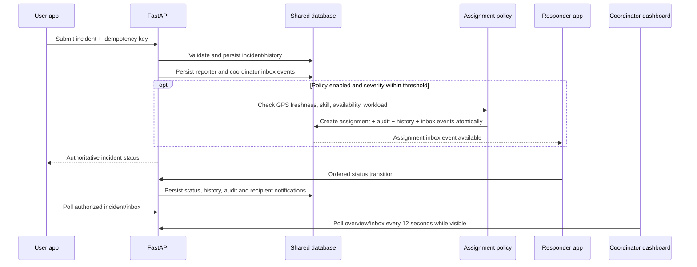

# Architecture and design decisions

## Current implementation

One Flutter Android app provides authenticated Admin, User, and Responder portals backed by a FastAPI service, plus the original isolated local training workspace. The API owns identities, role authorization, shared incidents, responders, assignments, resources, status transitions, and audit history. SQLite supports local development and automated tests; PostgreSQL is the deployment target because assignment uniqueness and concurrent writes must be transactional. Authenticated clients never write to the training JSON store, and training records are not imported automatically.

```text
Flutter (Admin / User / Responder portals; isolated training mode)
                  │ HTTPS bearer access token + idempotency key
                  │ rotating refresh token only when Remember Me is selected
                  ▼
FastAPI (validation, role/ownership checks, refresh rotation, assignments, notifications, audit)
                  │ SQLAlchemy transaction
                  ▼
PostgreSQL for deployment / SQLite for local development and tests
```

Incident intake records coordinator and reporter in-app events transactionally. If the Super Admin enabled automatic assignment, the same transaction checks the severity policy, fresh accurate incident/responder GPS, skill match, account/availability, and active-assignment constraints; then records the assignment, status history, audit decision, and recipient events together. The persistent notification inbox is recipient-scoped and deduplicated per account and event key. Notification events are in-app records only; there is no remote push/email delivery worker.



The repository contains the runnable API and role-specific workflows but no hosted service, verified agency integration, push delivery, or production deployment. Deployment must provide TLS, managed PostgreSQL, secure environment secrets, backups, monitoring, retention and incident-response policy. Mobile portals poll authorized data every 12 seconds. The browser dashboard refreshes its overview and notification inbox every 12 seconds while visible, and other pages on navigation or manual refresh.

## Authentication and session decisions

- Login is scoped to the selected server role; selecting a different portal never changes account permissions.
- Remember Me is unchecked by default. Without it, the access token stays in app memory and reopening the app requires sign-in.
- With it, the API issues a 30-minute access token and a random refresh token. Only the refresh-token hash is persisted server-side; the client stores the refresh token in Android secure storage and rotates it when refreshing access.
- Remembered sessions expire at the configured deadline (30 days by default; `REMEMBER_ME_DAYS` allows 1–365). Logout and account deactivation revoke the server session.
- App startup validates stored identity and role using `/auth/me` before selecting a workspace. A service outage never authenticates from locally cached identity; the direct login remains visible with an explicit retry for a saved session.
- Older builds persisted all sessions without an explicit choice. The new client deletes those legacy session entries instead of assuming consent.
- Refresh tokens are bearer secrets: production still needs login/refresh rate limits, monitoring, deployment-level concurrency testing, and a selected retention policy.

## Migration strategy

1. Keep the existing JSON and sample dataset in local training mode; never import them as users, responders, incidents, locations or assignments.
2. Create backend accounts and operational data through authenticated/admin-controlled API operations. Provision the first administrator with the one-time CLI command; there is no default administrator credential.
3. Apply Alembic migrations before running updated backend code against an existing database.
4. Before deployment, review operator identity, legal location handling, retention, backup, recovery, emergency-service boundaries and incident response.

## Domain records

- **User / session:** identity, role, active state, access-token session, hashed rotating refresh credential when Remember Me is enabled, expiry and revocation.
- **Incident:** category, description, severity/urgency, coordinates and display location, timestamps, priority/status, reporter and assignment links.
- **Responder:** account, service capabilities, availability, current location timestamp/accuracy and assignment.
- **Resource:** type, quantity, active and allocated count.
- **Assignment / update / audit event:** responder/resource relationship, lifecycle history, communications and actor/time/action details.

## Rules and data boundaries

- Priority uses the explicit policy in `lib/domain/dispatch_rules.dart`; rationale is visible. It is decision support only.
- Eligible responders are available, skill-compatible and unassigned. Recommendations show straight-line distance only when incident and responder locations are fresh and accurate. Manual assignment remains the default. The optional automatic policy (off by default, Super Admin controlled) only considers severity at or below its configured ceiling and requires fresh accurate GPS for both ends. It deterministically orders eligible candidates using configured distance/workload weights and stable name tie-breaking. Location failure, no candidate, over-limit severity, or DB uniqueness conflict leaves the request in human review.
- The shared User portal captures foreground GPS and supports manual location fallback. The Responder portal can share one foreground location point. There is no background tracking, map routing or ETA.
- Training mode uses simulated coordinates and a single app-private JSON file via Android MethodChannel. Shared records remain server-owned.

## UI and identity

Material 3 tokens in `lib/presentation/design_system.dart` define the reference-led dark palette, typography, spacing, controls, cards and touch targets. The supplied red-and-green SVG is rendered directly in Flutter; proportion-preserving derivatives appear in Android adaptive, legacy-density, themed monochrome, splash, and PWA assets. The app supports a cohesive dark theme across the training workspace and authenticated role portals.

## Remaining limits

This repository is a development implementation, not an emergency dispatch service. A real deployment still needs HTTPS, managed PostgreSQL, rate limits, password recovery/MFA decisions, monitoring, backups/restore drills, privacy and retention policy, penetration testing, accessibility review, and approved operational procedures. No ambulance/fire/police integration, push or notification email provider, or map service is included. Training examples and the priority heuristic are not validated operational data or policy.
